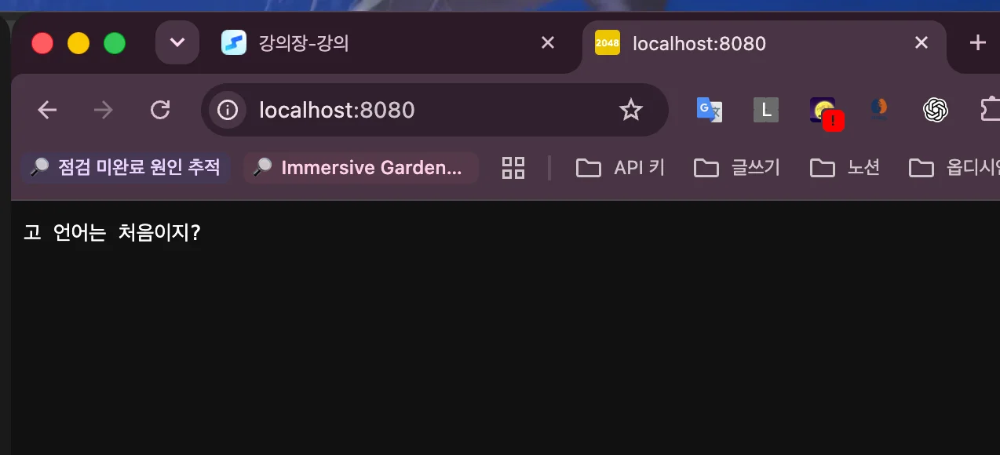
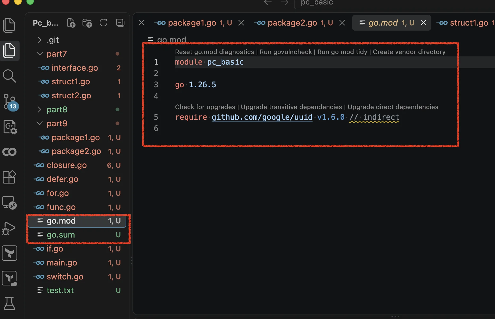
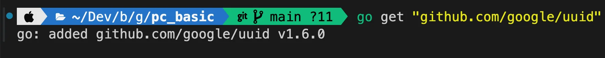
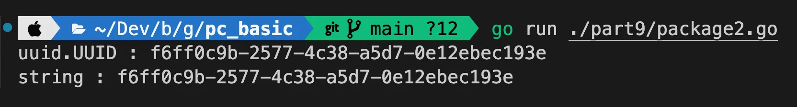
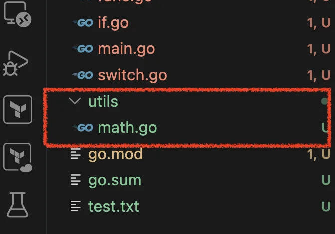
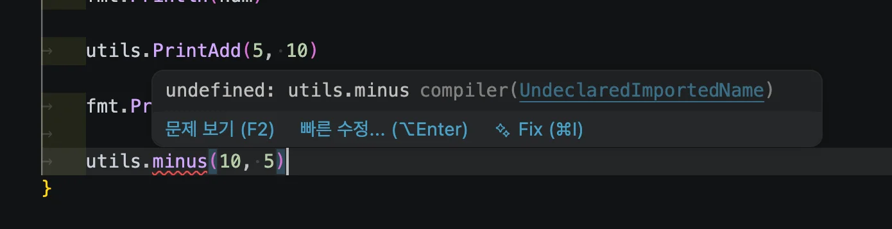
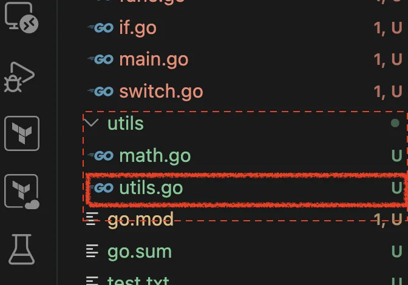
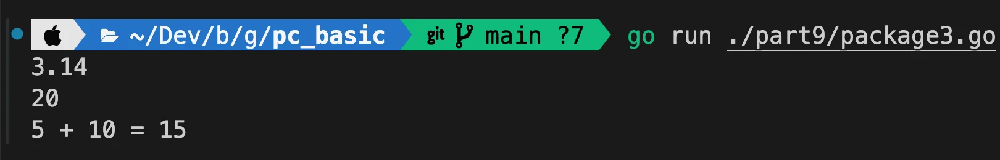

<a id="3beeda9b0fe180e8a5b3fefd0fd3cc64"></a>

## 패키지

---

> ✏️ 
> 
> - 코드의 논리적인 묶음 (비슷한 기능을 가진 코드들을 모아 놓은 것)
> 
> - Go에서 <strong><u>모든 소스 파일</u></strong><strong><u>은 </u></strong><strong><u>반드시 하나의 패키지에 속</u></strong>해야 한다&#46;
> 
> - 패키지의 이름은 코드의 첫 번째 라인에서 package 키워드를 사용하여 정의
> 
> <a id="3beeda9b0fe180629c92f049f392e546"></a>
> 
> ⇒ <code>재사용성</code>, <code>유지보수성</code>, <code>코드 충돌 방지</code>

<a id="3beeda9b0fe180de8b97de829ee9b0e6"></a>

###  기본 개념

<a id="3beeda9b0fe180219155ed6fddf1af13"></a>

#### 내장 패키지

- Go 언어에서 기본적으로 제공하는 패키지

- 설치 시 함께 제공되어, 즉시 사용 가능

- <code>fmt(입출력)</code>, <code>math(수학 연산)</code>, <code>net/http(HTTP 통신)</code> 등 패키지 

<a id="3beeda9b0fe180df8af4c96174c381a7"></a>

#### 외장 패키지

- Go 언어 표준 라이브러리(내장 패키지)가 아닌, 외부 개발자들이 만든 패키지 

- Github 와 같은 소스코드 호스팅 서비스에 공개되어 있음

- Go 프로젝트의 패키지 관리 도구(<code>go get</code>, <code>go mod</code>)를 통해 쉽게 설치 및 사용 가능

<a id="3beeda9b0fe180079127cfaeea12a43e"></a>

#### 사용자 정의 패키지 

- 개발자가 직접 정의한 패키지 

- 특정 프로젝트나 애플리케이션에서 사용

- 사용자 정의 패키지는 해당 프로젝트에서 코드의 모듈화와 재사용성을 높이는 데 사용됨

<a id="3beeda9b0fe1809dabcce1ca4363eef7"></a>

###  실습

> ✏️ 
> 
> <a id="3c4eda9b0fe1809e9a82ecc2f3aba6f2"></a>
> 
> <code>main</code>
> 
> <a id="3beeda9b0fe1800580dbca5b8647d3ce"></a>
> 
> 패키지명이 <code>main</code>인 경우, 컴파일러는 해당 패키지를 공유 라이브러리가 아닌, <strong><u>실행 프로그램으로 판단</u></strong>한다&#46;

> ✏️ 
> 
> <a id="3c4eda9b0fe180dc90f0ddbe2e2fd07a"></a>
> 
> <code>import</code>
> 
> <a id="3c4eda9b0fe1803da877e329c224c24e"></a>
> 
> 패키지에 작성된 코드를 해당 프로그램에서 사용하기 위해 <code>import</code> 해줘야한다&#46; 
> 
> <details>
> <summary>ex) </summary>
> 
> <a id="3c4eda9b0fe180d09e54ddcd3aabd814"></a>
> 
> ```go
> package main
> 
> import (
> 	"fmt"
> )
> 
> func main() {
> 		....
> ```
> 
> </details>

<a id="3beeda9b0fe180be99b4f45809525249"></a>

#### 1&#46; 내장 패키지

> 
> 
> <a id="3beeda9b0fe1805e8621f97fa092ae75"></a>
> 
> <code>내장 패키지</code>
> 
> - Go에서 기본적으로 지원하는 패키지
> 
> - <code>goroot</code> 에 <code>src</code> 폴더에 존재함

<details>
<summary><code>fmt</code></summary>

<a id="3beeda9b0fe180aca5c3fd8475e11884"></a>

```go
package main

import (
	"fmt"
)

func main() {
	// 1. 내장패키지: Go에서 기본적으로 지원하는 패키지
	// goroot 에 src 폴더에 존재함
	
	// fmt: 입출력 패키지로 입출력 처리 기능 지원
	var name string
	fmt.Print("이름: ") // 출력
	fmt.Scanf("%s", &name) // 입력
	
	// os: 운영체제와 상호작용을 위한 다양한 기능 제공
	fmt.Fprintf(os.Stdout, "이름 : %s\n", name) // 표준 출력
}
```

</details>

<details>
<summary><code>os</code>&#58; 파일 생성, 삭제</summary>

<a id="3beeda9b0fe1807f8c8fc284ae529490"></a>

```go
package main

import (
	"fmt"
	"os"
)

func main() {

	// 파일 생성
	file, err := os.Create("test.txt") // 파일 생성
	if err != nil {
		fmt.Println("파일 생성 오류 : ", err)
		return
	}

	defer file.Close() 
	fmt.Println("파일 생성 완료 : ", file.Name())

	// 파일 삭제 (연 후 반드시 종료해야 함)
	err := os.Remove("newfile.txt")
	if err != nil {
		fmt.Println("파일 삭제 오류 : ", err)
		return
	}
}
```

</details>

<details>
<summary><code>math</code></summary>

<a id="3beeda9b0fe180deb4f7da4fd1c4cf73"></a>

```go
package main

import (
	"fmt"
	"math"
)

func main() {

	// math: 수학관련 기능 제공 패키지 
	fmt.Println("PT: ", math.Pi) // 원주율)

	fmt.Println("2의 3제곱 : ", math.Pow(2, 3))
	fmt.Println("2의 제곱근 : ", math.Sqrt(4))
}
```

</details>

<details>
<summary><code>net/http</code>&#58; 서버 실행</summary>

<a id="3beeda9b0fe1808ba21fe8e4cae9f163"></a>

```go
package main

import (
	"fmt"
	"log"
	"net/http"
)

func handler(w http.ResponseWriter, r *http.Request) {
	fmt.Fprintf(w, "고 언어는 처음이지?")
}

func main() {

	// net/http: 앱 관련 기능을 제공하는 패키지
	http.HandleFunc("/", handler) 
	fmt.Println("웹서버 :8080 시작")
	log.Fatal(http.ListenAndServe(":8080", nil)) // 웹서버 시작 
}
```



</details>

<a id="3beeda9b0fe1805caa1de3b9b1e038ae"></a>

#### 2&#46; 외장 패키지 

> 
> 
> <a id="3beeda9b0fe1802cbde1ccd1cee7e513"></a>
> 
> <code>외장(외부) 패키지</code>
> 
> - 타 개발자가 만들어놓은 기능 → 라이브러리 
> 
> - <code>go mod init</code>를 통해 먼저 <code>go&#46;mod</code> 파일 init
> 
> - <code>go get</code>명령어를 통해 모듈에 등록 후 사용 가능
>     - <code>go get</code> 을 통해 모듈 등록 시, <strong><u>gopath/pkg 폴더에 다운로</u></strong>드 됨

> 
> 
> <a id="3beeda9b0fe180608e09e15b181db2bd"></a>
> 
> <code>go 모듈</code>&#58; 프로젝트 종속성 관리를 위한 시스템
> 
> - <code>go&#46;mod</code>&#58; 프로젝트의 모듈 이름과 종속성 정의
> 
> - <code>go&#46;sum</code>&#58; 버전 관리

<details>
<summary>초기 설정 &#45; <u>모듈 의존성 파일 init</u> 및 <u>uuid 패키지 설치</u></summary>

- 모듈 의존성 파일 init &#45; <code>go&#46;mod</code>, <code>go sum</code>
    <a id="3beeda9b0fe1804e8e42ddb82d9868f5"></a>

    ```go
    go mod init pc_basic
    ```

    

- uuid 패키지 설치
    <a id="3c4eda9b0fe18024b5ecf25b5ce9e04b"></a>

    ```go
    go get github.com/google/uuid@latest
    ```

    

</details>

<details>
<summary>uuid 사용</summary>

<a id="3c4eda9b0fe18022836dea6fcf9e7a69"></a>

```go
package main

import (
	"fmt"
	"github.com/google/uuid"
)

func main() {

	// 외부 패키지: 다른 개발자가 만들어놓은 기능 -> 라이브러리 
	// go install을 통해 설치 가능 (go get 레거시로 사용 X)
	// 모듈 다운 시 gopath/pkg 폴더에 다운됨

	// go 모듈: 프로젝트의 종속성 관리를 위한 시스템
	// go.mod 파일을 사용해 프로젝트의 모듈 이름과 종속성을 정의하고, go.sum 파일을 사용하여 버전 관리 

	// uuid: 고유한 식별자 생성 기능 제공 패키지
	newUUID := uuid.New()
	fmt.Printf("%T : %v\n", newUUID, newUUID)

	uuidStr := newUUID.String()
	fmt.Printf("%T : %v\n", uuidStr, uuidStr)

}

```

- 출력
    <a id="3c4eda9b0fe180b385b6ebe7ef764603"></a>

    ```go
    go run ./part9/package2.go
    ```

    

</details>

<a id="3beeda9b0fe1809caa7dd4302fcdc800"></a>

#### 3&#46; 사용자 정의 패키지 

<details>
<summary>패키지 정의 및 사용</summary>

<details>
<summary>사용자 정의 패키지&#58; <code>utils/math&#46;go</code></summary>



<a id="3c4eda9b0fe18006a81ec44b09787490"></a>

```go
package utils

import "fmt"


func Add(a, b int) int {
	return a + b;
}

func PrintAdd(a, b int) {
	fmt.Printf("%d + %d = %d", a, b, a+b)
}

// 변수명 시작 = 소문자 -> 외부 접근 불가능
func minus(a, b int) int {
	return a - b
}
```

</details>

<details>
<summary>사용</summary>

<a id="3c4eda9b0fe1806ab9a1d6ac3241d952"></a>

```go
package main

import (
	"fmt"
	"pc_basic/utils"
)

func main() {
	/*
	사용자가 직접 작성 후 프로젝트에 사용
	- 특정 기능 구현 -> 다른 파일, 프로젝트에서 재사용
	- 모듈 기준으로 접근해 사용
	*/

	num := utils.Add(10, 10)
	fmt.Println(num)

	utils.PrintAdd(5, 10)

	fmt.Println()
}
```

</details>

</details>

<details>
<summary>⚠️ 변수 시작 문자 = 소문자  → 외부 패키지 접근 불가 </summary>

> ⚠️ 
> 
> <a id="3c4eda9b0fe180988b75c162059ae5a0"></a>
> 
> <strong>변수명 시작이 소문자</strong>인 경우 <strong><u>외부 패키지에서 접근 불가능</u></strong>

<a id="3c4eda9b0fe180dca087d28a53a2dfea"></a>

```go
package main

import (
	"fmt"
	"pc_basic/utils"
)

func main() {
	
	utils.minus(10, 5) // 외부 패키지 접근 불가능
}
```

- 실행 불가능
    

</details>

<details>
<summary>초기화 패키지, 메소드</summary>

> ✏️ 
> 
> <a id="3c4eda9b0fe180d4b137c254893f8c22"></a>
> 
> <code>utils&#46;go</code> 와 <code>init()</code> 으로 네이밍 후 로직 정의 후, <strong><u>utils 패키지를 불러올 경우</u></strong>  <strong>자동으로 </strong><strong><code>init()</code></strong><strong> 내 로직이 가장 먼저 실행</strong>된다&#46; 
> 
> 
> 
> <a id="3c4eda9b0fe180b19372ec5322ba4780"></a>
> 
> ```go
> // utils/utils.go
> package utils
> 
> import "fmt"
> 
> /*
> init: 패키지 로드 시에 가장 먼저 호출
>  - 초기화 작업에 사용
> */
> func init() {
> 	PI := 3.14
> 	fmt.Println(PI)
> }
> ```

<a id="3c9eda9b0fe1800a80aafccbad7edb69"></a>

```go
// part9/package3.go
package main

import (
	"fmt"
	"pc_basic/utils"
)

func main() {
	
	num := utils.Add(10, 10)
	
	fmt.Println(num)

	utils.PrintAdd(5, 10)

	fmt.Println()
}
```

- 자동으로 <code>utils&#46;go</code> 가 import 되어 <code>init()</code> 함수가 실행되는 것을 확인할 수 있다&#46; 
    

</details>
