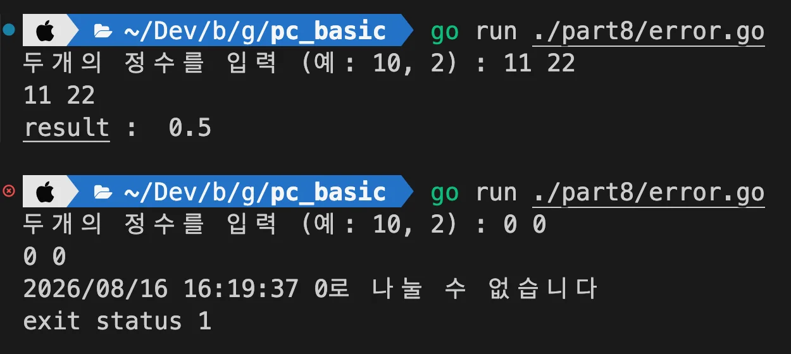

---

> ✏️ 
> 
> - Go 표준 라이브러리의 <strong><u>error 패키지를 사용</u></strong>해 오류 생성 및 처리
> 
> - 오류가 발생할 수 있는 함수는<strong><u> error 타입을 반환</u></strong>하며, <br><strong><u>호출한 쪽에서 이 값을 검사</u></strong>하며 오류를 처리함
> 
> - 대부분의 언어에서는 <code>try&#45;catch</code> 문을 통해서 예외를 처리하지만, Go에서는 <code>panic</code>, <code>recover</code>라는 두가지 키워드가 있어 <br><strong>프로그램이 치명적인 상태에 빠졌을 때 이를 처리</strong>할 수 있음

<a id="3beeda9b0fe180f68746d863b41ae769"></a>

### 문법

<a id="3beeda9b0fe18040857ee5b41c352627"></a>

```go
// 문법
type error interface {
		Error() string
}
```

<details>
<summary>ex)</summary>

<a id="3beeda9b0fe180238e68ea10c6aa293f"></a>

```go
// ex)
defer func() {
		if r := recover(); r != nil {
				fmt.Println("Recovered from panic: ", r)
		}
}()
```

</details>

<a id="3beeda9b0fe18023969ccb01fdc1938b"></a>

### 실습

> ✏️ 
> 
> <a id="3beeda9b0fe180ad96abcf106eff6b31"></a>
> 
> go에서는<strong><u> 함수가 오류를 발생</u></strong>할 경우 <strong>error를 리턴</strong>한다&#46;<br>오류가 발생할 수 있는 함수는 error 타입을 반환하며, <br>호출한 쪽에서는 이 값을 검사하여 오류를 처리한다&#46; 
> 
> <details>
> <summary>ex)</summary>
> 
> <a id="3beeda9b0fe1805da5c6e4f0871ae17c"></a>
> 
> ```go
> // ex 1) 참조
> func divide(a, b  float64) (float64, error) {
> 	if b == 0 {
> 		return 0, fmt.Errorf("%.0f로 나눌 수 없습니다", b)
> 	}
> 	
> 	return a/b, nil
> }
> 
> // 정상 값 및 오류 반환
> result, err := divide(num1, num2)
> ```
> 
> </details>

> ✏️ 
> 
> <a id="3beeda9b0fe18036b4c0f5f4176b0e3d"></a>
> 
> <strong><code>panic</code></strong>은 <code>db 연결 실패</code>,<code> 파일 경로 불일치</code> 등 <strong><u>자원을 사용할 수 없</u></strong>어 <strong>프로그램 진행이 어려운 심각한 오류</strong>의 경우 사용한다&#46; 
> 
> - ex 3) 참조

> 🤔 
> 
> <a id="3beeda9b0fe180dfbbf6e4c09ed70c96"></a>
> 
> <code>defer</code>
> 
> <a id="3beeda9b0fe18098b424c42b9a2038a8"></a>
> 
> 현재 <strong><u>함수가 종료되기 직전에 실행할 코드를 예약</u></strong>하는 문법
> 
> <details>
> <summary>ex) <code>defer</code> 선언 순서 중요 </summary>
> 
> - ex) 
>     <a id="3beeda9b0fe1803eb370ff1126cd90af"></a>
> 
>     ```go
>     func test() {
>         defer fmt.Println("A")
> 
>         panic("error")
> 
>         defer fmt.Println("B")
>     }
>     ```
> 
> - 실행 흐름
>     <a id="3beeda9b0fe180cc8879f11c5e6bb1bd"></a>
> 
>     ```plaintext
>     A defer 등록
>         ↓
>     panic 발생
>         ↓
>     B defer에는 도달하지 못함
>         ↓
>     등록된 A만 실행
>     ```
> 
> - 결과
>     <a id="3beeda9b0fe18061a619c94763a385d8"></a>
> 
>     ```plaintext
>     A
>     panic: error
>     ```
> 
> </details>

<details>
<summary>ex1) error 기본 사용</summary>

<a id="3beeda9b0fe18065881ec03718dd2d29"></a>

```go
// part8/error.go

package main

import (
	"fmt"
	"log"
)

func divide(a, b  float64) (float64, error) {
	if b == 0 {
		return 0, fmt.Errorf("%.0f로 나눌 수 없습니다", b)
	}
	
	return a/b, nil
}

func main() {
	var num1, num2 float64
	
	fmt.Print("두개의 정수를 입력 (예: 10, 2) : ")
	_, err := fmt.Scanf("%f %f", &num1, &num2)
	
	if err != nil {
		log.Fatal("입력 오류: ", err)
	}
	
	fmt.Println(num1, num2)
	
	result, err := divide(num1, num2)
	if err != nil {
		log.Fatal(err)
	} else {
		fmt.Println("result : ", result)
	}
}
```



</details>

<details>
<summary>ex2) panic</summary>

> ✏️ 
> 
> <a id="3beeda9b0fe180979dabc99c7c8a1153"></a>
> 
> go에서는<strong><u> 함수가 오류를 발생</u></strong>할 경우 <strong>error를 리턴</strong>한다&#46;<br>오류가 발생할 수 있는 함수는 error 타입을 반환하며, <br>호출한 쪽에서는 이 값을 검사하여 오류를 처리한다&#46; 

<a id="3beeda9b0fe18046a1b4ff21374f6137"></a>

```go
// part8/error.go

package main

import (
	"fmt"
)

func main() {
	defer func () {
		// recover()
			// 패닉 X -> nil
			// 패닉 O -> 프로그램이 종료되는 것을 막고, 프로그램 복구
		if r := recover(); r != nil {
			fmt.Println("복구 완료, 패닉 메시지: ", r)
		}
	}()
	
	// panic이 호출되면 현재 함수가 즉시 중단되며
	// defer 함수를 호출하고 자기자신을 호출한 곳으로 리턴
	fmt.Println("프로그램 시작")
	panic("예상 가능한 논리 에러 발생, 프로그램 중단")
	fmt.Println("프로그램 종료")
	
}
```


</details>

<details>
<summary>ex3) </summary>

<a id="3beeda9b0fe180aab178d2e78e8106cd"></a>

```go
package main

import (
	"fmt"
	"os"
)

func fileOpen(fileName string) {
	// ① 먼저 등록됨
	defer func () {
		if r := recover(); r != nil {
			fmt.Println("파일 검색 실패: ", r)
		}
	}()
	
	f, err := os.Open(fileName)
	if err != nil {
		panic(err)
	} else {
		fmt.Println(f.Name())
	}
	
	// ② 여기까지 도달해야 등록됨 (os.Open 성공해야 도달한다.)
	defer f.Close() // os.Open() 사용이 끝난 뒤 자원 해제 필요
}

func main() {
	fileOpen("log.txt")
	fmt.Println("프로그램 정상 종료")
}
```

<details>
<summary><code>os&#46;Open()</code> 정상 실행, panic 발생 X</summary>

<a id="3beeda9b0fe180cb830afa91dbdf1df7"></a>

```go
① recover용 defer 등록
       ↓
  os.Open 성공
       ↓
  파일 이름 출력
       ↓
② f.Close() defer 등록
       ↓
  fileOpen 종료
       ↓
② f.Close() 실행
       ↓
① recover용 함수 실행
   └─ panic이 없으므로 recover() == nil
```

</details>

<details>
<summary><code>os&#46;Open()</code> 실패, panic 발생</summary>

<a id="3beeda9b0fe180b48981c8700b06a7cf"></a>

```go
① recover용 defer 등록
       ↓
   os.Open 실패
       ↓
   panic(err)
       ↓
② f.Close()에는 도달하지 못함 → 등록 안 됨
       ↓
① defer 실행
       ↓
  recover()가 panic(err)를 잡음
       ↓
  "파일 검색 실패" 출력
       ↓
  fileOpen 종료
```

</details>

</details>
