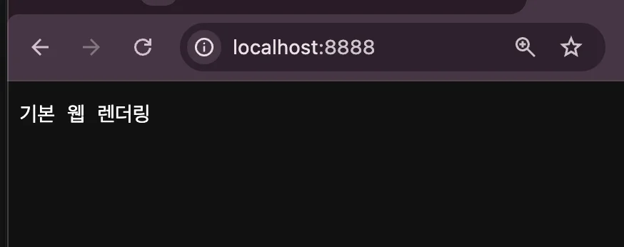
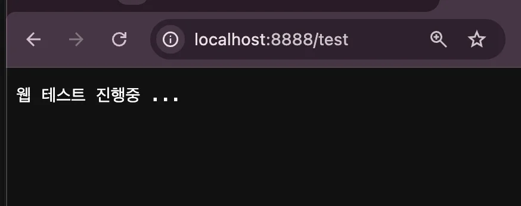
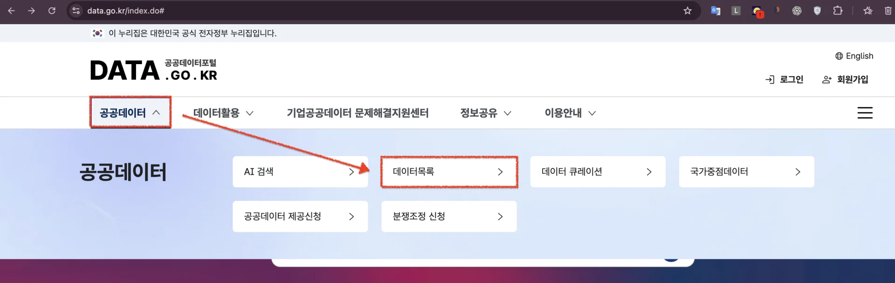
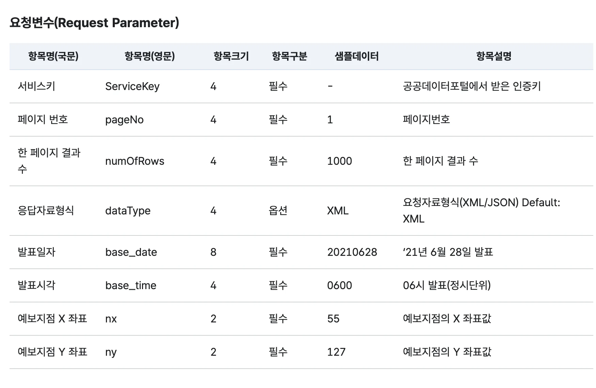
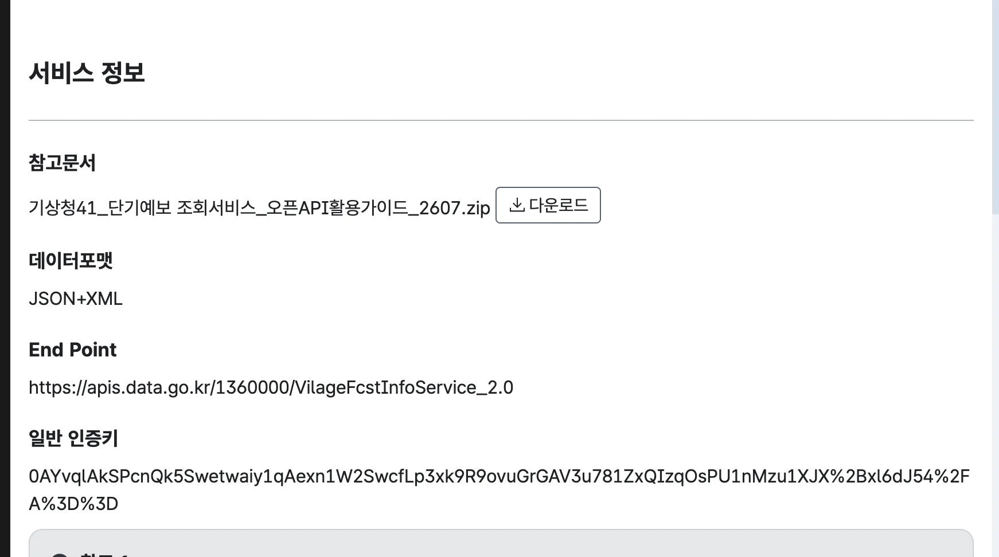
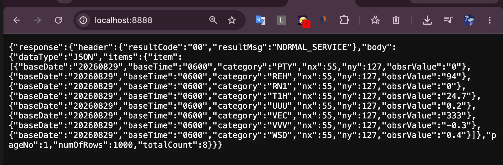
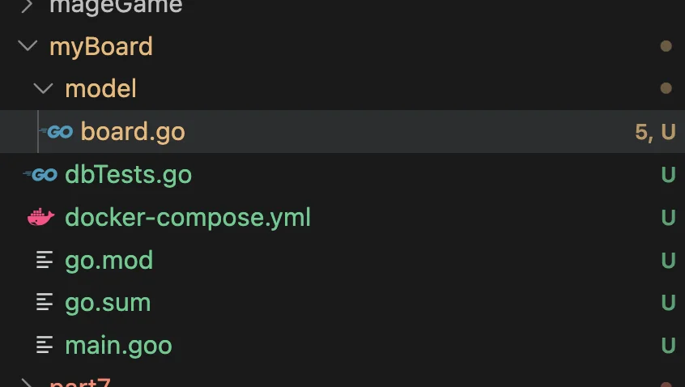
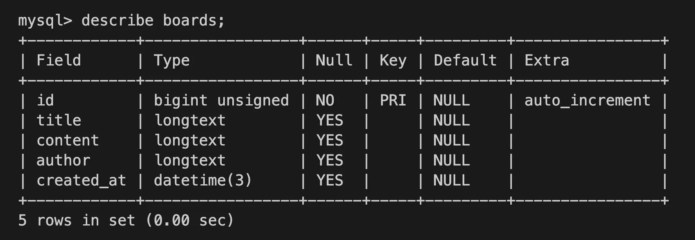
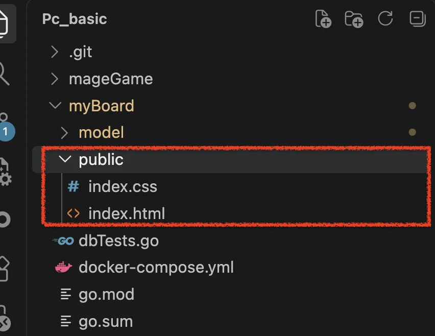

<a id="3cbeda9b0fe180dc8b96dcd9cbb5616e"></a>

## &#91;실습&#93; 간단 웹 서버 구축 테스트

> ✏️ 
> 
> <a id="3cbeda9b0fe180509d61e4baa0ddc6d9"></a>
> 
> 내장 패키지인 <code>net/http</code> 사용

<a id="3cbeda9b0fe1806582f8fa4c1f54106a"></a>

```go
package main

import (
	"fmt"
	"net/http"
)

func main() {
	http.HandleFunc("/", func(w http.ResponseWriter, r *http.Request) {
		fmt.Fprintf(w, "기본 웹 렌더링")
	})

	http.HandleFunc("/test", func(w http.ResponseWriter, r *http.Request) {
		fmt.Fprintf(w, "웹 테스트 진행중 ...")
	})

	http.ListenAndServe(":8888", nil)
}

```

<a id="3cbeda9b0fe180149fbbc1ee96c70c90"></a>

<strong>실행 확인</strong>

<a id="3cbeda9b0fe180b783eec320d8484ef2"></a>

```bash
go run ./web_basic/main.go
```





- 페이지 렌더링 확인

<a id="3cbeda9b0fe180e6a5d9c546945bd96b"></a>

## &#91;실습&#93; 공공 데이터 서빙

[공공데이터 포털]()



<details>
<summary>활용 &#45; 단기 예보</summary>

<a id="3cbeda9b0fe1808698a6d2c133f75508"></a>

<strong>Request 정보</strong>

> ‣



<a id="3cbeda9b0fe1803e9c6fd50c8e9b971d"></a>

<strong>인증 정보</strong>

> ‣



</details>

<details>
<summary>1&#46; response 받아오기</summary>

<a id="3cbeda9b0fe18077a69be05a5bf49292"></a>

```go
package main

import (
	"fmt"
	"io"
	"net/http"
	"net/url"
	"time"
)

func weatherAPIData() (string, error) {

	baseURL := "https://apis.data.go.kr/1360000/VilageFcstInfoService_2.0/getUltraSrtNcst"

	params := url.Values{}

	// 공공데이터포털에서 제공한 URL Encode 키
	encodedKey := "0AYvqlAkSPcnQk5Swetwaiy1qAexn1W2SwcfLp3xk9R9ovuGrGAV3u781ZxQIzqOsPU1nMzu1XJX%2Bxl6dJ54%2FA%3D%3D"

	// URL Decode
	serviceKey, err := url.QueryUnescape(encodedKey)
	if err != nil {
		return "", err
	}

	params.Add("ServiceKey", serviceKey)
	params.Add("pageNo", "1")
	params.Add("numOfRows", "1000")
	params.Add("dataType", "JSON")
	params.Add("base_date", time.Now().Format("20060102")) // 현재 날짜
	params.Add("base_time", "0600")
	params.Add("nx", "55")
	params.Add("ny", "127")

	finalURL := baseURL + "?" + params.Encode()

	fmt.Println("요청 URL:")
	fmt.Println(finalURL)

	resp, err := http.Get(finalURL)
	if err != nil {
		return "", err
	}
	defer resp.Body.Close()

	fmt.Println("요청 상태:", resp.StatusCode)

	body, err := io.ReadAll(resp.Body)
	if err != nil {
		return "", err
	}

	return string(body), nil
}

func main() {
	response, err := weatherAPIData()
	if err != nil {
		fmt.Println("요청 실패:", err)
		return
	}

	fmt.Println(response)
}
```

<details>
<summary>정상 응답</summary>

<a id="3cbeda9b0fe180d2a0a0fb08c16943f7"></a>

```bash
#  go run ./web_basic/main.go
요청 URL:https://apis.data.go.kr/1360000/VilageFcstInfoService_2.0/getUltraSrtNcst?ServiceKey=0AYvqlAkSPcnQk5Swetwaiy1qAexn1W2SwcfLp3xk9R9ovuGrGAV3u781ZxQIzqOsPU1nMzu1XJX%2Bxl6dJ54%2FA%3D%3D&base_date=20260829&base_time=0600&dataType=JSON&numOfRows=1000&nx=55&ny=127&pageNo=1

요청 상태: 200

{
  "response": {
    "header": {
      "resultCode": "00",
      "resultMsg": "NORMAL_SERVICE"
    },
    "body": {
      "dataType": "JSON",
      "items": {
        "item": [
          {
            "baseDate": "20260829",
            "baseTime": "0600",
            "category": "PTY",
            "nx": 55,
            "ny": 127,
            "obsrValue": "0"
          },
          {
            "baseDate": "20260829",
            "baseTime": "0600",
            "category": "REH",
            "nx": 55,
            "ny": 127,
            "obsrValue": "94"
          },
          {
            "baseDate": "20260829",
            "baseTime": "0600",
            "category": "RN1",
            "nx": 55,
            "ny": 127,
            "obsrValue": "0"
          },
          {
            "baseDate": "20260829",
            "baseTime": "0600",
            "category": "T1H",
            "nx": 55,
            "ny": 127,
            "obsrValue": "24.7"
          },
          {
            "baseDate": "20260829",
            "baseTime": "0600",
            "category": "UUU",
            "nx": 55,
            "ny": 127,
            "obsrValue": "0.2"
          },
          {
            "baseDate": "20260829",
            "baseTime": "0600",
            "category": "VEC",
            "nx": 55,
            "ny": 127,
            "obsrValue": "333"
          },
          {
            "baseDate": "20260829",
            "baseTime": "0600",
            "category": "VVV",
            "nx": 55,
            "ny": 127,
            "obsrValue": "-0.3"
          },
          {
            "baseDate": "20260829",
            "baseTime": "0600",
            "category": "WSD",
            "nx": 55,
            "ny": 127,
            "obsrValue": "0.4"
          }
        ]
      },
      "pageNo": 1,
      "numOfRows": 1000,
      "totalCount": 8
    }
  }
}
```

| category | 의미 | 값 |
| --- | --- | --- |
| <code>PTY</code> | 강수형태 | <code>0</code> → 없음 |
| <code>REH</code> | 습도 | <code>94%</code> |
| <code>RN1</code> | 1시간 강수량 | <code>0mm</code> |
| <code>T1H</code> | 기온 | <code>24&#46;7°C</code> |
| <code>UUU</code> | 동서바람성분 | <code>0&#46;2m/s</code> |
| <code>VEC</code> | 풍향 | <code>333°</code> |
| <code>VVV</code> | 남북바람성분 | <code>&#45;0&#46;3m/s</code> |
| <code>WSD</code> | 풍속 | <code>0&#46;4m/s</code> |

</details>

</details>

<details>
<summary>2&#46; 화면 출력</summary>

<a id="3cbeda9b0fe180c4a2a5d0bcf0ea79e0"></a>

```go
package main

import (
	"fmt"
	"io"
	"net/http"
	"net/url"
	"time"
)

func weatherAPIData() (string, error) {

	baseURL := "https://apis.data.go.kr/1360000/VilageFcstInfoService_2.0/getUltraSrtNcst"

	// 공공데이터포털에서 제공한 URL Encode 키
	encodedKey := "0AYvqlAkSPcnQk5Swetwaiy1qAexn1W2SwcfLp3xk9R9ovuGrGAV3u781ZxQIzqOsPU1nMzu1XJX%2Bxl6dJ54%2FA%3D%3D"

	// URL Decode
	serviceKey, err := url.QueryUnescape(encodedKey)
	if err != nil {
		return "", err
	}
	
	params := url.Values{}

	params.Add("ServiceKey", serviceKey)
	params.Add("pageNo", "1")
	params.Add("numOfRows", "1000")
	params.Add("dataType", "JSON")
	params.Add("base_date", time.Now().Format("20060102")) // 현재 날짜
	params.Add("base_time", "0600")
	params.Add("nx", "55")
	params.Add("ny", "127")

	finalURL := baseURL + "?" + params.Encode()

	fmt.Println("요청 URL:")
	fmt.Println(finalURL)

	resp, err := http.Get(finalURL)
	if err != nil {
		return "", err
	}
	defer resp.Body.Close()

	fmt.Println("요청 상태:", resp.StatusCode)

	body, err := io.ReadAll(resp.Body)
	if err != nil {
		return "", err
	}

	return string(body), nil
}

func main() {
	apiResponse, err := weatherAPIData()
	if err != nil {
		fmt.Println("요청 실패:", err)
		return
	}

	// fmt.Println(apiResponse)

	http.HandleFunc("/", func (w http.ResponseWriter, r *http.Request) {
		fmt.Fprintf(w, apiResponse)
	})

	http.ListenAndServe(":8888", nil)	
}
```



</details>

<a id="3cbeda9b0fe180c2a65ce7caa83799b0"></a>

## &#91;실습&#93; 간단한 게시판 사이트 구축

> ✏️ 
> 
> <a id="3cbeda9b0fe1806f83c6e2b6d462623b"></a>
> 
> <code>GIN</code>
> 
> > ‣
> 
> - Go 언어로 작성된 경량 고성능 웹 프레임워크
> 
> - RESTful API 및 웹 애플리케이션 개발에 자주 사용되며, <br>간결한 코드로 웹 서버를 제작하기 위한 다양한 기능 제공

> ✏️ 
> 
> <a id="3cbeda9b0fe18035af23fd253b31e684"></a>
> 
> <code>GORM</code>
> 
> - Go 언어에서 사용하는 <strong><u>객체 관계 매핑(ORM)</u></strong> 라이브러리

<details>
<summary>의존성 추가  &#45; <code>GIN</code>, <code>GORM</code></summary>

<a id="3cbeda9b0fe1808c8e5fca482149ac24"></a>

```bash
go mod init

# gorm
go get -u gorm.io/gorm

# gorm - mysql
go get -u gorm.io/driver/mysql

# gin
go get -u github.com/gin-gonic/gin
```

</details>

<details>
<summary>DB 세팅</summary>



<details>
<summary>compose 파일 세팅</summary>

<a id="3cbeda9b0fe180278368f0d5259606cc"></a>

```yaml
services:
  mysql:
    image: mysql:8.4
    container_name: mysql
    restart: unless-stopped

    environment:
      MYSQL_ROOT_PASSWORD: "0000"
      MYSQL_DATABASE: test_db

    ports:
      - "3306:3306"

    volumes:
      - mysql_data:/var/lib/mysql

volumes:
  mysql_data:
```

<a id="3cbeda9b0fe1803fb14ae395e1943a35"></a>

실행

<a id="3cbeda9b0fe1806aad4edaf9b05e3406"></a>

```go
docker compose up -d

docker compose ps 
```

</details>

<details>
<summary>DB 연결 테스트</summary>

- 테이블 생성 &#45; Board
    <a id="3cbeda9b0fe180f4b438e1c2d158b05e"></a>

    ```go
    package model

    import "time"

    type Board struct {
    	ID uint `gorm: "primaryKey"` // 게시글 번호
    	Title string `gorm: size:256l not null` // 제목
    	Content string `gorm: "type:text; not null"` // 내용
    	Author string `gorm: "size:100; not null` // 글쓴이
    	CreatedAt time.Time `gorm: "size:autoCreateTime` // 생성 시간
    }
    ```

- DB 연결 테스트
    <a id="3cbeda9b0fe180ea8f71d2a4b8be18f8"></a>

    ```go
    package main

    import (
    	"fmt"
    	"log"

    	"myBoard/model"

    	"gorm.io/driver/mysql"
    	"gorm.io/gorm"
    )

    func main() {
    	// MySQL 데이터베이스 접속 정보
    	dsn := "root:0000@tcp(127.0.0.1:3306)/test_db?charset=utf8mb4&parseTime=True&loc=Local"

    	// 데이터베이스 연결
    	db, err := gorm.Open(mysql.Open(dsn), &gorm.Config{})
    	if err != nil {
    		log.Fatalf("데이터베이스 연결 실패: %v", err)
    	}

    	fmt.Println("데이터베이스 연결 성공")

    	// Board 테이블 자동 생성
    	if err := db.AutoMigrate(&model.Board{}); err != nil {
    		log.Fatalf("테이블 생성 실패: %v", err)
    	}

    	fmt.Println("테이블 생성 성공")
    }
    ```

    <a id="3cbeda9b0fe1808c935de3fc201265be"></a>

    실행 결과

    <a id="3cbeda9b0fe180fe9588fc05c96439bb"></a>

    ```bash
    # go run ./dbTests.go
    데이터베이스 연결 성공
    테이블 생성 성공
    ```

</details>

<details>
<summary>Mysql 컨테이너 내부 접속 및 테이블 생성 확인</summary>

<a id="3cbeda9b0fe18054b8b5c04fa7559e83"></a>

```bash
docker exec -it mysql mysql -uroot -p
# 비번: 0000  - docker compose 파일 참조 
```

<a id="3cbeda9b0fe1803ba980d3e93401aad2"></a>

```sql
show dababases;

use test_db;

show tables;

describe boards;
```



</details>

</details>

<details>
<summary>클라이언트 화면 세팅</summary>

- resource 세팅 필요
    

- 클라이언트 세팅
    <details>
    <summary>&#91;코드&#93; dbTests&#46;go</summary>

    <a id="3cdeda9b0fe18053bcb4dbc6551ff7be"></a>

    ```go
    package main

    import (
    	"fmt"
    	"log"

    	"myBoard/model"

    	"gorm.io/driver/mysql"
    	"gorm.io/gorm"

    	"net/http"

    	"github.com/gin-gonic/gin"
    )

    func main() {
    	// MySQL 데이터베이스 접속 정보
    	dsn := "root:0000@tcp(127.0.0.1:3306)/test_db?charset=utf8mb4&parseTime=True&loc=Local"

    	// 데이터베이스 연결
    	db, err := gorm.Open(mysql.Open(dsn), &gorm.Config{})
    	if err != nil {
    		log.Fatalf("데이터베이스 연결 실패: %v", err)
    	}

    	fmt.Println("데이터베이스 연결 성공")

    	// Board 테이블 자동 생성
    	if err := db.AutoMigrate(&model.Board{}); err != nil {
    		log.Fatalf("테이블 생성 실패: %v", err)
    	}

    	fmt.Println("테이블 생성 성공")

    	r := gin.Default()

    	r.Static("/resources", "./public/resources")
    	r.StaticFile("index.css", "./public/index.css")
    	r.StaticFile("index.js", "./public/index.js")

    	r.LoadHTMLGlob("public/*.html")
    	r.GET("/", func(ctx *gin.Context) {
    		ctx.HTML(http.StatusOK, "index.html", gin.H{})
    	}) 
    	
    	r.Run(":8881")
    }
    ```

    </details>

    <a id="3cbeda9b0fe18082a0fcf436bdc02687"></a>

    ```go
    	  ...
    	
    	r := gin.Default()

    	r.Static("/resources", "./public/resources")
    	r.StaticFile("index.css", "./public/index.css")
    	r.StaticFile("index.js", "./public/index.js")

    	r.LoadHTMLGlob("public/*.html")
    	r.GET("/", func(ctx *gin.Context) {
    		ctx.HTML(http.StatusOK, "index.html", gin.H{})
    	}) 
    }
    ```

</details>

<a id="3cdeda9b0fe180d680e0ee9be7411ac3"></a>

### 게시글 CRUD

<a id="3cdeda9b0fe180869409d708654c8350"></a>

```go
myBoard/
├── api/                  # API 관련 로직
│   ├── api.go
│   └── handler.go        # HTTP 요청 처리
│
├── db/                   # 데이터베이스 관련 로직
│   ├── db.go             # DB 연결 및 설정
│   └── handler.go        # DB CRUD 처리
│
├── model/                # 데이터 모델
│   └── board.go          # Board 구조체
│
├── public/               # 정적 파일
│
├── router/               # 라우팅 설정
│   └── router.go
│
├── go.mod                # Go 모듈 및 의존성 정의
└── go.sum                # 의존성 버전 검증 정보
```

[FC&#95;go&#95;prac/myBoard at main · gyungsubLee/FC&#95;go&#95;prac]()
