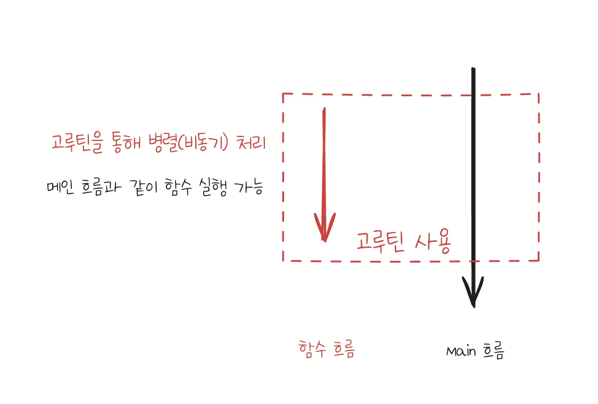

---

> ✏️ 
> 
> <a id="3c8eda9b0fe1806dacedf1c72db4f512"></a>
> 
> <code>병행처리(비동기)</code>
> 
> - <strong><u>여러 작업을 동시에 진행</u></strong>하는 개념
> 
> - <strong>빠르게 번갈아 가며 실행</strong>시켜 마치 <strong><u>코드가 동시에 실행</u></strong>되는 것처럼 보임
>     - <code>비동기 실행</code>

> ✏️ 
> 
> <a id="3c8eda9b0fe180dbb47ed5bd7e27ccd4"></a>
> 
> <code>GO루틴</code>
> 
> <a id="3c9eda9b0fe1809a95fce36bf2a9f70a"></a>
> 
> 다른 언어에서 병행처리 시 대부분 쓰레드라는 개념을 많이 사용하지만 <br>Go언어에서는<strong><u> 쓰레드의 경량 버전</u></strong>인 <code>고루틴</code>을 사용한다&#46; 
> 
> <a id="3c9eda9b0fe180599a30fbd26c94fe76"></a>
> 
> 고루틴은 <strong><u>기존 쓰레드 대비 사용 메모리가 훨씬 적</u></strong>기때문에 <strong><u>좀 더 많은 양의 데이터를 동시 다발적으로 처리 가능</u></strong>하다&#46;
> 
> - 비동기적으로 함수 루틴을 실행하여 여러 코드 동시 실행 가능 
>     - <code>비동기 처리 (병행처리)</code>
> 
> - 경량 스레드 의미, 다른 언어의 스레드보다 더 적은 메모리와 시스템 자원 사용
> 
> - main 함수는 메인 Go루틴을 포함하고 Go루틴은 항상 백그라운드에서 작동
> 
> - 메인 함수가 종료되면 모든 Go루틴은 종료됨

> ✏️ 
> 
> <a id="3c9eda9b0fe180b29fd3d0ccdac42a78"></a>
> 
> 스케줄러는 고루틴의 실행을 <u>선점형 방식으로 관리</u>하기 때문에 고루틴이 항상 순차적을 실행되지 않고 중간에 다른 고루틴으로 전환될 수 있다&#46; 
> 
> - 일반적으로 cpu가 멀티코어로 동작하며, 스위칭되며 실행하기 때문에 실행 순서가 보장되지 않는다&#46; 

<a id="3c8eda9b0fe18024a794d12e7ac75ac0"></a>

### 사용법

> ✏️ 
> 
> <a id="3c9eda9b0fe1803c92bdd55cdb6a9bce"></a>
> 
> Go루틴은 단순히 <strong><u>함수 호출 앞에 </u></strong><strong><u><code>go</code></u></strong><strong><u> 키워드를 붙여</u></strong> 만들 수 있다&#46; 
> 
> <a id="3c9eda9b0fe18036aa99eda855806fcf"></a>
> 
> 예를 들어, <code>go 함수명()</code> 형태로 사용하며, 해당 함수가 <strong><u>비동기적으로 실행</u></strong>되어 <strong><u>메인 함수는 다음 코드로 계속 진행</u></strong>된다&#46;
> 
> 
> 
> <a id="3c9eda9b0fe18074b4b1ebf45e6f89e3"></a>
> 
> 이를 통해 <strong>메인 흐름과 같이 함수 흐름을 </strong><strong><u>병렬로 처리</u></strong>할 수 있다&#46; 

<details>
<summary>ex) </summary>

> 
> 
> <a id="3c9eda9b0fe18081a935d9d173cc7b5b"></a>
> 
> <code>test 함수</code>는 <strong><u>각각 동시성을 가지고 실행</u></strong>되며, <strong>main 또한 test 함수의 종료를 기다리지 않고 진행</strong>됨

<a id="3c9eda9b0fe180fba48ac2de74e0b27d"></a>

```go
func main() {
		// 각각의 함수를 Go루틴으로 실행
		go test()
		go test()
		
		time.Sleep(6 * time.Second)
		
		fmt.Println("메인 함수 종료")
}
```

</details>

<a id="3c9eda9b0fe18000bdbfd890d240c108"></a>

### 실습

<details>
<summary>ex 1) 고루틴 적용 전, 후 비교</summary>

<details>
<summary>고루틴 적용 전</summary>

<a id="3c9eda9b0fe1803c9f61f6ffaf993d41"></a>

```go
package main

import (
	"fmt"
	"time"
)

func testGo1() {
	fmt.Println("ex1 함수 실행")
	time.Sleep(1 * time.Second)
	fmt.Println("ex1 함수 종료")
}

func testGo2() {
	fmt.Println("ex2 함수 실행")
	time.Sleep(1 * time.Second)
	fmt.Println("ex2 함수 종료")
}

func testGo3() {
	fmt.Println("ex3 함수 실행")
	time.Sleep(1 * time.Second)
	fmt.Println("ex3 함수 종료")
}

func main() {
	/* 고루틴
	
	타 언어의 쓰레드 경량 버전
	매우 작은 메모리 스택으로 시작하며, 필요에 따라 조절
		-> 수 많은 고루틴 동시 실행 가능
	*/
	testGo1()
	testGo2()
	testGo3()

	fmt.Println("main 함수 종료")
}
```

<a id="3c9eda9b0fe180219633c5d3458480a5"></a>

<strong>출력 확인</strong>

<a id="3c9eda9b0fe18036b998cf539a76af0e"></a>

```go
ex1 함수 실행
ex1 함수 종료
ex2 함수 실행
ex2 함수 종료
ex3 함수 실행
ex3 함수 종료
main 함수 종료
```

- 함수가 순차적으로 실행됨

</details>

<details>
<summary>고루틴 적용</summary>

<a id="3c9eda9b0fe18076bf59cf86304d5062"></a>

```go
package main

import (
	"fmt"
	"time"
)

func testGo1() {
	fmt.Println("ex1 함수 실행")
	time.Sleep(1 * time.Second)
	fmt.Println("ex1 함수 종료")
}

func testGo2() {
	fmt.Println("ex2 함수 실행")
	time.Sleep(1 * time.Second)
	fmt.Println("ex2 함수 종료")
}

func testGo3() {
	fmt.Println("ex3 함수 실행")
	time.Sleep(1 * time.Second)
	fmt.Println("ex3 함수 종료")
}

func main() {
	/* 고루틴
	
	타 언어의 쓰레드 경량 버전
	매우 작은 메모리 스택으로 시작하며, 필요에 따라 조절
		-> 수 많은 고루틴 동시 실행 가능
	*/
	go testGo1()
	go testGo2()
	go testGo3()

	fmt.Println("main 함수 종료")
}
```

<a id="3c9eda9b0fe18094ab5dce24f6c6f644"></a>

<strong>출력 확인</strong>

<a id="3c9eda9b0fe18042b556f973afad711a"></a>

```go
main 함수 종료
```

- 비동기적으로 실행되지만, main 흐름이 Go루틴 실행을 보장하지 않고 조기 종료됨

</details>

</details>

<details>
<summary>ex 2) 고루틴 적용 전, 후 비교 2</summary>

<a id="3c9eda9b0fe18018995fe392acb5b7a8"></a>

```go
package main

import (
	"fmt"
	"time"
)

func task(id string, count int) {
	fmt.Printf("%s : %d 번 시작\n", id, count)
	time.Sleep(1*time.Second)
	fmt.Printf("%s : %d 번 종료\n", id, count)
}

func withoutForoutines() {
	for i:=1; i<=5; i++ {
		task("test1", i)
	}
}

func withForoutines() {
	for i:=1; i<=5; i++ {
		go task("test2", i)
	}
}


func main() {
	// 동기 작업
	withoutForoutines()

	fmt.Println("-------------------------------")


	// 비동기 작업
	withForoutines()

	time.Sleep(5 * time.Second)

	fmt.Println("main 함수 종료")
}
```

<a id="3c9eda9b0fe1805ba1c2c44d52e55c49"></a>

<strong>출력 확인</strong>

<a id="3c9eda9b0fe18084b146c93cb68e0dca"></a>

```go
// 동기
test1 : 1 번 시작
test1 : 1 번 종료
test1 : 2 번 시작
test1 : 2 번 종료
test1 : 3 번 시작
test1 : 3 번 종료
test1 : 4 번 시작
test1 : 4 번 종료
test1 : 5 번 시작
test1 : 5 번 종료

-------------------------------

// 비동기 
test2 : 1 번 시작
test2 : 5 번 시작
test2 : 2 번 시작
test2 : 4 번 시작
test2 : 3 번 시작
test2 : 3 번 종료
test2 : 1 번 종료
test2 : 2 번 종료
test2 : 5 번 종료
test2 : 4 번 종료
main 함수 종료
```

- go루틴 사용 시 순차처리가 아니며, 병렬로 처리되어 더 빠르게 작업이 완료된다&#46;
    - 한번에 시작, 한번에 종료

</details>

<details>
<summary>ex 3) 클로저 &#43; 고루틴</summary>

<details>
<summary>위험</summary>

<a id="3c9eda9b0fe180098424d9ac43dbc277"></a>

for 루프를 도는 고루틴은 메인 고루틴이다&#46; 

<a id="3c9eda9b0fe180c7ac1dffe38a75bf7f"></a>

내부에서 실행하는 고루틴은 사이드 고루틴 함수이다&#46; 

- 추가적으로 실행하는 병행 처리 

<a id="3c9eda9b0fe180fe886dcb911e40be02"></a>

따라서 해당 함수가 i를 어떻게 참조하고 있는 지 생각해야 한다&#46; 

<a id="3c9eda9b0fe1806fb495f97b6229614c"></a>

함수에서 외부에 있는 i를 가지고 있기 때문에 이 함수가 실행되는 시점에 클로저로 가지고 있는다&#46; 

<a id="3c9eda9b0fe180669fbedc92bd9b41a4"></a>

i 변수는 참조 타입으로 저장

- 참조타입&#58; 변수 저장 시 해당 가상 공간(메모리 공간)에 값이 아닌 주소 저장

<a id="3c9eda9b0fe18044abcce394984fbdeb"></a>

주소를 참고하고 있기 때문에 메인 루틴(for 문)이 실행되는 go 루틴보다 더 먼저 실행될 수도 있다&#46; 

<a id="3c9eda9b0fe18073bb59efc47ef49a02"></a>

따라서 먼저 실해이 된다면 

<a id="3c9eda9b0fe1801ba42ec0927be65f5e"></a>

```go
package main

import (
	"fmt"
	"time"
)

func main() {
	/* 클로저 함수
	함수와 그 함수가 접근할 수 있는 변수를 함께 기억하는 특별한 함수
	*/
	result := make([]int, 100)

	for i := 0; i < 100; i++ {
		go func () {
			time.Sleep(100 * time.Microsecond)
			result[i] = i
		} ()
	}

	time.Sleep(3 * time.Second)
	fmt.Println("결과: ", result)
}
```

<a id="3c9eda9b0fe180619d25f1c5a6b8dbfd"></a>

<strong>출력 확인</strong>

<a id="3c9eda9b0fe18014a998f3f5cd8f69e7"></a>

```go
결과:  [0 1 2 3 4 5 6 7 8 9 10 11 12 13 14 15 16 17 18 19 20 21 22 23 24 25 26 27 28 29 30 31 32 33 34 35 36 37 38 39 40 41 42 43 44 45 46 47 48 49 50 51 52 53 54 55 56 57 58 59 60 61 62 63 64 65 66 67 68 69 70 71 72 73 74 75 76 77 78 79 80 81 82 83 84 85 86 87 88 89 90 91 92 93 94 95 96 97 98 99]
```

- go루틴 사용 시 순차처리가 아니며, 병렬로 처리되어 더 빠르게 작업이 완료된다&#46;
    - 한번에 시작, 한번에 종료

</details>

<details>
<summary>안전 사용</summary>

<a id="3c9eda9b0fe18038942ecbcc36d1d1b2"></a>

```go
package main

import (
	"fmt"
	"time"
)

func main() {
	/* 클로저 함수
	함수와 그 함수가 접근할 수 있는 변수를 함께 기억하는 특별한 함수
	*/
	result := make([]int, 100)

	for i := 0; i < 100; i++ {
		go func (index int) {
			time.Sleep(100 * time.Microsecond)
			result[index] = index
		} (i)
	}

	time.Sleep(3 * time.Second)
	fmt.Println("결과: ", result)
}
```

- <code>클로저 &#43; 고루틴</code>에 대해서 안전하게 사용하기 위해서는 참조 타입 변수를 <strong><u>인자값으로 넘겨 처리</u></strong>한다&#46; 
    - 클로저로 저장하는 것이 아닌 <strong><u>매개변수로 i를 전달</u></strong>하고 <strong><u>그 값이 복사</u></strong>된다&#46;

</details>

</details>
