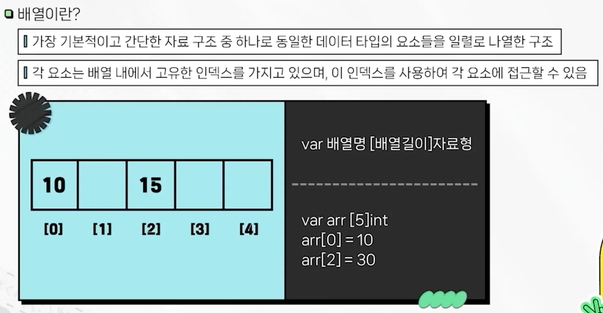
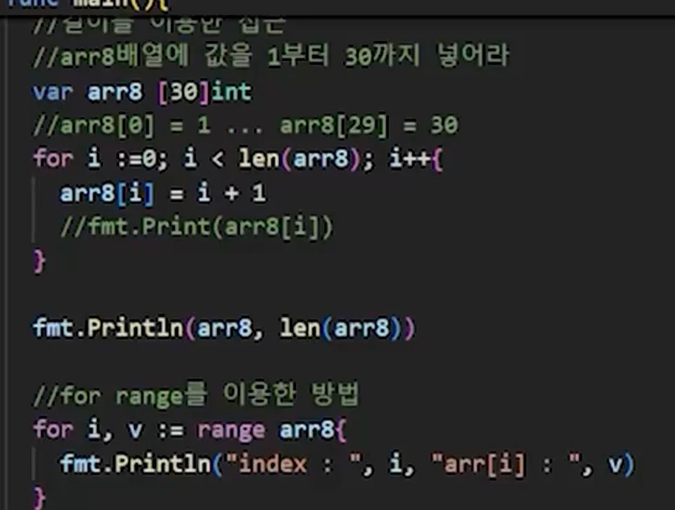
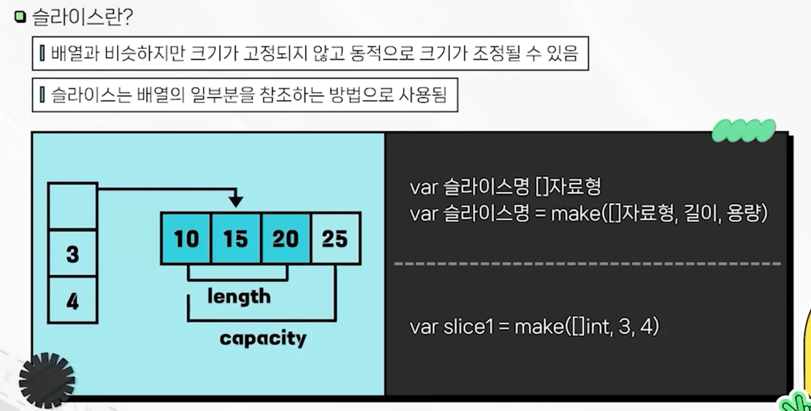
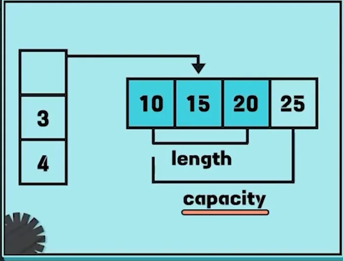
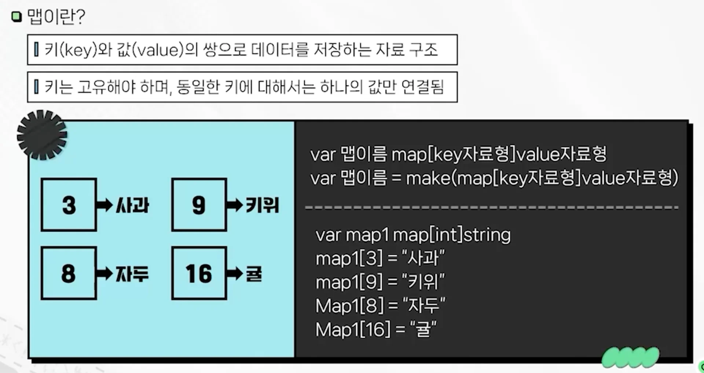
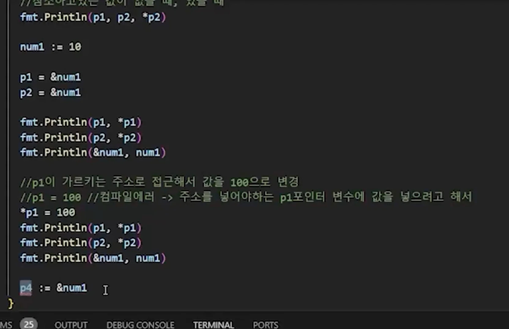

- 이전 정리 내용
    [Python_Algorithm_interview](https://github.com/gyungsubLee/Python_Algorithm_interview)

<a id="3bbeda9b0fe180759e0bdb7487363a6e"></a>

## 자료구조

> ✏️ 
> 
> <a id="3bbeda9b0fe18080a99bcc7b61c67b67"></a>
> 
> 데이터 효율적 저장 및 조작을 위해 설계된 방법, 구조
> 
> - 배열
> 
> - 슬라이스
> 
> - 맵

<a id="3bbeda9b0fe1807f90f0decf07079967"></a>

### 배열



<a id="3bbeda9b0fe180a18e7bdf8eb347c99a"></a>

```go
package main

import "fmt"

func main() {

	// 배열 선언 방법 1) 기본
	var arr1 [5]int // 길이 5 배열 arr1을 선언, 모든 값 0으로 초기화
	fmt.Println(arr1, len(arr1))
	
	// 배열 값 할당 및 사용 -> 인덱스 (0부터)
	arr1[0] = 1
	arr1[1] = 2
	arr1[3] = 10
	fmt.Println(arr1, len(arr1))
	fmt.Println(arr1[0], len(arr1[3])) // 인덱스 접근 동일
	
	// 배열 선언 방법 2) 동시 초기화
	var arr2 [5]int = [5]int{1, 2, 3, 4, 5}
	var arr3 = [5]int{1, 2, 3, 4, 5} // 타입 정보 제거 가능
	fmt.Println(arr2)
	fmt.Println(arr3)

	arr4 := [5]int{1, 3, 3}
	arr5 := [...]int{1, 1, 1, 1, 1, 1, 1, 1, 1, 1, 1, 1} // 스프레드 문법을 통해서 동작으로 크기 할당 가능
	fmt.Println(arr4)
	fmt.Println(arr5)
	
	arr6 := [...]string{"one", "two", "three"}
	fmt.Println(arr6)
	
	
	// # 접근
	// 값만 필요한 경우, 값 하나 생략, 블랭크 식별자
		// 값만 필요할 때 -> 값을 하나 생략 or 블랭크 식별자
	for v := range arr8 {
		fmt.Println("arr[1] : ", v)
	}
	
	// 길이를 이용한 접근
	for i := 0; i < len(arr8); i++ {
		arr[8] = i + 1
		// fmt.Println(arr8[i])
	}
	
	fmt.Println(arr8, len(arr8))
	
	// for range 접근
	for i, v := range arr8 {
		fmt.Println("index : ", i, "arr[i] : ", v)
	}
	
		// go에서 배열은 참조타입이 아닌 값타입이다..  - 얕은 복사 (sollow copy)
	arr9 := [5]int{1, 100, 10000, 100000, 1}
	arr10 := arr9
	
	arr10[0] = 999
	fmt.Println(arr9)
	fmt.Println(arr10)
```



<a id="3bbeda9b0fe1803f95ccccfbd6c2d8a1"></a>

### 슬라이스



<a id="3bdeda9b0fe18061b00ff5197f1937d7"></a>

```go
package main

import "fmt"

func main() {
	// 슬라이스
	// 배열을 기반으로 하지만, 가벽적으로 길이와 용량을 관리할 수 있음
	
	// 슬라이스 생성 방법 1) 배열과 유사하게 
	var slice1 []int // 길이와 용량이 가변적으로 조절이 되기 떄문에 가능 - 초기화 값: 길이 = 0, 용량 = 0
	slice2 := []int{1, 2, 3, 4, 5}
	fmt.Println(slice1, len(slice1), cap(slice1))
	fmt.Println(slice2, len(slice2), cap(slice2))
	
	// 슬라이스 값 할당 및 접근 
	slice1[0] = 1 // 예외 발생
	slice2[0] = 1000
	fmt.Println(slice2[0])
	
	slice1 = append(slice1, 1, 1, 1)
	fmt.Println(slice1, len(slice1), cap(slice1))
	
	
	// 슬라이스 생성 방법2 -> make 함수 이용
	// make(자료형, 길이, 용량) -> 효율적인 메모리 관리 가능
	var slice3 []int = make([]int, 5, 10)
	var slice4 []int = make([]int, 5)	
	
	fmt.Println(slice3, len(slice3), cap(slice3))
	 // 출력값; [0, 0, 0, 0, 0] 5 10
	fmt.Println(slice4, len(slice4), cap(slice4))
	 // 출력값; [0, 0, 0, 0, 0] 5 5	
	
	fmt.Println("---------------------------")
	
	// 슬라이스는 배열과 같은 값타입 아닌 참조타입이다.  - deep copy
	// 배열 -> 값타입
	arr1 := [5]int{1, 2, 3, 4, 5}
	arr2 := arr2 // 메모리 복사 -> 새로운 동일한 값이 메모리에 생성
	
	arr1[0] = 999
	fmt.Println(arr1)
	fmt.Println(arr2)
	
	// 슬라이스 참조타입
	sliceRef1 := []int{1, 2, 3, 4, 5}
	sliceRef2 := sliceRef1 // 메모리 주소 전달
	
	sliceRef1[0] = 1000
	sliceRef2[0] = 800		
	fmt.Println(sliceRef1)
	fmt.Println(sliceRef2)
	
	var sliceRef3 []int
	fmt.Println(sliceRef3 == nil)
	
	fmt.Println("---------------------------")
	
	// 슬라이스 복사 방법
	sliceRef4 := []int{1, 2, 3, 4, 5, 6, 7, 8, 9, 10}
	sliceRef5 := make([]int, len(sliceRef3))
	
	for i, v := range sliceRef4 {
		sliceRef5[i] = v
	}
	
	fmt.Println(sliceRef4)
	fmt.Println(sliceRef5)
	
	copy(sliceRef6, sliceRef5)
	fmt.Println(sliceRef6)
}
```

<details>
<summary>make 자료형 사용 이유</summary>

<a id="3bdeda9b0fe180888e7ee1ff64695672"></a>

```go
	// 슬라이스 생성 방법2 -> make 함수 이용
	// make(자료형, 길이, 용량) -> 효율적인 메모리 관리 가능
	var slice3 []int = make([]int, 5, 10)
	var slice4 []int = make([]int, 5)	
	
	fmt.Println(slice3, len(slice3), cap(slice3))
	 // 출력값; [0, 0, 0, 0, 0] 5 10
	fmt.Println(slice4, len(slice4), cap(slice4))
	 // 출력값; [0, 0, 0, 0, 0] 5 5	
```



- 실제 메모리 공간은 <code>capacity</code> 크기만큼 설정되어 있다&#46; 

- <code>capacity</code> 값을 초과하는 요소가 들어오면 배열의 크기를 다시 키워서 재할당을 해야한다&#46; 이 과정에서 비용이 든다&#46; (약간의 누수 발생)

- 어느 정도 <code>capacity</code>(수용공간)의 여유를 두고 배열을 선언하는 것이 좋다&#46;

- 그러나 너무 크게 <code>capacity</code>를 선언하면 더 큰 비용이 발생되므로 적절한 값을 설정해야 한다&#46; 

</details>

<a id="3bbeda9b0fe180bab988f4251638a346"></a>

### 맵



<a id="3bbeda9b0fe18043a8b8ef6ce53f1804"></a>

```go
package main

import "fmt"

func main() {
	// { key : value } 
	
	// # map 생성 1 
	// 기본
	var map1 map[int]string = make(map[int]string)
	
	// 축약
	map2 := make(map[int]string)
	
	map1[10] = "최지원"
	map1[15] = "김수민"
	map1[17] = "박지수"
	
	fmt.Println(map2)
	fmt.Println(map1)
	
	// map 데이터 접근: key
	fmt.Println("map1[10]: ", map1[10])  // 출력: 최지원
	fmt.Println("map1[17]: ", map1[17])  // 출력: 박지수
	
	// # map 생성 2 - 생성 과 동시에 출력
	map3 := map[string]int {
		"sport": 35,
		"ani": 49,
		"game": 52,
	}
	
	fmt.Println(map3)         // 
	fmt.Println(map3["ani"])  // 출력: 49
	
	// update - key로 접근 후 value 재할당
	map4 := make(map[string]int, 2)
	map4["sport"] = 35
	map4["ani"] = 49
	map4["game"] = 11
	fmt.Println(map4)

	map4["ani"] = 49
	fmt.Println(map4)
	
	// delete
	delete(map4, "game")
	fmt.Println(map4)
	
	// map return 2 = key, value
	value, isKey := map4["game"]
	fmt.Println(value, isKey)
	
	// 맵의 모든 값 순차적으로 접근 (순서 보장 X)
	for k, v := range map4 {
		fmt.Println(k, v)
	}	
}
```

<a id="3bdeda9b0fe18063938ad913d545ade1"></a>

### 포인터 

> ✏️ 
> 
> <a id="3bdeda9b0fe1808fb2d4d9418fc9fb55"></a>
> 
> 특정 메모리 공간을 참조해 해당 주소값을 가지고 있는다&#46; 

<a id="3bdeda9b0fe18084846ac723c650135a"></a>

```go
import "fmt"

func main() {
	"""
	포인터 - 메모리 주소를 가르킴
	포인터 변수: 메모리 주소를 값으로 가지는 변수 (참조변수)
	불필요한 메모리 낭비를 막을 수 있음
	포인터를 선언할 때 에스터리스크(*) 사용
	"""
	
	// 포인터 선언
	var p1 * int
	var p2 * int = new(int)
	
	// 참조하고 있는 값이 없을 때, 있을 때 
	fmt.Println(p1, p2, *p2)
	
	num1 := 10
	
	p1 = &num1
	p2 = &num1
	
	fmt.Println(p1, *p1)
	fmt.Println(p2, *p2)
	fmt.Println(&num1, num1)
	
	// p1이 가르키는 주소로 접근해서 값을 100으로 변경
	p1 = 100 // 컴파일 에러 - 주소를 넣어야 하는 p1 포인터 변수에 값을 넣으려 해서 
	fmt.Println(p1, *p1)
	fmt.Println(p2, *p2)
	fmt.Println(&num1, num1)
	
	p4 := &num1
	fmt.Println(p4, *p4)
	
}
```


