> 
> 
> - [Go 언어란?](#3b7eda9b0fe18020bb5ee3a2a0dfa0ff)
> - [Go 언어의 장점](#3b7eda9b0fe180cc9ebafc3030778227)
> - [ 1. 간결하고 빠름](#3b7eda9b0fe18067bee3cc83916e8b41)
> - [25개의 키워드](#3b7eda9b0fe18021a51cd3ce870dbf1a)
> - [빠른 컴파일](#3b7eda9b0fe180149674cd722d36a984)
> - [ 2. 풍부한 내장 패키지](#3b7eda9b0fe180709eabca6f9a0fb114)
> - [ 3. 병행처리 지원](#3b7eda9b0fe18078a4c8cea2de4c2762)
> - [Go 언어 활용 및 실습](#3b7eda9b0fe180a19758f8de4e9a008f)
> - [ Go 언어 설치 및 셋업](#3b7eda9b0fe1805bbe4cd8928eed07e6)
> - [go 언어 설치](#3b7eda9b0fe180779261fdea2edc0bbc)
> - [vscode 내 go 언어 활성화](#3b7eda9b0fe18098be3cd5b893208d0f)
> - [ 간단 실습, print](#3b7eda9b0fe180a69ff8e119bbd0b0cf)

<a id="3b7eda9b0fe18020bb5ee3a2a0dfa0ff"></a>

## <code>Go 언어</code>란?

---

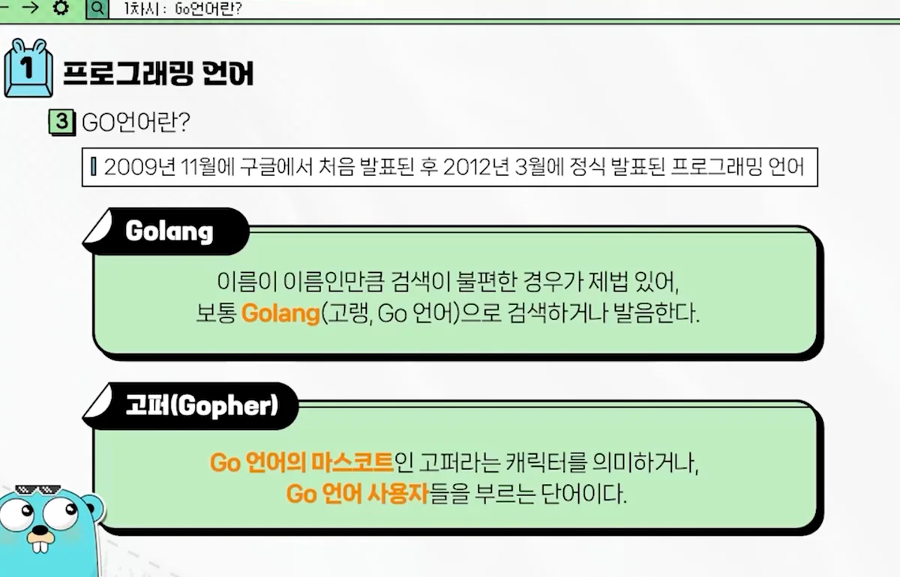

<a id="3b7eda9b0fe180cc9ebafc3030778227"></a>

## <code>Go 언어</code>의 장점

---

<a id="3b7eda9b0fe18067bee3cc83916e8b41"></a>

###  1&#46; 간결하고 빠름

<a id="3b7eda9b0fe18021a51cd3ce870dbf1a"></a>

#### 25개의 키워드

> ☝🏻 
> 
> - <code>파이썬</code>&#58; 30개 이상
> 
> - <code>자바</code>&#58; 60개 이상 
> 
> - <code>go</code>&#58; 25개 

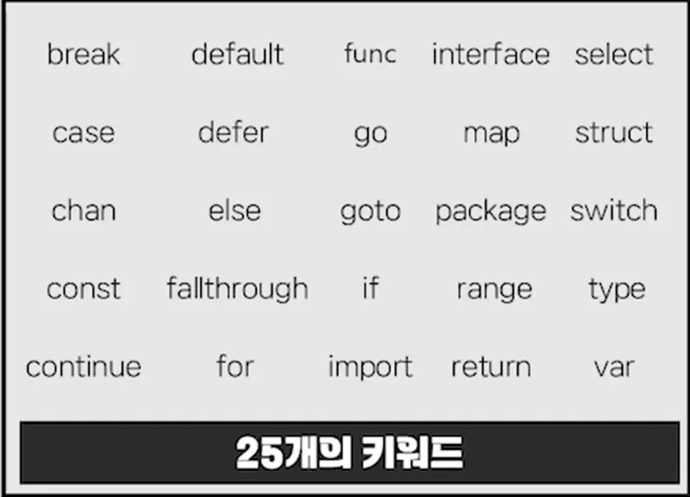

<a id="3b7eda9b0fe180149674cd722d36a984"></a>

#### 빠른 컴파일

> 🤔 
> 
> <a id="3b7eda9b0fe1809bbefce80a60f0f2ce"></a>
> 
> 컴파일
> 
> - 사람이 이해하기 쉬운 언어(고수준언어)를 컴퓨터가 이해하기 쉬운 언어로 바꾸는 것을 컴파일이라 한다&#46; 

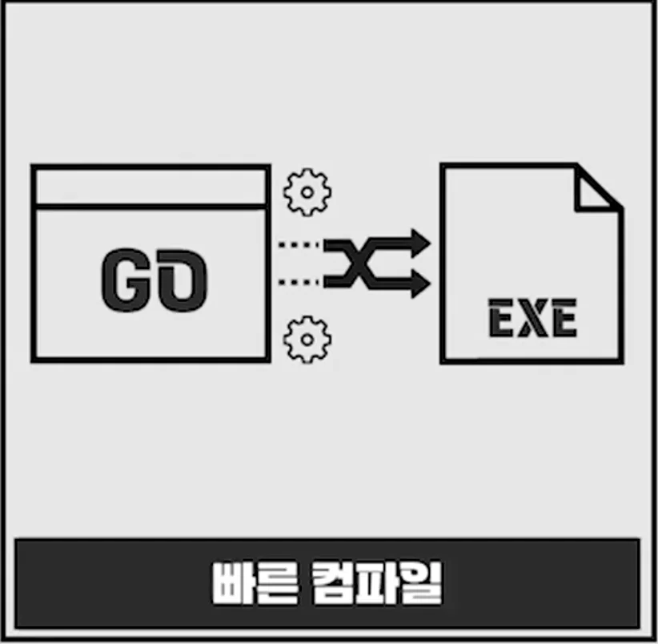

- 키워드가 다른 언어보다 적기 때문에  컴파일 속도가 더 빠르다&#46;

<a id="3b7eda9b0fe180709eabca6f9a0fb114"></a>

###  2&#46; 풍부한 내장 패키지

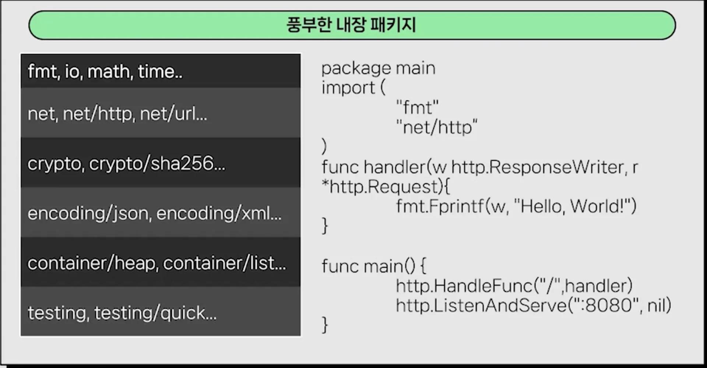

- 풍부한 내장 패키지를 지원하기 때문에, 빠른 서비스 구축 가능
    - 다른 언어들도 동일

<a id="3b7eda9b0fe18078a4c8cea2de4c2762"></a>

###  3&#46; 병행처리 지원

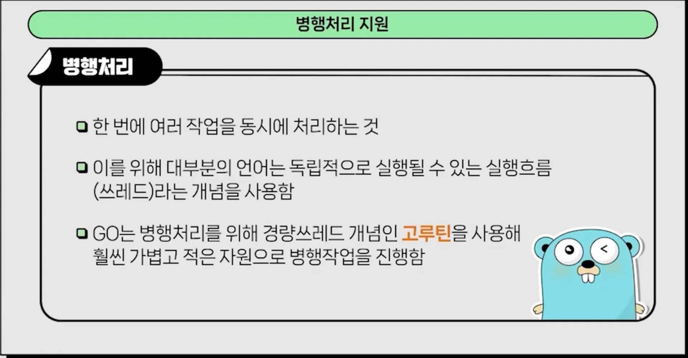

- 병렬(Parallel) 처리 지원

- 경량 쓰레드인 <code>고루틴</code>을 사용해 훨씬 가볍고 적은 자원으로 병행 작업 진행 가능

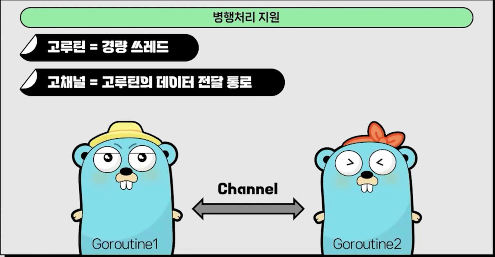

- 타 언어 대비 동일 메모리 사용에서 더 좋은 효율성을 가져감<br>즉, 더 많은 량의 데이터 처리가 가능함

<a id="3b7eda9b0fe180a19758f8de4e9a008f"></a>

## Go 언어 활용 및 실습

---

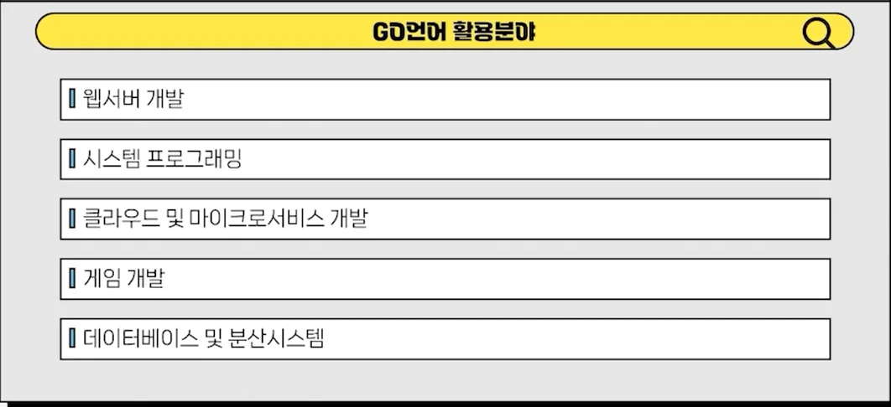

<a id="3b7eda9b0fe1805bbe4cd8928eed07e6"></a>

###  Go 언어 설치 및 셋업

<a id="3b7eda9b0fe180779261fdea2edc0bbc"></a>

#### go 언어 설치

[All releases &#45; The Go Programming Language]()

- os 에 맞게 다운 후 설치

<a id="3b7eda9b0fe18098be3cd5b893208d0f"></a>

#### vscode 내 go 언어 활성화

- vscode 내 확장 프로그램 설치
    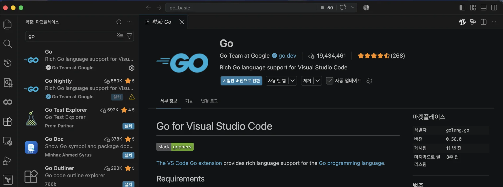

- cmd &#43; shift &#43; p → <code>go tools</code> 검색
    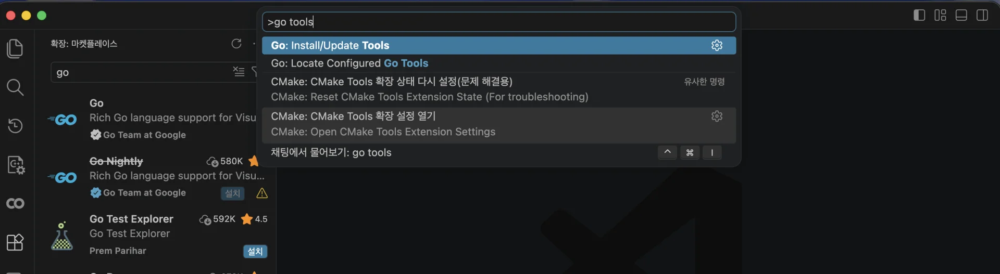

- 위와 같이 check 후 확인
    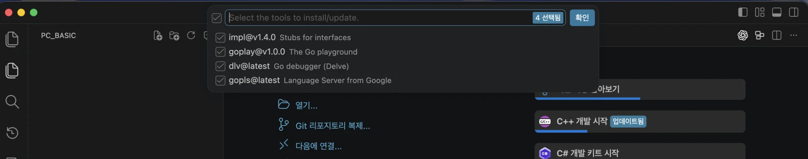

    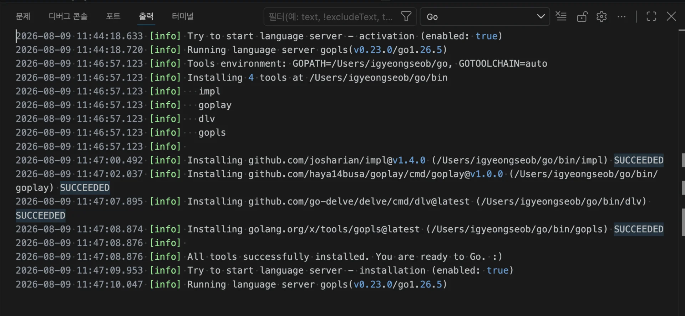

- 환경변수 확인
    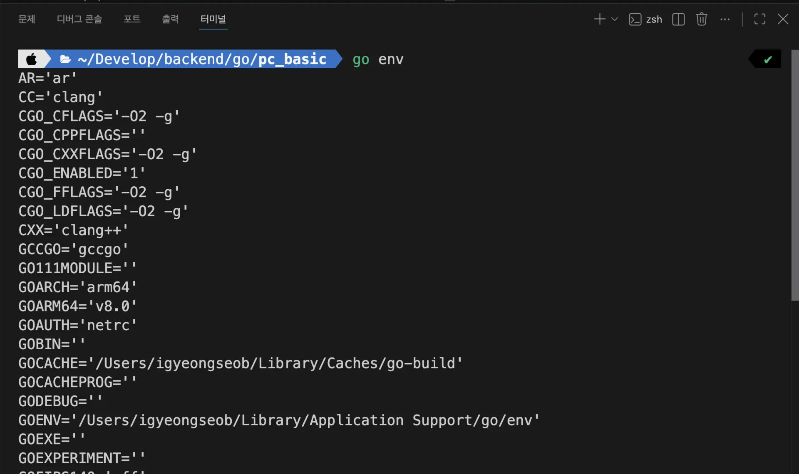

    - <code>go env</code> 입력 시 위 사진과 같이 설정된 환경변수들을 확인할 수 있다&#46;

<a id="3b7eda9b0fe180a69ff8e119bbd0b0cf"></a>

###  간단 실습, print

<details>
<summary>🤔 왜 <code>package main</code>을 명시하는가?</summary>

<a id="3b7eda9b0fe180f7b86ecd4e545bac00"></a>

Go의 모든 소스 파일은 반드시 <strong><u>자신이 속할 패키지를 선언</u></strong>해야 한다&#46;

<a id="3b7eda9b0fe180518043cb4634c08790"></a>

```go
package main
```

- main은 특별한 패키지 이름으로, Go 컴파일러에게 <br>해당 패키지가 <strong><u>직접 실행할 프로그램</u></strong>이라는 것을 명시한다&#46; 

<a id="3b7eda9b0fe18038b619ffb2d988afd4"></a>

외부 소스 실행 시 main 이 아닌 <strong><u>사용할 패키지 이름으로 명시</u></strong>한다 

> 
> 
> <a id="3b7eda9b0fe180b89e25ea30bae154e7"></a>
> 
> 실행 가능한 Go 프로그램은 아래 두 조건을 만족해야 한다&#46;
> 
> - 직접 실행&#58; <code>package main &#43; func main()</code>
> 
> - 가져다 쓰는 코드&#58; <code>package {다른 이름}</code>

1. 직접 실행 프로그램 패키지
    <a id="3b7eda9b0fe180b58719c28dc8bba0ec"></a>

    ```go
    package main

    func main() {
    	// 프로그램 시작 지점
    }
    ```

    - 프로그램을 실행하면 Go는 main 패키지를 초기화한 다음 main() 함수를 호출한다&#46;
        - ‣

1. 다른 코드가 가져다 쓰는 패키지
    <a id="3b7eda9b0fe180a9beedfa7114deee99"></a>

    ```go
    package calculator

    func Add(a, b int) int {
    	return a + b
    }
    ```

</details>

<a id="3b7eda9b0fe18073a3a9c4c923ed7546"></a>

```go
// main.go 
package main

import "fmt"

func main() {
	fmt.Println("Helle, GO!")
}
```

<a id="3b7eda9b0fe18003b625f36d64ff42c5"></a>

```bash
# 실행
go run main.go
```

- 실행 순서
    - <code>소스 검사</code> → <code>컴파일</code> → <code>링크</code> → <code>임시 실행 파일 실행</code>

- 첫 실행에서는 빌드 캐시를 준비하므로 더 느릴 수 있음
    <details>
    <summary>속도 비교 </summary>

    <a id="3b7eda9b0fe180cb9d02de6fe61a34a6"></a>

    ```bash
    time go run main.go
    ```

    <a id="3b7eda9b0fe180bca6baf149cce1e48f"></a>

    ```bash
    go build -o hello main.go
    time ./hello
    ```

    - <code>&#46;/hello</code>는 이미 컴파일됐으므로 거의 즉시<br>실행

    </details>
