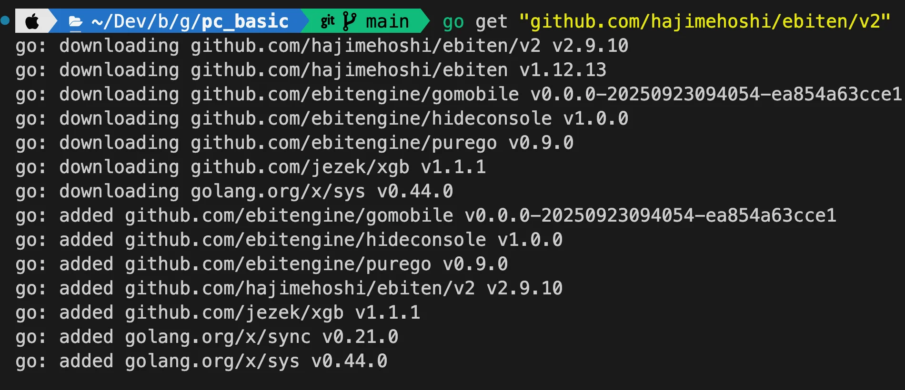
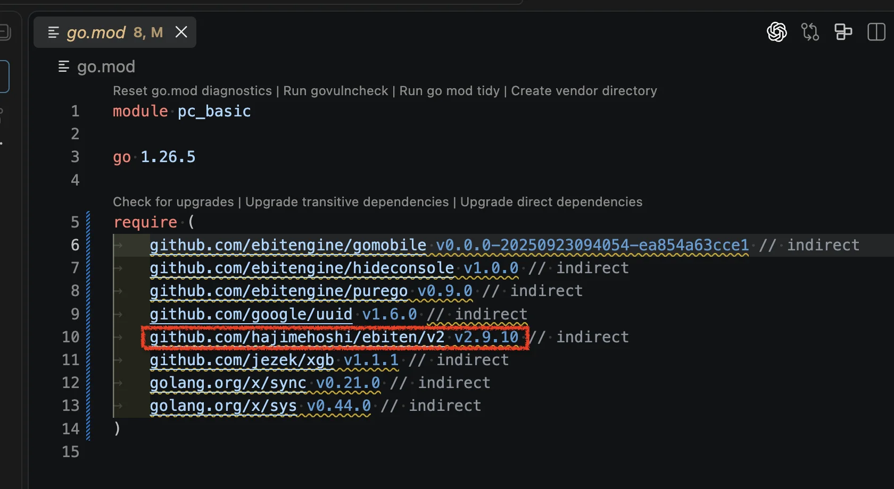

> ✏️ 
> 
> <a id="3caeda9b0fe18094aafeca789794a3be"></a>
> 
> 게임 엔진 &#45; <code>Ebitengine</code> 패키지
> 
> - Go 언어를 위한 오픈소스 게임엔진으로 2D 게임을 빠르고 쉽게 개발하도록 도와줌
> 
> - Go get을 통해 외부패키지를 받아 사용, 다양한 예제소스가 제공됨
> 
> - Ebitengine URL&#58; <code>https&#58;//ebitengine&#46;org/</code>

<details>
<summary><code>Ebitengine</code> 패키지</summary>

> ✏️ 
> 
> <a id="3caeda9b0fe180848e43c35e188fac06"></a>
> 
> <code>Ebitengine</code>의 기본 객체로 <code>Game</code>을 사용하며 Update, Draw, Layout 세가지 메서드 포함

| 메서드 | 기능 |
| --- | --- |
| <code>Layout</code> | 화면 크기 설정 |
| <code>Draw</code> | 코드를 통해 게임 화면 그림 |
| <code>Update</code> | 게임 상태를 지속적으로 반영 |

</details>

<a id="3caeda9b0fe18089876fe011a52b9473"></a>

### 실습

<details>
<summary><code>ebitengine</code> 설치</summary>

<a id="3caeda9b0fe180ea89d1d7711478afb1"></a>

```go
go get "github.com/hajimehoshi/ebiten/v2"
```





- <code>go&#46;mod</code> 파일에 의존성 추가 확인

</details>

<details>
<summary></summary>


</details>
