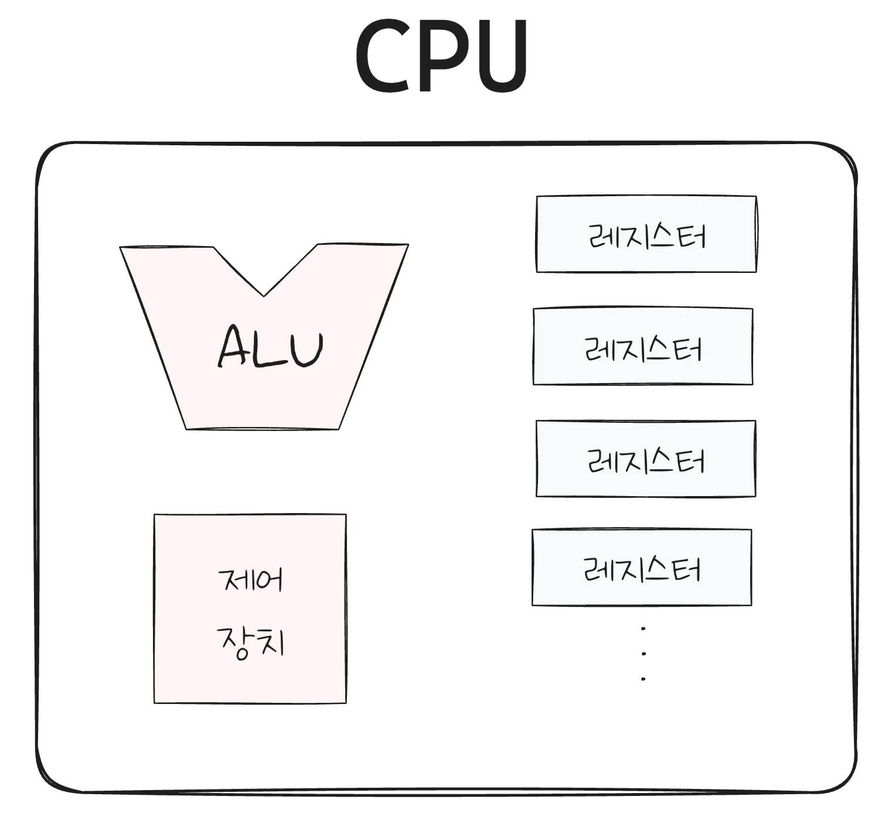
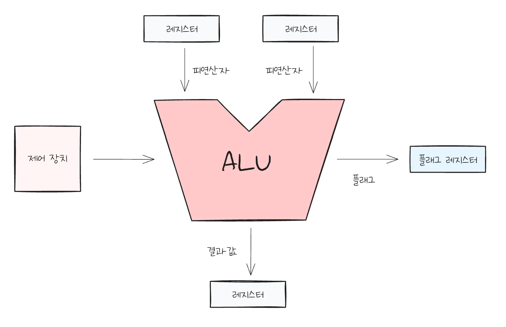

## CPU 구성요소

---

> ☝🏻 
> 
> 
> 
> CPU는 대단히 정교하게 설계되어 있는 부품인 만큼 모든 구성요소를 확인할 수 없다&#46; 그 중 가장 중요한 3가지만 확인 해본다&#46; 

> 
> 
> 
> 
> <strong>CPU 핵심 구성 요소 세가지</strong>
> 
> 
> 
> - <code>ALU (산술논리연산장치)</code>
>     - 연산을 수행하는 장치 ( 계산(<code>&#43;</code>, <code>&#42;</code>)을 담당하는 회로 )
>         - 더하기, 곱셉, 오버플로우 검출 등 다양한 회로들이 포함되어 있음
>             - <code>빼기</code>&#58; 2의 보수를 처리한 뒤 <strong><u>더하기 연산</u></strong>으로 처리됨
> 
> - <code>제어 장치</code>
>     - <strong><u>명령어를 해석</u></strong>하고 <strong><u>제어 신호를 보</u></strong>내는 장치
>         - <code>제어 신호</code>&#58; 컴퓨터 부품들한테 어떤 동작을 할지 알려주는 일종의 전기신호다
> 
>         - 다른 입출력 장치들도 제어신호를 내보냄
> 
> - <code>레지스터(들)</code>
>     - 명령어 처리 전후로 값을 임시 저장하는 장치
> 
>     - 여러 종류가 있으며, 특수한 목적을 가지는 레지스터들도 있다&#46; 

> ☝🏻 
> 
> 
> 
> 개발자에게는 <strong><u>레지스터</u></strong>가 가장 중요하다&#46; 
> 
> 
> 
> 특별한 직군을 제외하고 ALU, 제어장치를  코드나 명령어로 다룰 일은 거의 없다&#46; 
> 
> 
> 
> 그러나 레지스터는 <strong><u>일부 로우 레벨을 개발</u></strong>하거나, <strong><u>보안 관련된 직업</u></strong>의 경우, 레지스터를 알아야 한다&#46; 
> 
> 
> 
> <code>레지스터</code>는 <strong><u>명령어 처리 전후로 처리되는 값들을 저장</u></strong>하고 있는<strong><u> 저장장치</u></strong>다 따라서 <strong><u>레지스터에 어떤 값이 담기는 지 관찰</u></strong>하면 <strong>명령어 처리 과정을 엿볼 수 있</strong>다&#46; 
> 
> - 레지스터는 다양한 종류가 있고, 특별한 목적을 갖고 있는 레지스터도 있다&#46; 
> 
> - CPU 종류마다 레지스터 이름, 개수, 동작방식(주소 지정의 방식), 용량 등이 달라질 수 있다&#46; 그 중 공통적으로 다루는 것들만을 학습한다&#46; 

### ALU 

> ✏️ 
> 
> 
> 
> ALU ( 계산기 회로, 계산을 담당하는 회로의 묶음)
> 
> 
> 
> - 레지스터로부터 피연산자(연산의 대상)을 받아들인다&#46;
> 
> - 제어 장치로부터 제어 신호(연산할 작업)을 받아들인다&#46; 
> 
> - 연산의 결과를 레지스터, 플래그 레지스터에 저장한다&#46; 

- ex) <code>1 &#43; 2 = 3</code>
    > 레지스터에 프로그램 연산(제어신호) 전후로 담기는 값들이 있기 때문에 레지스터를 관찰하면 로우 레벨을 잘 관찰할 수 있다&#46; 

    - 피연산자&#58; <code>1</code>, <code>2</code>
        - AU

    - 제어신호&#58; <code>&#43;</code>
        - ALU가 해야되는 연산

    - 결과값&#58; <code>3</code>
        - ALU가 내보는 return 값

- 플래그 레지스터&#58; <code>연산 결과에 대한 부가 정보 저장</code>
    > 자세한 설명 아래 참조 

    

    연산을 하는 과정에서 <strong><u>부가적인 정보</u></strong>를 참조해야 될 때가 있다&#46; 

    1. <code>오버플로우</code>
        - 레지스터에 담는 결과값이 레지스터의 크가보다 커질 수 있다&#46;  

    1. <code>값 부호</code> 
        - 연산 결과가 음수, 양수 인지 

### 플래그 레지스터

## 레지스터

---

> 

## 명령어 사이클, 인터럽트

---

> 

## 멀티코어, 멀티프로세스

---

> 

## 명령어 병렬 처리 &#45; 파이프라이닝

---

> 

## 비순차적 명령어 처리

---

>
