<a id="3c7eda9b0fe1807695b0e8fa072f21f3"></a>

## 이진수/2의보수

---

> 
> 
> <a id="3c7eda9b0fe1801fab60dab80c98c4ff"></a>
> 
> 컴퓨터는 <code>0</code>, <code>1</code> 만을 이해한다&#46; 
> 
> - 모든 <strong><u>양수</u></strong> <code>0</code>, <code>1</code>로 표현 → <strong>이진수</strong>
> 
> - 모든 <strong><u>음수</u></strong> <code>0</code>, <code>1</code>로 표현 → <strong>2의 보수</strong>
> 
> - 모든 <strong><u>소수</u></strong> <code>0</code>, <code>1</code>로 표현 → <strong>부동 소수점</strong>
> 
> - 모든 <strong><u>문자</u></strong> <code>0</code>, <code>1</code>로 표현 → <strong>문자 집합 &#38; 인코딩</strong>

<details>
<summary>이진법 (이진수)</summary>

> ✏️ 
> 
> - 이진법&#58; <code>0</code>, <code>1</code>로 모든 수를 표기하는 방법
> 
> - 이진수&#58; <code>0</code>, <code>1</code>만으로 표현된 수
>     <a id="3c7eda9b0fe180089beefdc3eab86112"></a>
> 
>      → 1을 넘어가는 시점에 자리올림

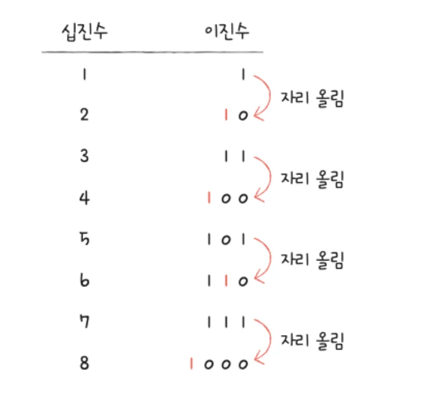

<a id="3d3eda9b0fe180008924e0593c6ec523"></a>

#### <strong>이진법(이진수) 단점</strong>

<a id="3d3eda9b0fe180579399dddf1bdc6089"></a>

→ <strong>숫자가 너무 길어진다&#46; </strong>

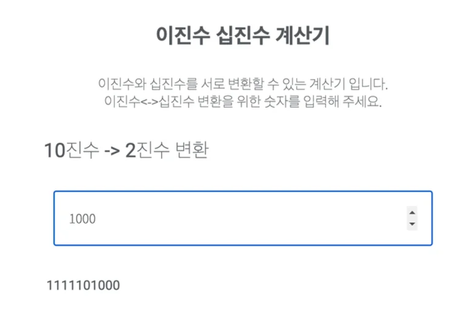

</details>

<details>
<summary>십육진법 (십육진수)</summary>

> ✏️ 
> 
> - 십육진법&#58; <code>1 &#126; 9</code> 와 <code>A &#126; F</code>로 모든 수를 표기하는 방법
>     - <code>A = 10</code>, <code>B = 11</code>, <code>C = 12</code>,<br><code>D = 13</code>, <code>E = 14</code>, <code>F = 15</code>

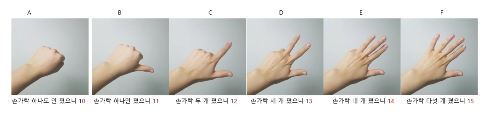

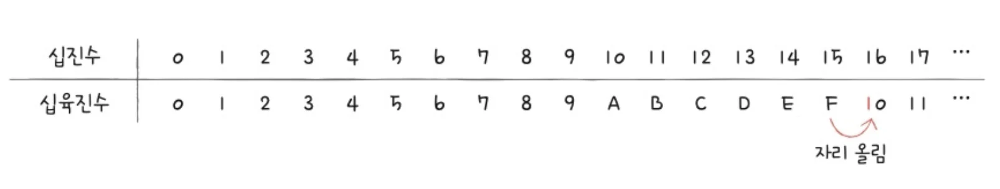

- <code>15(F)</code>을 넘어가는 시점에 자리올림

</details>

<details>
<summary>2의 보수법</summary>

> ✏️ 
> 
> <a id="3d3eda9b0fe1804390fee1bf92306ebe"></a>
> 
> <code>0</code>, <code>1</code> 만으로 <strong><u><code>음수</code></u></strong><strong><u>를 표현</u></strong>하는 방법 중 하나&#46; 

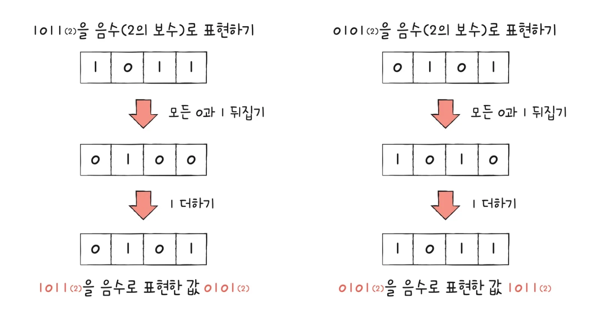

- 모든 0과 1을 뒤집은 뒤, 1을 더한 값
    - <code>1011</code>의 2의 보수 → <code>0101</code>

<a id="3d3eda9b0fe180cc81d7ea36c2feac38"></a>

#### 이를 어떻게 양수와 구분하는가? → <code>CPU 내부 </code><strong><u><code>플래그(flag)</code></u></strong><code> 정보</code>

- <code>플래그</code>&#58; CPU가 명령어를 실행하는 과정에서 참고할 정보 모음
    - 음수 플래스 설정&#58; <code>음수</code>

    - 음수 플래그 설정 ❌&#58; <code>양수</code>

</details>

<a id="3c7eda9b0fe1806a8e44fd8c3ef67972"></a>

## 부동소수점(floating point)

---

> 
> 
> <a id="3c7eda9b0fe18029aa53f88e74a9edf7"></a>
> 
> 부동소수점은 <code>‘근사값’</code>이다&#46;
> 
> - 실제 소수를 <code>0</code>,<code>1</code> 로 저장 시 <strong><u>무한히 반복되는 값</u></strong>이 나온다<br>따라서 <strong><u>일정 자릿수에 잘라서 저장</u></strong>한다&#46; <br>그렇기 때문에 <strong><u>미세한 오차가 발생</u></strong>한다&#46;
> 
> - <code>float</code>, <code>double</code>는 일반적으로 <strong><a href="https://ko.wikipedia.org/wiki/IEEE_754"><u>IEEE 754 부동소수점 표현</u></a></strong><strong> 방식</strong>을 사용한다&#46;

<details>
<summary>예제 &#45; <code>0&#46;1 &#43; 0&#46;2 ≠ 0&#46;3</code></summary>

> 모두 <code>Not Equal</code>이 나온다&#46; 
> 
> <a id="3d3eda9b0fe180b79cf9d9f76132bd73"></a>
> 
> → 컴퓨터 내 <strong>소수점 표현 방식의 한계</strong> 때문

<details>
<summary>&#91;코드&#93; c</summary>

<a id="3d3eda9b0fe1807ca4bbffe5cfb9e289"></a>

```c
#include <stdio.h>

int main() {
    double a = 0.1;
    double b = 0.2;
    double c = 0.3;

    if (a + b == c) {
        printf("Equal\n");
    } else {
        printf("Not Equal\n");
    }

    return 0;
}
```

</details>

<details>
<summary>&#91;코드&#93; python</summary>

<a id="3d3eda9b0fe1804c9331fc1caa0abf04"></a>

```python
a = 0.1
b = 0.2
c = 0.3

if a + b == c:
    print("Equal")
else:
    print("Not Equal")
```

</details>

<details>
<summary>&#91;코드&#93; java</summary>

<a id="3d3eda9b0fe180099ad7ef74d85edb93"></a>

```java
public class FloatingPointComparison {
    public static void main(String[] args) {
        double a = 0.1;
        double b = 0.2;
        double c = 0.3;

        if (a + b == c) {
            System.out.println("Equal");
        } else {
            System.out.println("Not Equal");
        }
    }
}
```

</details>

<details>
<summary>&#91;코드&#93; javascript</summary>

<a id="3d3eda9b0fe18095ab6fc6395b065fd8"></a>

```javascript
let a = 0.1;
let b = 0.2;
let c = 0.3;

if (a + b == c) {
    console.log("Equal");
} else {
    console.log("Not Equal");
}
```

</details>

</details>

<a id="3d3eda9b0fe180dab27be26ce63e6c69"></a>

### 부동소수점 &#45; <code>지수 (exponent)</code> &#43; <code>가수 (significand)</code>

<a id="3d3eda9b0fe180b3a5dfec96a3b82afe"></a>

####  다양한 형태의 <code>지수</code>와 <code>가수</code>

> ✏️ 
> 
> - 빨간 글씨 → <code>지수 (exponent)</code>
> 
> - 파란 글씨 → <code>가수 (significand)</code>

- ex 1) <code class="language-math">123&#46;123</code> 십진수 → <code class="language-math">m</code><code> x </code><code class="language-math">10^n</code>
    - <strong>1&#46;23123</strong><strong> </strong>x <code class="language-math">10^2</code>

    - <strong>1231&#46;23</strong> x <code class="language-math">10^{&#45;1}</code>

- ex 2) <code class="language-math">101011&#46;1010101</code> 이진수 →  <code class="language-math">m</code><code> x </code><code class="language-math">2^n </code>
    - <strong>1&#46;1010111010101</strong><strong> </strong>x <code class="language-math">2^6</code>

    - <strong>110101110&#46;10101</strong> x <code class="language-math">2^{&#45;2}</code>

<a id="3d3eda9b0fe180538b8ddcc2e085e164"></a>

####  컴퓨터 내부의 소수 표현 방식 → <strong><code>부동소수점</code></strong><strong>, </strong><strong><code>I</code></strong><code>EEE 754</code>

> ✏️ 
> 
> <a id="3d3eda9b0fe180118d3effaefb629681"></a>
> 
> <strong>컴퓨터 내부의 소수 표현 방식&#58; </strong><strong><code>부동 소수점</code></strong><strong>, </strong><strong><code>IEEE 754</code></strong>
> 
> 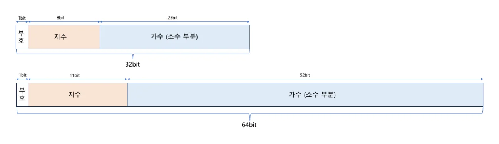
> 
> <a id="3d3eda9b0fe180e5b769d828bbc16f38"></a>
> 
> 이진수를 <code class="language-math">m</code><code> x </code><code class="language-math">2^n</code> 꼴로 나타내고, 가수 부분은 <code>1&#46;XXX</code> 꼴을 띄고 있음
> 
> - 이진수(진수)&#58;  <code class="language-math">m</code><code> x </code><code class="language-math">2^n</code>
> 
> - 가수&#58; <code>1&#46;XXX</code>
> 
> <a id="3d3eda9b0fe18037a338e1cb3d06af86"></a>
> 
> 이때, 1은 항상 동일하기 떄문에 제거해서 저장 → XXX(소수 부분만) 저장함

- 진수(이진수) 저장 시 바이어스(bias) 값이 더해져 저장됨
    - 바이어스 값&#58; <code class="language-math">2^{(k&#45;1)} &#45;1</code> (k는 지수의 비트수)

    - ex) 지수 비트&#58; <code>8비트</code> → 바이어스 값&#58; <code class="language-math">2^7&#45;1</code>

<a id="3d3eda9b0fe180b3974de3cd3ae9e657"></a>

####  이때 발생되는 문제점 &#45; <code>오차</code>

> ✏️ 
> 
> <a id="3d3eda9b0fe1806586e4e1848c6b76ab"></a>
> 
> <code>가수</code>는 <strong><u>한정된 공간</u></strong>을 가짐&#46; 따라서 <strong>무한히 많은 가수가 발생</strong>되는 경우, 일부 자릿수를 제외하고 버릴 수 밖에 없음, 이에 의해 <strong><u>오차</u></strong>가 발생됨

> 십진수 소수를 이진수로 표현할 때 십진수 소수와 이진수 소수 표현이 딱 맞아 떨어지지 않을 수 있다

- <code class="language-math">&#92;frac{1}{3}</code>이라는 분수 <code class="language-math">m  &#42; 3^n</code> 꼴로 표현하면 딱 떨어진다

- <code class="language-math">&#92;frac{1}{3}</code>이라는 분수 <code class="language-math">m  &#42; 10^n</code> 꼴로 표현하면 <strong><u>무한히 많은 가수가 필요</u></strong>하다

> 십진수 소수를 이진수로 표현할 때 십진수 소수와 이진수 소수 표현이 딱 맞아 떨어지지 않을 수 있다

- <code class="language-math">&#92;frac{1}{10}</code>이라는 분수 <code class="language-math">m  &#42; 10^n</code> 꼴로 표현하면 딱 떨어진다

- <code class="language-math">&#92;frac{1}{10}</code>이라는 분수 <code class="language-math">m  &#42; 2^n</code> 꼴로 표현하면 <strong><u>무한히 많은 가수가 필요</u></strong>하다

<a id="3c7eda9b0fe18044bdb3fb59431451d8"></a>

## 문자 인코딩/디코딩

---

> 
> 
> 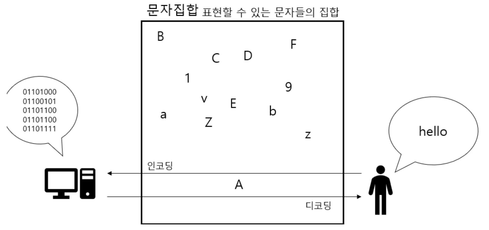
> 
> - <code>문자 집합</code>&#58; 표현 가능한 문자들의 집합
> 
> - <code>문자 인코딩</code>&#58; 문자를 0, 1 로 이루어진 문자 코드로 변환
> 
> - <code>문자 디코딩</code>&#58; 0, 1로 이뤄진 문자 코드를 문자로 변환

> 🤔 
> 
> <a id="3d3eda9b0fe180dbb179f2140976b886"></a>
> 
> <strong>문자 인코딩, 디코딩이 왜 중요한가?</strong>
> 
> ![  • [오류 화면\] A 방식 인코딩 후 지원하지 않는 B 방식으로 인코딩](8f128a256c8ac2ac.webp)
> 
> <a id="3d3eda9b0fe18092b071e13cb7079a25"></a>
> 
> 위와 같이 문자가 깨지는 경우, 대부분의 원인은 아래와 같다&#46; 
> 
> 1. <code>지원되지 않는 문자집합 사용</code>
>     - 컴퓨터가 이해할 수 없는 문자집합 사용
> 
> 1. <code>호환되지 않은 인코딩 방식으로 데이터 읽기(READ)</code>
>     - &#91; 오류&#93; A 방식 인코딩 → B 방식 디코딩
> 
> <a id="3d3eda9b0fe180668027f548741c4a01"></a>
> 
> 따라서 <strong><u>문자 깨진 경우, 대부분의 해결 방안</u></strong>은<strong> 인코딩 방식 확인 후 이에 맞게 변경</strong>하는 것이다&#46; 

<a id="3c7eda9b0fe18060ad0bd2023626f5e4"></a>

### <strong>아스키 문자 집합</strong>

> 💬 
> 
> <a id="3d3eda9b0fe18053bd31f982d73be55a"></a>
> 
> 다양한 인코딩, 디코딩 방식이 있지만 기본적으로 <strong><u>영어는 지원</u></strong>을 한다&#46; 이 이유는 최초의 문자 집합인 <strong><u>아스키 코드를 대부분 지원</u></strong>하기 때문이다&#46; 

<a id="3d3eda9b0fe180e4b181e659f74c5ca0"></a>

####  아스키 문자 집합

> ✏️ 
> 
> - 초장기 문자 집합
>     - 대부분의 인코딩/디코딩 방식이 아스키코드와 호환됨
> 
> - 표현 종류
>     - <code>알파벳</code>, <code>아라비아 숫자</code>, <code>일부 특수 문자</code>, <code>제어 문자</code> 

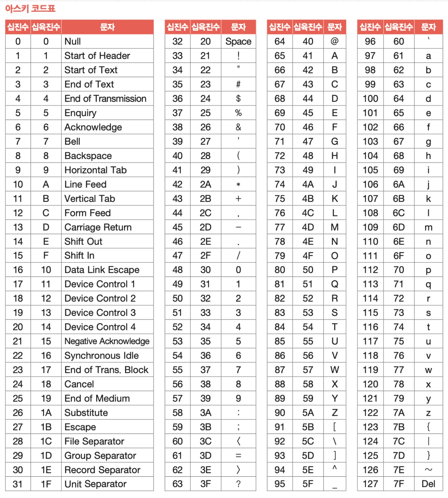

<a id="3d3eda9b0fe18045af2ef2bf253c8414"></a>

기본적으로 <code>8 bit</code>를 사용하고 그 중 <code>1 bit</code>는 오류 검증을 위해 사용한다&#46;  즉, <code>7 bit</code>만을 사용하기 때문에 <code class="language-math">2^7</code>(128, 0&#126;127) 의 개수를 가진다&#46;

<a id="3d3eda9b0fe1809982c9eea64d4f1804"></a>

####  인코딩 방식&#58; <code>대응</code>

> ✏️ 
> 
> <a id="3d3eda9b0fe18043b7d1fb53dcc899d2"></a>
> 
> 대응이 곧 인코딩 
> 
> - 즉, <code>97(숫자)</code> 출력 시 <code>a(문자)</code> 가 나오고 <br><code>a(문자)</code> 출력 시 <code>97(숫자)</code>이 나온다&#46; 

<details>
<summary>ex) <code>97 = a</code></summary>

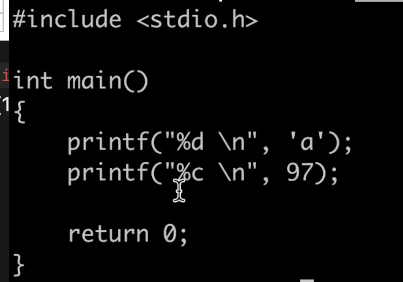

<a id="3d3eda9b0fe180d988a4c538766715fc"></a>

```python
vi ascii.c

gcc -o ascii ascii.c

./ascii

# 97
# a
```

- a 출력 시 97

- 97 출력 시 a

</details>

<a id="3d3eda9b0fe180278655f8d93d14c191"></a>

####  문제점

> 🤬 
> 
> <a id="3d3eda9b0fe18045ab2ffb261fc00e73"></a>
> 
> 한글 뿐 아니라 <strong>다양한 나라의 언어를 표현할 수 없</strong>다&#46; 
> 
> - <strong><u>7 bit로 문자를 표현</u></strong>하기 때문에 <strong>128가지의 표현 밖에 하지 못</strong>한다&#46; 

<a id="3d3eda9b0fe1802982ede2aec08d0cf6"></a>

⇒ 통일된 언어의 인코딩/디코딩 지원 &#45; 유니코드 문자&#58; <code>utf&#45;8</code>, <code>utf&#45;16</code>

<a id="3d3eda9b0fe18018bcc3cf91e5521130"></a>

### 유니코드 문자 집합

[Home]()

<a id="3d3eda9b0fe180178cd4e8f986b5a10b"></a>

####  유니코드 문자 집합

> ✏️ 
> 
> <a id="3d3eda9b0fe180d6b0dbd134800dc4e5"></a>
> 
> 유니코드 문자 집합은 대부분의 언어, 특수문자, 이모티콘, 화살표 등까지 표현 가능한 범용성이 높은 문자 집합이다&#46;
> 
> - <strong><u>유니코드 문자 집합, 인코딩, 디코딩 방식을 지원</u></strong>하면 <br>대부분의 언어 및 특수문자까지 지원 가능해진다&#46;

> 유니코드 형식&#58; <code>u&#43;{4자리 16진수}</code>

- <code>u&#43;</code>&#58; 유니코드에서 16진수라는 것을 나타냄

- <code>{4자리 16진수}</code>&#58; 코드 포인트(Code point)
    - 유니코드 문자에 부여된 고유한 수

    - 문자 인코딩 공간이나 테이블에서 특정 문자나 의미를 나타내기 위해 할당된 고유한 <strong>숫자(값)</strong>

- ex 1)
    

- ex 2)
    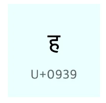

<a id="3d3eda9b0fe1806a89e2e5805652cbe1"></a>

문자 집합 내 문자마다 코드포인트를 부여하며

<a id="3d3eda9b0fe180f686b7ded3fc597d6f"></a>

이 코드 포인트를 어떻게 인코딩 하는 지에 따라 인코딩 방식이 달라진다&#46; 

- 인코딩 방식들&#58; <code>utf&#45;8</code>, <code>utf&#45;16</code>, <code>utf&#45;32</code>

<a id="3d3eda9b0fe180859cf6fd7a302b2da8"></a>

#### 실습 &#45; 유니코드 문자 집합

[fastcampus&#45;cs/arch at main · kangtegong/fastcampus&#45;cs]()

<a id="3d3eda9b0fe1800fbd0bd0f6eb676808"></a>

```python
import unicodedata

input_value = input("인코딩할 값을 입력하세요: ")

print("유니코드 코드 포인트:")
for char in input_value:
    code_point = ord(char)
    print(f"문자 '{char}': U+{code_point:04X}")

# UTF-8 인코딩
utf8_encoded = input_value.encode('utf-8')
print("UTF-8 인코딩 결과:", utf8_encoded)

# UTF-16 인코딩
utf16_encoded = input_value.encode('utf-16')
print("UTF-16 인코딩 결과:", utf16_encoded)

# UTF-32 인코딩
utf32_encoded = input_value.encode('utf-32')
print("UTF-32 인코딩 결과:", utf32_encoded)
```

<a id="3d3eda9b0fe18092a8d7c041c05eddb1"></a>

결과

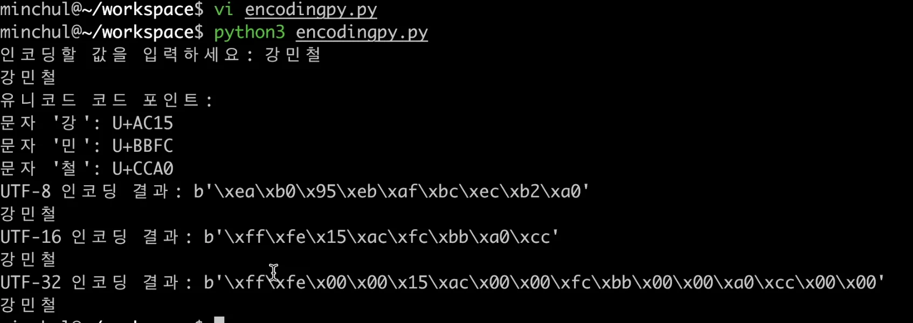

[Find all Unicode characters from Hieroglyphs to Dingbats – Codepoints]()
