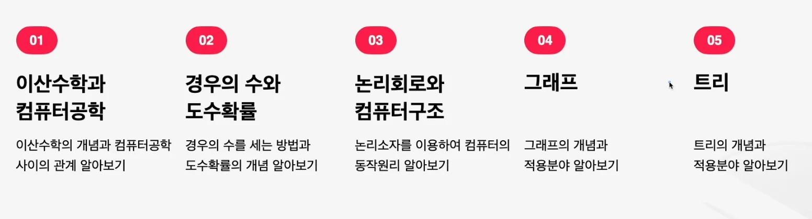

> 
> 
> <a id="3d4eda9b0fe18005b521c7c09fbb9aa2"></a>
> 
> <strong>&#91;패스트캠퍼스&#93;</strong> 논리적 문제 해결을 위한 컴퓨터과학
> 
> - 기간&#58; 26&#46;0&#46;0() &#126; 26&#46;0&#46;0()
> 
> - 강의&#58; ‣
> 
> <details>
> <summary>reference</summary>
> 
> - ‣
> 
> - ‣
> 
> - ‣
> 
> </details>

> 👉🏻 
> 
> <a id="ebbeda9b0fe1835490188152e678d618"></a>
> 
> <strong>&#91;패스트캠퍼스&#93;</strong> <strong>구조적인 문제 해결을 위한 컴퓨터공학</strong>
> 
> - 기간&#58; 26&#46;8&#46;19(수) &#126; 26&#46;8&#46;0()
> 
> - 강의&#58; ‣
> 
> <details>
> <summary>reference</summary>
> 
> - ‣
> 
> - ‣
> 
> - ‣
> 
> </details>

<details>
<summary>Template</summary>

> 

> ✏️ 

> 📖 

> 
> 
> <a id="dcbeda9b0fe182649aff01755ec2336b"></a>
> 
> <strong>목차</strong>
> 
> - [ 1. 이산수학](#884eda9b0fe1829f89730154b2e2e87d)
> - [ 2. 자료구조 & 알고리즘](#c11eda9b0fe1826eb08381f248596d83)

<details>
<summary>&#91; 코드 &#93;</summary>

<a id="145eda9b0fe18381aa8e81b102f6bf62"></a>

```typescript

```

</details>

[제목 없음](#/post/8ebeda9b-0fe1-82aa-841e-8162d479f752)

[[ 실습 ]](#/post/958eda9b-0fe1-8297-a58b-81050929c033)

[[ 의문점 ]](#/post/9cdeda9b-0fe1-829a-85a3-015b30fe6f3e)

</details>

<a id="884eda9b0fe1829f89730154b2e2e87d"></a>

###  1&#46; 이산수학



[이산수학, 컴퓨터 공학](#/post/c34eda9b-0fe1-837c-8535-818c25ab3ff2)

[연속변수, 이산변수](#/post/4a2eda9b-0fe1-820a-b081-017c9eeed5e4)

[부을대수, 논리회로](#/post/3bceda9b-0fe1-83ae-8dd8-81427957e8f3)

[그래프](#/post/3d4eda9b-0fe1-8016-8efa-e92df22ed683)

[트리](#/post/3d4eda9b-0fe1-80e6-9fde-d667fb516a71)

[마르코프 체인](#/post/3d4eda9b-0fe1-80cd-81a9-da1c2d7e7434)

<a id="c11eda9b0fe1826eb08381f248596d83"></a>

###  2&#46; 자료구조 &#38; 알고리즘

[자료구와, 알고리즘](#/post/a68eda9b-0fe1-8394-8ca0-01500ceb38f2)

[리스트, 알고리즘](#/post/3d4eda9b-0fe1-80ea-8209-e6d4ea4dec4c)

[재귀호출](#/post/3d4eda9b-0fe1-801e-9229-e4f34e50e082)

[트리, 알고리즘](#/post/3d4eda9b-0fe1-807b-a5e2-d745e29ee911)

[정렬](#/post/3d4eda9b-0fe1-8067-ae70-f4980ff5b5df)

[그래프](#/post/3d4eda9b-0fe1-8059-8d21-db7535d2d60d)

[검색](#/post/3d4eda9b-0fe1-80c1-8e57-cc34aae35061)

[동적 프로그래밍](#/post/3d4eda9b-0fe1-80ec-a6c3-cda3b2c2c76d)

[그리디 알고리즘](#/post/3d4eda9b-0fe1-8094-88ea-dcf6c2436523)
