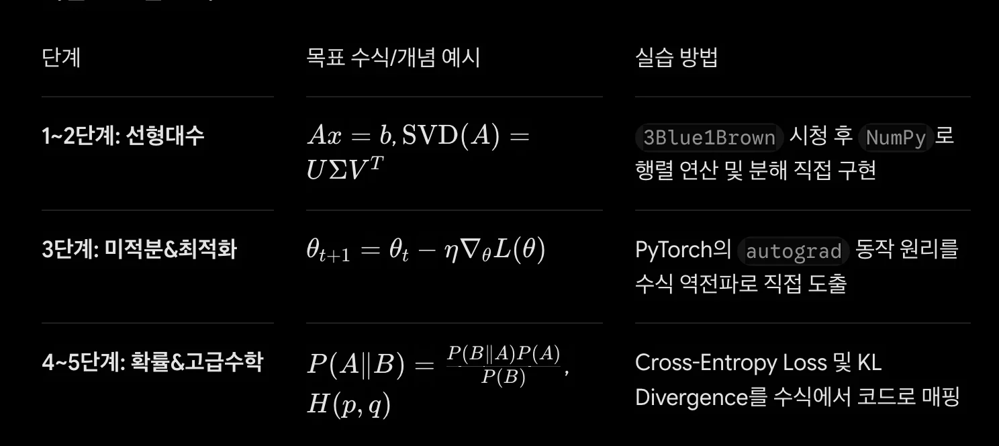

### <strong>1단계&#58; 기초 수학 &#38; 수치 연산 (Foundations)</strong>

- <strong>핵심 개념&#58;</strong> 함수, 수열, 지수·로그, 집합, 기본 벡터와 행렬 연산

- <strong>AI 연결점&#58;</strong> 데이터 표현, 활성화 함수(&#36;&#92;sigma(x)&#36;, &#36;&#92;text{ReLU}(x)&#36;) 및 스케일링의 원리

- <strong>추천 무료 강의&#58;</strong>
    - <a href="https://www.kmooc.kr/view/course/detail/9414">K&#45;MOOC &#45; 인공지능 수학 기초</a>&#58; 성균관대학교에서 제공하는 한국어 입문 과정&#46;
        [K&#45;MOOC]()

    - <a href="https://www.khanacademy.org/math">Khan Academy &#45; Algebra &#38; Precalculus</a>&#58; 부족한 기초 수학 개념을 부분적으로 빠르게 보완하기 최적화된 플랫폼&#46; 

### <strong>2단계&#58; 선형대수학 (Linear Algebra) — AI의 언어</strong>

• <strong>핵심 개념&#58;</strong> 벡터공간(Vector Space), 행렬 곱셈, 고윳값/고유벡터(Eigenvalue/Eigenvector), SVD(특잇값 분해), PCA(주성분 분석) • <strong>AI 연결점&#58;</strong> 데이터 임베딩, Transformer의 Self&#45;Attention 연산, 차원 축소 및 가중치 행렬 &#36;W&#36; • <strong>추천 무료 강의&#58;</strong>     ◦ <a href="https://www.youtube.com/playlist?list=PLZHQObOWTQDPD3MizzM2xVFitgF8hE_ab">3Blue1Brown &#45; Essence of Linear Algebra (유튜브)</a>&#58; 기하학적 시각화 애니메이션을 통해 직관을 기르는 1순위 시청 강의&#46;     ◦ <a href="https://ocw.mit.edu/courses/18-06-linear-algebra-spring-2010/">MIT 18&#46;06 &#45; Linear Algebra (Prof&#46; Gilbert Strang)</a>&#58; 세계적인 명저자 힐버트 스트랭 교수의 대학 정규 명강의&#46;     ◦ <a href="https://www.google.com/search?q=https://www.youtube.com/playlist%3Flist%3DPL_iJu012NOxcX9S9v6K3l4NstA9-KjOaT">혁펜하임 &#45; 보이는 선형대수학 (유튜브)</a>&#58; 직관적이고 직관성을 강조한 한국어 유튜브 강의 시리즈&#46; 

### <strong>3단계&#58; 미적분학 &#38; 최적화 (Calculus &#38; Optimization) — AI의 학습 메커니즘</strong>

• <strong>핵심 개념&#58;</strong> 편미분(Partial Derivative), 그래디언트(Gradient &#36;&#92;nabla f&#36;), 체인 룰(Chain Rule), 야코비안/헤시안(Jacobian/Hessian), 경사하강법(Gradient Descent) • <strong>AI 연결점&#58;</strong> 손실 함수(Loss Function) 최적화, 딥러닝 역전파(Backpropagation), Adam/RMSprop 최적화 알고리즘 • <strong>추천 무료 강의&#58;</strong>     ◦ <a href="https://www.youtube.com/playlist?list=PLZHQObOWTQDNPOjrT6KVlfJuKtYTftqH6">3Blue1Brown &#45; Essence of Calculus (유튜브)</a>&#58; 미적분의 핵심 개념과 순간 변화율의 직관적 이해&#46;     ◦ <a href="https://www.khanacademy.org/math/multivariable-calculus">Khan Academy &#45; Multivariable Calculus</a>&#58; 다변수 미적분학 및 편미분 연습&#46;     ◦ <a href="https://www.google.com/search?q=https://cs229.stanford.edu/section/cs229-linalg.pdf">Stanford CS229 &#45; Linear Algebra &#38; Calculus Review</a>&#58; 머신러닝에 핵심적으로 쓰이는 미적분/선형대수 요약 자료집&#46; 

### <strong>4단계&#58; 확률론 &#38; 통계학 (Probability &#38; Statistics) — 불확실성 제어</strong>

• <strong>핵심 개념&#58;</strong> 조건부 확률, 베이즈 정리(Bayes&#39; Theorem), 확률분포(가우시안, 베르누이), 기댓값 및 분산, 최대유도추정법(MLE), KL&#45;Divergence • <strong>AI 연결점&#58;</strong> 확률적 생성 모델(VAE, Diffusion), 분류 모델의 Softmax 확률 출력, LLM 토큰 생성 확률 분석 • <strong>추천 무료 강의&#58;</strong>     ◦ <a href="https://www.google.com/search?q=https://www.youtube.com/playlist%3Flist%3DPL2SOU6wwxB0uwwHGI718_OHEdZ3XyGi33">Harvard Stat 110 &#45; Introduction to Probability (Prof&#46; Joe Blitzstein)</a>&#58; 확률론 분야의 세계적 명강의 (유튜브 무료 공개)&#46;     ◦ <a href="https://www.google.com/search?q=https://ocw.mit.edu/courses/18-05-introduction-to-probability-and-statistics-spring-2014/">MIT 18&#46;05 &#45; Introduction to Probability and Statistics</a>&#58; 확률론부터 통계적 추론까지 다루는 OpenCourseWare&#46; 

### <strong>5단계&#58; 고급 AI 수학 &#38; 정보이론 (Advanced AI Math)</strong>

- <strong>핵심 개념&#58;</strong> 엔트로피(Entropy), 교차 엔트로피(Cross&#45;Entropy), 상호정보량(Mutual Information), 텐서 연산, 미분방정식(Diffusion의 SDE/ODE)

- <strong>AI 연결점&#58;</strong> Cross&#45;Entropy Loss, 텍스트 생성의 정보량 평가, 연속시간 기반 생성 모델 원리

- <strong>추천 교재&#58;</strong>
    - <a href="https://mml-book.github.io/book/mml-book.pdf">Mathematics for Machine Learning (PDF 무료 제공)</a>&#58;  Imperial College 교수진이 저술한 ML 수학의 대표 교재 (공식 웹사이트에서 PDF 무료 다운로드 가능)&#46;<strong> </strong>

<strong>학습 로드맵 요약</strong>

<strong>실전 학습 팁</strong>

- <strong>수식 ↔ 코드(PyTorch/NumPy) 1&#58;1 매핑&#58;</strong>  수식을 눈으로만 보지 않고 <code>numpy&#46;dot</code>, <code>torch&#46;matmul</code>, <code>torch&#46;autograd</code> 등을 활용해 주피터 노트북에서 코드로 직접 검증하는 것이 가장 빠릅니다&#46;

- <strong>Top&#45;down / Bottom&#45;up 병행&#58;</strong>  수학 전체를 다 끝내고 AI 모델을 시작하려면 지치기 쉽습니다&#46; 기본 선형대수/미적분 직관만 확보한 뒤, AI 논문이나 코드를 보다가 막히는 수식이 나올 때 해당 파트의 수학으로 들어가 부족한 부분을 채우는 전략이 효율적입니다&#46;
