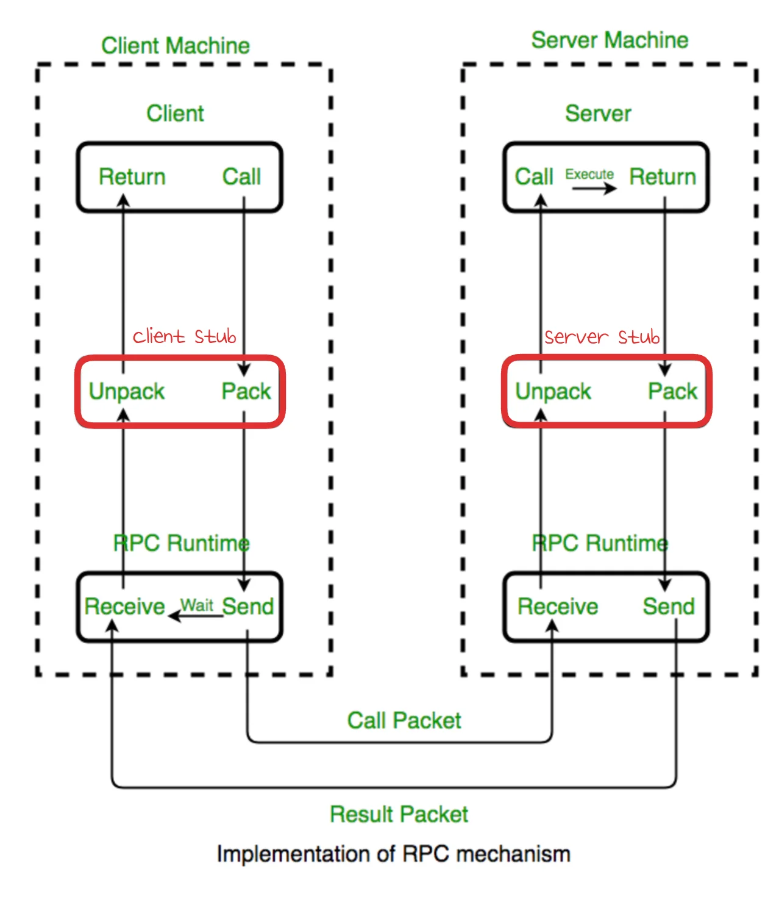
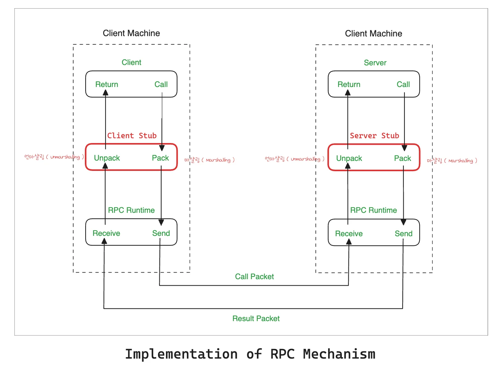
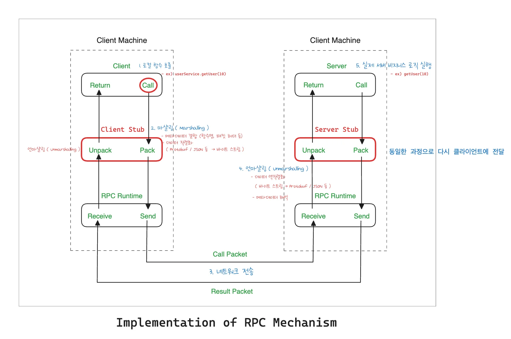

<details>
<summary>reference</summary>

- ‣

</details>

<a id="3ddeda9b0fe18010a7e2d21e0669aba6"></a>

## <strong>RPC</strong>

---

> 📖 
> 
> <a id="3ddeda9b0fe180df9bf2c0d56c4e442b"></a>
> 
> <code>RPC (Remote Procedure Call, 원격 프로시저 호출)</code>은 <u>원격 서버의 함수를 호출</u>할 수 있는 통신기술을 뜻한다&#46; 
> 
> - <em>RPC를 이용하면 프로그래머는 원격지의 자원을 내것처럼 사용할 수 있다&#46;</em>

<details>
<summary><code>RPC</code></summary>

- <strong><code>IDL</code></strong><code>(Interface Definition Language</code>)을 사용하여 <strong><u>호출 규약을 정의</u></strong>하고 이를 통해 <strong><u>Stub코드를 생성</u></strong>한다&#46;

- <strong>Program에서는 </strong><strong><u>Stub을 Call</u></strong> 함으로서 <strong><u>개발자는 네트워크에 대한 지식 없이 원격함수 호출이 가능</u></strong>하다&#46;

</details>

<details>
<summary><code>Stub</code></summary>

> ✏️ 
> 
> <a id="3ddeda9b0fe1801f8729f6b8b3741faf"></a>
> 
> RPC 환경에서 <strong>클라이언트와 서버 간의 통신을 중재하는 대리자(Proxy) 객체</strong>
> 
> <a id="3deeda9b0fe18058a810c50f1151b0dc"></a>
> 
> <strong><u>네트워크 레이어를 감추는 역할</u></strong>을 한다&#46;



- <strong><code>Client Stub</code></strong>
    - <strong>클라이언트가 로컬 함수를 호출</strong>하면, <strong><code>Stub</code></strong><strong>이 이 </strong><strong><u>호출 데이터(인수)를 바이너리나 텍스트 데이터 형태(네트워크 전송 가능 형태)로 변환(Marshalling)</u></strong>한 후 서버로 전송

- <strong><code>Server Stub (Skeleton)</code></strong>
    - <strong>서버 측</strong>에서 <strong><u>패킷을 받아 본래의 데이터 형태로 복원(Unmarshalling)</u></strong>하여 실제 서버 내부 함수를 실행하고, 결과를 다시 패킹하여 클라이언트에 돌려준다&#46;

</details>

<details>
<summary><strong><code>Stub을 이용한 RPC의 통신 과정</code></strong></summary>



<a id="3ddeda9b0fe180cebfa8cbb05d5e3901"></a>

```markdown
[Client]
     │
     ▼ (1) 로컬 함수 호출: userService.getUser(10)
[Client Stub] 
     │
     ├─► (2) 마샬링 (Marshalling)
     │     ├─ 메타데이터 결합 (함수명, 패킷 헤더 등)
     │     └─ 데이터 직렬화 (Protobuf / JSON 등 ──► 바이트 스트림 변환)
     │
     ▼ (3) 네트워크 전송 (HTTP/2, TCP)
[Server Stub / Skeleton]
     │
     ├─► (4) 언마샬링 (Unmarshalling)
     │     ├─ 데이터 역직렬화 (바이트 스트림 ──► 메모리 객체/파라미터 변환)
     │     └─ 메타데이터 해석
     │
     ▼ (5) 실제 서버 비즈니스 로직 실행: getUser(10)
[Server]
     │
     ▼ (6) 동일한 과정을 통해 Return 값 클라이언트로 전달
[Client]
```

</details>

<details>
<summary><code>마샬링</code>, <code>언마샬링</code></summary>

> ✏️ 
> 
> <a id="3ddeda9b0fe180df94e3eb7df176172d"></a>
> 
> <code>직렬화</code> vs <code>마샬링</code>
> 
> - <strong><code>직렬화</code></strong>
>     - 데이터(객체)를 단순히 연속된 바이트나 문자열로 <strong>형태 변환</strong>하는 기술 그 자체
> 
>     - 파일 저장, DB 저장 등에도 쓰임
> 
> - <strong><code>마샬링</code></strong>
>     - 서로 다른 프로세스/언어/네트워크 간에 <strong>의미가 통하도록 포장하여 전달하는 전체 과정</strong>



<a id="3ddeda9b0fe180608c4ec0d8bcff59c0"></a>

RPC나 원격 통신에서 <strong><u>마샬링이 진행</u></strong>될 때 내부적으로 다음과 같은 과정이 일어난다&#46;

1. <strong><code>메타데이터 및 헤더 추가</code></strong>
    - 호출하려는 원격 메서드 정보, 데이터 타입, 전송 관련 부가 정보(프로토콜 헤더 등) 결합

1. <strong><code>직렬화 (Serialization)</code></strong>
    - 메모리에 존재하는 객체나 파라미터 값들을 네트워크로 보낼 수 있는 <strong><u>연속된 바이트 스트림(Byte Stream</u></strong>)으로 변환

    - ex) Protocol Buffers, JSON, XML, Java Native Serialization 등

1. <strong><code>패킷화</code></strong>
    - 전송할 형태의 최종 네트워크 패킷으로 포장

</details>

<details>
<summary>🧐 왜 Protobuf 직렬화가 JSON보다 월등히 빠른가?</summary>

> ✏️ 
> 
> <a id="3ddeda9b0fe180548543ee4560c8aa3f"></a>
> 
> gRPC에서 기본 직렬화 도구로 사용하는 <code>Protocol Buffers(Protobuf)</code>가 <code>JSON/XML</code> 대비 용량이 적고 속도가 빠르다&#46; 그 이유는 아래와 같다&#46; 

- <strong><code>텍스트 vs 바이너리</code></strong>
    - JSON은 사람이 읽기 쉬운 텍스트(String) 형식이지만, <code>Protobuf</code>는 완전한 <strong><u>바이너리(Binary) 데이터</u></strong>로 변환한다&#46; 

- <strong><code>필드 태그(Tag) 방식 사용</code></strong>
    - JSON은 데이터 전송 시 Key 이름을 매번 포함합니다&#46;
        - <code>{&#34;user&#95;id&#34;&#58; 10, &#34;username&#34;&#58; &#34;kim&#34;}</code>

    - Protobuf는 IDL(<code>&#46;proto</code>) 파일에서 <strong><u>필드마다 부여된 숫자 번호(Tag)만 전송</u></strong>한다&#46; 
        <a id="3ddeda9b0fe180d48ec1c3cfce1afc15"></a>

        따라서 Key 이름 정보가 빠지므로 <strong><u>전송 용량이 대폭 줄</u></strong>어든다&#46;

- <strong><code>파싱(Parsing) 비용 절감</code></strong>
    - JSON은 텍스트 형태의 문자열을 읽고 해석하는 문자열 파싱 작업이 필요하지만, 

    - 바이너리 직렬화는 <strong><u>메모리에 직접 매핑</u></strong><strong><u>할 수 있</u></strong>어 <strong><u>CPU 사용량이 크게 감소</u></strong>한다&#46;

</details>

<details>
<summary>🧐 언어 간 FFI 및 원격 통신에서 마샬링이 필수적인 이유</summary>

> ✏️ 
> 
> <a id="3ddeda9b0fe1802f91f7cf7485130813"></a>
> 
> 서로 다른 프로그래밍 언어나 운영체제(OS) 환경에서는 메모리 구조, 표현 방식 등이 다르기 떄문에 마샬링 과정이 반드시 필요하다&#46; 

- <strong><code>엔디안(Endianness) 차이</code></strong>
    - 시스템(CPU)에 따라 바이트를 메모리에 저장하는 순서(Big&#45;Endian vs Little&#45;Endian)가 다르다&#46;

    - 마샬링을 통해 통일된 네트워크 바이트 순서로 전환한다&#46;

- <strong><code>메모리 패딩(Memory Padding) 및 정렬</code></strong>
    - C/C&#43;&#43; 등에서 구조체(Struct)를 정의할 때 메모리 성능을 위해 공백 바이트(Padding)를 삽입한다&#46; 

    - 언어 간 데이터를 주고받을 때 이 메모리 배치를 정제해야 한다&#46;

- <code>포인터(Pointer) 처리</code>
    - 로컬 메모리의 주소값(포인터)은 다른 컴퓨터나 프로세스에서 아무런 의미가 없다&#46; 

    - 포인터가 가리키는 실제 데이터 값을 찾아 바이트 배열로 포장(마샬링)해 넘겨주어야 한다&#46;

</details>

<a id="3ddeda9b0fe180299a7ce614f7f2c53a"></a>

## gRPC

---

> 
> 
> <a id="3ddeda9b0fe180d29929ece5fd18bdff"></a>
> 
> 구글이 만든 <strong>고성능 오픈소스 RPC 프레임워크, 전통적인 RPC 개념을 현대적인 웹 및 마이크로서비스 환경에 맞추어 최적화했다&#46;</strong>
> 
> - <strong><code>gRPC(google Remote Procedure Call)</code></strong><strong> </strong>
>     - 구글에서 개발한 RPC 통신방법으로 HTTP 2&#46;0 기반으로 양방향 스트리밍 데이터 처리가 가능하다&#46; 
> 
>     - MSA 구조의 서비스에서 활용된다&#46;
> 
> - <strong><code>protobuf</code></strong>
>     - gRPC의 IDL로 proto buffer의 줄임이다&#46; 
> 
>     - 프로그램상에서 이를 사용하기 위해서는 <code>&#46;proto</code> stub이 생성되어야 한다&#46; 
> 
>     - JSON, XML 통신보다 데이터 전송 크기가 작고 성능이 빠르다&#46;
> 
> - <strong><code>지원언어</code></strong>
>     - Protobuf의 경우 <code>version 2</code>, <code>version 3</code> 2가지가 존재하고, <code>proto3</code>가 <code>proto2</code>의 간략한 버전이다&#46;
> 
>     - proto 3가 지원하는 언어가 더 많기 때문에, 일반적으로 proto3를 사용한다&#46;

> 자세한 내용들은 해당 ch2 참조

<details>
<summary><code>gRPC</code> vs <code>HTTP API</code></summary>

|  | <strong>gRPC</strong> | <strong>HTTP API</strong> |
| --- | --- | --- |
| 계약 | &#46;Proto 파일 생성 필수 | 실행을 위한 파일 불필요 |
| 프로토콜 | HTTP 2&#46;0 | HTTP |
| Payload | Protobuf | JSON, Text |
| 스트리밍 | Client, Server, 양방향 | Client, Server |
| 브라우저 지원 | 미지원 | 지원 |
| 보안 | TLS | TLX |

</details>
