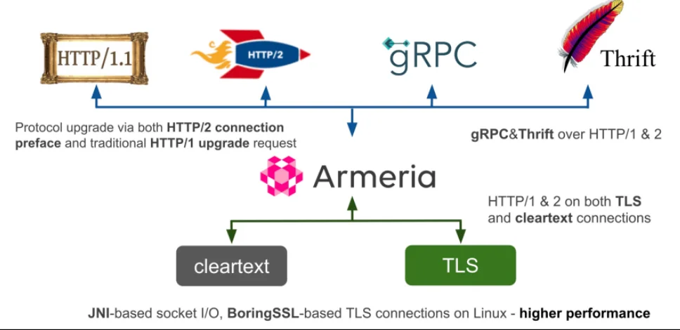
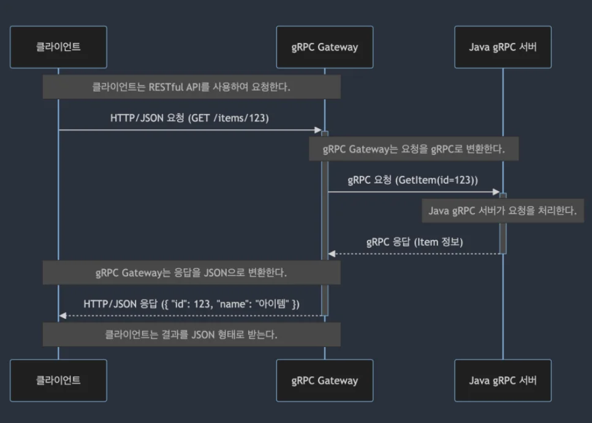

<details>
<summary>&#91; 코드 &#93;</summary>

<a id="3e1eda9b0fe180daa1dcd0e1e0487f71"></a>

```java

```

</details>

<details>
<summary>reference</summary>

- ‣

</details>

<a id="3e1eda9b0fe1808bb89ce2c04554fbf9"></a>

## Armeria 사용 예제

---

> 📖 
> 
> <a id="3e1eda9b0fe180199a6bc87008a16eb0"></a>
> 
> <code>Armeria</code>는 <strong><u>JVM 환경</u></strong>에서 <strong><u>HTTP API </u></strong>와 <strong><u>RPC 서비스를 개발</u></strong>하기 위한 <strong><u>비동기 서버•클라이언트 프레임워크</u></strong>이다&#46; 
> 
> <a id="3e1eda9b0fe180a1be69e7daa484afcd"></a>
> 
> <strong><u>Netty의 논블로킹 I/O 모델</u></strong>을 기반으로 하며, <code>HTTP/1&#46;1</code>, <code>HTTP/2</code>, <code>gRPC</code> • <code>gRPC&#45;Web</code> • <code>Thrift&#45;over&#45;HTTP</code> 등을 지원한다&#46;

<details>
<summary>주요 특징</summary>

> ✏️ 
> 
> 
> 
> <a id="3e1eda9b0fe1803e89b2cb2e4dcdc6fc"></a>
> 
> 단순히 REST와 gRPC 사이의 변환만 담당하는 도구가 아니라, <br><strong>하나의 애플리케이션에서 여러 통신 방식을 제공하고 기존 서비스와 통합할 수 있는 프레임워크이다&#46;</strong>

| 주요 특징 | 설명 |
| --- | --- |
| <strong><code>JVM 기반</code></strong> | Java·Kotlin 등 JVM 언어로 서비스를 개발할 수 있다&#46; |
| <strong><code>비동기·논블로킹 처리</code></strong> | Netty 기반으로 네트워크 I/O 처리 |
| <strong><code>HTTP/1&#46;1·HTTP/2 지원</code></strong> | 기존 HTTP 서비스와 HTTP/2 기반 서비스를 함께 구성할 수 있다&#46; |
| <strong><code>gRPC·gRPC&#45;Web 지원</code></strong> | 서버 간 RPC와 브라우저의 RPC 호출 지원 |
| <strong><code>Spring Boot 통합</code></strong> | Spring의 의존성 주입과 자동 설정을 활용해 Armeria 애플리케이션을 구성할 수 있다&#46; |

</details>

<a id="3e1eda9b0fe180338feecb61b0b00dfe"></a>

#### 웹 애플리케이션과 연결하는 2가지 방식

<details>
<summary>reference</summary>

- ‣

- ‣

- ‣

</details>

> ✏️ 
> 
> <a id="3e1eda9b0fe180f7a610f056acb632e1"></a>
> 
> Armeria로 gRPC 서비스를 웹에 제공 시, gRPC&#45;Web 과 HTTP/JSON Transcoding을 구분해야 한다&#46; 
> 
> <a id="3e1eda9b0fe180e1a041d7dcf4360704"></a>
> 
> 두 기능은 같은 서비스 구현에 접근할 수 있지만, 클라이언트 요청 방식이 다르다&#46;

| 구분 | <code>gRPC&#45;Web</code> | <code>HTTP/JSON Transcoding</code> |
| --- | --- | --- |
| 목적 | 브라우저에서 RPC 방식으로 호출 | 일반 HTTP/JSON 요청으로 RPC 호출 |
| 클라이언트 | gRPC&#45;Web 클라이언트 라이브러리 | <code>fetch</code>, <code>Axios</code>, <code>cURL</code> 등 |
| 요청 형태 | RPC 메서드와 메시지 기반 | HTTP 메서드·URL·JSON 기반 |
| 서버의 역할 | gRPC&#45;Web 프로토콜 처리 | HTTP 요청을 RPC 요청에 매핑 |
| 주요 활용 | <code>&#46;proto</code> 기반 호출 계약 재사용 | gRPC 서비스를 HTTP/JSON API로 제공 |

<details>
<summary>1&#46; <code>gRPC&#45;Web</code>&#58; 브라우저에서 RPC 방식으로 호출</summary>

> ✏️ 
> 
> - 브라우저가 HTTP/2를 지원하더라도 JavaScript에서 일반 gRPC가 사용하는 네트워크 동작을 그대로 다루기는 어렵다&#46;
> 
> - <strong>gRPC&#45;Web은 브라우저 환경에 맞춘 별도의 RPC 통신 형식</strong>이며, HTTP/2에만 의존하지 않는다&#46;

<details>
<summary>ex 1) 프록시 서버를 사용한 gRPC&#45;Web 처리 </summary>

<a id="3e1eda9b0fe1802d8d57df00cd30d9e4"></a>

```bash
브라우저 ---------->  변환 프록시 (ex. Envoy)  ----------> gRPC 서버
	      gRPC-web                           일반 gRPC
```

- 일반 gRPC만 지원하는 서버에 연결할 때는 위와 같은 프록시로 구성 가능하다&#46; 

- 공식 gRPC&#45;Web 예제도 Envoy를 사용하는 구조를 제공한다&#46; 

</details>

<details>
<summary>ex 2) Armeria를 gRPC&#45;Web 처리 </summary>

<a id="3e1eda9b0fe180678b4bf47e2c3a2bb7"></a>

```bash
브라우저 ----------> Armeria 애플리케이션
	      gRPC-web    ├─ gRPC-Web 프로토콜 처리
                    └─ 등록된 Java gRPC 서비스 구현 실행

```

- Armeria는 gRPC&#45;Web을 직접 처리하므로, 서비스 구현을 Armeria에 등록하면 위와 같이 구성할 수 있다&#46;
    - 여기서 “직접 호출”한다는 것은 <strong>브라우저가 </strong>Armeria의 gRPC&#45;Web 엔드포인트로 요청한다는 뜻이다&#46; 
        - 브라우저가 일반 gRPC 프로토콜을 그대로 사용한다는 뜻은 아니다&#46;

        - ‣

</details>

</details>

<details>
<summary>2&#46; <code>HTTP/JSON Transcoding(Gate)</code>&#58; 일반 HTTP API로 호출</summary>

> ✏️ 
> 
> <a id="3e1eda9b0fe18005a90ec4a3aae52b01"></a>
> 
> 브라우저가 <strong><u>gRPC&#45;Web 클라이언트 없</u></strong>이 <code>fetch</code>나 <code>Axios</code>로 요청하게 하려면 <strong><code>HTTP/JSON Transcoding</code></strong>을 사용해야 한다&#46; 
> 
> - <strong><code>HTTP/JSON Transcoding</code></strong>은 HTTP 메서드·경로·요청 데이터를 RPC 메서드와 메시지에 연결한다&#46;
> 
> - ‣

<details>
<summary>동작 방식</summary>



1. <strong><code>&#91;클라이언트 → gRPC Gateway&#93;</code></strong>
    - HTTP/JSON 형식으로 요청 보냄

    - ex) <code>GET /item/123</code>

1. <strong><code>&#91;gRPC Gateway → Java gRPC 서버&#93;</code></strong>
    - gRPC 요청 형식으로 변환되어 요청 보냄

    - ex) <code>GetItem(id&#45;123)</code>

1. <strong><code>Java gRPC 서버에서 요청 처리</code></strong>
    - 받아온 gRPC 메서드를 실행하여 응답 생성

1. <strong><code>&#91;Java gRPC 서버 → gRPC Gateway&#93;</code></strong>
    - gRPC 메서드가 실행된 응답을 프록시 서버로 보냄

    - ex) <code>Item 정보</code>

1. <strong><code>&#91;gRPC Gateway → 클라이언트&#93;</code></strong>
    - gRPC 응답을 HTTP/JSON 응답으로 변환시켜 클라이언트로 보냄

    - ex) <code>{”id”&#58; 123, “name”&#58; “아이템”}</code>

</details>

</details>

<a id="3e1eda9b0fe180daa8c2f46bf1308e9b"></a>

#### ex) <code>HTTP/JSON</code> → <code>gRPC</code> 연결 

<details>
<summary>1&#46; <code>&#46;proto</code>&#58; RPC와 HTTP 엔드포인트 정의</summary>

<a id="3e1eda9b0fe18021869bed00275f49d5"></a>

```protobuf
// src/main/proto/greeting.proto
syntax = "proto3";

package demo.v1;

import "google/api/annotations.proto";

option java_package = "example.grpc";
option java_multiple_files = true;

service GreetingService {
  rpc GetGreeting(GreetingRequest) returns (GreetingReply) {
    option (google.api.http) = {
      get: "/v1/greetings/{name}"
    };
  }
}

message GreetingRequest {
  string name = 1;
}

message GreetingReply {
  string message = 1;
}
```

- REST API
    - HTTP 메서드&#58; <code>GET</code>

    - HTTP 경로&#58; <code>/v1/greetings/{name}</code>

- 연결할 RPC&#58;
    - <code>demo&#46;v1&#46;GreetingService&#46;GetGreeting</code>

- 요청값 매핑&#58; 
    - URL의 <code>{name}</code> →<code>GreetingRequest&#46;name</code>

</details>

<details>
<summary>2&#46; Java 서버 구성</summary>

<a id="3e1eda9b0fe18046b99fddae90b64d23"></a>

```java
// src/main/java/example/Application.java
package example;

import java.util.Set;

import com.linecorp.armeria.server.Server;
import com.linecorp.armeria.server.grpc.GrpcService;

import example.grpc.GreetingReply;
import example.grpc.GreetingRequest;
import example.grpc.GreetingServiceGrpc;

import io.grpc.Status;
import io.grpc.stub.StreamObserver;

public final class Application {

    public static void main(String[] args) {
        GrpcService grpcService = GrpcService.builder()
                // 같은 JVM에서 실행할 서비스 구현체 등록
                .addService(new GreetingServiceImpl())

                // .proto의 google.api.http 매핑 활성화
                .enableHttpJsonTranscoding(true)
                .build();

        // 자동 구성된 라우트 확인
        grpcService.routes().forEach(System.out::println);

        Server server = Server.builder()
                .http(8080)
                // GrpcService가 제공하는 라우트들을 등록
                .service(grpcService)
                .build();

        Runtime.getRuntime().addShutdownHook(
                new Thread(() -> server.stop().join())
        );

        server.start().join();
    }

    private static final class GreetingServiceImpl
            extends GreetingServiceGrpc.GreetingServiceImplBase {

        // 성공·오류 응답을 확인하기 위한 예제 데이터
        private static final Set<String> RECIPIENTS = Set.of("Lucy", "Bob");

        @Override
        public void getGreeting(
                GreetingRequest request,
                StreamObserver<GreetingReply> observer) {

            String name = request.getName().trim();

            // 개발 중 호출 확인용 출력
            System.out.println("[handler] getGreeting: " + name);

            if (name.isEmpty()) {
                observer.onError(
                        Status.INVALID_ARGUMENT
                                .withDescription("name must not be blank")
                                .asRuntimeException()
                );
                return;
            }

            if (!RECIPIENTS.contains(name)) {
                observer.onError(
                        Status.NOT_FOUND
                                .withDescription("Recipient not found")
                                .asRuntimeException()
                );
                return;
            }

            GreetingReply reply = GreetingReply.newBuilder()
                    .setMessage("Hello, " + name + "!")
                    .build();

            observer.onNext(reply);
            observer.onCompleted();
        }
    }
}
```

</details>

<details>
<summary>3&#46; HTTP 요청</summary>

<a id="3e1eda9b0fe1809fad0cfe5abdfb50b9"></a>

curl 요청

<a id="3e1eda9b0fe1800da813d1c34312eb1d"></a>

```bash
curl --http1.1 -i \
  'http://localhost:8080/v1/greetings/Lucy'
```

<a id="3e1eda9b0fe1809e8151c0d31fc415ce"></a>

응답 

<a id="3e1eda9b0fe180b38c74ec13d1309e3b"></a>

```plaintext
HTTP/1.1 200 OK
content-type: application/json; charset=utf-8

{"message":"Hello, Lucy!"}
```

</details>

<details>
<summary>🧐 <code>엔드포인트</code>와 <code>Java 메서드</code>는 어떻게 연결되는가?</summary>

<a id="3e1eda9b0fe180d79f87e1b22d258e15"></a>

개발자는 아래와 같은 코드를 작성하지 않아도 된다&#46; 

<a id="3e1eda9b0fe18028bfabf2528c80f883"></a>

```bash
# 직접 작성할 필요가 없는 연결 로직의 개념
GET /v1/greetings/{name}
     → request 생성
     → greetingService.getGreeting(request, observer)
```

<a id="3e1eda9b0fe18031ad1bf6d19c507b35"></a>

대신 3가지 정보가 연결된다&#46;

| 구성 요소 | 역할 |
| --- | --- |
| <strong><code>google&#46;api&#46;http</code></strong> | HTTP 메서드·경로와 RPC의 연결 규칙 제공 |
| <strong>생성된 </strong><strong><code>GreetingServiceGrpc</code></strong><strong> </strong> | RPC 메서드와 Java 구현체를 연결하는 서비스 바인딩 제공 |
| <strong>Armeria 서비스 등록</strong> | 바인딩과 descriptor를 읽어 라우트를 구성하고 요청 전달 |

- Armeria의 <code>addService(&#46;&#46;&#46;)</code> 구현은 서비스의 <code>bindService()</code>를 호출하며, Transcoding 구성은 메서드 descriptor에서 <code>google&#46;api&#46;http</code> 옵션을 읽는다&#46; <strong>요청마다 </strong>

- <strong><code>&#46;proto</code></strong><strong> 파일을 다시 읽거나 메서드 이름을 추측하는 방식 아니다&#46; </strong>

</details>
