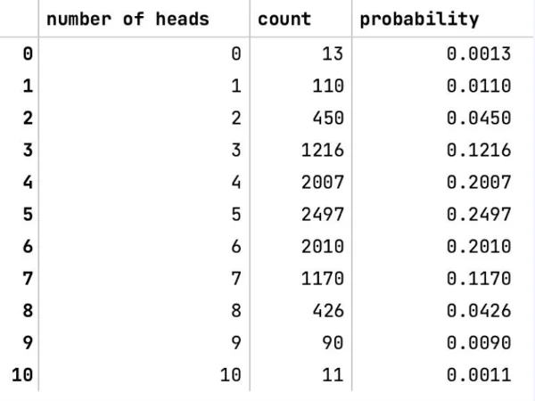
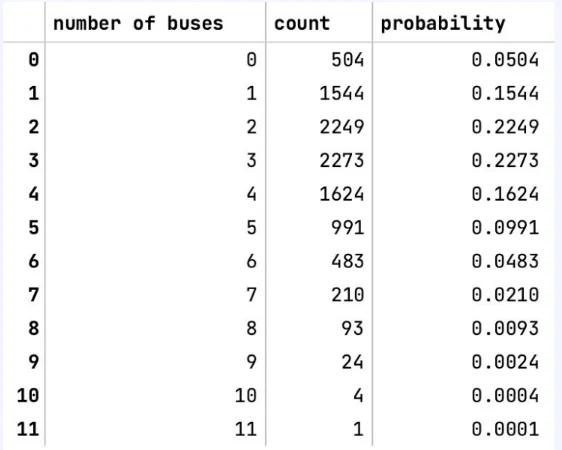
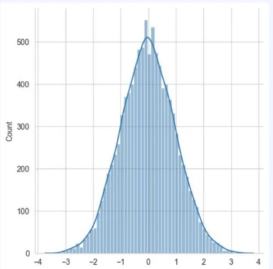
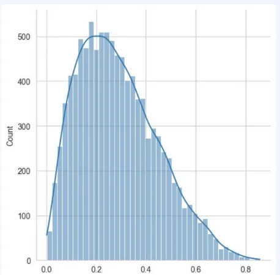

> 
> 
> 
> 
> <strong>목차</strong>
> 
> - [확률분포표, 확률밀도함수](#3f2eda9b0fe180f88be2c66057f108d9)
> - [ 확률분포표](#3f2eda9b0fe180a38309df8e3d3bf26b)
> - [ 확률밀도함수](#3f2eda9b0fe18083881edfc4282065f2)

## 확률분포표, 확률밀도함수

---

###  확률분포표

> ✏️ 
> 
> - 확률변수의 값에 대해 확률을 표로 표시한 것
> 
> - 이산형 자료의 확률 분포를 표현하기에 적합한 방식

예시

- 동전을 10번 던졌을 때 나오는 앞면의 수
    

- 1시간 이내에 정류장을 지나가는 버스의 수
    

###  확률밀도함수

> ✏️ 
> 
> 
> 
> 확률 변수의 분포를 나타내는 함수
> 
> 
> 
> 주료 연속형 자료의 확률 분포를 표현할 때 사용

예시

- 정규 분포의 확률밀도함수
    

- 베타 분포의 확률밀도함수
    

