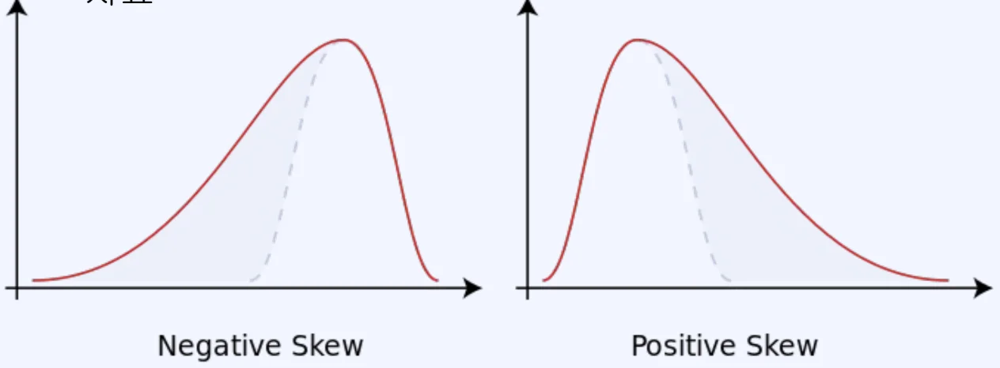
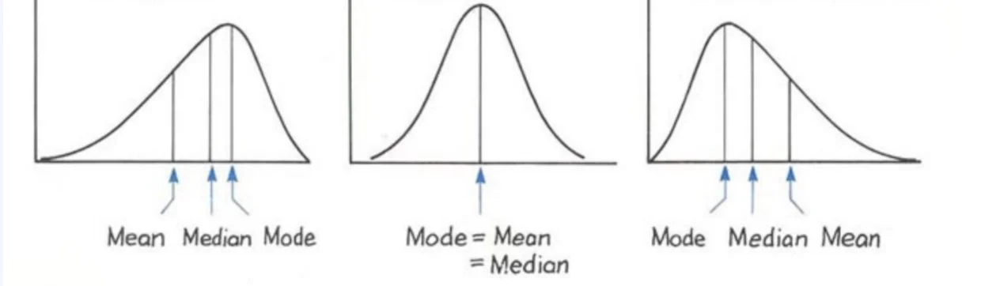
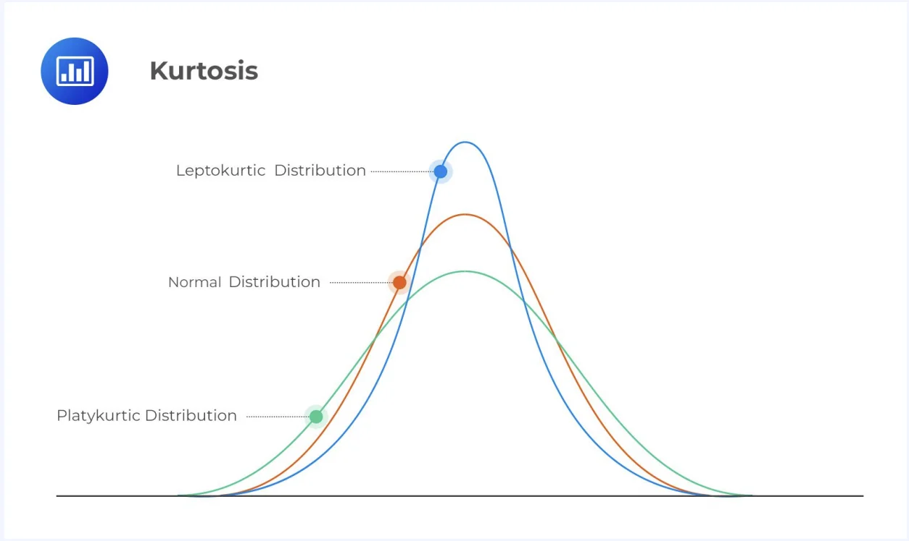

> 
> 
> 
> 
> <strong>목차</strong>
> 
> - [기초통계량3 - 왜도, 첨도](#3f2eda9b0fe18038964af1a911034653)
> - [ 왜도 (skewness)](#3f2eda9b0fe1803cad57c8ac202438c6)
> - [ 첨도 (kurtosis)](#3f2eda9b0fe18015ace8ff83003705c1)

## 기초통계량3 &#45; 왜도, 첨도

---

###  왜도 (skewness)

- 분포가 정규분포에 비해 얼마나 비대칭적인지를 나타내는 지표

###  첨도 (kurtosis)

- 평균을 중심으로 얼마나 가까이 몰려있는지 나타내는 지표

- 양쪽 꼬리의 두터움 정도를 나타내는 값

- 편차가 큰 데이터가 많을수록 커짐

- 이상치에 영향을 많이 받음
