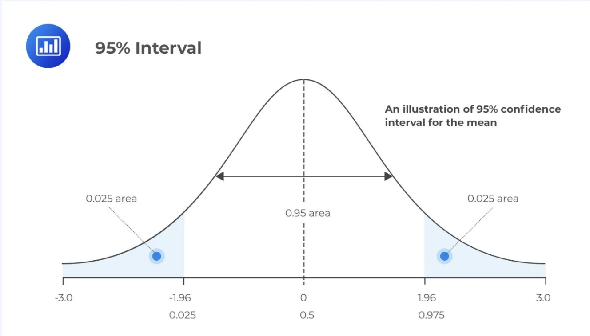
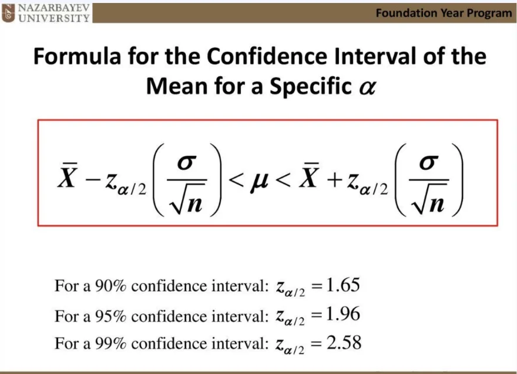
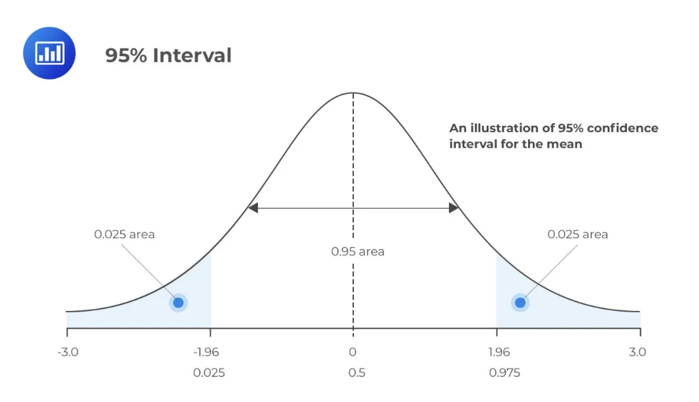

> 
> 
> 
> 
> <strong>목차</strong>
> 
> - [추정, 신뢰도, 신뢰구간](#3f2eda9b0fe180ceb325fdbf908ce69e)
> - [ 표본 추줄의 목적](#3f2eda9b0fe180d59904d1657936013a)
> - [ 신뢰도](#3f2eda9b0fe180c99307e204580d7182)
> - [ 신뢰구간](#3f2eda9b0fe1807f8a74f2e3f45bf52b)

## 추정, 신뢰도, 신뢰구간

---

###  표본 추줄의 목적

- 표본 데이터를 바탕으로 모집단을 추정하기 위함

- 표본이 커질수록 모평균에 가까워진다&#46;

###  신뢰도

- 값이 알맞은 모평균이라고 믿을 수 있는 정도

- 95%, 99%를 주로 사용

###  신뢰구간

- 모평균의 추정 구간
    

- 신뢰도에 따라, 표본의 수에 따라 정해짐
    
