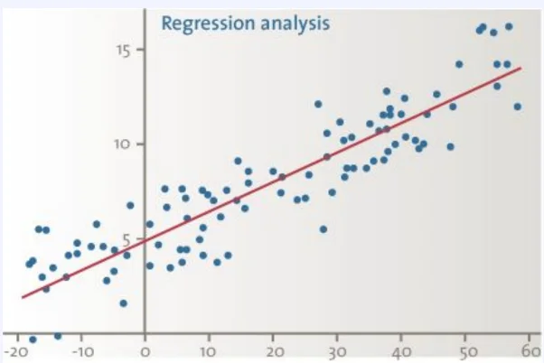

> 
> 
> 
> 
> <strong>목차</strong>
> 
> - [회귀분석](#3f2eda9b0fe1807faf23d8e4ca5adbd9)
> - [‘회귀분석’이란?](#3f2eda9b0fe180d29fa1d11b0b11de89)
> - [장단점](#3f2eda9b0fe1809ea940dd19ebdeecb7)

## 회귀분석

> 🤔 
> 
> 
> 
> 회귀분석을 공부하는 이유
> 
> - 보통의 경우 결과를 설명하기 위해서 하나의 변수만 영향을 주지 않는다&#46;
>     - <code>종속변수</code>&#58; 결과
> 
>     - <code>독립변수</code>&#58; 종속변수(결과)를 설명하기 위한 변수들

### ‘회귀분석’이란?

- 변수 사이의 모형을 구한 뒤 적합도를 측정해 내는 분석 방법

- 대표적인 모형이 선형 회귀 모형
    

### 장단점

- 장점
    - 대부분의 경우 결과를 설명하는 요인이 매우 많음

    - 둘 이상의 변수 간의 관계를 보여주는 통계적 방법

    - 종속변수에 영향을 미치는 독립변수의 영향력을 판단 가능

- 단점
    - 인과관계를 설명하지 못함
