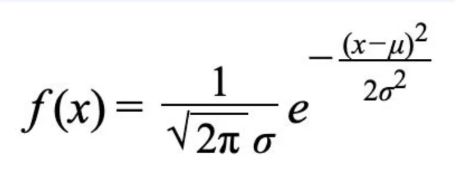
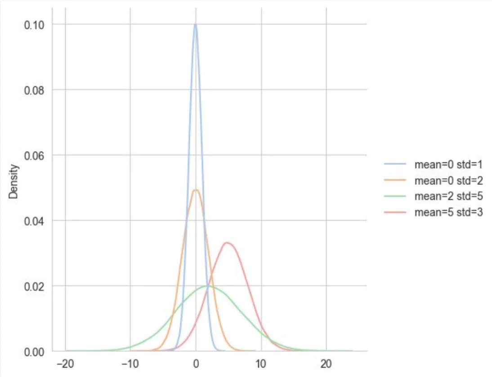
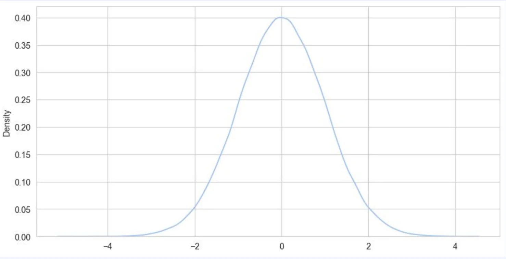
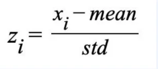

> 
> 
> 
> 
> <strong>목차</strong>
> 
> - [정규분포, 표준정규 분포, 표준화](#3f2eda9b0fe180bbb677d52ca13339b4)
> - [ 정규분포](#3f2eda9b0fe180eeac4cd9653d3c6ec8)
> - [ 표준정규분포](#3f2eda9b0fe1805e9690ec28a12b08fa)
> - [ 표준화](#3f2eda9b0fe1808e904ae41db5d72d53)

## 정규분포, 표준정규 분포, 표준화

---

###  정규분포

- 평균 <code class="language-math">&#92;mu</code> 와 표준편차 <code class="language-math">&#92;alpha</code>에 대해서 아래의 확률밀도함수를 가지는 분포
    

> 🤔 
> 
> 
> 
> <strong>정규분포는 왜 중요한가?</strong>
> 
> 
> 
> 18세기 천문학자들은 동일한 대상을 반복 측정해도 매번 조금씩 다른 값이 나온다는 사실에 주목했다&#46;
> 
> 
> 
> 이 오차들을 모아 분포를 그려보면 중심 근처에 몰리고 양 끝으로 갈수록 드물어지는, <strong><u>좌우 대칭의 종 모양</u></strong>을 그린다는 것을 발견했다&#46;
> 
> 
> 
> 천문학·물리학뿐 아니라 생물학적 측정치(키, 몸무게), 심리 검사 점수, 공정 품질 지표 등 전혀 다른 맥락에서도 같은 형태가 나타났고, 이는 자연스럽게 하나의 의문으로 이어졌다&#46;
> 
> > <strong>&#34;왜 이렇게 다양한 상황에서 비슷한 분포가 나타나는가?&#34;</strong>
> 
> 
> 
> 이 질문에 대한 답은 <strong><u><code>중심극한정리</code></u></strong><strong>이다&#46; </strong>어떤 분포를 따르든, <strong><u>독립적인 확률 변수들의 합(또는 평균)</u></strong>은 <strong><u>표본 크기가 커질수록 </u></strong><strong><u>정규분포에 수렴</u></strong>한다&#46;
> 
> 
> 
> 현실의 많은 현상이 수많은 독립적인 미세 요인들의 합산 결과이기 때문에, 개별 요인이 어떤 분포를 따르든 최종 결과는 종 모양을 띠게 된다&#46; 
> 
> - 수학적인 방법을 통해 증명됨

- 평균(mean), 표준편차(std)에 따라 달라지는 정규분포
    

    - 표준편차(std)이 클수록 옆으로 퍼지는 모양이 된다&#46; 

    - 평균(mean)에 따라 중심축이 이동한다&#46; 

###  표준정규분포

정규분포 중에서 <strong><u>평균이 </u></strong><strong><u><code>0</code></u></strong>, <strong><u>표준편차가 </u></strong><strong><u><code>1</code></u></strong>인 정규분포

###  표준화

> ✏️ 
> 
> 
> 
> - 다양한 형태의 정규 분포를 <strong><u>표준 정규 분포로 변환</u></strong>하는 방법
> 
> - 표준 정규 분포에 대한 값을 이용해 원래 분포의 확률을 구할 수 있다&#46;

> ☝🏻 
> 
> 
> 
> 표준화의 중요성
> 
> - 다양한 데이터를 균일한 기준으로 비교할 수 있음
> 
> - 이후 다양한 통계량을 구하는 과정에서 계속 등장

예시

사람의 키 분포 조사 → <code>평균&#58; 170</code>, <code>표준편차&#58; 5</code> 인 정규분포임을 확인

여기서 한 사람이 있을 때, 키가 175 &#126; 180일 확률은?

