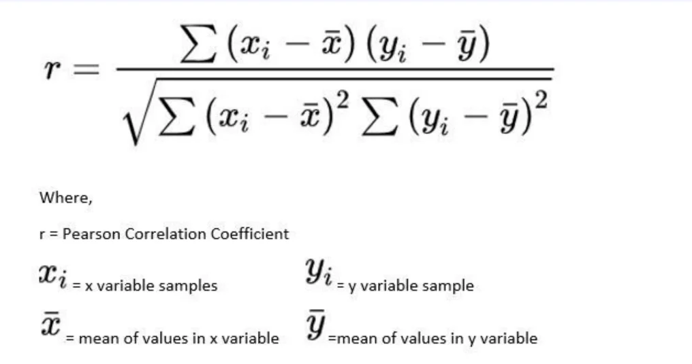

> 
> 
> 
> 
> <strong>목차</strong>
> 
> - [상관계수](#3f2eda9b0fe180678a48c6ca17bd1db2)
> - [피어슨 상관 계수(Pearson correlation coefficient)](#3f2eda9b0fe1801f848fcab1a6f8c6dd)

## 상관계수

---

### 피어슨 상관 계수(Pearson correlation coefficient)

- 상황에 따라 기준이 조금 다르지만, 절대값이 <code>0&#46;5 &#126; 0&#46;7</code> 이상이면 강한 상관관계를 가진다고 봄

- <code>&#45;0&#46;2 &#126; 0&#46;2</code> 정도인 경우 상관관계가 약하거나 없다고 해석ㄴ
