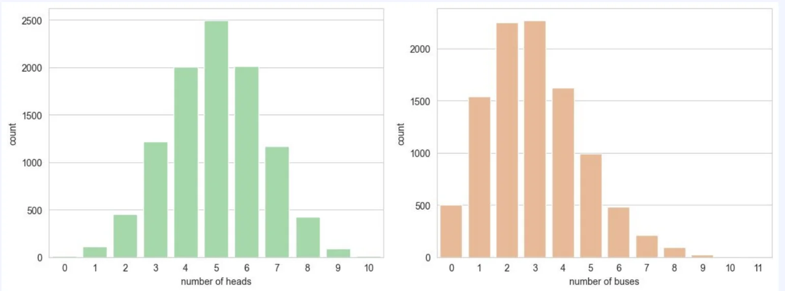
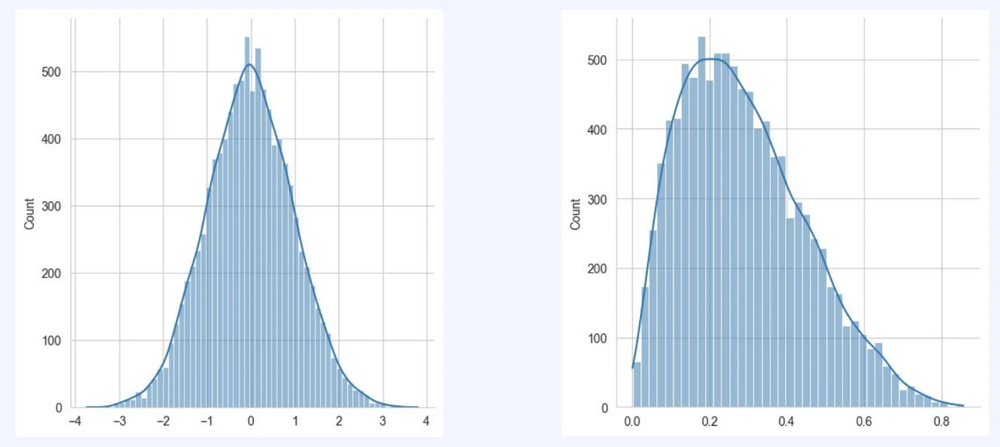

> 
> 
> 
> 
> <strong>목차</strong>
> 
> - [이산형 확률분포 와 연속형 확률분포](#3f2eda9b0fe1808a925eea8ef9ba538d)

## 이산형 확률분포 와 연속형 확률분포

> ✏️ 
> 
> 
> 
> <strong><u>데이터의 종류</u></strong>에 따라서 확률분포를 보는 방식이 조금씩 다르다&#46;

- 자료 종류
    - 범주형 자료 ( categorical )
        - 자료의 범위가 몇개의 범주로 한정되는 경우를 의미

        - ex) <code>혈액 (A, B, O, AB &#46;&#46;)</code>, <code>차량(소형, 중형, 대형 …)</code>

    - 양적 자료 
        - 수치적으로 표현 가능한 자료 의미

        - 양적 자료는 수치로 표현되는 자료로써 연산 처리 가능

        - ex) <code>키</code>, <code>몸무게</code> 등

- 범주형 자료
    - 명목형 자료
        - 순서 X

        - 

    - 순서형 자료

> ✏️ 
> 
> - 범주형 자료
>     - 명목형 자료
> 
>     - 순서형 자료
> 
> - 양적 자료
>     - 이산형 자료 
> 
>     - 연속형 자료
> 
>     ---
> 
>     - 구간형 자료
> 
>     - 비율형 자료

- 이산형 자료, 이산형 확률분포
    

- 연속형 자료, 연속형 확률 분포
    
