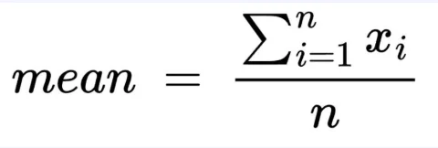
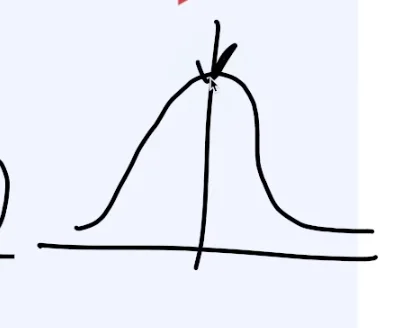
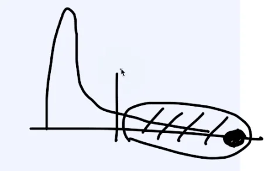
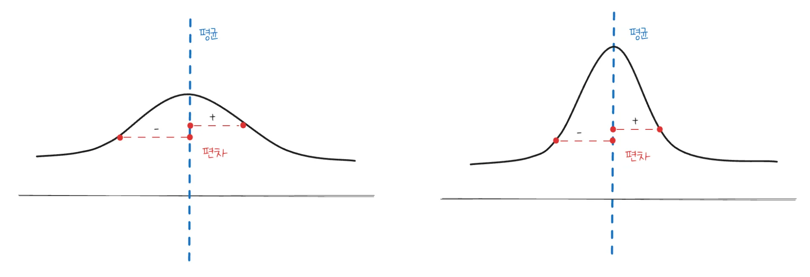
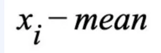
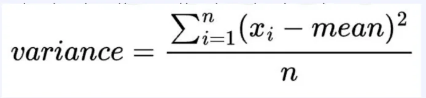
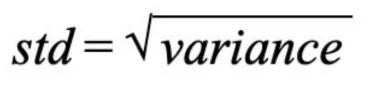
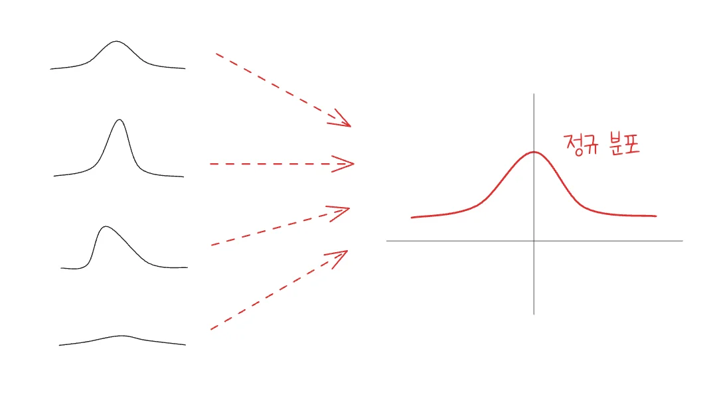

> 
> 
> <a id="3f2eda9b0fe1808bbecff1ba944082cf"></a>
> 
> <strong>목차</strong>
> 
> - [평균, 분산, 표준편차  (도수 있는 경우, 없는 경우)](#3f2eda9b0fe180b8840aeadf57b45ef0)
> - [평균(mean)](#3f2eda9b0fe180fb9a6edd830d81addd)
> - [분산(variance) ](#3f2eda9b0fe180c78fb1d60594f35915)
> - [편차(deviation)](#3f2eda9b0fe180869e48dab44462b94d)
> - [분산 (variance) ](#3f2eda9b0fe18040a896f750decbb7e9)
> - [표준편차 (standard deviation )](#3f2eda9b0fe180509266fc558c5e9b71)

<a id="3f2eda9b0fe180b8840aeadf57b45ef0"></a>

## 평균, 분산, 표준편차  (도수 있는 경우, 없는 경우)

---

<a id="3f2eda9b0fe180fb9a6edd830d81addd"></a>

### <code>평균(mean)</code>

> 💬 
> 
> <a id="3f2eda9b0fe180bfb614f4d11abd30ca"></a>
> 
> 상황에 따라서 쓰이는 평균은 조금 다르지만, <strong><u>기본</u></strong>적으로 <code>산술 평균</code>을 많이 사용한다&#46; 
> 
> - ex) <code>산술 평균</code>, <code>기하 평균</code>, <code>조화 평균</code> …
>     - <code>조화 평균</code>&#58; recall, precision 등을 활용해 F1 스코어 구하는 등의 경우에 사용

> ✏️ 
> 
> <a id="3f2eda9b0fe1804888d8f9330596a380"></a>
> 
> <strong>산술 평균</strong>
> 
> 
> 
> - <code>변량의 합(</code><code class="language-math">&#92;Sigma{x}</code><code>)</code>을 <code>변량의 수(n)</code>로 나눈 값

<details>
<summary>예시 &#45; 파이썬</summary>

<a id="3f2eda9b0fe180aab60be249d869ae1e"></a>

```python
df['value'].mean()
```

- 출력&#58; <code>168&#46;91175358050074</code>

</details>

<a id="3f2eda9b0fe18002a181ce10f53cc195"></a>

일반적으로 <code>평균</code>은 전체 분포에서 가운데 값을 의미하기 때문에 굉장히 중요한 대표값이다&#46; 



<a id="3f2eda9b0fe18008a54cc51f447f4e47"></a>

그러나 아래와 같은 <strong><u>편향된 데이터 분포</u></strong><u>를 가지는 경우</u>, 평균값이 해당 집단을 대표한다 라고 보기 어렵다&#46; 

<a id="3f2eda9b0fe180089673fd391b8834e3"></a>

따라서 경우에 따라 <code>중앙값(중위값)</code> 등 <strong><u>다른 통계량에 대해서도 반드시 확인</u></strong>해야 한다&#46;



<a id="3f2eda9b0fe180c78fb1d60594f35915"></a>

### <code>분산(variance)</code> 

> ✏️ 
> 
> 
> 
> <a id="3f2eda9b0fe18034a808c0d6a8f6e2c9"></a>
> 
> <u><code>변량</code></u><u>이 </u><u><code>중심(평균)</code></u><u>에서 </u><strong><u>얼마나 떨어져있는지</u></strong>를 보기 위한 지표(통계량)

<a id="3f2eda9b0fe180869e48dab44462b94d"></a>

#### <code>편차(deviation)</code>

> ✏️ 
> 
> <a id="3f2eda9b0fe180338c9ec54c5c078277"></a>
> 
> 변량에서 평균을 뺀 값



<a id="3f2eda9b0fe18040a896f750decbb7e9"></a>

#### <code>분산 (variance)</code> 

> ✏️ 
> 
> <a id="3f2eda9b0fe180b1a0a8f26bb49db3f7"></a>
> 
> <code>모든 변량과 편차의 차에 대한 제곱을 합</code>을 <code>변량의 수</code> 만큼 나눈 값
> 
> - 편차의 경우, <strong>음수도 존재</strong>하기 때문에 제곱 처리



<a id="3f2eda9b0fe180509266fc558c5e9b71"></a>

### <code>표준편차 (standard deviation )</code>

> ✏️ 
> 
> <a id="3f2eda9b0fe1803cb5e3e5116d2b64ac"></a>
> 
> <strong><u>관찰값들이 얼마나 흩어져 있는 지</u></strong>를 <strong><u>하나의 수치</u></strong>로 나타내는 통계량
> 
> <a id="3f2eda9b0fe180bf82d2f58b498600d5"></a>
> 
> 관측된 변량의 <strong><u>스케일을 </u></strong><strong><u>표준화</u></strong>할 수 있는 좋은 방법
> 
> - 분산(<code class="language-math">&#92;frac{&#92;Sigma{편차}^2}{평균}</code>) 에서 제곱으로 수가 커졌기 때문에, <br>다시 <u>제곱근(</u><code class="language-math">&#92;sqrt{분산}</code><u>) 연산</u>을 통해 스케일을 맞춘다<br> → <strong><u>정규화</u></strong>
> 
> - 편차의 평균(산술 평균 X) 과 비슷한 의미를 가지는 통계향

- <code>표준편차</code> = 분산(variance) 제곱근
    

> ✏️ 
> 
> <a id="3f2eda9b0fe1804bad2ce4ee60cb14dc"></a>
> 
> <u>여러 형식으로 분포들</u>을 <strong><u>정규화</u></strong>를 통해 <code>정규 분포</code> 형태로 변환
> 
> <a id="3f2eda9b0fe180abb74add54aa6bcbdf"></a>
> 
> 이러한 변환의 기준이 되는 통계량이 <code>표준 편차</code>이다&#46; 
> 
> -  표준편차&#58; <code>분산</code>에 대해서 <u>정규화(제곱급)</u>를 진행


