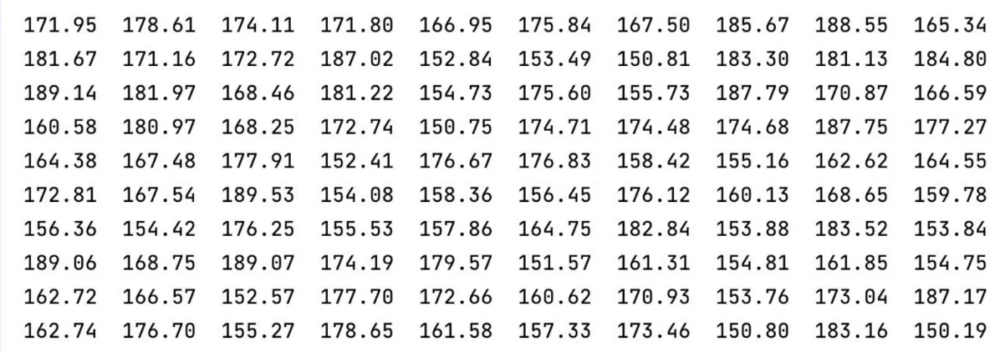
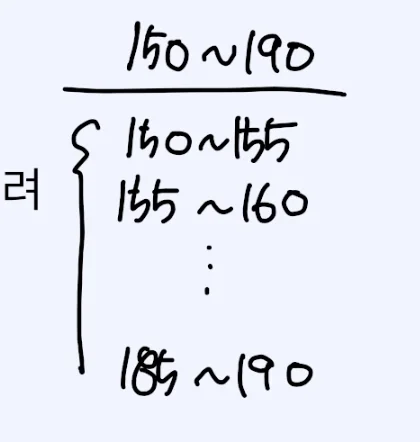
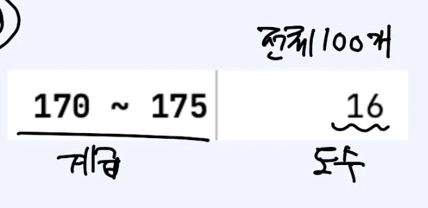
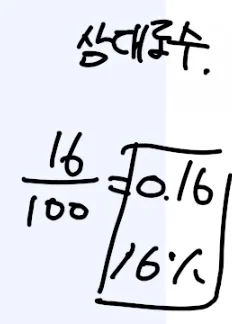
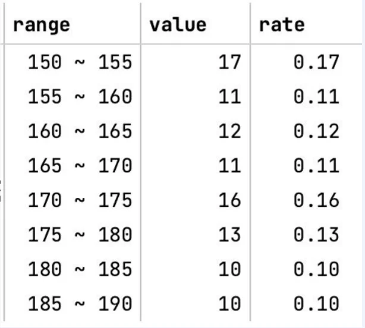
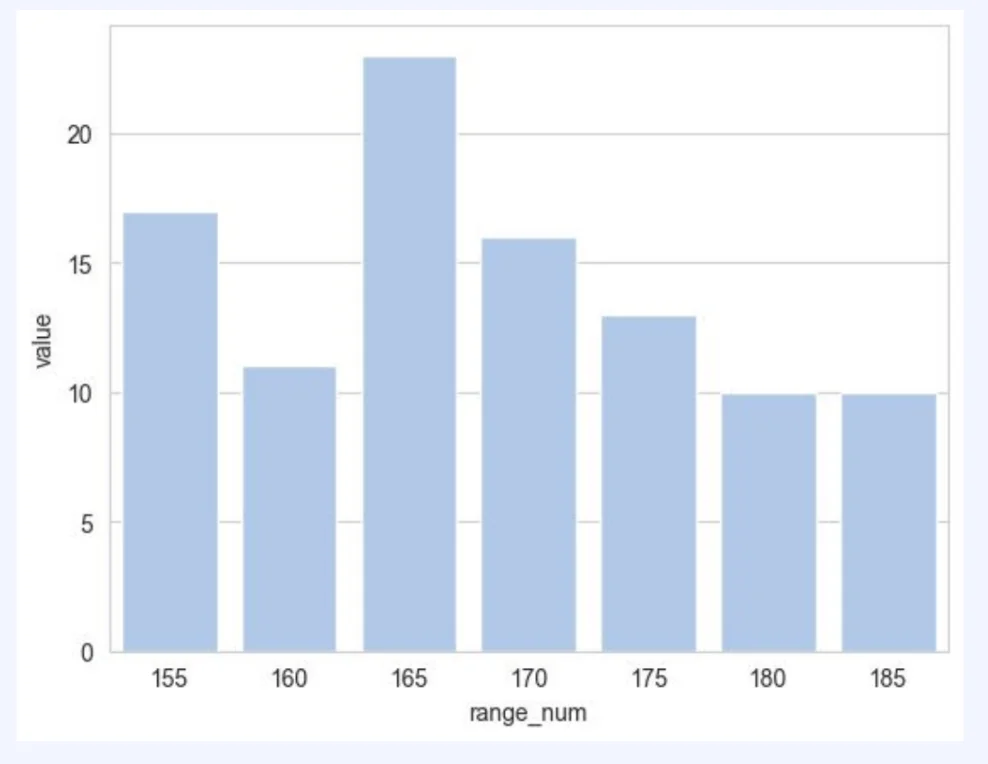
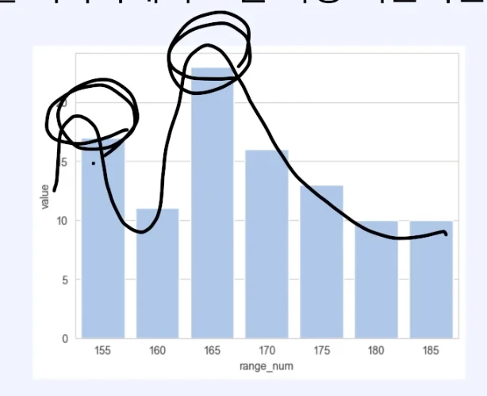

> 
> 
> 
> 
> <strong>목차</strong>
> 
> - [변량, 도수, 상대도수, 도수분포표, 히스토그램](#3f2eda9b0fe180788cb2e12d87c68959)
> - [변량](#3f2eda9b0fe180578678d1a7089cfaeb)
> - [계급](#3f2eda9b0fe1801391acf4aac6f7348b)
> - [도수](#3f2eda9b0fe1800d92a7c0b3e1e37aef)
> - [상대 도수](#3f2eda9b0fe1803f830ec73b7a4efc34)
> - [도수 분포표](#3f2eda9b0fe180d7a1e9c76b1647af71)
> - [히스토그램](#3f2eda9b0fe18064a726cabcc0b36421)

## 변량, 도수, 상대도수, 도수분포표, 히스토그램

---

### <code>변량</code>

> ✏️ 
> 
> 
> 
> <strong>변량</strong>
> 
> 
> 
> 자료의 수치, 즉 데이터의 값을 의미하는 용어

> 🤔 
> 
> 
> 
> 변량은 키, 나이(숫자)뿐만 아니라 혈액형, MBTI 등 <strong><u>특정 타입에 관계없이 데이터의 값</u></strong>을 의미한다&#46;

- 위와  같은 데이터들의 각 값들을 <code>변량</code>이라 한다&#46; 

### <code>계급</code>

> ✏️ 
> 
> 
> 
> 어느 정도 구간을 가지고 데이터를 묶어야 할지에 대한 기준
> 
> - 변량을 일정한 간격으로 나눈 구간
> 
> - 계급을 정할 때 변량의 최소, 최대를 고려

> 🤔 
> 
> 
> 
> 데이터 전체의 개형을 파악할 수 있는 적당한 수치로 계급(구간)을 나눠 도수를 구해야 한다&#46;
> 
> - 적당한? 굉장히 애매한 표현
> 
> - 구간을 너무 크게 잡거나, 너무 작게 잡지 않고 적당한 구간을 잡아야 전체 개형 파악이 가능하다&#46;
>     - 도수 분포의 목적 
> 
> ---
> 
> 

> 
예시 &#45; <code>1 cm</code>

> 
> 
> 
> 1cm 단위로 나눌 시 약 40 개의 구간이 생기며 이는 100개의 데이터 중 실제 구간들의 각 데이터 분포 개수가 약 2 &#126; 3 정도가 된다&#46; 
> 
> 
> 
> 애매해 진다&#46; ? → 왜 애매하지?
> 
> 

> 
> 

> 
예시 &#45; <code>20 cm</code>

> 
> 
> 
> 150 &#126; 170, 170 &#126; 190 
> 
> 
> 
> 데이터의 전체 분포를 보기 어려움 
> 
> 

### <code>도수</code>

> ✏️ 
> 
> 
> 
> 각 계급에 속하는 변량의 개수

### <code>상대 도수</code>

> ✏️ 
> 
> 
> 
> 각 계급에 속하는 변량의 비율
> 
> > <code class="language-math">&#92;frac{도수(해당 계급의 개수)}{전체 개수}</code>

### <code>도수 분포표</code>

> ✏️ 
> 
> 
> 
> 주어진 자료를 계급에 따라 나눈 표
> 
> 
> 
> 아래의 표와 같이 <code>계급</code>, <code>도수</code>, <code>상대 도수</code>를 보기 쉽게 표현한다&#46;

> 💬 
> 
> 
> 
> 정렬 기준
> 
> - 순서가 있는 경우, 순서대로 요약
> 
> - 순서가 없는 경우, 도수가 큰 값이나 강조하고 싶은 계급을 더 위에 정렬

> 💬 
> 
> - 장점
>     - 구간별 분포를 한눈에 알아보기 좋다&#46; 
> 
> - 단점
>     - 각 변량의 정확한 값 생략
>         - 계급 구간 안에 존재하는 실제 값에 대해서 파악 불가능

### <code>히스토그램</code>

> ✏️ 
> 
> 
> 
> <strong>도수분포표</strong>를 <code>시각화</code>해서 보는 <strong><u>가장 기본</u></strong>적인 방법
> 
> 
> 
> - Pivot chart와 비슷한형태
> 
> 
> 
> 데이터가 많아지고 구간이 넓어지며 세분화 되어 쪼개지는 상황들이 많이 발생되는 경우, 표 보다는 차트 형태가 전체적인 개형을 파악하는 데 용이하다&#46;

- 위와 같이 히스토그램으로 각 계급의 변량을 시각화하여 한눈에 전체 데이터의 개형을 파악할 수 있다&#46;
