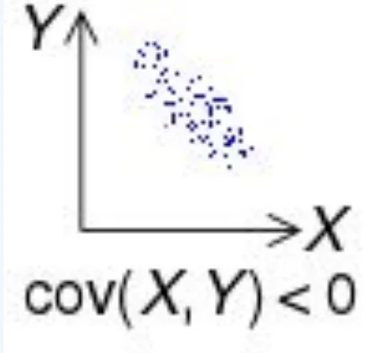
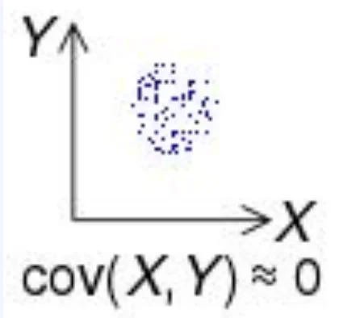
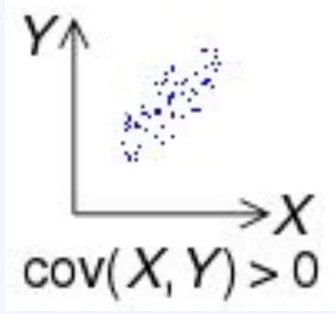

> 
> 
> 
> 
> <strong>목차</strong>
> 
> - [공분산](#3f2eda9b0fe1804986e3ce30a5b7d2cd)
> - [ 공분산](#3f2eda9b0fe180cf9170e402872f78b5)
> - [ 표본공분산](#3f2eda9b0fe180f593a4ccebe980959a)
> - [ 주의점](#3f2eda9b0fe180a6b5c4fafb8faba2d6)

## 공분산

---

###  공분산

- 2개의 확률변수의 선형 관계를 나타내는 값

- 부호
    - <code>&#45;</code>&#58; 음의 상관관계

    - <code>0</code>&#58; 상관관계 없음

    - <code>&#43;</code>&#58; 양의 상관관계

###  표본공분산

<code class="language-math">Cov(X, Y) = &#92;frac{&#92;Sigma&#95;i^n(X&#95;i &#45; &#92;overline{&#92;vphantom{M}X})(Y&#95;i &#45; &#92;overline{&#92;vphantom{M}Y})}{n&#45;1}</code>

###  주의점

> <code>두변수 독립 변수</code> → <code>공분산 = 0</code>, 그 역은 성립 할수도 안할수도 있음

- 두 변수가 아무 관계 없는 독립 변수일 때
    - 공분산 = 0

- 공분산 = 0
    - 두 변수가 독립은 아닐 수 있음
