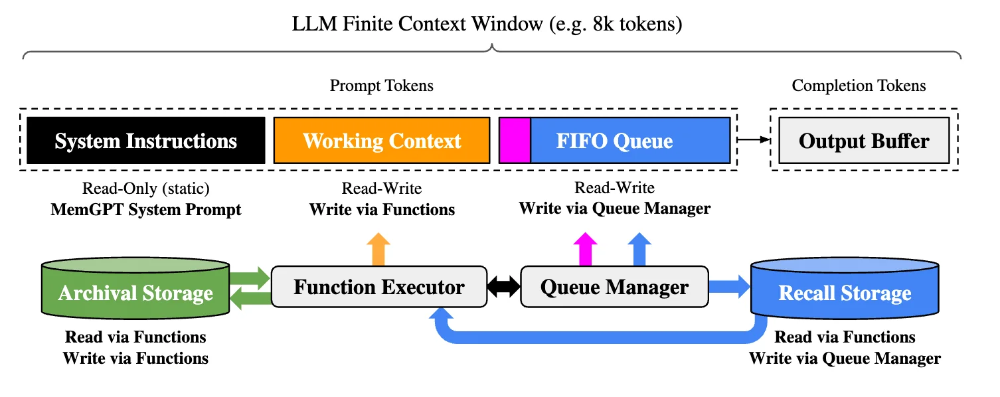
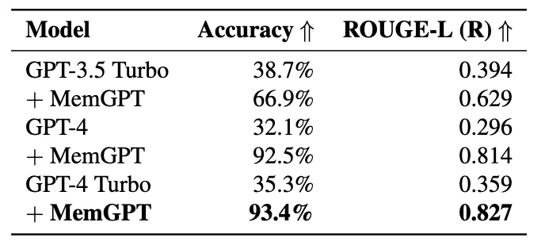
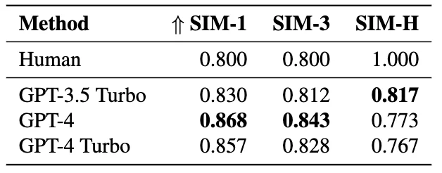
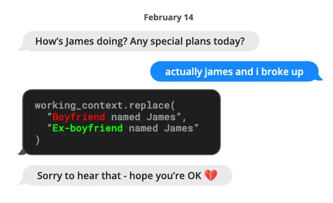

## 논문 리뷰&#58; MemGPT (OS 가상 메모리)

---

[MemGPT&#58; Towards LLMs as Operating Systems]()

- 접근 방식&#58;  <code>가상 메모리 페이징</code> 
    > 컨텍스트 윈도우를 <strong><u>제한된 메모리 자원으로 취급</u></strong>하며, 전통적인 운영체제에서 사용되는 메모리 계층 구조와 유사한 LLM용 메모리 계층 구조를 설계함

    - 애플리케이션이 <strong><u>메인 메모리와 디스크 사이에서 데이터를 </u></strong><strong><u>페이징</u></strong>함으로써 <strong><u>사용 가능한 메모리를 훨씬 초과</u></strong>하는 데이터셋 작업 가능

    - <code>함수 호출</code>을 사용하여 LLM 에이전트는 <u>외부 데이터 소스를 읽</u>고 쓰고, <u>자신의 컨텍스트를 수정</u>하며, <u>사용자에게 응답을 반환할 시점 선택</u> 가능
        - LLM 에이전트의 최근 함수 호출(function calling) 능력 향상(Schick et al&#46;, 2023; Liu et al&#46;, 2023b)을 활용하여 가상 컨텍스트 관리를 위한 <strong><u>운영체제 기반 LLM 시스템</u></strong>인 MemGPT 설계

        - 이러한 기능들을 통해 LLM은 전통적인 운영체제의 계층적 메모리와 유사하게 컨텍스트 윈도우(운영체제의 &#34;메인 메모리&#34;에 해당)와 외부 저장소 사이에서 정보를 효과적으로 &#34;페이징” 함

    

    ### 운영체제(OS)의 가상 메모리 페이징

    - 전통적인 운영 체제(OS)의 애플리케이션은 <strong><u>가상 메모리</u></strong>와 상호작용

    - 가상 메모리는 OS가 <strong><u>오버플로우 데이터를 디스크로 페이징</u></strong>하고, 애플리케이션이 데이터에 접근할 때 페이지 폴트(page fault)를 통해 데이터를 메모리로 다시 가져옴으로써, <strong><u>실제(즉, 메인) 메모리보다 더 많은 메모리 자원이 존재하는 것과 같이 활용</u></strong> 가능

    [현대 운영체제 가상 메모리 시스템의 아키텍처 및 메커니즘 분석](#/post/3f4eda9b-0fe1-8004-89ff-c68ec5620797)

    

    ### LLM OS → 가상 메모리 

    

    더 긴 컨텍스트 길이의 환상(가상 메모리와 유사함)을 제공하기 위해  LLM이 자체 컨텍스트(물리적 메모리와 유사함)에 무엇을 배치할지 &#39;LLM OS&#39;를 통해 관리하도록 허용한다&#46; 

    - function call 을 통해 파일 시스템에 context를 저장하고 불러옴으로써 해결

    -  LLM이 컨텍스트 내에 배치되지 않아 누락된 관련 과거 데이터 검색 가능

    - 덜 중요한 데이터를 컨텍스트에서 외부 저장 시스템으로 내보낼 수 있게 함

메모리 계층 구조, OS 기능, 이벤트 기반 제어 흐름을 결합하여 사용함으로써 MemGPT는 유한한 컨텍스트 윈도우를 가진 LLM을 사용하여 무제한 컨텍스트를 처리할 수 있

새로운 OS 기반 LLM 시스템의 유용성을 입증

유한한 컨텍스트로 인해 심각하게 제한되는 두 가지 영역에서 MemGPT를 평가

1. 문서 분석
    -  표준 텍스트 파일의 길이가 현대 LLM의 입력 용량을 빠르게 초과할 수 있

1. 대화형 에이전트
    - 제한된 대화 윈도우에 묶인 LLM은 확장된 대화 중에 컨텍스트 인식, 페르소나 일관성, 장기 기억력이 부족

 MemGPT의 OS 기반 다단계 메모리 아키텍처는 두 가지 주요 메모리 유형을 구분

1. <code>메인 컨텍스트(메인 메모리/물리적 메모리/RAM과 유사)</code>
    - LLM 프롬프트 토큰으로 구성

    - 메인 컨텍스트에 있는 모든 것은 컨텍스트 내(in&#45;context)에 있는 것으로 간주되어 추론 중에 LLM 프로세서가 접근할 수 있음

1. <code>외부 컨텍스트(디스크 메모리/디스크 저장소와 유사)</code>
    - LLM의 고정된 컨텍스트 윈도우 외부에 보관되는 모든 정보를 의미

    - 이러한 컨텍스트 외부 데이터는 추론 중에 LLM 프로세서로 전달되기 위해 항상 명시적으로 메인 컨텍스트로 이동되어야 함

이를 function call 을 통해 사용자 개입 없이 LLM이  자체적으로 메모리를 제어할 수 있도록 함

메인 컨텍스트(프롬프트 토큰) MemGPT의 프롬프트 토큰은 <code>시스템 지침</code>, <code>워킹 컨텍스트</code>, <code>FIFO 큐</code>라는 세 개의 연속된 섹션으로 나눔

1. <code>시스템 지침 (System Instruction)</code>
    - 읽기 전용(정적)

    -  MemGPT 제어 흐름, 다양한 메모리 레벨의 의도된 사용법, MemGPT 함수 사용 방법(예&#58; 컨텍스트 외부 데이터 검색 방법)에 대한 정보 포함

1. <code>워킹 컨텍스트 (Working Context)</code>
    - 비정형 텍스트의 고정 크기 읽기/쓰기 블록

    - MemGPT <strong><u>함수 호출을 통해서만 쓰기가 가능</u></strong>

    - 대화형 설정에서 워킹 컨텍스트는 <strong><u>사용자와 에이전트가 채택한 페르소나에 대한 핵심 사실, 선호도 및 기타 중요한 정보를 저장</u></strong>하여 에이전트가 사용자와 유창하게 대화할 수 있도록 하는 데 사용

1. <code>FIFO 큐 (FIFO Queue)</code>
    - 에이전트와 사용자 간의 메시지, 시스템 메시지(예&#58; 메모리 경고), 함수 호출 입력 및 출력을 포함하여 메시지의 순환 기록을 저장

    - FIFO 큐의 첫 번째 인덱스는 큐에서 제거된 메시지의 재귀적 요약을 포함하는 시스템 메시지를 저장함

1. <code>큐 매니저 (Queue Manager)</code>
    - 리콜 저장소와 FIFO 큐의 메시지 관리

    -  시스템이 새로운 메시지를 수신하면 큐 관리자는 들어오는 메시지를 FIFO 큐에 추가하고, 프롬프트 토큰을 연결하며, LLM 추론을 트리거하여 LLM 출력(완성 토큰) 생성

    - 큐 관리자는 들어오는 메시지와 생성된 LLM 출력을 모두 리콜 저장소(MemGPT 메시지 데이터베이스)에 기록함
        - MemGPT 함수 호출을 통해 리콜 저장소의 메시지가 검색되면 큐 관리자는 이를 뒤쪽에 추가함

### 특징

- <code>고정된 컨텍스트를 가진 LLM 프로세서</code>
    - 계층적 메모리 시스템과 스스로 메모리를 관리할 수 있게 해주는 함수들로 보강됨

- <code>LLM의 프롬프트 토큰(입력) 또는 메인 컨텍스트</code>
    - 시스템 지침, 작업 컨텍스트, 그리고 FIFO 큐로 구성

    - LLM 완료 토큰(출력)은 함수 실행기에 의해 함수 호출로 해석

    - MemGPT는 함수를 사용하여 메인 컨텍스트와 외부 컨텍스트(아카이브 및 리콜 저장소 데이터베이스) 간에 데이터를 이동함

    -  LLM은 출력에 특수 키워드 인수(request heartbeat=true)를 생성하여 함수 호출을 연쇄적으로 수행하도록 즉각적인 후속 LLM 추론을 요청할 수 있음

- <code>함수 연쇄</code>
    - MemGPT가 사용자 질의에 답하기 위해 다단계 검색을 수행할 수 있게 하는 요소이며, 큐를 다시 LLM의 컨텍스트 윈도우로 삽입합니다&#46;

- <code>큐 관리자</code>
    - 큐 퇴거 정책을 통해 컨텍스트 오버플로우를 제어할 책임이 있음

    - 프롬프트 토큰이 기본 LLM 컨텍스트 윈도우의 &#39;경고 토큰 수&#39;(예&#58; 컨텍스트 윈도우의 70%)를 초과하면, 큐 관리자는 큐에 시스템 메시지를 삽입하여 LLM에게 임박한 큐 퇴거(&#39;메모리 압박&#39; 경고)를 알림

    - 이를 통해 LLM은 MemGPT 함수를 사용하여 FIFO 큐에 포함된 중요한 정보를 작업 컨텍스트나 아카이브 저장소(임의 길이의 텍스트 객체를 저장하는 읽기/쓰기 데이터베이스)에 저장할 수 있음

    - 프롬프트 토큰이 &#39;플러시 토큰 수&#39;(예&#58; 컨텍스트 윈도우의 100%)를 초과하면,큐 관리자는 컨텍스트 윈도우의 공간을 확보하기 위해 큐를 플러시

    - 큐 관리자는 특정 수의 메시지(예&#58; 컨텍스트 윈도우의 50%)를 퇴거시키고, 기존의 재귀적 요약과 퇴거된 메시지를 사용하여 새로운 재귀적 요약을 생성함

    - 큐가 플러시되면 퇴거된 메시지는 더 이상 컨텍스트 내에 존재하지 않아 LLM이 즉시 볼 수 없게 되지만, 해당 메시지들은 리콜 저장소에 무기한 저장되며 MemGPT 함수 호출을 통해 읽을 수 있음

- <code>함수 실행기(완료 토큰 처리) MemGPT</code>
    - LLM 프로세서에 의해 생성된 함수 호출을 통해 메인 컨텍스트와 외부 컨텍스트 간의 데이터 이동을 조정함

- <code>메모리 편집 및 검색</code>
    - 전적으로 자기 주도적 

    - MemGPT는 현재 컨텍스트를 기반으로 자신의 메모리를 자율적으로 업데이트하고 검색함

예를 들어, 대화 기록이 너무 길어질 때(그림 1 참조) 컨텍스트 간에 항목을 이동하거나, 현재 목표와 책임에 대한 진화하는 이해를 더 잘 반영하도록 메인 컨텍스트를 수정할 시점을 결정할 수 있습니다(그림 3 참조)&#46; 

- 명시적인 지침을 시스템 지침 내에 제공함으로써 자기 주도적 편집 및 검색 구현
    1.  메모리 계층 구조와 각 유틸리티에 대한 상세 설명

    1. 2&#46; 시스템이 메모리에 접근하거나 수정하기 위해 호출할 수 있는 함수 스키마(자연어 설명 포함)

    

    각 추론 주기 동안 LLM 프로세서는 메인 컨텍스트(단일 문자열로 연결됨)를 입력으로 받아 출력 문자열을 생성

    

    이 출력 문자열은 정확성을 보장하기 위해 MemGPT에 의해 파싱되며, 파서가 함수 인수를 검증하면 해당 함수가 실행됨

    

    메인 컨텍스트가 최대 용량일 때 추가를 시도하는 경우와 같이 발생하는 런타임 오류를 포함한 결과는 MemGPT에 의해 프로세서로 다시 피드백됨

    

    이 피드백 루프를 통해 시스템은 자신의 행동으로부터 학습하고 그에 따라 행동을 조정할 수 있음&#46;

    

     컨텍스트 제한에 대한 인식은 자기 편집 메커니즘을 효과적으로 작동시키는 핵심 요소이며, 이를 위해 MemGPT는 프로세서에 토큰 제한에 관한 경고를 제공하여 메모리 관리 결정을 안내

    

    또한, 당사의 메모리 검색 메커니즘은 이러한 토큰 제약을 인지하도록 설계되었으며, 검색 호출이 컨텍스트 윈도우를 넘치게 하지 않도록 페이징 구현

### 실험 지표 해석

위 표는 MemGPT가 Deep Memory Retrieval (DMR) 작업에서 기존 LLM 모델(GPT&#45;3&#46;5 Turbo, GPT&#45;4, GPT&#45;4 Turbo)의 성능을 얼마나 효과적으로 개선하는지 보여주는 결과이다&#46;

DMR 작업은 에이전트가 이전 대화 세션에서 다루었던 구체적인 사실을 기억하고 답해야 하는, 일관성 유지 능력을 평가하는 핵심 지표이다&#46; 

#### 주요 분석 결과

- 성능 향상 
    - 모든 모델에서 &#43; MemGPT를 적용했을 때, &#42;&#42;Accuracy(정확도)&#42;&#42;와 ROUGE&#45;L(R) 점수가 대폭 상승했습니다&#46;
        - <code>GPT&#45;4</code>&#58; 기본 모델의 정확도는 32&#46;1%에 불과했으나, MemGPT를 탑재하자 &#42;&#42;92&#46;5%&#42;&#42;로 약 3배 가까이 급증했습니다&#46;

        - <code>GPT&#45;4 Turbo</code>&#58; 가장 높은 정확도인 &#42;&#42;93&#46;4%&#42;&#42;를 기록하며 MemGPT의 효과가 극대화됨을 보여줍니다&#46;

- ROUGE&#45;L (R)의 의미&#58; 
    - 이 지표는 생성된 답변이 &#39;gold answer(정답)&#39;와 얼마나 텍스트적으로 일치하는지를 측정함&#46; 

    - 점수가 높을수록 에이전트가 과거의 대화 내용을 정확하게 인지하여 일관성 있고 맥락에 맞는 답변을 생성하고 있음을 의미

- 운영체제 설계의 유효성&#58; 
    - 기본 모델들은 제한된 컨텍스트 윈도우 때문에 과거 정보를 잃어버리거나 요약된 정보에 의존해야 하지만, 

    - MemGPT는 전통적인 운영체제의 페이징(paging) 기법을 사용하여 필요한 과거 정보를 외부 저장소에서 메인 컨텍스트로 불러옴으로써 이러한 한계를 극복함

- 연구적 관점&#58;
    - 이 결과는 단순히 모델의 컨텍스트 윈도우 크기를 늘리는 것(Context scaling)만으로는 &#39;기억&#39; 문제를 완전히 해결할 수 없음을 시사

    - 최근 연구들은 MemGPT의 아이디어를 확장하여, 에이전트가 메모리를 더 효율적으로 관리하도록 만드는

    - MemLLM(Modarressi et al&#46;)과 같은 방식으로 발전하고 있음 

    - 이는 정적인 모델에 동적인 &#39;운영체제적 사고&#39;를 결합하는 것이 미래 AI 시스템의 필수적인 방향임을 보여줍니다&#46;

#### MemGPT가 사용하는 페이징 기법과 실제 운영체제의 가상 메모리 관리 방식은 어떤 점이 가장 유사한가요?

MemGPT가 제안하는 &#42;&#42;&#39;가상 컨텍스트 관리&#39;&#42;&#42;는 현대 운영체제의 가상 메모리(Virtual Memory) 및 페이징(Paging) 시스템의 논리를 LLM 환경에 완벽하게 이식한 것이다&#46;

 두 시스템은 &#34;한정된 물리적 자원을 사용하여 더 큰 논리적 자원을 활용한다&#34;는 근본적인 목적을 공유한다&#46;

1. 메모리 계층화 (Hierarchical Memory)&#58;
    - 운영체제&#58; 
        - 빠른 속도의 &#42;&#42;RAM(물리 메모리)&#42;&#42;과 속도는 느리지만 용량이 큰 &#42;&#42;HDD/SSD(디스크/스왑 공간)&#42;&#42;로 계층을 나눕니다&#46;

    - MemGPT&#58; 
        - LLM의 제한된 &#42;&#42;컨텍스트 윈도우(메인 컨텍스트)&#42;&#42;를 RAM에, 방대한 과거 대화와 문서가 저장된 &#42;&#42;회상/아카이브 저장소(외부 컨텍스트)&#42;&#42;를 디스크에 비유합니다&#46;

1. 페이지 폴트와 데이터 페이징&#58;
    - 운영체제&#58; 
        - 프로그램이 필요한 데이터가 RAM에 없을 때 &#42;&#42;&#39;페이지 폴트(Page Fault)&#39;&#42;&#42;가 발생하고, OS는 디스크에서 해당 데이터를 RAM으로 불러와 실행을 계속합니다&#46;

    - MemGPT&#58; 
        - LLM이 주어진 질문에 답하기 위해 과거의 특정 정보가 필요할 때, 해당 정보를 컨텍스트에 가지고 있지 않으면 &#42;&#42;함수 호출(Function Call)&#42;&#42;을 통해 외부 저장소를 검색합니다&#46; 이 과정이 페이지 폴트 처리와 매우 유사하게 작동합니다&#46;

1. 컨텍스트 스와핑 및 관리 (Eviction Policy)&#58;
    - 운영체제&#58;
        -  RAM이 꽉 차면 LRU(Least Recently Used) 등의 알고리즘을 사용해 오랫동안 사용되지 않은 데이터를 디스크로 쫓아내(Swap out) 공간을 확보합니다&#46;

    - MemGPT&#58; 
        - 컨텍스트 윈도우가 가득 차면(Memory Pressure), 시스템은 덜 중요한 대화 내용을 요약하여 외부 저장소로 이동시키거나 삭제하여 새로운 정보를 담을 공간을 마련합니다&#46;

1. 작업의 연속성 (Transparency)&#58;
    - 운영체제&#58; 
        - 프로그래머는 물리 메모리 크기를 일일이 신경 쓰지 않아도 가상 메모리 덕분에 거대한 프로그램을 실행할 수 있습니다&#46;

    - MemGPT&#58; 
        - 사용자는 LLM의 컨텍스트 제한을 신경 쓰지 않고도 수개월간의 대화 기록이나 수만 페이지의 문서를 마치 &#39;하나의 긴 대화&#39;처럼 이어갈 수 있습니다&#46;

- 연구적 확장&#58; 무엇이 다르고 무엇을 고민해야 할까요?
    

    전통적인 운영체제와 달리 MemGPT는 &#42;&#42;&#39;언어 모델의 추론 능력&#39;&#42;&#42;을 메모리 관리자로 사용한다는 점이 매우 독특합니다&#46;

    - 지능형 관리&#58; 
        - 전통적인 OS는 규칙 기반(Rule&#45;based) 알고리즘으로 메모리를 관리하지만, MemGPT는 LLM 스스로가 &#34;어떤 정보가 현재 작업에 중요한가?&#34;를 판단하여 직접 메모리를 재구성합니다&#46;

    - 한계점&#58; 
        - LLM이 메모리 관리자 역할을 할 때, 메모리를 관리하는 과정 자체에서 발생하는 &#42;&#42;토큰 비용(Token cost)&#42;&#42;과 &#42;&#42;지연 시간(Latency)&#42;&#42;이 새로운 시스템 병목 현상이 될 수 있습니다&#46; 

        - 이는 Cached Model&#45;as&#45;a&#45;Resource와 같은 최신 연구들이 메모리 관리 에이전트의 효율성을 어떻게 개선할지 고민하게 만드는 주요 지점이기도 합니다&#46;

### 실험 지표 해석

- <code>SIM&#45;1 / SIM&#45;3</code>
    - 에이전트가 생성한 대화 시작 멘트가 실제 페르소나(persona) 데이터(MSC 데이터셋 기준)와 얼마나 유사한지를 나타내는 유사도 점수

    

    #### SIM 1, 3 의 구분 의미는? 데이터 셋에 따른 구분인가?더 복잡한 코퍼스에 대한 점수 유형인가?

    

    표 3에 언급된 SIM&#45;1과 SIM&#45;3는 데이터셋 자체의 구조나 코퍼스의 복잡도에 따른 구분이라기보다, &#42;&#42;페르소나 정보의 &#39;추상화 수준&#39; 또는 &#39;평가 타겟의 범위&#39;&#42;&#42;에 따른 구분으로 이해하시는 것이 정확합니다&#46;

    

     제시된 논문의 맥락(Multi&#45;Session Chat, MSC 데이터셋)을 기반으로 그 의미를 자세히 설명해 드립니다&#46;

    1. SIM&#45;1과 SIM&#45;3의 의미 이 수치들은 에이전트가 생성한 문장이 실제 페르소나 정보를 얼마나 잘 담고 있는지를 측정하기 위한 상대적 유사도(Similarity) 평가 지표입니다&#46;

    

    SIM&#45;1 (Session 1 Persona)&#58; 첫 번째 세션에서 정의된 가장 기본적인 페르소나 정보를 얼마나 잘 반영했는지를 의미합니다&#46; 즉, 에이전트가 본래 설정된 자신의 기본적인 성격이나 신상 정보를 잊지 않고 대화를 시작했는지 측정합니다&#46;

    

    SIM&#45;3 (Session 3 / Cumulative Persona)&#58; 대화가 세 번째 세션까지 진행되면서 축적된, 더 고도화되고 복잡해진 페르소나 정보를 반영했는지를 의미합니다&#46; 단순한 신상 정보를 넘어, 대화 과정에서 드러난 취향, 선호도, 과거 경험 등이 포함된 &#42;&#42;&#39;진화된 페르소나&#39;&#42;&#42;에 대한 유사도를 평가합니다&#46;

    1. 왜 이렇게 구분했는가? (평가 의도) 저자들이 이 지표를 구분한 이유는 &#42;&#42;&#34;에이전트가 기억을 제대로 &#39;확장&#39;하고 있는가?&#34;&#42;&#42;를 검증하기 위해서입니다&#46;

    

    일관성 평가&#58; 단순히 처음 설정된 정보(SIM&#45;1)만 기억하는 것은 쉽습니다&#46; 하지만 시간이 지날수록 대화의 양은 늘어나고 페르소나는 더 다층적이 됩니다&#46; 확장성 평가&#58; SIM&#45;3 점수가 높다는 것은, 에이전트가 대화가 진행됨에 따라 새로 학습한 사실이나 변경된 태도를 잘 흡수하여 이후 대화의 시작점에서 적절히 활용하고 있다는 강력한 증거가 됩니다&#46;

    1. 데이터셋과의 관계 질문하신 대로 데이터셋에 따른 구분이 맞습니다&#46;

    

    MSC(Multi&#45;Session Chat) 데이터셋은 5개의 세션으로 구성되어 있는데, 이 세션들은 시간이 지남에 따라 에이전트의 지식이 누적되는 구조입니다&#46; 따라서 &#42;&#42;SIM&#45;1은 초기 데이터(초기 페르소나)&#42;&#42;와의 유사도, &#42;&#42;SIM&#45;3은 후기 데이터(누적된 페르소나)&#42;&#42;와의 유사도를 비교함으로써, 모델이 긴 대화 흐름 속에서 기억을 얼마나 체계적으로 업데이트했는지 단계별로 측정하는 것입니다&#46;

    

    요약하자면&#58; SIM&#45;1과 SIM&#45;3는 에이전트의 기억력을 &#39;초기 기억&#39;과 &#39;장기/누적 기억&#39;으로 나누어, 대화가 진행됨에 따라 에이전트가 얼마나 매력적이고 일관성 있게 자기 정보를 유지하는지를 다각도로 분석하기 위한 평가 척도입니다&#46;

- <code>SIM&#45;H</code>
    - 실제 사람이 작성한 대화 시작 멘트와 에이전트가 생성한 멘트 사이의 유사도를 측정합니다&#46;

- 핵심 결과
    - 인간을 상회하는 성능&#58; MemGPT를 사용하는 모델들은 전반적으로 인간이 작성한 대화 오프너와 유사하거나, 일부 지표(SIM&#45;1, SIM&#45;3)에서는 오히려 더 높은 성능을 보입니다&#46; 풍부한 정보 활용&#58; 저자들은 MemGPT가 사람보다 더 상세하고 풍부하게 페르소나 정보를 반영하여 멘트를 생성하는 경향이 있다고 설명합니다&#46; 메모리의 중요성&#58; &#39;Working Context&#39;에 중요한 정보를 저장하는 것이 이러한 높은 참여도(Engagement)를 이끌어내는 핵심 요소임을 강조하고 있습니다&#46;

- 모델별 차이
    - GPT&#45;4는 SIM&#45;1과 SIM&#45;3 지표에서 가장 높은 점수를 기록하며, 모델 자체의 추론 능력이 뛰어날수록 MemGPT의 메모리 관리 기법과 시너지를 내어 더 효과적인 대화 시작을 가능하게 함을 알 수 있습니다&#46;

- 결론 및 시사점
    - 이 표는 MemGPT가 단순히 정보를 저장하는 것을 넘어, &#39;맥락에 적합하고 매력적인 대화&#39;를 주도적으로 구성할 수 있음을 입증합니다&#46; 특히 고정된 컨텍스트 윈도우의 제약을 받는 기존 모델들과 달리, 과거의 대화 기억을 필요할 때 가져와 사용함으로써 대화의 연속성과 친밀감을 크게 높일 수 있음을 보여줍니다&#46;d

#### SIM&#45;H(Human) 점수는 왜 SIM&#45;1, 3보다 인간의 문장과 직접 비교함에도 불구하고 수치가 다른 지표들과 큰 차이를 보이는 것인가요?

표 3에서 SIM&#45;H(Human) 점수가 SIM&#45;1이나 SIM&#45;3와 다른 양상을 보이는 이유는 &#42;&#42;&#39;비교 대상의 성격&#39;&#42;&#42;과 &#42;&#42;&#39;평가의 목적&#39;&#42;&#42;이 근본적으로 다르기 때문입니다&#46; 이를 이해하기 위해 다음 세 가지 관점에서 분석해 볼 수 있습니다&#46;

1. &#34;정답이 하나인가, 아니면 일관성이 중요한가?&#34;

SIM&#45;1/3 (페르소나 유사도)&#58; 이는 에이전트가 자신의 &#39;설정값(Persona)&#39;을 얼마나 잘 반영했는지 측정하는 자기 일관성(Self&#45;consistency) 평가입니다&#46; 정해진 정보가 있고, 에이전트가 그 정보를 문장에 포함했는지를 확인하는 것이므로 비교적 점수가 높게 나올 수 있습니다&#46; SIM&#45;H (인간 유사도)&#58; 이는 에이전트가 &#39;사람이 쓴 멘트&#39;와 &#42;&#42;&#39;얼마나 똑같이 말하는가&#39;&#42;&#42;를 측정하는 지표입니다&#46; 사람이 쓴 문장은 매우 가변적이고, 창의적이며, 문맥에 따라 뉘앙스가 수만 가지로 변할 수 있습니다&#46; 즉, 에이전트의 내용이 아무리 정확해도 사람이 쓴 문장의 &#39;문체(Style)&#39;나 &#39;선택한 어휘&#39;가 다르면 점수는 낮아지게 됩니다&#46;

1. 창의성과 다양성의 패러독스

사람의 멘트는 예측 불가능성(Unpredictability)을 가집니다&#46; 사람이 친구에게 보내는 첫 메시지는 단순히 페르소나 정보를 전달하는 것 외에도, 그날의 기분, 대화의 속도, 가벼운 농담 등 수많은 비정형적 요소를 포함합니다&#46; 반면, LLM 기반의 MemGPT는 페르소나 정보를 &#39;충실하게 반영하려는&#39; 경향이 강합니다&#46; 그래서 MemGPT는 정보량 측면에서는 완벽할지 몰라도, 인간이 무심코 던지는 짧고 자연스러운 말 한마디와는 형태가 다를 수 있습니다&#46; 따라서 SIM&#45;H 점수가 낮다는 것이 반드시 에이전트가 나쁘다는 뜻은 아니며, 오히려 &#42;&#42;&#34;더 분석적이고 페르소나에 충실한 답변&#34;&#42;&#42;을 하고 있다고 해석할 수 있습니다&#46;

1. 평가 방식의 차이 (Content vs&#46; Style)

SIM&#45;1/3은 &#39;내용(Content)&#39; 중심 평가&#58; &#34;에이전트가 페르소나 정보를 포함했는가?&#34;라는 질문에 가깝습니다&#46; 그래서 에이전트가 자신의 설정을 잘 인지하고 있다면 점수가 높게 나옵니다&#46; SIM&#45;H는 &#39;스타일 및 뉘앙스(Style &#38; Nuance)&#39; 포함 평가&#58; &#34;사람이 하는 말과 얼마나 흡사한가?&#34;를 묻습니다&#46; LLM이 생성한 문장이 아무리 페르소나 정보가 완벽해도, 말하는 말투나 어순이 다르면 SIM&#45;H 점수는 낮아질 수밖에 없습니다&#46; 논문에서 &#34;MemGPT가 인간보다 더 상세한 정보를 담고 있다&#34;라고 언급한 점을 보면, 오히려 인간의 대화보다 더 &#39;완벽한 정보 전달&#39;을 지향하고 있기 때문에 SIM&#45;H 점수가 낮게(혹은 다르게) 나타나는 현상이 발생합니다&#46;

결론 SIM&#45;H 점수가 SIM&#45;1/3과 차이가 나는 이유는 &#42;&#42;&#34;페르소나 정보를 얼마나 잘 기억하고 있는가(SIM&#45;1/3)&#34;&#42;&#42;와 &#42;&#42;&#34;인간의 화법을 얼마나 잘 흉내 내는가(SIM&#45;H)&#34;&#42;&#42;라는 서로 다른 두 가치를 측정하기 때문입니다&#46; MemGPT는 기억력과 정보 전달(Consistency) 면에서 인간을 능가할 가능성을 보여주지만, 인간의 대화가 가진 &#42;&#42;비정형적인 스타일(Naturalness)&#42;&#42;과는 차이가 있을 수 있음을 시사합니다&#46;

#### 💬 MemGPT와 같은 메모리 강화 방식이 실제 서비스 환경에서 에이전트의 페르소나 일관성을 유지하는 데 실질적으로 얼마나 큰 도움을 줄 수 있을까요?

 MemGPT와 같은 메모리 강화(Memory Augmentation) 방식은 실제 서비스 환경에서 에이전트의 &#39;페르소나 일관성&#39;을 유지하는 데 있어 결정적인 전환점을 제공합니다&#46; 기존의 LLM 서비스가 &#39;금붕어 기억력(Goldfish memory)&#39; 문제로 인해 짧은 대화 후 초기 설정을 잊어버리는 것과 달리, MemGPT는 다음과 같은 실질적인 이점을 제공합니다&#46;

1. 망각 방지를 통한 &#39;장기적 신뢰&#39; 구축

지속적 페르소나 유지&#58; 기존 LLM은 컨텍스트 윈도우가 넘어가면 처음 설정했던 페르소나(예&#58; &#34;나는 까칠하지만 유머러스한 로봇이다&#34;)를 잊고 일반적인 AI처럼 행동하기 쉽습니다&#46; MemGPT는 Working Context에 핵심 페르소나 정보를 고정해두어, 대화가 수개월간 이어져도 자신의 정체성을 잃지 않게 합니다&#46; 사용자별 맞춤형 경험&#58; 사용자가 6개월 전에 했던 말(예&#58; &#34;나는 민트초코를 싫어해&#34;)을 에이전트가 기억하고 있다면, 사용자는 에이전트를 단순한 도구가 아니라 자신을 &#39;이해하는 존재&#39;로 인식하게 됩니다&#46; 이는 사용자 충성도(Retention)를 높이는 핵심 요소입니다&#46;

1. 수동적 기억에서 &#39;능동적 기억&#39;으로의 전환

맥락 기반 검색&#58; 서비스 환경에서 중요한 것은 사용자의 모든 대화를 나열하는 것이 아니라, &#39;지금 필요한 정보&#39;를 적절한 시점에 꺼내는 것입니다&#46; MemGPT는 아카이브 저장소에서 필요한 정보를 스스로 검색(Retrieve)하고 페르소나에 맞게 가공합니다&#46; 실시간 성격 업데이트&#58; 에이전트가 사용자와의 대화를 통해 학습한 새로운 사실(예&#58; &#34;우리는 어제 Six Flags에 다녀왔어&#34;)을 능동적으로 자신의 메모리에 업데이트합니다&#46; 이는 정적인 페르소나가 아니라 대화를 통해 &#42;&#42;&#39;함께 진화하는 페르소나&#39;&#42;&#42;를 가능하게 합니다&#46;

1. 일관성 유지를 위한 운영체제식 관리

컨텍스트 오버플로 방지&#58; 기존 모델들은 메모리가 찰수록 요약(Summarization)을 거치며 정보의 손실(Lossy)이 발생합니다&#46; MemGPT는 메모리 압박 시 시스템 경고를 통해 정보를 구조적으로 분류하고 저장하므로, 핵심 페르소나와 부차적인 정보를 엄격히 구분하여 일관성을 보호합니다&#46; 비용 효율성&#58; 모든 대화 기록을 모델에 매번 넣는 것이 아니라, 필요할 때만 인출(paging)하는 방식은 운영 비용 측면에서도 매우 효율적입니다&#46;

실제 서비스 현장에서의 한계와 과제 물론 MemGPT 방식이 도입된다고 해서 모든 문제가 해결되는 것은 아닙니다&#46;

검색의 정확도(Retrieval Accuracy)&#58; 검색된 정보가 잘못되었을 경우(Hallucination), 그 잘못된 정보를 바탕으로 페르소나가 무너질 수 있습니다&#46; 메모리 오염(Memory Poisoning)&#58; 사용자가 악의적으로 에이전트의 메모리에 가짜 정보를 주입하거나 페르소나를 조작하려 할 때, 이를 방어할 수 있는 보안 계층이 필요합니다&#46;

결론적으로, MemGPT와 같은 방식은 에이전트를 &#39;단순한 답변 기계&#39;에서 &#39;상태(State)를 가진 인격체&#39;로 격상시키는 기술입니다&#46; 서비스 환경에서 페르소나 일관성은 사용자와의 정서적 연결(Emotional Attachment)을 결정짓는데, MemGPT는 이를 물리적으로 가능하게 만드는 강력한 프레임워크라고 할 수 있습니다&#46;

#### MemGPT가 대화 오프너를 작성할 때 어떤 기준으로 어떤 정보를 &#39;Working Context&#39;에 남길지 판단하나요?

MemGPT가 대화 오프너(Conversation Opener)를 작성하거나 새로운 정보를 메모리에 저장할 때 어떤 정보를 Working Context에 남길지 판단하는 과정은, 논문에서 제시하는 시스템 지침(System Instructions)과 LLM의 추론 능력에 의해 결정됩니다&#46; 단순히 모든 대화를 저장하는 것이 아니라, 다음과 같은 OS 수준의 메모리 관리 철학을 따릅니다&#46;

1. 시스템 지침(System Instructions)에 의한 가이드라인 MemGPT의 System Instructions에는 메모리 계층별 활용 목적이 명시되어 있습니다&#46;

Working Context의 용도&#58; &#34;대화의 흐름을 유창하게 이어가기 위해 필요한 핵심 정보&#34;로 정의됩니다&#46; 판단 기준&#58; 사용자의 핵심 정보&#58; 이름, 직업, 위치, 가족 관계 등 사용자를 정의하는 기본적인 &#39;정적 정보&#39;&#46; 사용자의 선호도 및 제약&#58; &#34;민트초코를 싫어함&#34;, &#34;주말에는 바쁨&#34;과 같이 향후 대화에서 에이전트의 답변 방향을 결정짓는 &#39;필터링 정보&#39;&#46; 현재의 목표(Objectives)&#58; 현재 수행 중인 태스크(예&#58; 생일 선물 추천, 약속 잡기 등)와 직결된 정보&#46;

1. LLM 프로세서의 자가 판단 (Self&#45;Directed Editing) MemGPT는 단순히 규칙에 따르는 것이 아니라, LLM이 &#39;자신의 문맥이 꽉 찼는지&#39;와 &#39;지금 이 정보가 중요한지&#39;를 스스로 판단합니다&#46;

기능 호출(Function Calling)&#58; 대화 중 LLM은 working&#95;context&#46;append() 혹은 replace() 함수를 호출할 수 있습니다&#46; 예를 들어 사용자가 새로운 사실을 언급하면, LLM은 &#34;이 정보가 나중에 대화를 이어갈 때 핵심적인 힌트가 될까?&#34;를 스스로 추론합니다&#46; 우선순위 부여&#58; LLM은 대화 맥락 속에서 &#42;&#42;&#39;가장 최근의 정보&#39;&#42;&#42;와 &#42;&#42;&#39;가장 반복적으로 언급된 정보&#39;&#42;&#42;에 높은 우선순위를 둡니다&#46; 예를 들어, 대화 중에 &#34;James라는 남자친구와 헤어졌다&#34;는 정보가 들어오면, 이전에 있던 &#34;James와 영화 보러 갔다&#34;는 정보를 삭제하고, &#34;현재 상태&#58; 솔로(James와 결별)&#34;로 정보를 갱신합니다&#46;

1. FIFO 큐와 요약(Summarization)의 결합

Working Context는 고정된 크기를 가집니다&#46; 따라서 새로운 정보를 넣기 위해 공간이 필요하면, LLM은 덜 중요한 정보를 Archival Storage로 내보내거나(Eviction), FIFO 큐의 메시지를 요약하여 Working Context를 최적화합니다&#46; 즉, &#42;&#42;&#34;지금 내 대화 능력을 유지하기 위해 가장 필수적인 요약본&#34;&#42;&#42;이 Working Context에 남게 됩니다&#46;

실무적인 관점에서의 요약 MemGPT가 무엇을 남길지 판단하는 핵심 알고리즘은 &#42;&#42;&#39;LLM의 인코딩 능력&#39;&#42;&#42;입니다&#46;

중요도 필터링&#58; LLM은 수신된 메시지를 읽으며 &#34;이것은 페르소나에 관한 것인가?&#34;, &#34;이것은 사실인가?&#34;를 구분합니다&#46; 공간 확보&#58; Working Context의 토큰 한계치에 다다르면, &#34;어떤 정보가 더 이상 불필요한가?&#34;를 판단하여 삭제하거나 아카이브로 이동시킵니다&#46; 능동적 검색&#58; 오프너를 작성할 때, LLM은 대화가 시작되기 직전에 search() 함수를 호출하여 아카이브에 저장된 정보 중 &#39;현재 사용자와 다시 이야기할 만한 흥미로운 주제(예&#58; 과거의 Six Flags 경험)&#39;를 골라 Working Context로 불러들입니다&#46;

결국 MemGPT는 정보를 &#39;저장&#39;하는 시스템이 아니라, LLM이 스스로 자신의 &#39;기억 장치를 비우고 채우는 과정&#39;을 자동화한 시스템이라고 볼 수 있습니다&#46;

### 예시 및 context 자동 업데이트 

제공된 이미지는 MemGPT가 대화 중 사용자의 새로운 정보를 바탕으로 자신의 <code>메모리(Working Context)</code>를 능동적으로 업데이트하는 과정을 보여줌

- 상황 인식 및 자동 업데이트
    - 사용자가 &#34;actually james and i broke up&#34;이라고 말하자, MemGPT는 단순히 대화 내용을 기억하는 것에 그치지 않습니다&#46; 

    - 기존에 저장되어 있던 &#34;Boyfriend named James&#34;라는 정보를 &#34;Ex&#45;boyfriend named James&#34;로 수정하는 &#42;&#42;함수 호출(Function Call)&#42;&#42;을 실행합니다&#46;

- Working Context의 역할&#58;
    -  working&#95;context는 MemGPT의 메인 컨텍스트 내에 있는 읽기/쓰기 가능한 영역입니다&#46; 

    - 이곳에 사용자의 주요 사실이나 상태(예&#58; 관계 변화)를 업데이트함으로써, 에이전트는 이후 대화에서 일관성 있는 페르소나를 유지하고 개인화된 대화를 이어갈 수 있습니다&#46;

- 지능적 메모리 관리&#58;
    -  이 과정은 사용자의 별도 지시 없이도 MemGPT가 스스로 판단하여 수행한 것입니다&#46; 이는 LLM이 단순히 텍스트를 생성하는 모델을 넘어, 자신의 &#39;상태(State)&#39;를 관리하는 운영체제와 같은 역할을 수행할 수 있음을 보여줍니다

- 일관성 유지&#58; 
    - 이러한 메모리 업데이트 메커니즘은 대화형 에이전트가 시간이 지나도 사용자 정보를 잊지 않고, 상황에 맞춰 대화 내용을 수정함으로써 장기적인 대화 흐름을 매끄럽게 만드는 데 핵심적인 역할을 합니다&#46;

### 중첩 KV 검색 (NESTED KEY&#45;VALUE RETRIEVAL) 

저희는 이전 연구(Liu et al&#46;, 2023a)에서 제안된 합성 Key&#45;Value 검색을 기반으로 새로운 작업을 도입합니다&#46; 

이 작업의 목표는 MemGPT가 어떻게 여러 데이터 소스에서 정보를 수집할 수 있는지 보여주는 것입니다&#46; 원래의 KV 작업에서 저자들은 각 키와 값이 128비트 UUID(universally unique identifier)인 합성 키&#45;값 쌍 데이터셋을 생성하였습니다&#46; 

에이전트는 키를 제공받고 해당 키와 연관된 값을 반환하도록 요청받습니다&#46; 

저희는 값 자체가 키가 될 수 있는 KV 작업의 버전인 중첩 KV 검색(nested KV retrieval)을 생성하였으며, 이는 에이전트가 다중 홉(multi&#45;hop) 조회를 수행하도록 요구합니다&#46;

저희는 KV 작업의 한 버전인 중첩 KV 검색(nested KV retrieval)을 생성하였으며, 여기서 값(value) 자체가 키(key)가 될 수 있으므로 에이전트가 다중 홉(multi&#45;hop) 조회를 수행해야 합니다&#46; 

저희 설정에서는 총 UUID 쌍의 수를 140개로 고정하였으며, 이는 대략 8k 토큰(GPT&#45;4 베이스라인의 컨텍스트 길이)에 해당합니다&#46; 저희는 중첩 수준의 총 개수를 0(초기 키&#45;값 쌍의 값이 키가 아님)에서 4(즉, 최종 값을 찾기 위해 총 4번의 KV 조회가 필요함)까지 다양하게 변경하였으며, 초기 키 위치와 중첩 키 위치를 모두 포함하는 30개의 서로 다른 순서 구성(ordering configuration)을 샘플링하였습니다&#46;

GPT&#45;3&#46;5와 GPT&#45;4는 기존 KV 작업에서 우수한 성능을 보이지만, 두 모델 모두 중첩 KV 작업에서는 어려움을 겪습니다&#46;

 GPT&#45;3&#46;5는 해당 작업의 중첩 변형을 완료할 수 없으며 성능이 즉각적으로 하락하여, 1단계 중첩 수준에서 0퍼센트의 정확도를 기록합니다(저희는 이 모델의 주요 실패 모드가 단순히 원래 값을 반환하는 것임을 관찰하였습니다)&#46;

 GPT&#45;4와 GPT&#45;4 Turbo는 GPT&#45;3&#46;5보다 우수하지만, 이들 역시 유사한 성능 하락을 겪으며 3단계 중첩 수준에서 0퍼센트의 정확도를 기록합니다&#46; 

반면, GPT&#45;4를 사용하는 MemGPT는 중첩 수준의 수에 영향을 받지 않으며, 함수 쿼리를 통해 메인 컨텍스트에 저장된 키&#45;값 쌍에 반복적으로 접근함으로써 중첩 조회를 수행할 수 있습니다&#46; 

GPT&#45;4 Turbo 및 GPT&#45;3&#46;5를 사용하는 MemGPT 또한 대응하는 베이스라인 모델보다 더 나은 성능을 보이지만, 충분한 조회를 수행하지 못하여 2단계 중첩 수준에서 성능이 하락하기 시작합니다&#46; 

중첩 KV 작업에서의 MemGPT 성능은 다중 쿼리를 결합하여 다중 홉 조회를 수행하는 능력을 입증합니다&#46;

요청하신 링크는 UC 버클리 연구진이 발표한 대표적인 AI 논문 <strong>&#34;MemGPT&#58; Towards LLMs as Operating Systems&#34;</strong> (Packer et al&#46;, 2023/2024)를 다루고 있습니다&#46;

MemGPT는 <strong>운영체제(OS)의 가상 메모리(Virtual Memory) 개념을 대형 언어 모델(LLM)의 컨텍스트 윈도우 한계 극복에 도입한 파격적인 시도</strong>로, AI 에이전트 및 LLM 메모리 분야의 대표적 분기점으로 평가받고 있습니다&#46;

### 1&#46; 주요 긍정적 평가 (혁신성과 기여)

- <strong>패러다임의 전환 (LLM as OS)&#58;</strong> 컴퓨터 운영체제가 제한된 RAM의 한계를 극복하기 위해 디스크 공간을 &#39;가상 메모리&#39;로 활용하는 것처럼, LLM의 컨텍스트 윈도우를 Main Memory(주 기억장치)로, 외부 DB/스토리지를 External Memory(디스크)로 계층화했습니다&#46; LLM을 단순 &#39;텍스트 생성기&#39;가 아닌 &#39;메모리와 입출력을 제어하는 OS의 CPU&#39;로 바라보는 새로운 관점을 제기했습니다&#46;

- <strong>자율적 메모리 제어 (Self&#45;directed Memory Management)&#58;</strong> 외부 단에서 정적으로 RAG(검색 증강 생성)를 실행해 관련 정보만 잘라 넣는 방식과 달리, <strong>LLM이 함수 호출(Function Calling)을 활용해 스스로 필요할 때 외부 메모리를 읽고, 수정하며, 오래된 정보를 요약하여 저장(Paging)하도록 설계</strong>한 점이 높은 평가를 받았습니다&#46;

- <strong>장기 대화 및 대용량 문서 분석 해결책&#58;</strong> 세션이 끊겨도 이전 대화 맥락과 사용자 프로필을 유지하는 &#39;멀티 세션 에이전트&#39; 및 긴 문서(10&#45;K 보고서 분석 등) 처리에 뛰어난 실용성을 보여주며 빠른 속도로 오프소스 에코시스템(Letta/MemGPT 프로젝트)을 형성했습니다&#46;

### 2&#46; 한계점 및 업계의 지적 (비판적 시각)

- <strong>프롬프트/함수 호출 비용과 레이턴시(Latency)&#58;</strong> 메모리를 관리하기 위해 LLM이 스스로 수시로 함수 호출과 재귀적 요약(Recursive Summarization)을 실행하므로, 토큰 소비량이 증가하고 응답 대기 시간이 길어지는 단점이 지적되었습니다&#46;

- <strong>컨텍스트 윈도우 대형화 시대에서의 입지 변화&#58;</strong> Gemini, Claude, GPT&#45;4o 등 최신 LLM들의 <strong>컨텍스트 윈도우가 100만&#126;200만 토큰 이상으로 급격히 확대</strong>됨에 따라, 단기 메모리 한계 극복이라는 MemGPT의 가장 큰 셀링 포인트가 일부 퇴색했다는 시각이 존재합니다&#46;

- <strong>정밀 검색(Needle&#45;in&#45;a&#45;Haystack) 한계&#58;</strong> 정보를 저장하는 과정에서 요약(Summarization)과 임베딩 기반 검색을 거치다 보니, 복잡하고 미세한 팩트 단위의 정보를 유실하거나 정밀한 핀포인트 정보 추출 시 오작동하는 성능 한계가 벤치마크 평가 연구들에서 지적되었습니다&#46;

### 3&#46; 총평 및 업계 내 영향력

MemGPT는 LLM 기반 에이전트(Autonomous AI Agents)의 장기 기억(Long&#45;term Memory) 아키텍처를 논의할 때 반드시 거론되는 &#39;표준적 기준점(Baseline)&#39;의 위치를 차지하고 있습니다&#46;

현재는 단순한 학술 논문을 넘어 <strong>Letta</strong> 등의 엔터프라이즈 에이전트 프레임워크로 발전했으며, Mem0, LangChain 등 최근 에이전트 메모리 솔루션 설계 방식에도 지대한 영향을 주었습니다&#46;
