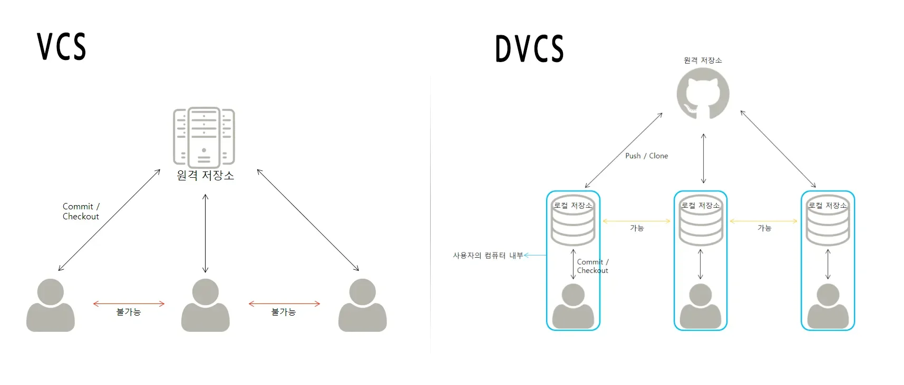
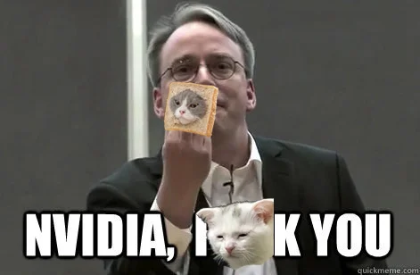
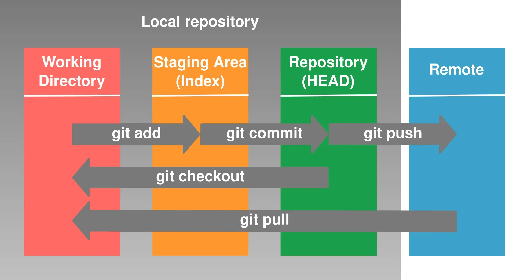
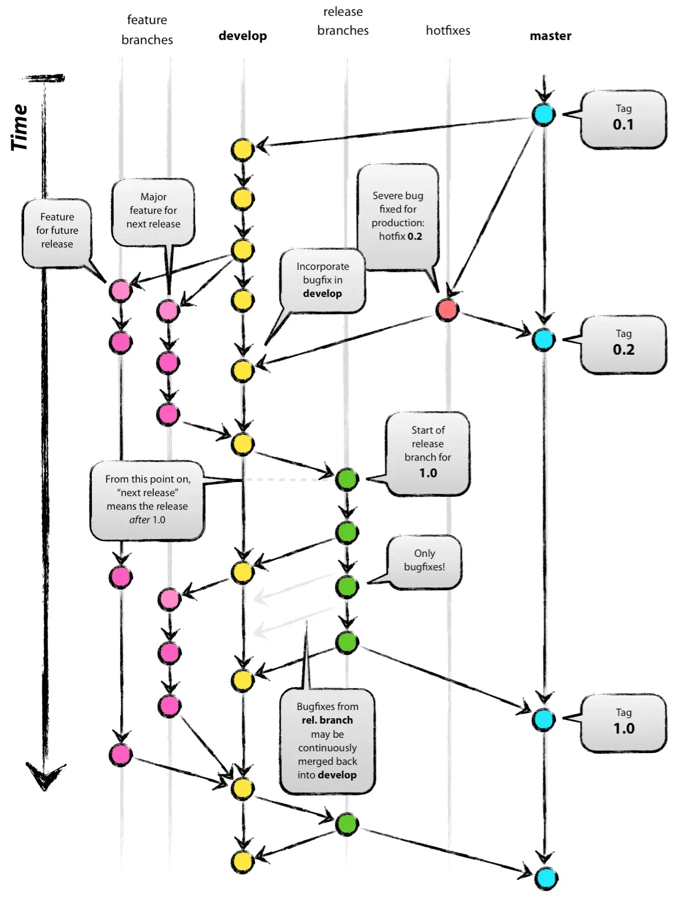
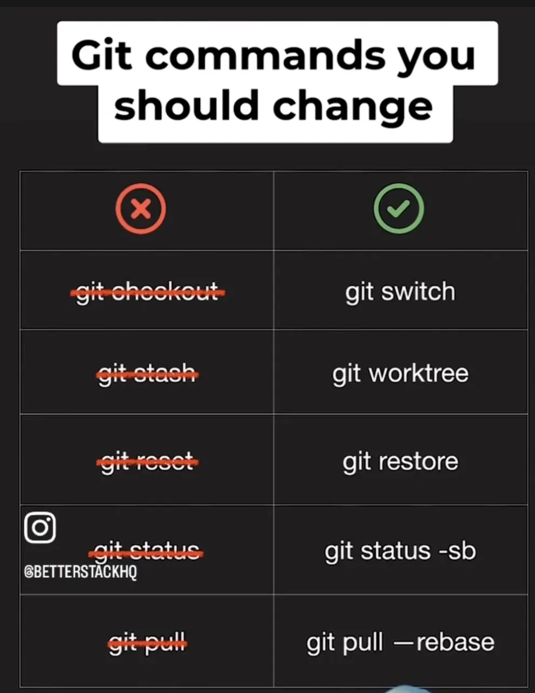
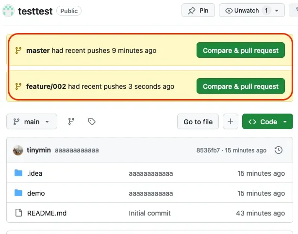
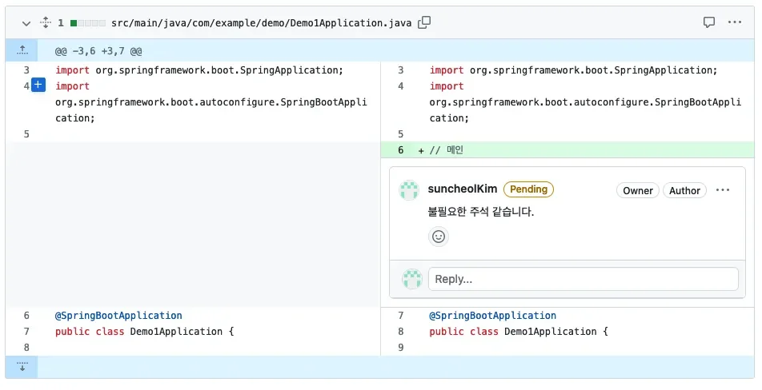
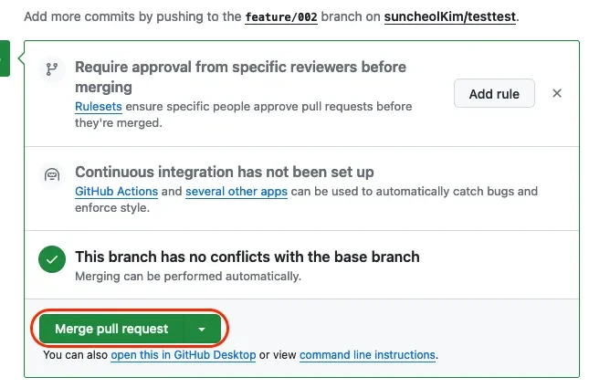

reference

<a href="https://beautiful-college-c84.notion.site/13b2dc3ef5148024a24fe82118f60552">페이지</a> 

[Video Conferencing, Web Conferencing, Webinars, Screen Sharing]()

[Git]()

[CS Visualized&#58; 유용한 깃(Git) 명령어]()

### VCS

---

<code>Version Control System</code> <u>버전 관리 시스템</u>이라고 한다&#46;

 버전 관리 시스템은 일반적으로 소스코드의 변경사항을 관리하고 추척하는 역할을 한다&#46; 물론 일반적인 문서도 VCS로 관리할 수 있지만 최근 VCS는 곧 Git이라고 할 만큼 Git은 매우 많은 곳에서 사용되고 있다&#46;

 하지만 이전에는 Git 이외에도 많은 VCS 들이 있었다&#46;

- Subversion (SVN) &#58; 자바 진영에서 Git 이전에 주로 쓰던 시스템&#46; 중앙 서버에 모든 데이터를 관리

- Mercurial &#58; Git과 비슷하지만 잘 안 씀

- CVS &#58; SVN의 전신

- TFS, SourceSafe &#58; MS진영의 VCS

Mercurial을 제외하고는 모두 중앙 서버가 없으면 코드를 관리할 수 없는 중앙 집중식 시스템이다&#46; 이와 반대로 Git은 중앙 서버가 없어도 동작한다&#46;

 이를 구분하기 위해 Git은 DVCS(Distributed VCS, 분산 VCS)라고 한다&#46;

### DVCS  vs  VCS

---

VCS는 모든 작업자가 서버 하나를 바라본다&#46; 저장소는 서버에 있는 딱 하나 존재한다&#46; 각 작업자의 PC에는 저장소가 없다&#46; 따라서 서버가 없다면 아무것도 할 수 없다&#46;

> ☝🏻 VCS에서 commit은 서버와 통신을 의미한다&#46; PC가 VCS와 동일 네트워크에 연결 되어 있지 않다면 아무런 작업을 할 수 없다&#46; 이 말은 작성한 코드를 이력으로 저장할 수 없다는 의미이고, 날려먹을 수 있다는 의미이다&#46; 

DVCS는 <u>내 PC안에 로컬 저장소를 가진</u>다&#46; 그리고 <code>commit</code> 등의 <u>모든 작업이 내 로컬 PC에서 발생</u>한다&#46; 

그리고 <code>push</code>, <code>pull(fetch)</code>를 통해 원격 저장소와 <strong><u>동기화</u></strong>를 합니다&#46;

여기서 <u>동기화 작업 때문에 항상 git이 어려운 이유</u>이다&#46;

### SVN 문제점

> VCS의 가장 대표적인 SVN의 몇 가지 문제점

1. 서버 의존성 모든 커밋, 업데이트, 브랜치 생성 및 태그 작업은 서버와의 통신을 필요로 한다&#46; 서버가 다운되거나 네트워크 문제가 있으면 작업을 할 수 없는데, 만약 네트워크 문제가 발생한 사이 코드를 날리게 된다면 다시 개발해야한다&#46; 이는 모든 VCS가 가지는 문제점이다&#46;

1. 오프라인 작업 제한 1번의 영향으로 생기는 것으로 만약 외부( 출장 등 ) 인터넷이 없는 곳에서 작업을 한다면 절대 코드를 commit 할 수 없다&#46; 이런 경우 역시나 변경 사항을 잃어버릴 수 있다&#46;

1. 브랜치 문제 SVN의 브랜치는 디렉토리를 복사하는 방식으로 작동한다&#46; 이는 시간과 리소스를 많이 소비하며 어떤 조직에서는 관리자 이외에는 브랜치를 만들지 못 하도록 설정한 곳도 있다&#46; 이런 경우는 소스 충돌이 일어날 가능성이 높다&#46;

1. 병합과 출동 관리의 어려움 SVN은 중앙 서버에 모든 변경 사항이 저장되기 때문에 commit 할 때 충돌이 빈번하게 발생한다&#46;

1. 테스트의 어려움 commit 자체가 서버에 반영되고, 브랜치를 자유롭게 만들기 어렵다보니 테스트에 어려움이 많다&#46; 만약 동작여부가 확실하지 않은 기능을 dev나 qa 서버에 올려 테스트 해보고 싶은 경우가 있을 수 있다&#46; 이 경우 공용 브랜치에 commit을 해야하며, 만약 그 사이 다른 사람이 코드를 받아간다면 오류가 발생하는 코드를 가져가게 된다&#46;

---

### Git의 출현

Git은 리눅스의 아버지 리누스 토발즈가 만들었다&#46;

오픈소스 진영의 대표자인 리누스 토발즈는 VCS가 일반적일 때에도 전혀 쓰지 않다가 한참 뒤에 상용 프로그램인 BitKeeper 라는 DVCS를 사용했습니다&#46; 오픈소스 개발자가 상용프로그램을 쓴다는 논란과 BitKeeper 제작사의 제한 조치 때문에, 이럴거면 그냥 내가 만들지… 하고 <a href="https://i.namu.wiki/i/jZzytOh9thNO2KJp9twHQM12vrPu767lEb_kXz6YC1W0gYd92HDvJRgXJgo7YvJyCpOqHEbOgPXDOB5rr2dKkQ.webp">간단하게</a> 2주만에 만들었습니다&#46; <del>쉽게 말해서 킹받아서 만들었단 이야기</del>    <del>(그리고 나서 BitKeeper를 포함한 많은 VCS들이 날아갔…)</del>

> 👉🏻 <strong>모두까기 장인 리누스 토발즈</strong>
> 
> - <a href="https://namu.wiki/w/%EB%A6%AC%EB%88%84%EC%8A%A4%20%ED%86%A0%EB%A5%B4%EB%B0%9C%EC%8A%A4#s-5">https&#58;//namu&#46;wiki/w/리누스 토르발스&#35;s&#45;5</a>
> 
> 

> 
대표사진

> 
> 
> 
> 

### Git 특징

- <strong>분산형 버전 관리</strong>&#58; 오프라인에서도 작업 가능, 중앙 서버 의존 없음

- <strong>강력한 브랜칭 및 병합</strong>&#58; 빠르고 효율적인 브랜치 생성 및 병합

- <strong>빠른 작업 속도</strong>&#58; 로컬에서 대부분의 작업 수행

- <strong>스테이징 영역</strong>&#58; 선택적 커밋 가능

- <strong>데이터 무결성</strong>&#58; SHA&#45;1 해시로 파일과 커밋 식별

- <strong>분산 협업</strong>&#58; 여러 리모트 리포지토리와 유연한 협업 가능

### Git 기초

---

### Git&#45;Flow

---

reference

[우린 Git&#45;flow를 사용하고 있어요 &#124; 우아한형제들 기술블로그]()

> 🗣 Git&#45;Flow는 Git을 쓸 때 브랜치를 어떻게 운영하면 가장 효과적으로 쓸 수 있을지에 대한 <strong><u>가이드 라인</u></strong>이다&#46;

### 브랜치 네이밍 &#45; bad case

개발할 때 많은 관습이 있다&#46;

for문의 변수는 i로 한다거나, 자바의 네이밍은 카멜케이스 등등 많은 것들이 있는데,  브랜치 이름도 이와 같은 관습이 존재한다&#46; 

> 물론 회사마다 다르다&#46;

 develop 브랜치를 dev로 줄여 쓰는 것을 많이 줄여 사용하며,

보통 회사 모두에서 dev 브랜치는 dev 환경을 의미하는 브랜치로 많이 사용한다&#46; 

스프링 부트는 환경에 따라 Profile을 <code>dev</code>, <code>qa</code>, <code>stage</code>, <code>prod</code>, <code>test</code> 이렇게 나눕니다&#46; 여기서 <code>dev</code>가 쓰이고 있어서 <u>브랜치명 </u><u><code>dev</code></u><u>는 </u><u><code>dev</code></u><u> 환경에 테스트해보기 위한 브랜치로 통용</u>된다&#46;

<code>feature</code> 브랜치 작성에서도 <code>feat&#45;OOO</code> 라고 작성하는 케이스들도 많다&#46; &#46;

역시나 <code>feature</code> 브랜치도 줄여 쓰지 않는다&#46;

구분자 또한 <code>/</code>를 사용한다&#46;

 따라서 <u><code>feature/OOO</code></u><u> 형태로 사용하는 것이 좋</u>다&#46;

- bad case&#58; <code>feat&#45;OOO</code>

- best case&#58;  <u><code>feature/OOO</code></u>

> ☝🏻 이런 네이밍룰, 관습들은 가능한 반드시 지켜야한다&#46;

### Git 권장 명령어 

- git checkout  →  git switch

- git stash  →  git worktree

- git reset  →  git restore

- git status  →  git status &#45;sb

- git pull  →  git pull  —rebase

### Pull Request

현업에서는 사실 직접적으로 merge를 하는 경우가 잘 없다&#46;

왜냐하면 항상 코드 리뷰를 받아야 하기 때문이다&#46;

인텔리J로 merge를 하게 되면 코드 리뷰 없이 바로 merge가 되기 때문에 이렇게 사용하지 않는다&#46;

> 일반적으로는  Pull Request(PR)을 사용해서 작업을 진행

Github 또한 PR을 지원합니다&#46; feature 브랜치를 원격 저장소에 push 하면 github에서 자동으로 이런 알림을 띄워준다&#46;

위 버튼을 클릭하면 PR을 생성할 수 있으며, 이렇게 하고 나서 변경된 코드를 보며 각각 코멘트를 달아 의견을 나눌 수 있다&#46;

이 작업이 완료 되면 비로소 Merge 버튼을 눌러 공용 브랜치에 코드를 반영한다&#46;

pr 방법 &#45; 외우기

1. master를 pull 

1. feature 브랜로 switch 

1. master —&#62; feature로 merge 합

1. 이 때 코드 충돌이 발생하는데 이 부분을 해결한다&#46; 코드가 어떤 내용인지를 정확히 보고 해결을 해야한다&#46; 둘 다 스스로 작성한 코드라서 이해하실 수 있으실 것이라 생각된다&#46; 다른 사람이 만든 코드와 충돌 발생했을 때도, 반드시 내용을 보고 <strong><u>상대방의 코드가 유실되지 않도록 잘 병합</u></strong> 해야한다&#46;

1. feature —&#62; master로 merge를 합니다&#46;

1. master를 push 합니다&#46;

