> ✏️ 
> 
> 
> 
> 컴퓨터들은 네트워크를 통해 서로 통신한다&#46; 
> 
> 
> 
> 이 네트워크는 <code>물리적 연결(예&#58; 케이블, 무선 신호)</code>과 <code>논리적 프로토콜(예&#58; TCP/IP)</code>로 구성된다&#46;
> 
> 
> 
> L3 전송 단위인 패킷으로 나뉘어 전송되며, 각 패킷은 목적지 주소를 포함하고 있어 올바른 경로를 통해 전달된다&#46;

### 인터넷

---

> 인터넷(Internet)은 인터넷 프로토콜 스위트(TCP/IP)를 기반으로 하여 전 세계적으로 연결되어 있는 <strong><u>컴퓨터 네트워크 통신망</u></strong>을 일컫는 말이다&#46;

유/무선 방식으로 이름에 걸맞은 <strong><u>World Wide Web(WWW) </u></strong>가 구축되어 있다&#46; 

해저 광케이블을 통한 물리적인 연결

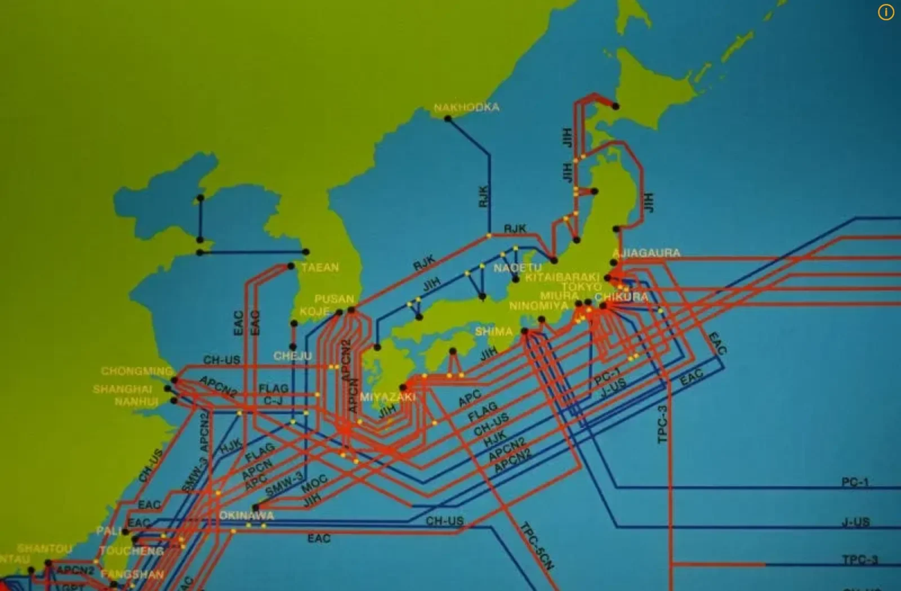

인공위성을 통한 무선 통신

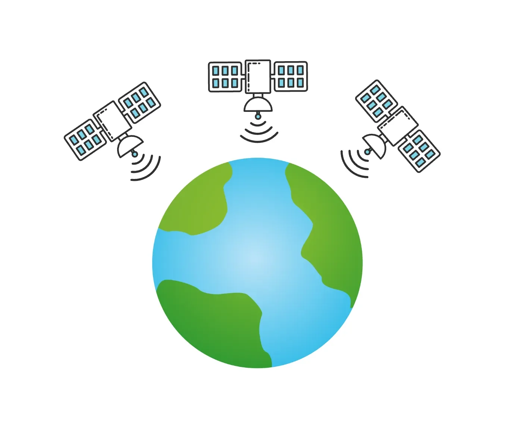

### 인터넷 프로토콜, IP ( Internet Protocol )

---

> 인터넷 네트워크에서<strong> </strong><strong><u>정보(데이터)를 수신하고 송신하는 통신</u></strong>에 대한 <u>규약(약속)</u>을 의미한다&#46; 

<strong>IP 주소 </strong>

> 각 기기 간의 통신을 식별할 수 있는 주소이다&#46; 

택배가 아래의 송장에서 <u>보내는 사람의 주소</u>와<u> 받는 사람의 주소</u>를  통해서 배송이 되듯이

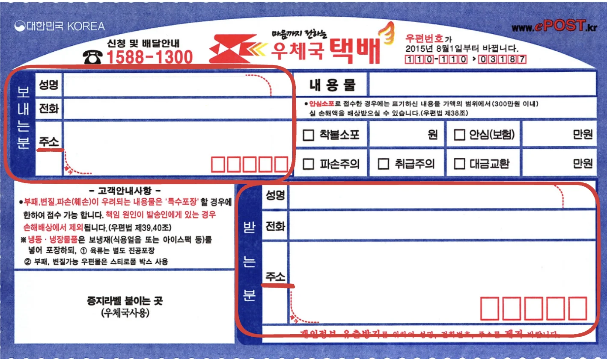

기기(컴퓨터, 핸드폰…) 간의 <u>데이터 전송</u>도 <u>송장의 집주소</u>처럼  <u>기기의 네트워크마다 IP주소</u>를 통해 전달하고 전달 받는다&#46; 

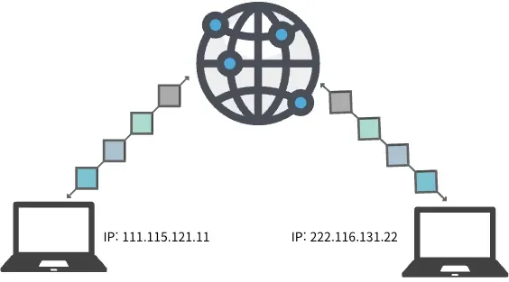

패킷( Packet )

> 인테넷 계층(L3)에서의 데이터 전송 단위이다&#46; 

- 패킷에는 택배에 배송을 위해 송장이 붙어있듯이, <code>출발지(소스) IP 주소</code>, <code>도착지(대상) IP 주소</code>가 담겨 있다&#46; 

- Packet은 크게 <strong><u>헤더</u></strong>, <u>페이로드</u>, <u>트레일러(수신여부 포함)</u>로 구분된다&#46; 
    - 수신을 거부할 수도 있음 → <u>트레일러(수신여부 포함)</u>

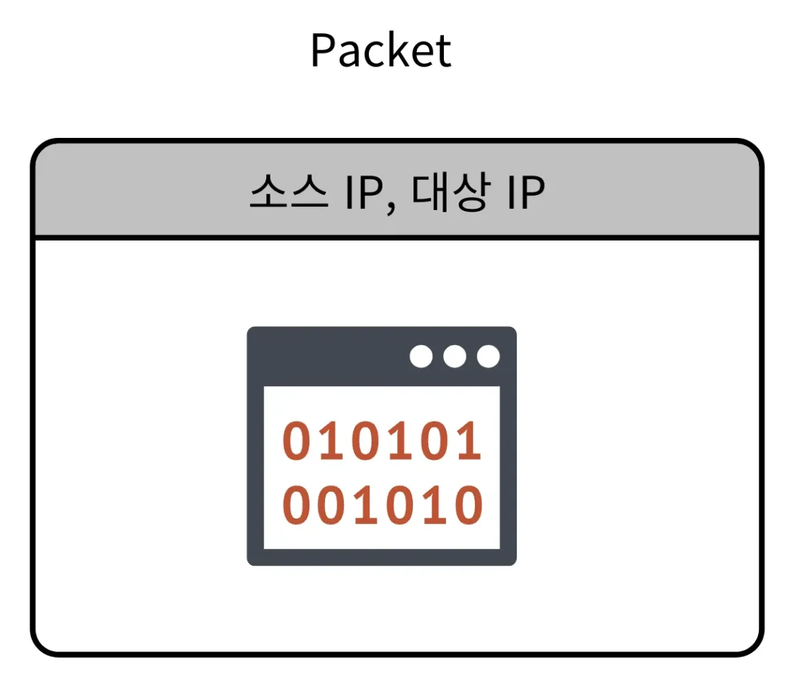

IP주소 통신의 한계

애플리케이션 구분

- IP 주소는 한 기기를 구분하는 용도이다&#46; 따라서 수신 받은 데이터가 기기 내부의  어떤 프로그램에서 사용 되는지를 구분할 수 없다&#46; 
    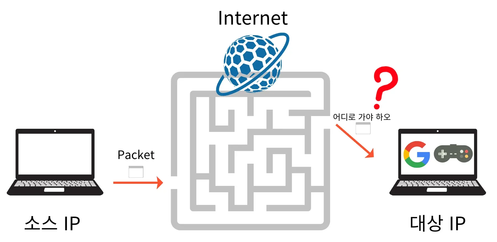

비연결성

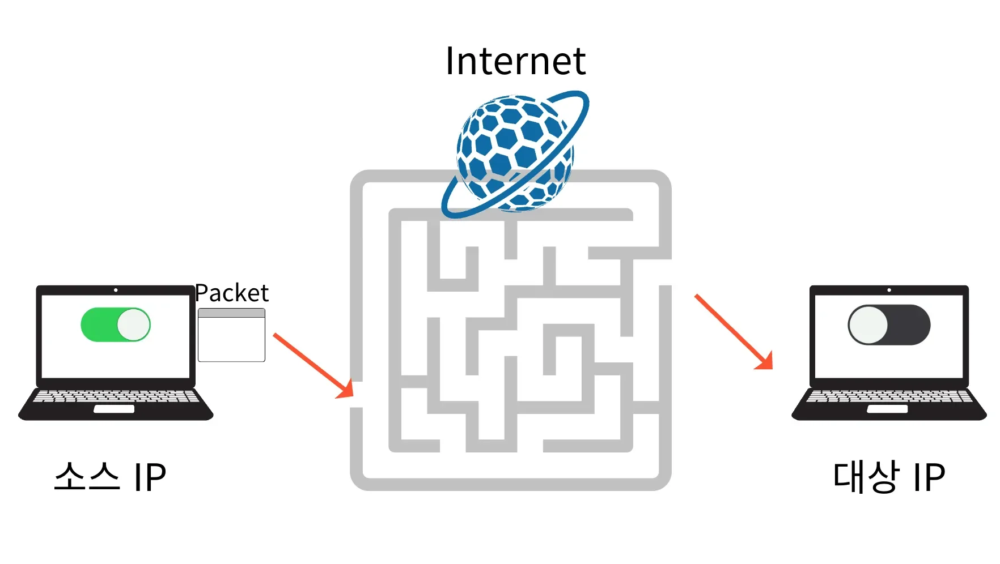

- 데이터를 전송하는데 있어, 받는 기기가  갑자기 꺼지거나, 오류가 나서 받지 못하는데도그냥 무작정 보내는 것

- 개선) TCP/IP &#45; 3 way handshake, ack 전송 등

비신뢰성

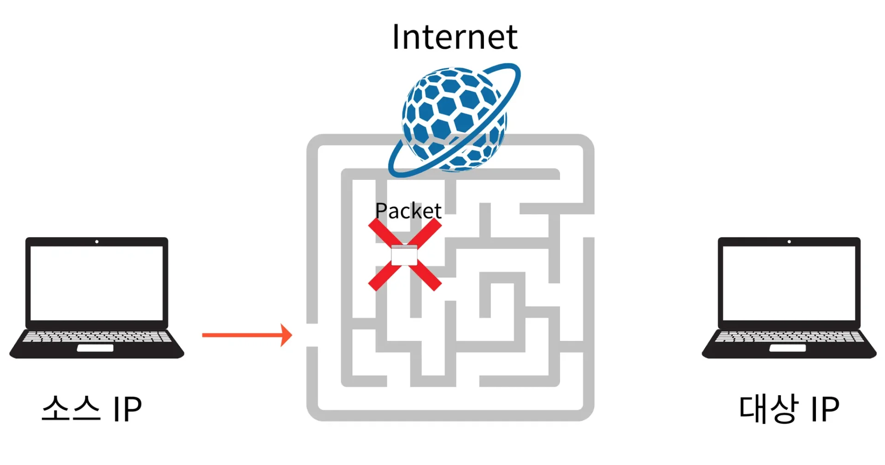

- 중간에 패킷이 손실될 수 있다&#46; 

- 그러나 이 손상여부를  송신, 수신 측 모두 파악할 수 없다&#46; 
    - 자세한 내용은 아래의  TCP/IP 정리 참조

데이터 순서 보장 ❌

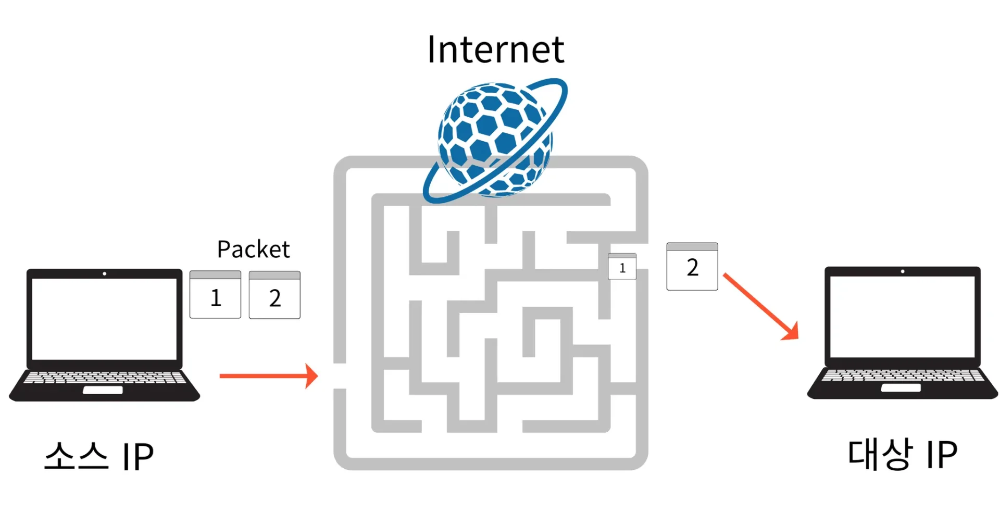

- 수신 받는 패킷의 순서가 섞여서 들어온다&#46;
    - 자세한 내용은 아래의  TCP/IP 정리 참조

> ☝🏻 
> 
> 
> 
> 위와 같은 IP 통신의 문제점을 해결해 주는 것이 <strong><u>TCP 프로토콜</u></strong>이다&#46;

### TCP (Transmission Control Protocol)

---

> ❔ 
> 
> 
> 
> IP 방식에서는 패킷이 손실되거나 오류가 생겨도 데이터를 재전송하지 않는 등의 문제가 있다&#46;  그렇다면 TCP에서의 데이터 신뢰성을 검증하는 방법은 무엇인가? 
> 
> 
> 
> 이를 <strong><code>3 Way HandShake</code></strong><strong> 및 </strong><strong><code>SYN</code></strong><strong>, </strong><strong><code>ACK</code></strong><strong> 응답으로 해결한다&#46; </strong>

> 두 기기간의 데이터 전달에 있어 신뢰성을 주기 위해 만들어진 프로토콜

<strong>3 Way HandShake</strong>

> ⚠️ 
> 
> - 최소한의 논리적인 연결이다
>     - 수신에 대한 응답(ACK)를 주고 받는 것으로 연결을 판단
> 
> - 물리적 연결이 아닌 <u>논리적 연결</u>이기 때문에, <u>연결을 지속적으로 재확인</u> 해야한다&#46; 

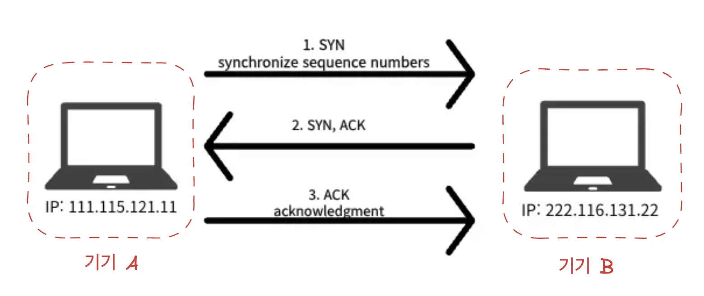

🧐 SYN, ACK 

- <strong>SYN (Synchronize)</strong>
    - 기기 간의 연결을 위한 요청

    - &#34;연결을 시작하고 싶다&#34;는 의사를 나타내기 위해 SYN 플래그가 설정된 패킷을 전송

    - 패킷에는 시퀀스 번호도 포함되어 있고 데이터 전송 순서를 관리할 준비를 함 

- <strong>ACK (Acknowledge)</strong>
    - 연결 요청을 확인(클라이언트의 SYN 패킷 받음)했다는 응답 신호

    -  SYN 요청을 수락하며, 자신도 연결을 시작하고 싶다는 뜻을 담아 SYN 플래그와 함께 ACK 플래그가 설정된 패킷을 전송

    -  요청시에 전달된 패킷의 시퀀스 번호에 1을 더한 값을 ACK로 응답함

1. 기기 A에서 <code>SYN(접속 요청)</code> 보냄

1. SYN 수신 받은 기기 B 에서, <code>ACK(요청 수락)</code> 와 <code>SYN(접속 요청)</code>을 보냄
    - ACK가 없다면 연결 실패

1. 기기 A 에서 다시 기기 B로 <code>ACK(요청 수락)</code>을 보내며 TCP/IP의 연결이 성사됨

TCP Header

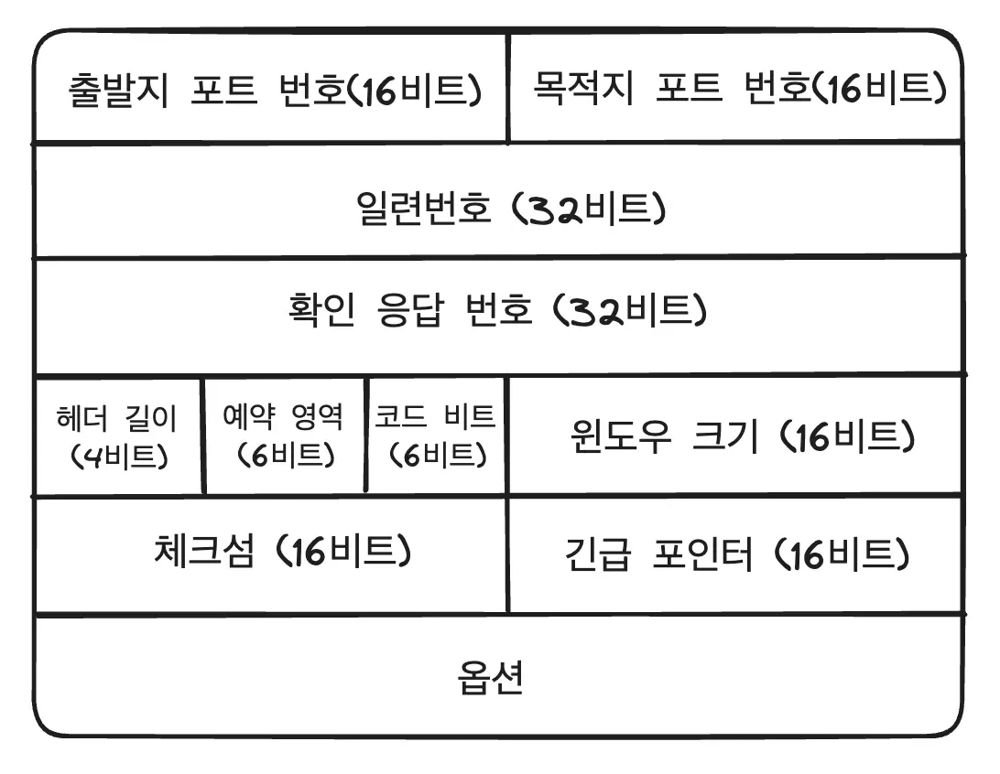

TCP 특징

데이터 전송 여부

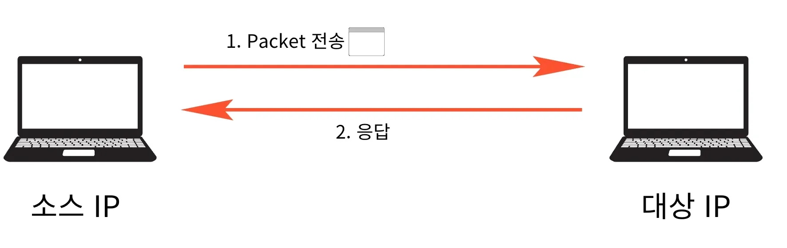

- 패킷이 올바르게 전달 되었는지 <strong><u>응답을 보내 확인</u></strong>한다&#46;

- 응답이 일정 시간 동안 오지 않으면 해당 패킷을 다시 보낸다&#46; 

패킷 순서 

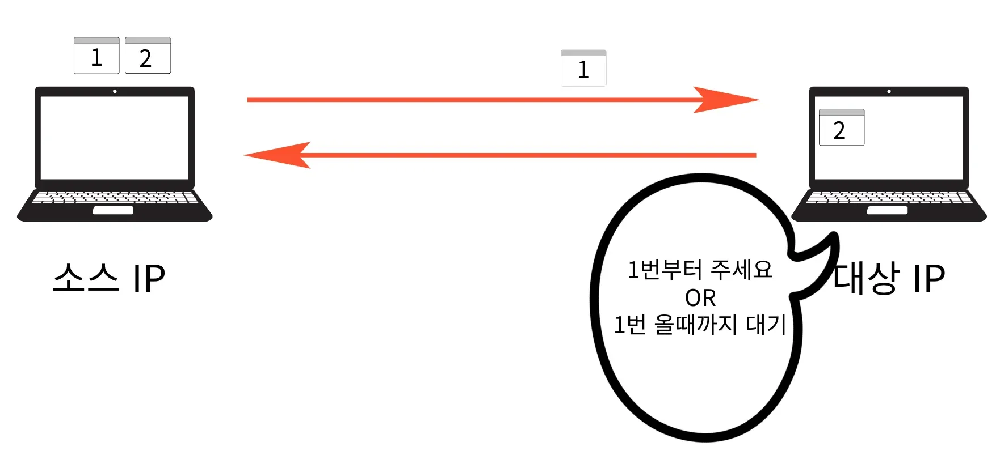

- 패킷 순서를 보장한다&#46;

- 전송 간에 잘못된 순서로 패킷이 도착하면 다시 보낸다&#46;

> 🚫 
> 
> 
> 
> TCP 전송의 한계
> 
> 
> 
> TCP는 신뢰성이 있지만<strong><u> 연결하는 과정 및  데이터 전송에 많은 비용(시간)이 발생</u></strong>된다
> 
> - TCP는 현재 단계 이상의 최적화를 하기 힘들다&#46; 
> 
> -  3 way handshake 과정을 거치는 만큼 속도가 느리다&#46;
> 
> 
> 
> 따라서  <strong><u>실시간 통신이나 스트리밍 애플리케이션</u></strong>에서는 <strong>빠른 전송이 중요</strong>하기 때문에 TCP 통신은 불가능하다&#46; 
> 
> 
> 
> 이를 <strong><u>UDP 통신</u></strong>을 통해 해결한다&#46;

### UDP (User Datagram Protocol)

---

> UDP는 비연결성, 신뢰성이 없는 전송 프로토콜이다&#46; 따라서 빠르다&#46; 

UDP Header

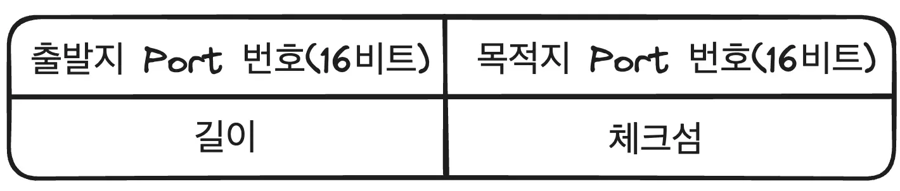

- TCP Header 랑 다르게 포트 번호 와  길이, 데이터 검증을 위한 체크섬 밖에 없다&#46;

- 필요한 기능은 커스텀(추가) 가능하다&#46; 

UDP 특징

IP 방식과 비슷하다&#46;

- 3 way handshake ❌
    

    → 데이터 전송, 응답, 순서를 보장하지 않는다&#46; (비신뢰성)

추가적인 기능이 거의 없다&#46; → 커스텀 해서 사용

- 기능이 없고, 연결을 하지 않아 속도가 빠르다&#46;

- 필요한 부분을 커스텀해서 사용 가능하다&#46;

<strong>PORT</strong><strong> </strong>가 존재

- IP 통신과 다르게 Port 번호가 있어 프로세스를 구분할 수 있다&#46; 

데이터 무결성 검사 → 체크섬(Checksum) 포함

- 체크섬(Checksum) 값을 통해 수신 받은 데이터의 손실 여부를 결정한다&#46; 

### Port 번호 

---

> 같은 IP(한 기기) 내에서 프로세스(프로그램) 구분을 위해 사용

포트(Port) 란?

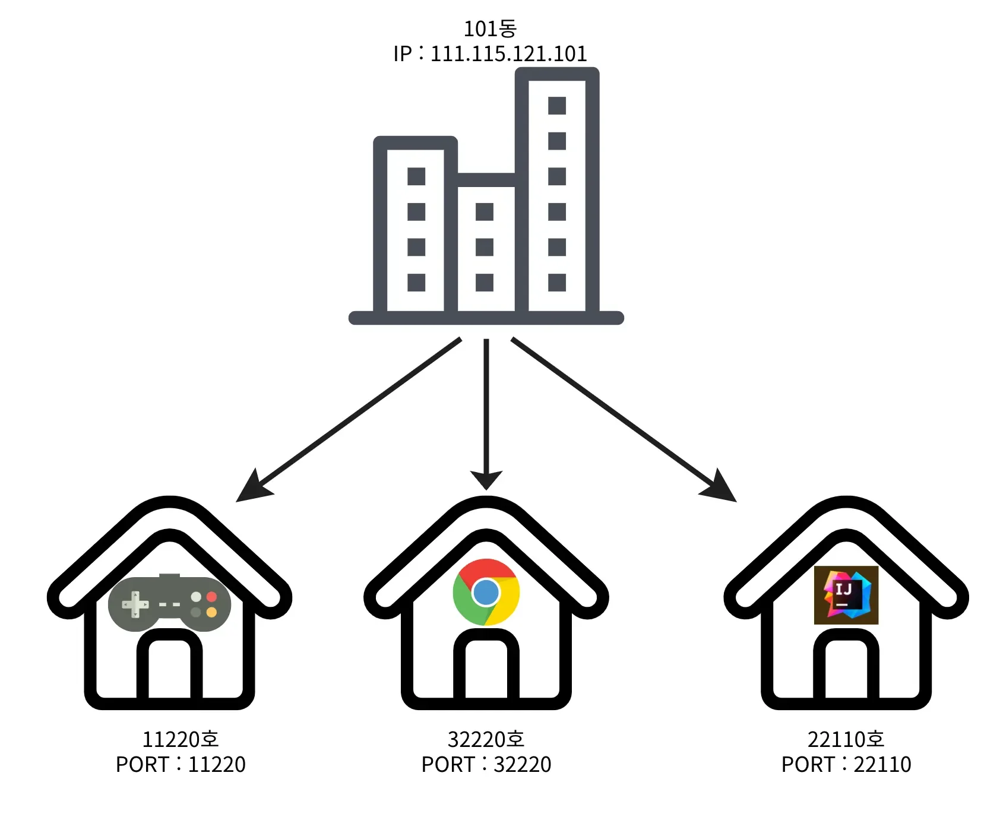

IP 주소를 통해서 기기를 구분했다&#46; 

이를 택배에  비유하자면 <u>아파트까지만 주소에 기입</u>한 것이다&#46; 

따라서 구체적인 호수(205호 &#46;&#46;)가 빠져 택배가 전달되지 못하고 반송될 것이다&#46;

이는 인테넷 상에서도 똑같다&#46; 한 기기 안에서도 여러개의 프로그램(프로세스)가 존재한다&#46; 

크롬을 통해서 웹브라우저를 사용하던지, Slack을 사용하여 게시글을 작성하던지 등…

이렇게 한 기기의 여러 프로그램에서 데이터의 송•수신이 일어나며 이를 IP주소를 통해서만 구분할 수는 없다&#46; 

<strong><u>아파트에서 </u></strong><strong><u>구체적인 </u></strong><strong><u>호수</u></strong><strong><u>를 기입</u></strong><strong>하여 택배가 전달되는 집을 구분</strong>을 하듯이, <strong>한 기기 안의 데이터의 송•수신이 일어나는 프로그램들</strong>을 <strong><u>포트(Port) 번호</u></strong>를 통해서 구분한다&#46; 

<strong>자주 사용되는 PORT</strong>

🧐 포트 번호의 한계

<strong>포트 번호는 </strong><strong><u>16비트</u></strong><strong>로 표현된다&#46; 따라서 </strong><strong><u>0부터 65535까지</u></strong><u> 할당 </u>가능하다&#46;

<strong><u>높은 트래픽을 처리</u></strong>하거나 <strong><u>동시에 많은 연결을 열</u></strong>어야 하는 경우, <u>이 한계가 문제로 작용</u>할 수 있다&#46;

일반적으로 서버는 이러한 포트 제한 문제를 해결하기 위해 <strong><u>로드 밸런서</u></strong>나 <strong><u>여러 IP 주소를 사용</u></strong>하여 다수의 연결을 분산 처리한다&#46;

> <strong>포트 번호</strong><strong> </strong><strong><code>0</code></strong><strong> &#126; </strong><strong><code>65535</code></strong><strong> 할당 가능  (</strong><strong><u>16비트)</u></strong>

<strong>🧐 </strong><strong><code>0번&#126;1023번</code></strong><strong> &#45; Well&#45;Known Ports</strong> (잘 알려진 포트)

- 국제 도메인 관리기구에 의해 관리된다, 사용하지 않는것이 좋다&#46;

- <code>FTP</code> &#45; 20, 21 (TCP)

- <code>SSH</code> &#45; 22 (TCP)

- <code>텔넷</code> &#45; 23 (TCP)

- <code>SMTP</code> &#45; 25 (TCP)

- <code>DNS</code> &#45; 53 (TCP/UDP)

- <code>DHCP</code> &#45; 67 (UDP)

- <code>HTTP</code> &#45; <strong>80 (TCP)</strong>

- <code>HTTPS</code> &#45; <strong>443 (TCP)</strong>

- <code>RDP</code> &#45; 3389 (TCP/UDP)

- <strong><code>0번&#126;1023번</code></strong><strong> &#45;</strong> <strong>Well&#45;Known Ports</strong> (잘 알려진 포트)로, 웹 서버(HTTP 80), 메일 서버(SMTP 25) 등과 같이 공인된 서비스에 사용

- <strong><code>1024번&#126;49151번</code></strong>&#58; <strong>Registered Ports</strong> (등록된 포트)로, 특정 애플리케이션이 사용할 수 있도록 등록된 포트

- <strong><code>49152번&#126;65535번</code></strong>&#58; <strong>Dynamic or Private Ports</strong> (동적/개인용 포트)로, 임시 연결에서 주로 사용되는 포트

<strong> </strong>실제 개발을 진행할 때 사용되지 않는 나머지 포트를 사용하여 개발

<strong>🧐 TCP/IP 송수신 과정</strong>

> 이전에 정리한 내용 복습 겸, 다시 정리함 

- 하드디스크의 데이터를 프로세서의 Buffer애서 Copy ( Stream, 데이터 덩어리 )

- Socket Buffer에서 Copy(Send)

- &#91; L4 &#93; Segment로 분해 &#91; MSS(최대 세그먼트 크기)&#58; 1460Byte&#93;

- &#91; L3 &#93; Packet 으로 Encapsulation

- &#91; L2 &#93; Frame 으로 Encapsulation

- 목적지 MAC 주소를 통해 Gateway로 이동

- 목적지 IP주소를 통해 인터넷을 거쳐 수신받는 컴퓨터로 이동

- &#91; L2 &#93; Frame → Packet Decapsulation

- &#91; L3 &#93; Packet → Segment Decapsulation

- 포트 번호를 통해 해당 프로세스 Socket Buffer에 Segment 전달, Stream으로 합쳐짐

- Socket Buffer의 Stream 데이터를 프로세스 Buffer에서 받아온다&#46; (Recieve)
    - 만약 Socket 버퍼로 받아오는 속도보다 Process 버퍼로 가져가는 속도가 느릴 경우,  Socket 버퍼의 용량이 가득 차기 때문에, 공간이 없어 데이터를 받을 수 없다&#46; 
        

        <strong>→ </strong><strong>&#91; Error &#93;</strong>  <code>Zero Window</code>

- 송 • 수신 시, 원본 데이터를 작게 나눠서 전달한다&#46;  (전달 용량 한계)

- 나눠진 데이터는 순서를 가지며, 송•수신시에는 해당 순서에 맞춰 전달되고 전송받아야 한다&#46; 

- 따라서 나눠진 데이터 마다 올바른 데이터를 받았는지 여부를 송신 서버에 응답(ACK, Acknowledgement(피드백)) 상태를 보내 알린다&#46;
    - <strong>&#91;Error&#93; </strong><code>Loss(유실)</code>
        - 인터넷에서 데이터(Packet)이 사라졌을 경우

    - <strong>&#91;Error&#93;</strong> <code>Duplicate</code>
        - Ack 응답을 느리게 전송, 송신 서버를 일정시간 동안 ACK 가 오지 않으면 중간에 유신되었다 판단하여 데이터를 다시 보낸다&#46; 따라서 두 번의  데이터 전송 및 ACK 응답이 발생된다&#46; 

    - <strong>&#91;Error&#93;</strong> <code>out of order</code>
        - 잘못된 순서로 데이터가 왔을 경우 

