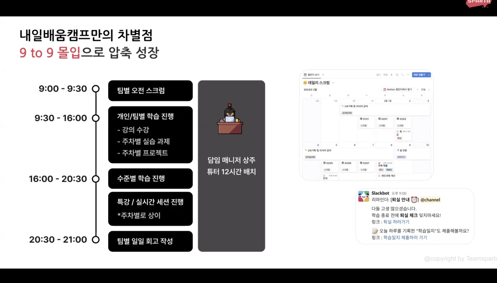
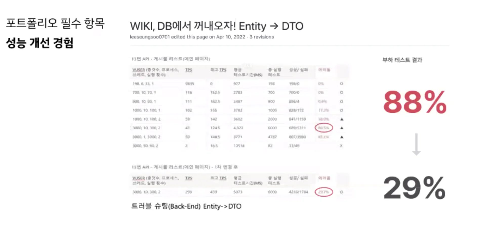

> 💡 
> 
> 
> 
> 기간&#58; 224&#46;09&#46;24

### 1부  &#45; 2024 개발자 채용 시장

기업이 원하는 인재

채용 시장에서 원하는 개발자

개발자 공고 중 백엔드가 매우 많음

팀프로젝트, 커뮤니케이션, 협업

- 실제 팀플레이시 어떤 문제가 있었고 어떻게 해결 하였는가?

- 백엔드 취업 로드맵

글로벌 ( 해외 취업 ) , 창업

현실적으로 독학으로 취업이 가능한가?

내가 잘하고 있느지 확신이 어려움

블로그/강의만 보고 개발은 실무에서 사용하지 않는 기술로 개발함

포토폴리오를 어떻게 준비해야 할지 몰라 막막함

팀프로젝트 경험을 쌓기 어려움

취업 전략이 갖춰진 곳에서 시작해라

최소 공부 12시간 이상 공부

### 2부  &#45; 개발자 커리어 전환

### 3부 &#45; 사전 질문 및 실시간 QnA

학력보단 실력이 중요하다&#46; 

몽고 DB 프리티어 &#45; 공부 시 문제 없음

적은 리소스로 큰 임펙트를 내는 경험이 있는 것이 중요하다&#46; 

코딩테스트 

파이썬으로 진행이 좋다&#46; 

아무리 자바에 익숙해도 파이썬이 훨씬 빠르다&#46;

근데 자바로 진행하려는 경우도 더 가산점이 있다&#46; 

- 부트 캠프 수료 후 단기 심화 10주 주차에서 배울 수 있다&#46; 

### Notes

---

내일배움카드 발급만하면 가능한가? 

제출하는 서류가 있는가? 

aws 서버 비용 지원 금액

인턴십 프로그램 

기업 인턴십 필수   

- 비용 지원? 

- 

내일배움캠프

수준에 따른 반 정리

블로그 정리 진행

튜터 매일 상주 

충분히 고민 후 질문 → 내것으로 만들기 위해, 

트러블 슈팅을 어떻게 구체적으로 하는지? 

코드 리뷰 바로 가능

서버를 터트린다?  → 테스트 환경에서 확인 가능

서버비용 동일 유지 → 서버 개선

aws 서버 비용 무제한 지원 

인텔리제이 유료 버전 지원?

1&#58;1 면접 코칭 &#45; 인텔리픽 적극 활용 

워밍업 사전 캠프 &#45; 강의 지급해 드림 

포토폴리오 어떻게 준비?

면접관이 물어볼만한 질문을 위조로 준비

코딩 테스트 가이드 제공 

