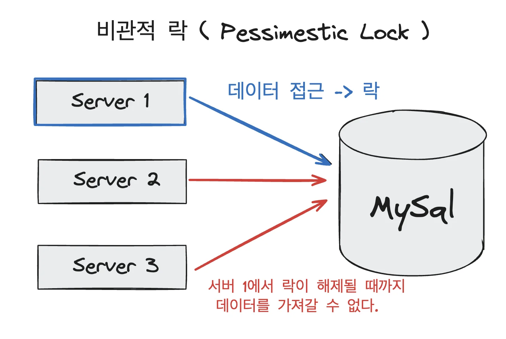
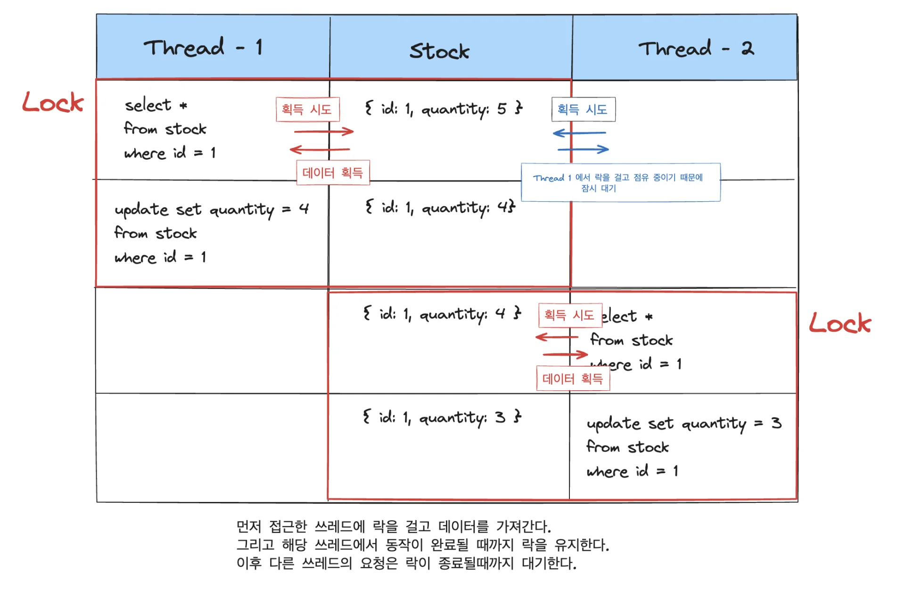
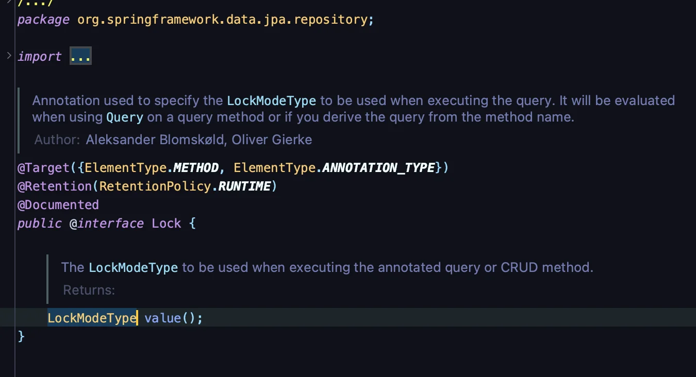
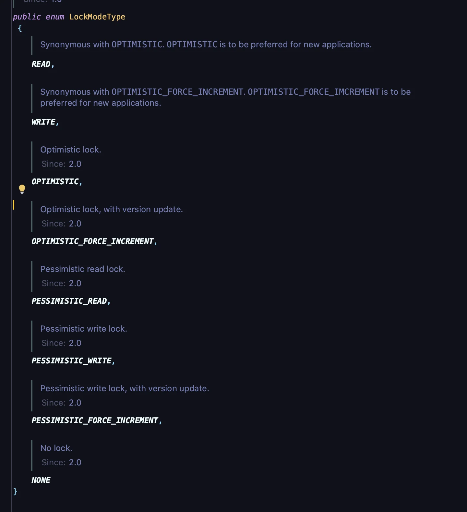

> 🤔 
> 
> <a id="f21eda9b0fe182a4acbe81fb2a2586ae"></a>
> 
> <strong>데이터베이스를 활용한 데이터 정합성을 맞추는 방법 (3가지)</strong>
> 
> - <strong>Pessimistic Lock ( 비관적 락 )</strong>
> 
> - Optimistic Lock ( 낙관적 락 ) 
> 
> - Name Lock ( 명명된 락)

<a id="882eda9b0fe1822ba8b7018b8b9cae98"></a>

## Pessimistic Lock ( 비관적 락 )

---

> 📖 
> 
> - 실제 <strong><u>데이터에 락을 걸어 정합성을 맞</u></strong>추는 방법
> 
> - <strong>exclusive lock</strong>을 걸게되면 <strong><u>다른 트랜잭션에서 lock이 해제되기 전에 데이터를 가져갈 수 없</u></strong>게 된다&#46; 
> 
> - 사용 시 <strong><u>데드락이 걸릴 수 있</u></strong>기 때문에 <strong><u>주의하여 사용</u></strong>해야 한다&#46; 

<a id="fc2eda9b0fe18309844301d73263e2e2"></a>

### Pessimistic Lock(비관적 락) 개념



- 데이터에는 <u>락을 가진 스레드만 접근</u>이 가능하기 때문에 <u>레이스 컨디션 문제를 해결</u>할 수 있다&#46; 



- 먼저 접근한 스레드에 락을 걸고 데이터를 획득한다&#46; 

- 해당 스레드에서 동작이 완료될 때까지 락을 유지한다&#46; 

- 이후 다른 스레드의 요청은 락이 종료될 때까지 대기한다&#46;

<a id="ce3eda9b0fe183b08680812dea9f0dd3"></a>

###  Spring Data JPA에서의  비관적 락 ( Pessimistic Lock )

<a id="946eda9b0fe183759b5181ddbb3b8344"></a>

스프링 부트 JPA에서는 <code>&#64;Lock</code>이라는  Annotation을 통해 손쉽게 구현 가능하다&#46; 

<a id="ed3eda9b0fe18251b42801706fc307b1"></a>

```java
@Lock(LockModeType.PESSIMISTIC_WRITE)
```

<details>
<summary><code>&#64;Lock</code></summary>



</details>

<details>
<summary><code>LockModeType</code></summary>



</details>

<a id="78deda9b0fe1820894a0010612a527bf"></a>

### 코드 예제

<details>
<summary>&#91; 코드 &#93; StockRepository</summary>

<a id="147eda9b0fe183c09ace817c35963f93"></a>

```java
@Repository
public interface StockRepository extends JpaRepository<Stock, Long> {

    @Lock(LockModeType.PESSIMISTIC_WRITE)
    @Query("select s from Stock s where s.id = :id")
    Stock findByIdWithPessimisticLock(Long id);
}

```

</details>

<details>
<summary>&#91; 코드 &#93; PessimisticLockStockService</summary>

<a id="18eeda9b0fe182a6804b81be93dbd90f"></a>

```java
@Service
public class PessimisticLockStockService {

    private final StockRepository stockRepository;

    public PessimisticLockStockService(StockRepository stockRepository) {
        this.stockRepository = stockRepository;
    }
	
		@Transactional
    public void decrease(Long id, Long quantity) {

        Stock stock = stockRepository.findByIdWithPessimisticLock(id);

        stock.decrease(quantity);

        stockRepository.save(stock);
    }
}

```

- 조회 시, 락이 걸리고 해당되는 트랜잭션이 종료될 때 락이 해제된다&#46;

</details>

<details>
<summary>&#91; 테스트 코드 &#93; PessimisticLockStockServiceTest</summary>

<a id="c96eda9b0fe183428c9b012d3721cec6"></a>

```java
@SpringBootTest
class PessimisticLockStockServiceTest {

    @Autowired
    private PessimisticLockStockService stockService;

    @Autowired
    private StockRepository stockRepository;

    @BeforeEach
    public void before() {
        stockRepository.saveAndFlush(new Stock(1L, 100L));
    }

    @AfterEach
    public void after() {
        stockRepository.deleteAll();
    }

    @Test
    public void 동시에_100명_주문() throws InterruptedException {
        int threadCount = 100;
        ExecutorService executorService = Executors.newFixedThreadPool(100);
        CountDownLatch latch = new CountDownLatch(threadCount);

        for (int i = 0; i < threadCount; i++) {
            executorService.submit(() -> {
                try {
                    stockService.decrease(1L, 1L);
                } finally {
                    latch.countDown();
                }
            });
        }
        latch.await();

        Stock stock = stockRepository.findById(1L).orElseThrow();

        // 100 - (100 * 1) = 0
        assertEquals(0, stock.getQuantity());
    }

}
```

- 기존 테스트 로직과 동일

</details>

<details>
<summary>ex 2)</summary>

<a id="f33eda9b0fe1822eb1910149289fbd24"></a>

```java
@Lock(LockModeType.PESSIMISTIC_WRITE)
@Query("SELECT s FROM Stock s WHERE s.id = :id")
Optional<Stock> findByIdWithLock(@Param("id") Long id);
```

<a id="5d4eda9b0fe18314af4c0143cecf670d"></a>

```java
@Transactional
public void decrease(Long stockId, Long quantity) {
    Stock stock = stockRepository.findByIdWithLock(stockId)
                                  .orElseThrow(() -> new IllegalArgumentException("Stock not found"));

    if (stock.getQuantity() < quantity) {
        throw new IllegalArgumentException("Insufficient stock");
    }

    stock.decrease(quantity);
    stockRepository.save(stock);
}
```

</details>

<a id="303eda9b0fe1831d9c7f011f51bb790a"></a>

### 장•단점

- 장점
    - <strong>충돌이 빈번</strong>하게 일어난다면 optimistic lock보다는 성능이 좋을 수 있다&#46; 

    - 락을 통해 업데이트를 제어하기 때문에 데이터의 정합성이 보장된다&#46; 

- 단점
    - <u>별도의 락을 잡</u>기 때문에 <strong>성능 감소가 있</strong>을 수 있다&#46; 

<a id="775eda9b0fe18365bf950197d6d8c52d"></a>

### 의문점

<details>
<summary>🧐 어떻게 락을 유지하는가?  어떻게 종료 시점을 설정되는가?</summary>

<a id="52deda9b0fe1837ba74d815f79750730"></a>

```java
@Repository
public interface StockRepository extends JpaRepository<Stock, Long> {

    @Lock(LockModeType.PESSIMISTIC_WRITE)
    @Query("select s from Stock s where s.id = :id")
    Stock findByIdWithPessimisticLock(Long id);
}
```

<a id="db8eda9b0fe1829683b5814e36c96446"></a>

```java
public void decrease(Long id, Long quantity) {
    Stock stock = stockRepository.findByIdWithPessimisticLock(id);

    stock.decrease(quantity);

    stockRepository.save(stock);
}
```

<a id="061eda9b0fe1827cb44081d40dc51459"></a>

위 코드에서 <code>findByIdWithPessimisticLock()</code> 호출 시점에 락을 건다&#46;

<a id="fc8eda9b0fe18240a722819977cc9ccd"></a>

그 이후 어떻게 락을 유지하며 종료를 하는가?

<a id="ae0eda9b0fe1836da41c01e7d0427c5c"></a>

종료에 대한 조건이 해당하는 entity가 저장될 떄인가? 

<a id="40deda9b0fe18263917401d4fcf0770f"></a>

트랜잭션으로 관리를 하는 것이 아닌가? <br>트랜잭션 선언을 하지 않았는데 어떻게 동일한 트랜잭션으로 판단하고 락을 유지하는가?

<a id="685eda9b0fe18288971381988081bbd3"></a>

그렇다면 만약 2번 저장이되는 경우는 어떻하는가? <br>

<a id="aaceda9b0fe1827ebe25017c6167bf37"></a>

### 해결

<a id="fc0eda9b0fe1826f916a81897e901332"></a>

```java
@Transactional
public void decrease(Long id, Long quantity) {

    Stock stock = stockRepository.findByIdWithPessimisticLock(id);

    stock.decrease(quantity);

    stockRepository.save(stock);
}
```

<a id="db7eda9b0fe182c09ec3815099df3806"></a>

위와 같이 <code>&#64;Transaction</code>을 선언하여 해당 트랜잭션이 종료될 때까지 락을 유지한다&#46; 

</details>
