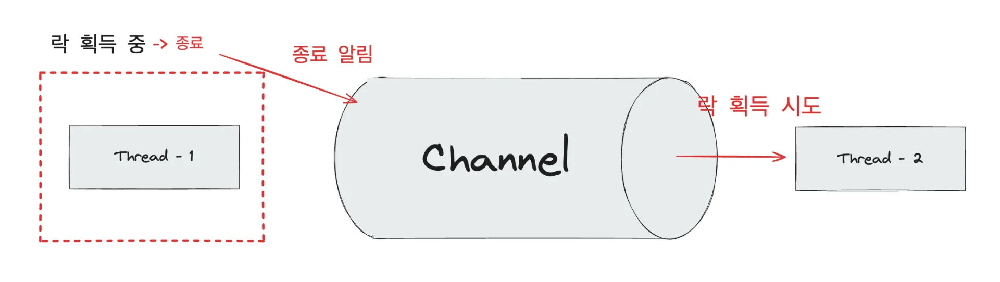
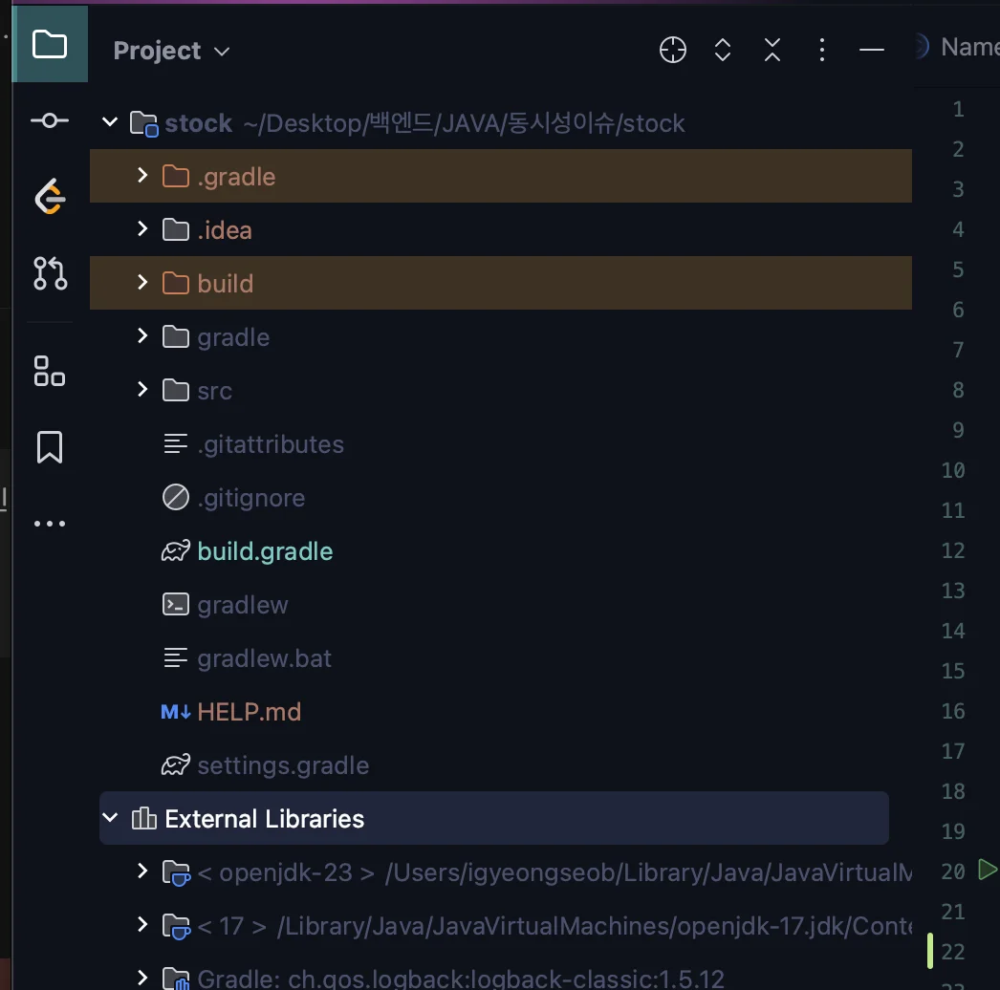
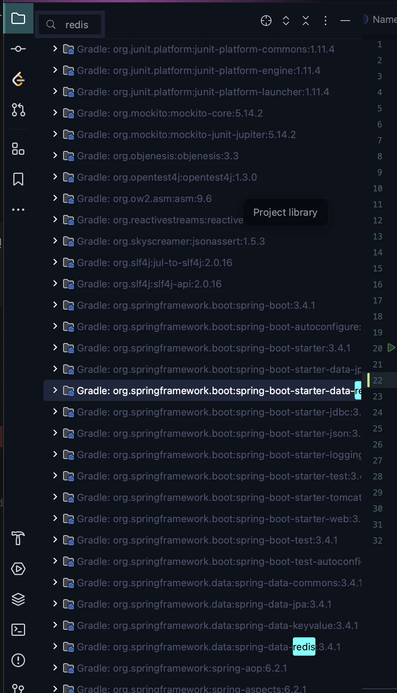

<a id="3b3eda9b0fe183558d40814bea3b00b0"></a>

 

> ✏️ 
> 
> <a id="2c8eda9b0fe183438f6c81c2c0d3ff14"></a>
> 
> 레디스를 사용하여 동시성 문제 해결 시, 사용하는 대표적인 라이브러리 2가지
> 
> - Lettuce
> 
> - Redisson

<a id="884eda9b0fe18341988101c9419a0982"></a>

## 1&#46; 레투스, Lettuce

- setnx 명령어를 활용하여 분산락을 구현할 수 있다&#46;
    - setnx 명령어
        - set if not exist의 줄임말

        -  key, value를 설정(set) 시, 값이 없을 대만 set한다&#46;

- setnx를 활용하는 방식은 Spin Lock 방식으로 retry 개발자가 작성해줘야 한다&#46; 
    - 🧐  Spin Lock 
        <a id="bd8eda9b0fe18264a4c301dff877c933"></a>

        Sprin Lock 이란, 락 획득하려는 스레드가 락을 사용할 수 있는지 반복적으로 확인하면서 락 획득을 시도하는 방식이다&#46; 

<a id="941eda9b0fe18285aa1b0137b744cf72"></a>

## 2&#46; Redisson 

- pub, sub 기반의 락 구현
    - pub, sub 기반은 채널을 하나 만들고 락을 점유 중인 쓰레드가 락 획득하려고 대기 중이 스레드에게 해제를 알려주면 안내를 받은 스레드가 락 획득 시도를 하는 방식이다&#46; 

    - 레투스와 다르게 실패에 대한 별도의 re&#45;try 로직을 작성하지 않아도 된다&#46; 

    

<a id="d3eeda9b0fe1821ab68001b8410f259f"></a>

### 기본 설정

<details>
<summary><strong>🤬 오류 </strong>&#45; 설정한 포트가 이미 사용 중 </summary>

<a id="27ceda9b0fe182fe8f1a81f18f1ab3ed"></a>

### 오류 내용

> 동일한 포트를 두 개의 컨테이너에서 동시에 바인딩할 수 없다&#46;

- 포트 중복

<a id="81deda9b0fe1828e97430175f8935942"></a>

```docker
docker: Error response from daemon: driver failed programming external connectivity on endpoint myredis (6c6bb2f5722f049c88caac6cb8b49ba657baa453dd954f4269386e60355dc0bf): Bind for 0.0.0.0:6379 failed: port is already allocated
```

- 이름 중복

<a id="10eeda9b0fe1823c85f8815ed90b7998"></a>

```docker
docker: Error response from daemon: Conflict. The container name "/myredis" is already in use by container "ff63c59c74912423c0b47dee8ecae12f5dee0d6df8d3913a7c62453ca3fa8565". You have to remove (or rename) that container to be able to reuse that name.
See 'docker run --help'.
```

<a id="0b5eda9b0fe1822bb82781386732f8a6"></a>

6379 포트가 이미 사용 중이라, 실행 오류가 발생됨

<a id="198eda9b0fe183adbd13011b4dbd5012"></a>

### 해결

<details>
<summary><strong>방법 1 &#45; 기존 컨테이너 중지 및 삭제</strong></summary>

1. 컨테이너 ID 확인
    <a id="3fdeda9b0fe183039eb681e8615b5705"></a>

    ```docker
    docker ps -a --filter "publish=6379"
    ```

1. 컨테이너 중지
    <a id="de8eda9b0fe1832e897301f6aa937b46"></a>

    ```docker
    docker stop <컨테이너 ID>
    ```

1. 컨테이너 삭제
    <a id="2c6eda9b0fe182148a1a81c08fe2d9ce"></a>

    ```docker
    docker rm <컨테이너 ID>
    ```

</details>

<details>
<summary>방법 2 &#45; 다른 포트, 이름 사용</summary>

1. 기존 실행 중인 컨테이너 확인
    <a id="435eda9b0fe18293994081885ce7531a"></a>

    ```docker
    docker ps -a --filter "name=myredis"
    ```

    <details>
    <summary>출력 내용 확인</summary>

    <a id="9ddeda9b0fe1823dac6901034402a8ec"></a>

    ```docker
    CONTAINER ID   IMAGE     COMMAND                  CREATED        STATUS                     PORTS    NAMES
    ff63c59c7491   redis     "docker-entrypoint.s…"   5 minutes ago Exited (1) 5 minutes ago           myredis
    ```

    </details>

1. 다른 이름 및 포트로 컨테이너 생성
    <a id="cddeda9b0fe18229ae3281a4c26cb74a"></a>

    ```docker
    docker run --name mynewredis -d -p 6380:6379 redis
    ```

</details>

</details>

<details>
<summary>Docker  </summary>

- Redis  다운
    <a id="9a6eda9b0fe183c8850b01f070baf649"></a>

    ```docker
    docker pull redis
    ```

- Redis 실행 
    <a id="9beeda9b0fe182d2bda181172863b5d5"></a>

    ```docker
    docker run --name myredis -d -p 6379:6379 redis
    ```

    - <code>docker run</code>&#58; 새 컨테이너 생성 및 실행

    - <code>—name &#91;명칭</code>&#93;&#58; 컨테이너 이름 설정
        - ex) <code>&#45;&#45;name myredis</code>&#58; 컨테이너 이름 <code>myredis</code>로 설정 

    - <code>&#45;d</code>&#58; 컨테이너를 백그라운드에서 실행

    - <code>&#45;p &#91;호스트 포트&#93;&#58;&#91;컨테이너 포트&#93;</code>&#58; 호스트와 컨테이너의 포트 번호 설정
        - ex) 	<code>&#45;p 6379&#58;6379</code>&#58;  호스트 포트 번호 = 6379, 컨테이너 포트 번호 = 6379

</details>

<details>
<summary>redis 의존성 추가</summary>

<a id="9d7eda9b0fe18293bbac0147cf665860"></a>

```groovy
implementation 'org.springframework.boot:spring-boot-starter-data-redis'
```

</details>

<details>
<summary>redis 다운 확인</summary>

- External Libraries 확인 후 
    

- 검색( <code>cmd</code> &#43; <code>f</code> ) &#45; redis 
    

</details>

- 앱 정상 동작 확인
