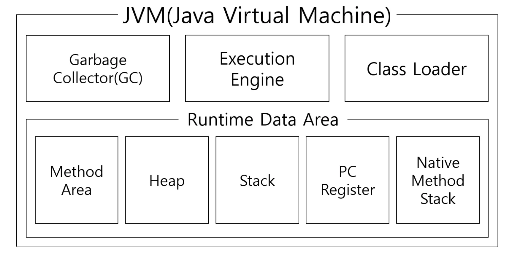
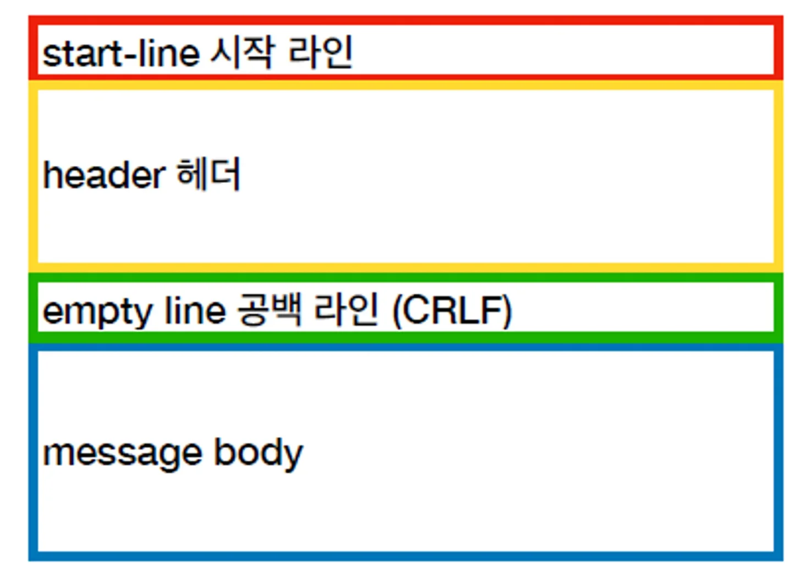
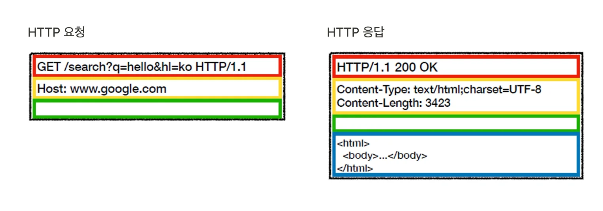
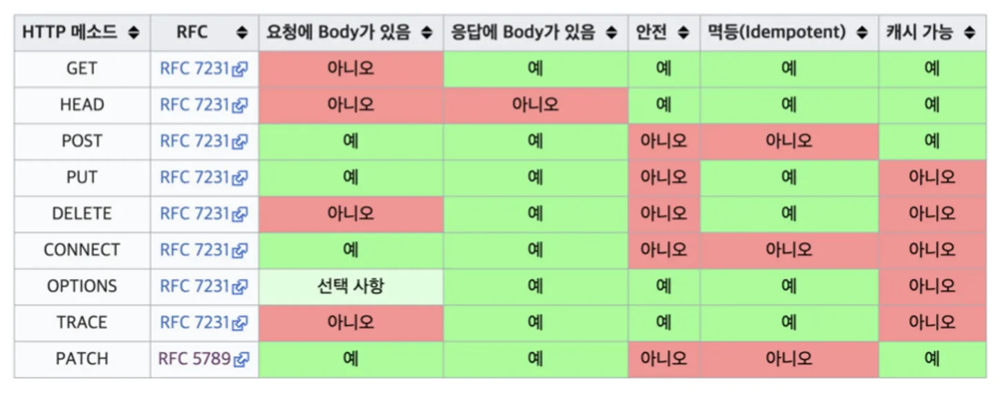

<a id="83d04a0a655c47e795b82f3e866b2a8a"></a>

<a href="https://beautiful-college-c84.notion.site/1342dc3ef514806ba59eeb774ca76e09">페이지</a> 

<a id="459802063cd74083a1c75857ebc16ad9"></a>

## 1&#46; JVM

<a id="194eda9b0fe1809ba7caecdef2c0e55e"></a>

### 1&#46; JVM이란 무엇인가?

- 정의&#58; JVM은 자바 바이트 코드를 OS에 맞게 해석하고 실행하는 가상 머신이다&#46; 

- 역할
    - 자바 프로그램의 실행 환경을 제공한다&#46; 

    - OS와 하드웨어에 독립적인 실행을  가능하게 한다&#46; 

<a id="194eda9b0fe1804fb683e8a226c7de98"></a>

### 2&#46; JVM의 구조



- <code>Class Loader</code>&#58; 클래스 파일을 메모리에 로드

- <code>Execution Engine</code>&#58; 바이트 코드를 기계어로 변환하여 실행

- <code>Runtime Data Area</code>&#58; 프로그램 실행에 필요한 메모리 공간
    - Method, Heap Area, Stack Area 등으로 구성

- <code>Garbege Collector</code>&#58; 사용되지 않는 객체를 메모리에서 해제

<a id="194eda9b0fe180698aa8f0d2b8565463"></a>

### 3&#46; JVM의 특징

- <code>플랫폼 독립성</code>&#58; 한 번 컴파일된 자바 바이트 코드는 어느 OS에서나 실행 가능하다&#46;

- <code>메모리 관리</code>&#58; GC를 통해 자동으로 메모리를 관리한다&#46; 

<a id="194eda9b0fe180b7a682dc9415bf6fa3"></a>

## 2&#46; 변수와 네이밍 컨벤션

<a id="194eda9b0fe1809ea436fa0aa78b90fa"></a>

### 1&#46; 변수란 무엇인가?

- 값을 저장할 수 있는 메모리 공간

- <code>타입 중요성</code>&#58;  변수의 타입은 저장되는 데이터 형태를 결정한다&#46; 

<a id="194eda9b0fe180c28669f967c46fd536"></a>

### 2&#46; 네이밍 컨벤션

- 클래스명&#58; 대문자 카멜 표기법 (e&#46;g <code>Student</code>, <code>Car</code>)

- 메서드명&#58; 소문자 카멜 표기법 (e&#46;g <code>getName()</code>)

- 변수명&#58; 소문자 카멜 표기법 (e&#46;g <code>studentName</code>)

- 상수명&#58; 대문자, 언더스코어 (e&#46;g <code>MAX&#95;VALUE</code>, <code>DEFAULT&#95;TIMEOUT</code>)

<a id="194eda9b0fe180e894dfd0bc6b0873f7"></a>

### 3&#46; 좋은 변수 사용

<details>
<summary>리펙토링 전</summary>

<a id="194eda9b0fe180c6b541c3a92d72f3be"></a>

```java
public class ShoppingCart {
    private List<Item> items;

    public ShoppingCart() {
        items = new ArrayList<>();
    }

    // 아이템 추가
    public void addItem(Item item) {
        items.add(item);
    }

    public double calculateTotalPrice(List<Item> items) {
	    double total = 0;
	    for (Item item : items) {
	        total += item.getPrice();
	    }
	    total = total + (total * 0.1);
	    return total;
		}
}
```

</details>

- 리펙토링 후
    - 공통적으로 쓰이는 값 → 상수

    - 역할에 따라 메서드 분리

    <a id="194eda9b0fe180128c20f5e520957db9"></a>

    ```java
    public class ShoppingCart {
    		private static final double TAX_RATE = 0.1;
        private List<Item> items;

        public ShoppingCart() {
            items = new ArrayList<>();
        }

        // 아이템 추가
        public void addItem(Item item) {
            items.add(item);
        }

        public double calculateTotalPrice(List<Item> items) {
    		    double subtotal = calculateSubtotal(items);
    		    double tax = calculateTax(subtotal);
    		    return subtotal + tax;
    		}
    		
    		private double calculateSubtotal(List<Item> items) {
    		    double subtotal = 0;
    		    for (Item item : items) {
    		        subtotal += item.getPrice();
    		    }
    		    return subtotal;
    		}
    		
    		private double calculateTax(double amount) {
    		    return amount * TAX_RATE;
    		}
    }
    ```

<a id="194eda9b0fe180dc969afdbe1d5687b3"></a>

## 3&#46; 클래스, 객체

<a id="194eda9b0fe180f8af41cdad6aff18c5"></a>

### 1&#46; 클래스 ( Class )

- 정의&#58; 객체(인스턴스)를 생성하기 위한 틀 ( 설계도 )

- 구성 요소&#58;
    - <code>속성(Attribute)</code>&#58; 객체의 상태나 특징을 나타내는 변수

    - <code>메서드(Methods)</code>&#58; 객체의 행동이나 기능을 나타내는 함수

    - <code>생성자(Constructor)</code>&#58; 객체 생성 시, 초기화를 담당하는 특별한 메서드

<a id="194eda9b0fe1809aafbcf12953da982f"></a>

### 2&#46; 객체 ( Object )

- 정의&#58; 클래스로부터 생성된 실제 메모리 상의 실체

- 역할&#58; 프로그램에서 실제로 동작하고 데이터를 처리하는 주체

<details>
<summary>ex) 실생활 예제&#58; 학생 클래스</summary>

<a id="194eda9b0fe180278585e601b368fd51"></a>

```java
public class Student {
    // Attributes
    private int studentID;
    private String name;
    private int age;
    private String major;

    // Constructor
    public Student(int studentID, String name, int age, String major) {
        this.studentID = studentID;
        this.name = name;
        this.age = age;
        this.major = major;
    }

    // Methods
    public void study() {
        System.out.println(name + "이(가) 공부합니다.");
    }

    public void introduce() {
        System.out.println("안녕하세요, 저는 " + name + "이고, 전공은 " + major + "입니다.");
    }
}
```

</details>

<a id="194eda9b0fe18050a0d2fb39c2930437"></a>

### 3&#46; 상속 ( Inheritance )

- 개념
    - 정의&#58; 기존 클래스(부모 클래스)의 속성과 메서드를 새로운 클래스(자식 클래스)가 물려받는 것

    - 장점
        - 코드 재사용성 향상

        - 계층적 구조로 코드 관리 용이

        - 다형성 구현의 기반

    <details>
    <summary>ex) 예제&#58; 자동차 클래스 상속</summary>

    <a id="194eda9b0fe180d695d0f018d399955e"></a>

    ```java
    public class Car {
        protected String color;
        protected int speed;

        public Car(String color) {
            this.color = color;
            this.speed = 0;
        }

        public void accelerate() {
            speed += 10;
        }
    }

    public class ElectricCar extends Car {
        private int batteryCapacity;

        public ElectricCar(String color, int batteryCapacity) {
            super(color);
            this.batteryCapacity = batteryCapacity;
        }

        @Override
        public void accelerate() {
            speed += 20; // 전기차는 가속이 빠름
        }
    ```

    </details>

<a id="194eda9b0fe1809ea0cecae74a780b64"></a>

### 4&#46; 추상 클래스, 인터페이스 다형성

<details>
<summary><strong>추상 클래스(Abstract Class)</strong></summary>

- 추상 클래스는 객체 지향 프로그래밍에서 클래스의 상속을 위해 사용되는 개념이다&#46;

- 추상 클래스 자체로는 객체를 생성할 수 없으며, 반드시 상속을 통해 그 기능이 구현되어야 한다&#46;  즉, 하나 이상의 추상 메서드를 포함하고 있는 클래스를 의미한다&#46; 

- <code>사용 이유</code>
    - 공톡적인 기능을 가진 클래스를 설계할 때, 특정 메서드는 상속받는 클래스에 따라 다르게 동작해야할 필요가 있을 경우 사용
        - <code>Overriding</code>

<details>
<summary>ex) </summary>

- 동물 클래스(Animal)
    - 추상 메소드&#58; 소리내기()

    - 개(Dog)에서는 소리내기()를 &#39;멍멍&#39;으로 구현

    - 고양이(Cat)에서는 소리내기()를 &#39;야옹&#39;으로 구현

<details>
<summary>&#91; 코드 &#93; Animal</summary>

<a id="194eda9b0fe180c3bf97efde14cac827"></a>

```java
abstract class Animal {
    // 추상 메소드
    abstract void makeSound();

    // 일반 메소드
    public void eat() {
        System.out.println("이 동물은 먹고 있습니다.");
    }
}

class Dog extends Animal {
    // 추상 메소드 구현
    @Override
    void makeSound() {
        System.out.println("멍멍");
    }
}

class Cat extends Animal {
    // 추상 메소드 구현
    @Override
    void makeSound() {
        System.out.println("야옹");
    }
}

public class Main {
    public static void main(String[] args) {
        Animal myDog = new Dog();
        Animal myCat = new Cat();
        
        myDog.makeSound();
        myDog.eat();
        
        myCat.makeSound();
        myCat.eat();
    }
}

```

</details>

</details>

</details>

<details>
<summary><strong>인터페이스(Interface)</strong></summary>

- 모든 메서드가 추상 메서드인 특별한 형태의 클래스

- &#91; Java &#93; <code>클래스</code>&#58; 여러 인터페이스 구현 가능 → 클래스들의 <strong><u>일정한 동작을 보장</u></strong>함

<details>
<summary>ex)</summary>

- 비행 가능한 인터페이스(Flyable)
    - 비행하다()

    - 비행기(Plane), 새(Bird)가 이 인터페이스를 구현

<details>
<summary>&#91; 코드 &#93; Flyable</summary>

<a id="194eda9b0fe18093a020d9e0686eb4fd"></a>

```java
interface Flyable {
    void fly();
}

class Bird implements Flyable {
    public void fly() {
        System.out.println("새가 날고 있습니다.");
    }
}

class Plane extends A implements Flyable {
    public void fly() {
        System.out.println("비행기가 날고 있습니다.");
    }
}

public class Main {
    public static void main(String[] args) {
        Flyable myBird = new Bird();
        Flyable myPlane = new Plane();
        
        myBird.fly();
        myPlane.fly();
    }
}

```

</details>

</details>

</details>

<details>
<summary><strong>다형성(Polymorphism)</strong></summary>

- <strong><u>&#39;많은 형태를 가질 수 있는 성질&#39;</u></strong> 의미

- 객체 지향 프로그래밍에서 한 객체가 여러 타입을 가질 수 있는 것을 말한다&#46;

- 이는 주로 상속, 인터페이스를 통해 구현한다&#46; 

- 다형성의 가장 큰 장점은 코드의 유연성을 높여준다&#46;

- <code>사용 이유</code>
    - 하나의 코드가 다양한 타입의 객체에 대해 동작 가능
        <a id="194eda9b0fe180d08436ce3cd924b76f"></a>

        → 코드 재사용성 ⬆, 유지 보수 용이

    <details>
    <summary>ex)</summary>

    - <code>동물 클래스(Animal)</code>를 <strong><u>상속</u></strong>받은 모든 객체는<strong><u> 동물 클래스 타입</u></strong>으로 처리 가능

    - 다양한 동물들이 &#39;음식 먹기&#39;라는 <code>동일한 메소드</code>를 <strong><u>다른 방식으로 구현( 오버라이딩 )</u></strong>

    <details>
    <summary>&#91; 코드 &#93; Animal</summary>

    <a id="194eda9b0fe18037bf4cea40d6e69497"></a>

    ```java
    class Animal {
        public void makeSound() {
            System.out.println("동물 소리!");
        }
    }

    class Dog extends Animal {
        @Override
        public void makeSound() {
            System.out.println("멍멍");
        }
    }

    class Cat extends Animal {
        @Override
        public void makeSound() {
            System.out.println("야옹");
        }
    }

    public class Main {
        public static void main(String[] args) {
            Animal[] animals = {new Dog(), new Cat()};
            
            for (Animal animal : animals) {
                animal.makeSound();
            }
        }
    }

    ```

    </details>

    </details>

</details>

<a id="194eda9b0fe180d19c76ee833f48a62f"></a>

### 5&#46; Enum ( 열거형 )

- <strong>정의</strong>&#58; 관련된 상수들의 집합을 표현하는 특별한 데이터 타입&#46;

- <strong>사용 이유</strong>&#58;
    - 코드의 가독성 향상

    - 타입 안전성 제공

<details>
<summary>ex)</summary>

<a id="194eda9b0fe18076a3d5d120c7b0f202"></a>

```java
public enum Weekday {
    MONDAY, TUESDAY, WEDNESDAY, THURSDAY, FRIDAY, SATURDAY, SUNDAY
}

Weekday today = Weekday.MONDAY;
System.out.println("오늘은 " + today);
```

</details>

<a id="194eda9b0fe18080b943ec11be2b3da0"></a>

### 6&#46; 컬렉션, 프레임워크

- 데이터 집합을 효율적으로 관리하기 위한 클래스와 인터페이스 집합

- <strong>주요 인터페이스</strong>
    - <strong>List</strong>&#58; 순서가 있고 중복을 허용하는 컬렉션

    - <strong>Set</strong>&#58; 순서가 없고 중복을 허용하지 않는 컬렉션

    - <strong>Map</strong>&#58; 키와 값의 쌍으로 이루어진 컬렉션

<details>
<summary>ex)</summary>

<a id="194eda9b0fe18013be6cd624ccc4ccbd"></a>

```java
List<String> myList = new ArrayList<>();
myList.add("Apple");
myList.add("Banana");

Set<Integer> mySet = new HashSet<>();
mySet.add(1);
mySet.add(2);

Map<String, String> myMap = new HashMap<>();
myMap.put("name", "홍길동");
myMap.put("email", "hong@example.com");
```

</details>

<a id="194eda9b0fe1804bb4e2fa4fbbb47c6a"></a>

###  7&#46; 예외 처리, 제네릭

<details>
<summary><strong>예외 처리 (Exception Handling)</strong></summary>

- <strong>예외</strong>&#58; 프로그램 실행 중 발생하는 예기치 못한 상황

- <strong>예외 처리의 필요성</strong>
    - 프로그램의 비정상 종료 방지

    - 오류 원인 파악 및 대응

</details>

<details>
<summary><strong>try&#45;catch&#45;finally 구문</strong></summary>

<a id="194eda9b0fe180d1bec1dd40496b14fd"></a>

```java
try {
    // 예외 발생 가능성 있는 코드
} catch (ExceptionType e) {
    // 예외 처리 코드
} finally {
    // 항상 실행되는 코드
}

```

</details>

<details>
<summary> <strong>제네릭 (Generics)</strong></summary>

- <strong>정의</strong>&#58; 클래스나 메서드에서 사용할 데이터 타입을 외부에서 지정할 수 있게 하는 기법&#46;

- <strong>장점</strong>&#58;
    - 코드의 재사용성 증가

    - 타입 안전성 제공

<details>
<summary>ex)</summary>

<a id="194eda9b0fe1807aa649efaad7398c18"></a>

```java
public class Box<T> {
    private T item;
    public void setItem(T item) { this.item = item; }
    public T getItem() { return item; }
}

Box<String> stringBox = new Box<>();
stringBox.setItem("Hello");
```

</details>

</details>

<a id="194eda9b0fe180f5b327e9a3eb13bf24"></a>

## 4&#46; 웹 흐름의 기초

<details>
<summary>1&#46; <strong>URL 입력 및 분석</strong>&#58;</summary>

> ✏️ 
> 
> <a id="194eda9b0fe180b68665ed53790ff97a"></a>
> 
> <strong>URL</strong>&#58; <code>https&#58;//google&#46;com/search?q=hello&#38;hl=ko</code>
> 
> - <strong>프로토콜</strong>&#58; <code>https</code> &#45; 이는 웹 서버와 안전한 연결을 위한 HTTPS 프로토콜을 사용함을 의미
> 
> - <strong>호스트명</strong>&#58; <code>google&#46;com</code> &#45; 이는 웹 페이지를 호스팅하는 서버의 주소
> 
> - <strong>포트번호</strong>&#58; 명시되지 않았으나 <code>https</code>의 기본 포트인 <code>443</code>을 사용합
>     - <code>https&#58;//google&#46;com&#58;443/search?q=hello&#38;hl=ko</code> 
> 
>     - <code>http&#58;//google&#46;com&#58;80/search?q=hello&#38;hl=ko</code>
> 
> - <strong>패스</strong>&#58; <code>/search</code> &#45; 서버에서 어떤 리소스를 요청하는지를 나타내는 경로
> 
> - <strong>쿼리 파라미터</strong>&#58; <code>q = hello</code>, <code>hl = k</code>

- 사용자가 웹 브라우저의 주소 표시줄에<strong><u> URL(Uniform Resource Locator)</u></strong> 입력
    - ex) <code>https&#58;//google&#46;com/search?q=hello&#38;hl=ko</code>

</details>

<details>
<summary>2&#46; <strong>DNS 조회</strong>&#58; </summary>

- 브라우저는 도메인 이름 시스템(DNS)을 사용하여 <code>google&#46;com</code>과 같은 호스트명을 IP 주소로 변환

</details>

<details>
<summary>3&#46; <strong>서버와의 연결</strong>&#58;</summary>

- 브라우저는 변환된 IP 주소를 사용하여 서버에 TCP 연결 시도

-  HTTPS를 사용하는 경우, SSL/TLS 핸드셰이크 과정을 통해 암호화된 연결로 설정

</details>

<details>
<summary>4&#46; <strong>HTTP 요청</strong>&#58;</summary>

- 브라우저는 HTTP 프로토콜을 통해 서버에게 웹 페이지를 요청
    - RESTful API&#58; <code>GET</code>, <code>POST</code>, <code>PATCH</code>, <code>DELETE</code> …

</details>

<details>
<summary>5&#46; <strong>DispatcherServlet 수신</strong>&#58;</summary>

- 모든 요청은 먼저 Spring의 <strong><code>DispatcherServlet</code></strong>에 도달한다&#46;
    - 해당 서블릿은 <strong><u>프론트 컨트롤러</u></strong>로 작동

    - 들어오는 요청을 적절한 컨트롤러에 전달하는 역할을 함

</details>

<details>
<summary>6&#46; <strong>핸들러 매핑</strong>&#58;</summary>

- <strong><code>DispatcherServlet</code></strong>은 요청 URL을 분석하여 해당 요청을 처리할 수 있는 컨트롤러를 찾는다&#46;

- 이를 위해 <strong><code>HandlerMapping</code></strong>을 사용

</details>

<details>
<summary>7&#46; <strong>컨트롤러 실행</strong>&#58;</summary>

- 요청이 매핑된 컨트롤러에 도달하면, Spring Framework는 해당 컨트롤러의 메서드를 호출한다&#46;

- ex) <strong><code>https&#58;//yourapp&#46;com/products/details?id=123</code></strong><strong> </strong>
    <a id="194eda9b0fe1804ab12ec4793eff0a0a"></a>

    <strong>        → </strong><strong><code>products/details</code></strong> 패스와 <u>관련된 </u><strong><u>컨트롤러 메서드</u></strong><u> 실행</u><strong> </strong>

</details>

<details>
<summary>8&#46; <strong>비즈니스 로직 처리</strong>&#58;</summary>

- 컨트롤러 내부의 메서드는 사용자의 요청과 함께 전달된 파라미터(ex&#46; productId)를 처리함
    - 서비스 계층에 전달되어 필요한 비즈니스 로직을 수행함

</details>

<details>
<summary>9&#46; <strong>모델 채우기</strong>&#58;</summary>

- 서비스 계층에서의 처리 결과를 컨트롤러가 다시 받아 모델 객체에 데이터를 채움
    -  모델 객체는 주로 요청에 대한 응답으로 보낼 데이터를 포함한다&#46;

</details>

<details>
<summary>10&#46; <strong>응답 생성 및 전송</strong>&#58;</summary>

- 서버는 HTML OR Json 응답 데이터를 생성하여 브라우저로 전송

</details>

<details>
<summary>11&#46; <strong>콘텐츠 렌더링</strong>&#58;</summary>

- 브라우저는 받은 HTML, CSS, JavaScript 등을 해석하고 사용자에게 웹 페이지를 보여주기 위해 렌더링

</details>

<details>
<summary>12&#46; <strong>추가 리소스 로딩</strong>&#58;</summary>

- HTML 문서 내에 추가 리소스(이미지, 스타일시트, 스크립트 등)가 있을 경우, 이들도 필요에 따라 각각의 요청을 통해 로드하고 처리

</details>

<a id="194eda9b0fe18055bf5bdcfb770b6b3d"></a>

## 5&#46; HTTP 기초

<a id="194eda9b0fe180059433e4061e70b74c"></a>

### HTTP 구조



- <strong>HTTP 헤더 용도</strong>
    - HTTP 전송에 필요한 모든 부가정보
        - 메시지 바디의 내용, 메시지 바디의 크기, 압축, 인증, 요청 클라이언트(브라우저) 정보 등

    - 표준 헤더가 너무 많다&#46;

    - 필요한 경우 임의의 헤더 추가 가능

    

<a id="194eda9b0fe1800faaedff3ae222dc06"></a>

### <strong>HTTP Method</strong>

1. <strong>GET ✨</strong><br>서버로부터 정보를 조회하기 위해 사용됩니다&#46; 데이터를 가져오는 데 사용되며, 데이터를 변경하지 않습니다&#46;

1. <strong>POST 📮</strong><br> 서버에 데이터를 생성하기 위해 사용됩니다&#46; 예를 들어, 새로운 게시물을 작성하거나 폼 데이터를 제출할 때 사용됩니다&#46;

1. <strong>PUT 🔄</strong><br>서버에 있는 자원의 전체를 교체하기 위해 사용됩니다&#46; 예를 들어, 기존의 내용을 새로운 내용으로 전체 교체할 때 사용됩니다&#46;

1. <strong>DELETE 🗑️</strong><br>서버에 있는 자원을 삭제하기 위해 사용됩니다&#46;

1. <strong>PATCH</strong>

1. <strong>HEAD</strong>

1. <strong>OPTIONS</strong>

1. <strong>CONNECT</strong>

1. <strong>TRACE</strong>



<a id="194eda9b0fe180568b78e0e9b6a4aa5a"></a>

### <strong>HTTP 상태 코드</strong>

<a id="194eda9b0fe1803b8516de91a5d3beba"></a>

서버가 브라우저의 요청에 어떻게 반응했는지를 나타내는 짧은 메시지입니다&#46; 

1. <strong>2xx (성공)&#58;</strong> 클라이언트의 요청이 성공적으로 받아들여졌음을 나타냅니다&#46;
    - <strong><code>200 OK</code></strong>&#58; 요청이 성공적으로 처리되었습니다&#46;

    - <strong><code>201 Created</code></strong>&#58; 요청이 성공적으로 이루어져 새로운 리소스가 생성되었습니다&#46;

    - <strong><code>204 No Content</code></strong>&#58; 요청은 성공적이지만, 컨텐츠를 제공하지 않습니다&#46;

1. <strong>3xx (리다이렉션)&#58;</strong> 요청을 완료하기 위해 추가적인 조치가 필요함을 나타냅니다&#46;
    - <strong><code>301 Moved Permanently</code></strong>&#58; 요청한 리소스가 영구적으로 새 위치로 이동되었습니다&#46;

    - <strong><code>302 Found</code></strong>&#58; 요청한 리소스가 일시적으로 다른 URI로 이동되었습니다&#46;

    - <strong><code>304 Not Modified</code></strong>&#58; 이전에 방문했을 때와 비교하여 리소스가 변경되지 않았습니다&#46;

1. <strong>4xx (클라이언트 오류)&#58;</strong> 클라이언트의 잘못된 요청을 나타냅니다&#46;
    - <strong><code>400 Bad Request</code></strong>&#58; 서버가 요청을 이해할 수 없습니다&#46;

    - <strong><code>401 Unauthorized</code></strong>&#58; 요청이 인증을 필요로 합니다&#46;

    - <strong><code>403 Forbidden</code></strong>&#58; 서버가 요청을 거부하고 있습니다&#46;

    - <strong><code>404 Not Found</code></strong>&#58; 요청한 리소스를 찾을 수 없습니다&#46;

    - <strong><code>405 Method Not Allowed</code></strong>&#58; 요청한 메서드는 허용되지 않습니다&#46;

1. <strong>5xx (서버 오류)&#58;</strong> 서버가 유효한 요청을 처리하지 못했음을 나타냅니다&#46;
    - <strong><code>500 Internal Server Error</code></strong>&#58; 서버에 일반적인 오류가 발생했습니다&#46;

    - <strong><code>501 Not Implemented</code></strong>&#58; 서버가 요청 메서드를 지원하지 않습니다&#46;

    - <strong><code>503 Service Unavailable</code></strong>&#58; 서버가 일시적으로 요청을 처리할 준비가 되어 있지 않습니다&#46; 보통 유지 관리 또는 과부하로 인해 발생합니다&#46;
