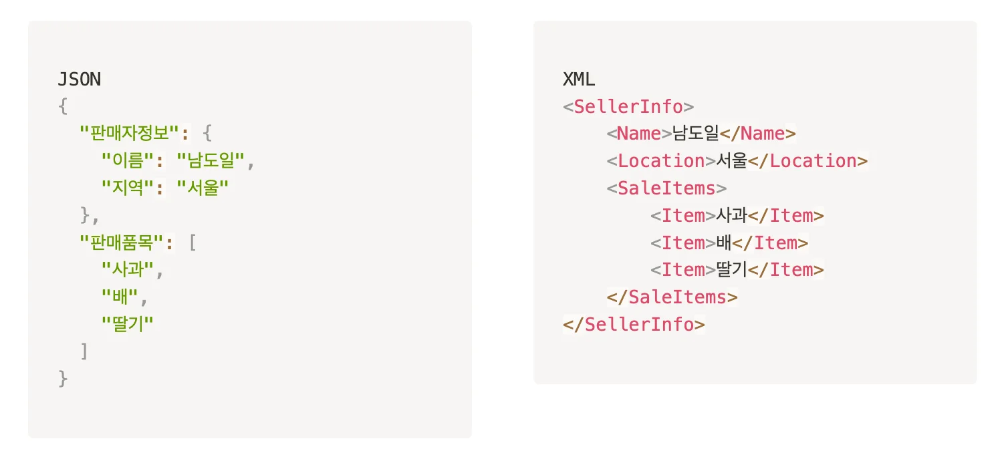

<a id="a13c1ac7ea2f4c95930bcf6eba62962d"></a>

<a href="https://beautiful-college-c84.notion.site/13b2dc3ef514805f9ba5fca3742d5b92">페이지</a> 

<a id="194eda9b0fe1803b9443f0dc3a2a0162"></a>

## 1&#46; Spring Boot 설정

> ✏️ 
> 
> <a id="194eda9b0fe180ccb1a4fd7bdcc7a1b8"></a>
> 
> <code>Gradle</code>은 자바, 코틀린 등을 비롯한 여러 언어의 프로젝트를 위한 오픈소스 <strong><u>빌드 자동화 시스템</u></strong>이다&#46;

<a id="194eda9b0fe18071bb88ec86d7ec8694"></a>

<code>build&#46;gradle</code> 파일은 Gradle 빌드 도구를 사용하는 프로젝트에서 매우 중요한 역할을 한다&#46;  

<a id="194eda9b0fe180649f53c18cbf1a0b4a"></a>

### <strong>build&#46;gradle의 구조와 역할</strong>

---

1. <strong>프로젝트 설정 (Project Configuration)</strong>

<a id="194eda9b0fe1802dae22e928be2643d8"></a>

```java
group 'com.example'
version '1.0-SNAPSHOT'
```

- 프로젝트의 기본 설정 정의, 프로젝트의 이름, 버전 등의 기본 정보가 포함될 수 있다&#46; 

1. <strong>의존성 관리 (Dependencies Management)</strong>

<a id="194eda9b0fe18042aa2ccd91d2809ee6"></a>

```java
dependencies {
    implementation 'org.springframework.boot:spring-boot-starter-web'
    implementation 'org.springframework.boot:spring-boot-security'
    testImplementation 'junit:junit:4.12'
}
```

- 프로젝트가 필요로 하는 외부 라이브러리(dependencies) 선언
    - 프로젝트의 실행, 컴파일, 테스트 등에 필요한 모든 라이브러리가 포함

1. <strong>플러그인 (Plugins)</strong>

<a id="194eda9b0fe18049b64bc453e23ac5e0"></a>

```java
plugins {
    id 'java'
    id 'org.springframework.boot' version '2.4.1'
}
```

- 프로젝트를 빌드하고 관리하기 위해 필요한 Gradle 플러그인을 적용
    - Java 프로젝트를 위한 <code>java</code> 플러그인 

    - Spring Boot 프로젝트를 위한 <code>org&#46;springframework&#46;boot</code> 플러그인

    - 등…

1.  <strong>태스크 설정 (Task Configuration)</strong>

<a id="194eda9b0fe18054a2f9c1f71345b23c"></a>

```java
task myTask {
    doLast {
        println 'Hello, Gradle!'
    }
}
```

- Gradle 빌드 프로세스를 커스터마이징하기 위해 사용자 정의 태스크 설정 가능

1. <strong>빌드 설정 (Build Configuration)</strong>

<a id="194eda9b0fe180638a96e56a444cbab0"></a>

```java
compileJava {
    options.encoding = 'UTF-8'
}
```

- 빌드 스크립트에서 컴파일 옵션, 패키징 방법 등을 세부적으로 설정 가능

<a id="194eda9b0fe1802f8f00f8d33e0b3b7c"></a>

## 2&#46; RESTful API 설계

<a id="194eda9b0fe180418a47e50ee630cb71"></a>

### 1&#46; RESTful API

- REST(Representational State Transfer)는 웹 표준을 기반으로 하는 API 설계 아키텍처이다&#46;

- RESTful API는 네트워크 상에서 클라이언트와 서버 간의 통신을 위해 자원(Resource)의 상태를 전달하는 방법을 정의한다&#46;

- 클라이언트가 서버의 자원에 접근하고 이를 활용할 수 있도록 하는 역할을 한다&#46;

<a id="194eda9b0fe1808e89d5f790498f4510"></a>

### 2&#46; 자원 중심의 URI 설계

- <strong>자원의 식별</strong>&#58; 각 자원은 명확한 URI로 식별되어야 합니다&#46;

- <strong>URI는 명사를 사용</strong>&#58; 자원은 동사가 아닌 명사를 사용하여 표현합니다&#46; 예&#58; <code>/getUsers</code> 대신 <code>/users</code>

<a id="194eda9b0fe18035a321ea108798bf9c"></a>

### 3&#46; HTTP 메서드를 통한 행위 정의

- <strong>GET</strong>&#58; <code>자원 조회</code>, 서버에 데이터를 변경하지 않는 안전한(read&#45;only) 작업에 사용

- <strong>POST</strong>&#58; <code>새로운 자원 생성</code>, 예를 들어, 새 사용자 추가에 사용된다&#46;

- <strong>PUT</strong>&#58; <code>자원 업데이트</code>,자원의 전체를 교체하는 데 사용됩니다&#46;

- <strong>DELETE</strong>&#58; <code>자원 삭제</code>

<a id="194eda9b0fe180e492fbf34730040098"></a>

### 4&#46; 데이터 포맷

- <code>JSON(JavaScript Object Notation)</code> 형식을 통해 데이터를 교환하는 것이 <strong><u>트렌드</u></strong>
    -  XML보다 가볍고, 인간이 읽기 쉽다&#46;



<a id="194eda9b0fe18044afa5ec47b4917462"></a>

## 3&#46; Spring MVC &#45; 요청 데이터

<a id="194eda9b0fe180248fb9dfd1b692124f"></a>

### <code>&#64;PathVariable</code>

- URL 경로에 포함된 변수를 컨트롤러 메서드의 매개변수로 바인딩하는데 사용

- 특징
    - URL 경로의 일부를 변수로 사용 →  동적으로 변하는 URL 경로 처리

    - 간결하고 직관적인 API 경로를 설계 가능

    <details>
    <summary>ex)</summary>

    - <strong>Spring Controller 예제</strong>
        <a id="194eda9b0fe1802d9d92e130f31a806f"></a>

        ```java
        @RestController
        @RequestMapping("/users")
        public class UserController {

            @GetMapping("/{userId}")
            public String getUser(@PathVariable("userId") Long userId) {
                // userId를 사용한 로직 처리
                return "User ID: " + userId;
            }
        }
        ```

    - <strong>cURL 요청</strong>
        <a id="194eda9b0fe1805aab83db64597e3ac5"></a>

        ```java
        curl -X GET "<http://localhost:8080/users/123>"
        ```

    - Path Variable
        <a id="194eda9b0fe180c49fa9f72aa69854b8"></a>

        ```java
        userId = 123
        ```

    </details>

<a id="194eda9b0fe180ce9b47f27e76b38ba4"></a>

### <code>&#64;RequestParam</code> 

- <strong>개념</strong>&#58; <code>&#64;RequestParam</code>은 클라이언트가 전송하는 HTTP 요청 파라미터를 컨트롤러 메서드의 매개변수로 바인딩하는 데 사용됩니다&#46;

- <strong>특징</strong>&#58;
    - URL에서 지정된 이름의 파라미터를 메서드 매개변수로 전달합니다&#46;

    - 필수 여부, 기본값 설정 등의 추가적인 설정이 가능합니다&#46;

<details>
<summary><strong>예제 코드</strong></summary>

- <strong>Spring Controller 예제</strong>&#58;
    <a id="194eda9b0fe18041ac67c897b44d497c"></a>

    ```java
    @GetMapping("/products")
    public String getProduct(@RequestParam("id") Long productId) {
        // productId를 사용한 로직 처리
    }

    ```

- <strong>cURL 요청</strong>&#58;이 cURL 요청은 <strong><code>id</code></strong> 파라미터로 <strong><code>123</code></strong>을 전달합니다&#46;
    <a id="194eda9b0fe180b7a3a5c311dbd19eea"></a>

    ```shell
    curl -X GET "http://localhost:8080/products?id=123"
    ```

</details>

<a id="194eda9b0fe180d092efe00400e6c617"></a>

### <code>&#64;ModelAttribute</code> 

- <strong>개념</strong>&#58; <code>&#64;ModelAttribute</code>는 요청 파라미터를 객체로 매핑하여, 복잡한 데이터 구조를 쉽게 다루게 해줍니다&#46;

- <strong>특징</strong>&#58;
    - 폼 데이터의 각 필드가 객체의 필드와 자동으로 매핑됩니다&#46;

    - 복잡한 객체 구조의 데이터를 간편하게 처리할 수 있습니다&#46;

<details>
<summary><strong>예제 코드</strong>&#58;</summary>

- <strong>Spring Controller 예제</strong>&#58;
    <a id="194eda9b0fe180caa101eae81acab455"></a>

    ```java
    @PostMapping("/register")
    public String registerUser(@ModelAttribute User user) {
        // user 객체를 사용한 로직 처리
    }
    ```

- <strong>cURL 요청</strong>&#58;이 cURL 요청은 <strong><code>username</code></strong>과 <strong><code>email</code></strong> 폼 데이터를 전송합니다&#46;
    <a id="194eda9b0fe180a6afc7cfe949926065"></a>

    ```shell
    curl -X POST "http://localhost:8080/register" -d "username=JohnDoe&email=john@example.com"
    ```

</details>

<a id="194eda9b0fe1800291e9eb33e6de8e31"></a>

### <code>&#64;RequestBody</code> 

- <strong>개념</strong>&#58; <code>&#64;RequestBody</code>는 클라이언트가 전송하는 HTTP 요청의 본문(body)을 Java 객체로 변환하여 받습니다&#46;

- <strong>특징</strong>&#58;
    - HTTP 요청 본문의 내용을 자바 객체로 역직렬화합니다&#46;

    - 주로 JSON형식의 데이터 처리에 사용됩니다&#46;

<details>
<summary><strong>예제 코드</strong></summary>

- <strong>Spring Controller 예제</strong>&#58;
    <a id="194eda9b0fe1801ca58fd21ce6373013"></a>

    ```java
    @PostMapping("/api/user")
    public String apiUser(@RequestBody User user) {
        // user 객체를 사용한 로직 처리
    }
    ```

- <strong>cURL 요청</strong>&#58;이 cURL 요청은 JSON 형식의 본문 데이터를 전송하며, <strong><code>Content&#45;Type</code></strong> 헤더를 <strong><code>application/json</code></strong>으로 설정합니다&#46;
    <a id="194eda9b0fe180efa24fca658140b5e0"></a>

    ```shell
    curl -X POST "http://localhost:8080/api/user" -H "Content-Type: application/json" -d '{"username":"JohnDoe", "email":"john@example.com"}'
    ```

</details>

<a id="194eda9b0fe1800dbc66e0be8ded85b7"></a>

### ex) 도서관 API 설계

1. <strong>도서 (Books)</strong>
    - <strong><code>GET /books</code></strong> &#45; 모든 도서 조회

    - <strong><code>GET /books/{id}</code></strong> &#45; 특정 도서 조회

    - <strong><code>POST /books</code></strong> &#45; 새로운 도서 생성

    - <strong><code>PUT /books/{id}</code></strong> &#45; 기존 도서 정보 업데이트

    - <strong><code>DELETE /books/{id}</code></strong> &#45; 도서 삭제

    <details>
    <summary>ex)</summary>

    <a id="194eda9b0fe1808dbc66d1a8050a28dc"></a>

    ```javascript
    Method / URI / Param / PathVariable / Body 


    Post /books/3/loans 
    Get /books/3/loans/{?}
    Post /loans?booksId=3
    Post /loans?booksId=3
    Get /books/3 -> Post/loans?bookId=3
    ```

    </details>

1. <strong>대출 (Loans)</strong>
    - <strong><code>GET /loans</code></strong> &#45; 모든 대출 조회

    - <strong><code>GET /loans/{id}</code></strong> &#45; 특정 대출 조회

    - <strong><code>POST /loans</code></strong> &#45; 새로운 대출 생성

    - <strong><code>PUT /loans/{id}</code></strong> &#45; 기존 대출 정보 업데이트

    - <strong><code>DELETE /loans/{id}</code></strong> &#45; 대출 삭제

    <details>
    <summary>ex)</summary>

    <a id="194eda9b0fe1802698c7dd3091d995f0"></a>

    ```javascript
    Method / URI / Param / PathVariable / Body 

    PUT /loans/3 -d "{*******}"
    PUT /books?bookId=3 -d "반납"

    Get /student/1/score?subjectsience

    PUT /post/3/comment/53
    ```

    </details>
