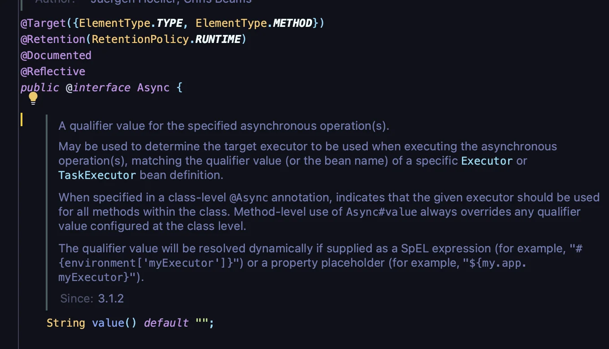
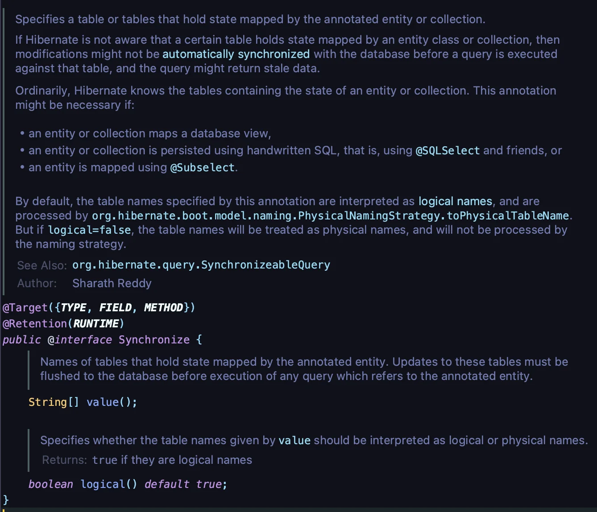
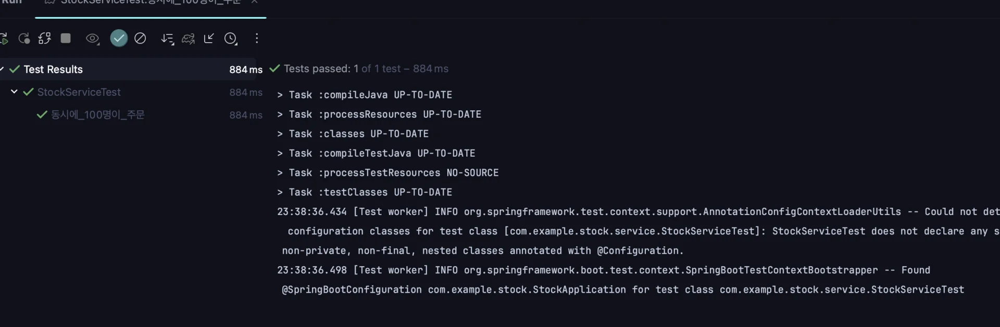
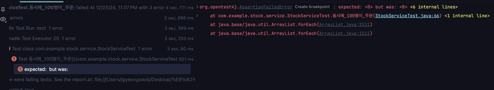
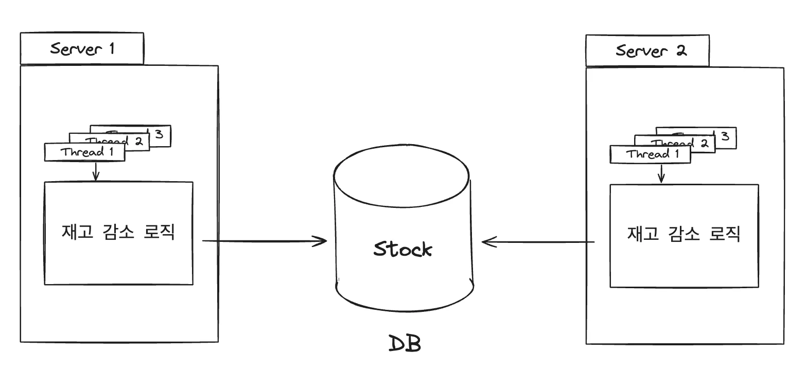

<details>
<summary><strong>🧐 </strong><strong><code>모니터 락(Monitor Lock)</code></strong></summary>

<details>
<summary>정의</summary>

- 자바에서 동기화를 구현하기 위해 사용되는 기본적인 메커니즘

- 자바의 모든 객체는 <u>암묵적으로 </u><strong><u>모니터 락</u></strong><u>을 가지고 있</u>으며, <code>synchronized</code> 키워드를 사용하면 해당 객체의 모니터 락을 획득하여 동기화된 코드 블록을 실행한다&#46;

- 여러 스레드가 동시에 접근하는 공유 자원(예&#58; 변수, 데이터 구조)을 보호하기 위해 사용된다&#46; 

</details>

<details>
<summary>동작 원리</summary>

1. <strong>모니터 락 획득</strong>
    <a id="d95eda9b0fe183399b41816adfdf2da0"></a>

    스레드가 <code>synchronized</code><u> 블록 또는 메서드</u>에 진입하려면 먼저 해당 객체의 모니터 락을 획득해야한다&#46;

1. 단일 스레드 접근
    <a id="af6eda9b0fe1837e895e01f5d46dd60e"></a>

    <strong><u>한 번에 하나의 스레드만 락을 획득</u></strong>할 수 있다&#46;

    <a id="d5ceda9b0fe18326bf52811114c6cc65"></a>

    <strong><u>다른 스레드는 락이 해제될 때까지 대기 상</u></strong>태가 된다&#46;

1. <strong>락 해제</strong>
    <a id="9ceeda9b0fe1829c82fd814313e45e88"></a>

    <strong><u>락을 보유한 스레드</u></strong>가 <u>블록을 벗</u>어나거나 <u>메서드 실행을 완료</u>하면 <strong><u>락이 해제</u></strong>된다&#46;

</details>

<details>
<summary>특징</summary>

- <strong>객체 단위 락</strong>
    - synchronized는 기본적으로 객체 단위의 락을 사용한다&#46;

    - ex) <code>synchronized(this)</code> 사용, <strong><u>현재 객체(this)의 모니터 락을 획득 가능</u></strong>

- 클래스 단위 락
    - <code>static synchronized</code> 메서드는 클래스 수준에서 락을 획득하며, 모든 인스턴스에 대해 동기화를 적용한다&#46; 

</details>

<details>
<summary>장단점</summary>

- 장점
    - 간단한 문법으로 동기화를 구현할 수 있다&#46; 

    - 코드 블록 또는 메서드 수준에서 제어가 가능하다&#46; 

- 단점
    - 락 경쟁이 심하면 성능 저하가 발생할 수 있다&#46; 

    - 블로킹 방식으로 동작하므로 비동기 처리가 불가능하다&#46; 

</details>

<details>
<summary>ex)</summary>

<a id="aa3eda9b0fe18264b51b0163f68c03eb"></a>

```java
public class Counter {
    private int count = 0;

    // 객체 락 사용
    public synchronized void increment() {
        count++;
    }

    // 특정 블록만 동기화
    public void decrement() {
        synchronized (this) {
            count--;
        }
    }

    // 클래스 락 사용
    public static synchronized void staticMethod() {
        // 클래스 수준 동기화
    }
}
```

</details>

</details>

<details>
<summary>🧐 <strong><code>TaskExecutor</code></strong></summary>

<details>
<summary>정의</summary>

- Spring에서 <strong><u>비동기 작업</u></strong>을 실행하기 위해 제공되는 인터페이스

- 내부적으로<strong><u> 쓰레드 풀(Thead Pool)을 사용하여 작업을 관리</u></strong>하며, <strong><u>효율적인 멀티스레드 환경을 제공</u></strong>한다&#46; 

</details>

<details>
<summary>주요 역할</summary>

- 비동기 작업 처리
    <a id="f34eda9b0fe1821f9b5f814fa08b703a"></a>

    <code>&#64;Async</code> 어노테이션과 함께 사용하여 작업을 별도의 스레드에서 실행한다&#46; 

- 스레드 풀 관리
    <a id="d0feda9b0fe18337be30017a613b63f2"></a>

    <strong>작업 처리 중 스레드를 생성하거나 재사용</strong>하여 <strong><u>성능을 최적화</u></strong>한다&#46; 

- 병렬 실행
    <a id="479eda9b0fe1829b9d43819670e6326b"></a>

    여러 작업을 병렬로 실행하여 응답 시간을 단축한다&#46; 

</details>

<details>
<summary><strong>주요 구현체</strong></summary>

<a id="9c3eda9b0fe18322b79c01190fc02b03"></a>

Spring에서 제공하는 다양한 TaskExecutor 구현체가 있으며, 용도에 따라 선택 할 수 있다&#46;

- <code>SimpleAsyncTaskExecutor</code>
    - 매번 새로운 스레드를 생성 (가벼운 작업에 적합)

- <code>ThreadPoolTaskExecutor</code>
    - 스레드 풀을 관리하며, 대부분의 경우 권장되는 구현체

- <code>ConcurrentTaskExecutor</code>
    - JDK의 java&#46;util&#46;concurrent&#46;Executor를 감싸는 구현체

- <code>SyncTaskExecutor</code>	
    - 비동기 작업을 동기 방식으로 처리 (테스트용)

</details>

<details>
<summary>장단점</summary>

- 장점
    - 작업을 병렬로 실행하여 성능을 최적화

    - 개발자가 직접 스레드를 관리하지 않아도 됨

- 단점
    - 스레드 풀 크기와 작업의 성격에 따라 성능이 제한될 수 있음

    - 잘못 설정된 경우 스레드 경합이나 리소스 부족 문제가 발생할 수 있음

</details>

<details>
<summary>설정 및 사용법</summary>

1. <strong>Configuration 설정</strong>
    - <code>&#64;EnableAsync</code> 추가 → 비동기 작업을 사용

    <a id="b6beda9b0fe182fdba3681e3477a7374"></a>

    ```java
    @Configuration
    @EnableAsync
    public class AsyncConfig {
        @Bean
        public Executor taskExecutor() {
            ThreadPoolTaskExecutor executor = new ThreadPoolTaskExecutor();
            executor.setCorePoolSize(5);       // 기본 스레드 수
            executor.setMaxPoolSize(10);       // 최대 스레드 수
            executor.setQueueCapacity(25);     // 대기 큐 크기
            executor.setThreadNamePrefix("Async-Thread-");
            executor.initialize();
            return executor;
        }
    }
    ```

1. <strong>서비스에서 사용</strong>
    <a id="976eda9b0fe183fc937281df4e5fa319"></a>

    ```java
    @Service
    public class AsyncService {
        @Async
        public void performAsyncTask() {
            System.out.println("비동기 작업 실행: " + Thread.currentThread().getName());
        }
    }
    ```

<a id="010eda9b0fe1828bad9581563dd6efcb"></a>

3&#46; <strong>호출</strong>

- <code>&#64;Asyn</code>c 메서드 → 별도의 쓰레드에서 실행

<a id="fa3eda9b0fe183d5a8a9811f203f6133"></a>

```java
@RestController
public class AsyncController {
    private final AsyncService asyncService;

    public AsyncController(AsyncService asyncService) {
        this.asyncService = asyncService;
    }

    @GetMapping("/async")
    public String executeAsync() {
        asyncService.performAsyncTask();
        return "비동기 작업 요청 완료";
    }
}
```

<a id="956eda9b0fe183fea6d50160b0f31ca9"></a>

<br>

</details>

</details>

<a id="5fceda9b0fe1825a863b016dca4f39a0"></a>

### <strong>🧐 </strong><strong><code>synchronized</code></strong><strong>, </strong><strong><code>&#64;Async</code></strong><strong>, </strong><strong><code>&#64;Synchronized</code></strong><strong>의 차이점</strong>

---

<details>
<summary><strong>1&#46; </strong><strong><code>synchronized</code></strong><strong> (Java 키워드)</strong></summary>

-  <strong><u>Java의 키워드</u></strong>로, 특정 블록이나 메서드에 대해 <code>스레드 안전(Thread&#45;Safety)</code>을 보장한다&#46;
    - 이전에 살펴본 <strong><u>레이스 컨디션</u></strong>에 대한 문제를 보장한다&#46; 

- 즉, 한 개의 쓰레드만 <code>synchronized</code> <u>블록</u> 또는 <u>메서드</u>에 접근 가능토록 한다
    - 해당 객체 또는 클래스 레벨의 <code>모니터 락(Monitor Lock)</code>을 사용한다&#46;

- <strong><u>단일 JVM에서만 작동</u></strong>한다&#46; 따라서 <u>분산 환경에서는 동작이 불가능</u>하다&#46; 

- 기본적으로 <strong>블로킹</strong> 방식으로 동작하므로 성능에 영향을 줄 수 있다&#46;
    - 하나의 쓰레드가 작업이 끝나지 전까지 다음 쓰레드의 작업이 블로킹 된다(막힌다)&#46;  

<details>
<summary>ex)</summary>

<a id="ca9eda9b0fe18209a81f810881f6c4fd"></a>

```java
public synchronized void criticalSection() {
    // 한 번에 하나의 스레드만 이 메서드에 접근 가능
}

public void criticalSection() {
    synchronized (this) {
        // 특정 블록에만 락 적용
    }
}
```

</details>

</details>

<details>
<summary><strong>2&#46; </strong><strong><code>&#64;Async </code></strong><strong>(Spring 어노테이션)</strong></summary>



- <strong><u> Spring 프레임워크</u></strong>에서 비동기(Asynchronous) 처리를 위한 어노테이션

- <code>&#64;Async</code>를 붙인 메서드는 호출 <strong><u>즉시 다른 스레드에서 실행</u></strong>되며, <strong><u>호출한 스레드는 해당 메서드의 실행을 기다리지 않</u></strong>는다&#46;

- Spring의 <code>TaskExecutor</code>를 사용하여 <u>백그라운드 스레드를 관리</u>한다&#46;

- <strong><u>비동기 처리</u></strong>를 통해<strong><u> 병렬 실행을 구현</u></strong>한다&#46; 

- 동기화와 관련된 기능은 없으며, 성능최적화가 목적이다&#46; 

</details>

<details>
<summary><strong>3&#46;  </strong><strong><code>&#64;Synchronized</code></strong><strong> (Lombok 어노테이션)</strong></summary>



- Lombok에서 제공하는 어노테이션으로, Java의 <code>synchronized</code>를 대체한다&#46;

- 메서드 수준에서 동기화를 지원하며, synchronized 키워드와 동일한 기능을 제공한다&#46;

- 메서드 호출 시 <strong>락 객체</strong>를 자동으로 생성하여 스레드 안전을 보장함

---

- 클래스의 <strong>인스턴스 락</strong>(기본적으로 this)을 사용하지만, 별도의 락 객체를 지정할 수 있다&#46;

- static 메서드에서는 클래스 수준의 락(Class 객체)을 사용한다&#46;

- Java의 synchronized와 달리 <strong><u>클래스 수준과 인스턴스 수준</u></strong><u>을 구분</u>하여 적용할 수 있다&#46;
    - 가독성 향상

<details>
<summary>ex) </summary>

<a id="c27eda9b0fe1839bb4e201f8bb6633b7"></a>

```java
@Synchronized
public void synchronizedMethod() {
    // 한 번에 하나의 스레드만 이 메서드에 접근 가능
}
```

</details>

</details>

<a id="1ebeda9b0fe18220be4281c60b28e949"></a>

## Synchronized

---

<a id="4f7eda9b0fe182c08a53810a64312c24"></a>

자바에서는 <code>Synchronized</code>를 사용하면 손쉽게 한 개의 쓰레드만 접근 가능하도록 할 수 있다&#46; 

<a id="1e4eda9b0fe1820bae7a0112540aa510"></a>

<code>Synchronized</code>를 아래와 같이 메서드 선언부에 붙여주면 해당 메서드는 한 개의 Thread만 접근이 가능하다&#46;

<a id="cadeda9b0fe182d4a7cd013b369efb30"></a>

```java
@Service
public class StockService {

    private final StockRepository stockRepository;

    public StockService(StockRepository stockRepository) {
        this.stockRepository = stockRepository;
    }


    public synchronized void  decrease(Long id, Long quantity) {
        // Stock 조회
        // 재고를 감소한 뒤
        // 갱신된 값을 저장
        Stock stock = stockRepository.findById(id).orElseThrow();
        stock.decrease(quantity);

        stockRepository.saveAndFlush(stock);
    }
}
```

<details>
<summary>이전 실패한 테스트 케이스  → 정상 실행됨</summary>

- <code>Synchronized</code> 적용 전, 레이스 컨디션으로 인해 테스트 실패함

<a id="f88eda9b0fe182a19d7a81a8037cf4a4"></a>

```java
@Test
public void 동시에_100개의_요청() throws InterruptedException {
    int threadCount = 100;
    ExecutorService executorService = Executors.newFixedThreadPool(32);
    CountDownLatch latch = new CountDownLatch(threadCount);

    for (int i = 0; i < threadCount; i++) {
        executorService.submit(() -> {
            try {
                stockService.decrease(1L, 1L);
            } finally {
                latch.countDown();
            }
        });
    }

    latch.await();

    Stock stock = stockRepository.findById(1L).orElseThrow();

    // 100 - ( 1 * 100 ) = 0
    assertEquals(0, stock.getQuantity());
}
```

- 결과 &#45; 테스트 성공
    

</details>

<a id="7aeeda9b0fe1822e9cda0142e91e6aed"></a>

### 🤬 오류 &#45; <code>&#64;Transactional</code>,  <code>synchronized</code> 동시에 사용 시 라이프사이클 불일치로 인한 오류 발생

<details>
<summary>문제 코드</summary>

<a id="72ceda9b0fe182b987dc81798ac212db"></a>

```java
@Transactional
public synchronized void  decrease(Long id, Long quantity) {
    // Stock 조회
    // 재고를 감소한 뒤
    // 갱신된 값을 저장
    Stock stock = stockRepository.findById(id).orElseThrow();
    stock.decrease(quantity);

    stockRepository.saveAndFlush(stock);
}
```

<details>
<summary>테스트 코드</summary>

<a id="9f0eda9b0fe18296b9a7816488204961"></a>

```java
@Test
public void 동시에_100명이_주문() throws InterruptedException {
    int threadCount = 100;
    ExecutorService executorService = Executors.newFixedThreadPool(32);
    CountDownLatch latch = new CountDownLatch(threadCount);

    for (int i = 0; i < threadCount; i++) {
        executorService.submit(() -> {
            try {
                stockService.decrease(1L, 1L);
            } finally {
                latch.countDown();
            }
        });
    }
    latch.await();

    Stock stock = stockRepository.findById(1L).orElseThrow();

    // 100 - (100 * 1) = 0
    assertEquals(0, stock.getQuantity());
}
```

</details>

<a id="b4aeda9b0fe1837bb2368101ab135502"></a>

위와 같이 <code>&#64;Transactional</code>, <code>synchronized</code>를 동시에 적용 시, 아래와 같이 테스트 가 실패함



</details>

<details>
<summary>원인</summary>

> 
> 
> - <code>&#64;Transactional</code>
>     - <strong>트랜잭션 관리</strong>와 관련된 애노테이션
> 
>     - 메서드가 실행되는 동안 데이터베이스와의 연결을 관리
> 
>     - 예외가 발생하면 롤백하거나 성공하면 커밋
> 
> - <code>synchronized</code>
>     - <strong>동기화</strong>와 관련된 키워드
> 
>     - 여러 스레드가 동시에 해당 메서드를 실행하지 못하도록 보장한다&#46;

<a id="621eda9b0fe1839d9af701d1b4f12222"></a>

<code>&#64;Transactional</code>, <code>synchronized</code> <strong><u>둘이 경합</u></strong><strong>되었을 때, 문제가 발생</strong>된다&#46; 

<a id="fc1eda9b0fe183f280980157b9045a0c"></a>

<code>synchronized</code>는 <strong><u>JVM 메서드 락을 사용</u></strong>하여 멀티스테드 환경에서 한 번에 하나의 스레드만 해당 메서드를 실행하도록 보장한다&#46;

<a id="7a6eda9b0fe183a4bf9b017a248c7492"></a>

하지만, <code>&#64;Transactional</code>은 트랜잭션을 관리하는 <strong><u>별도의</u></strong><strong><u> 프록시(래핑 클래스)</u></strong><strong><u>를 통해 동작</u></strong>한다&#46; 

<details>
<summary>ex) 래핑 클래스 &#45; <code>TransactionStockService</code></summary>

<a id="33eeda9b0fe180ce9c0ef488ed92d7ec"></a>

```java
public class StockService {

	. . .

	@Transactional
	public synchronized void  decrease(Long id, Long quantity) {
	    // Stock 조회
	    // 재고를 감소한 뒤
	    // 갱신된 값을 저장
	    Stock stock = stockRepository.findById(id).orElseThrow();
	    stock.decrease(quantity);
	
	    stockRepository.saveAndFlush(stock);
	}
```

- <code>&#64;Transactional</code>  적용 시 Spring 내부적으로 아래와 같은 프록시 클래스를 생성하여 처리한다&#46; 

<a id="bb3eda9b0fe182a0987881bdf773e24a"></a>

```java
public class TransactionStockService {

    private StockService stockService;

    public TransactionStockService(StockService stockService) {
        this.stockService = stockService;
    }

    public void decrease(Long id, Long quantity){
        startTransaction();

        stockService.decrease(id, quantity);

        endTransaction();
    }

    private void startTransaction() {
        System.out.println("Transaction Start");
    }

    private void endTransaction() {
        System.out.println("Commit");
    }
}
```

- 아래와 같이 <code>&#64;Transactional</code>이  적용된 <code>stockService</code>를 필드로 가지는 래핑 클래슬 새로 만들고 해당 메서드에  트랜잭션의 시작과  끝을 적용하여 트랜잭션 단위로 관리한다&#46;

</details>

<a id="584eda9b0fe183ad857c0110cfc08ae9"></a>

여기서 문제가 발생되는 데, 트랜잭션 종료 시점에 데이터베이스가 업데이트가 되지만, 

<a id="04ceda9b0fe18203bbf98192313bf213"></a>

<code>synchronized</code>가 적용된 <code>stockService&#46;decrease()</code>는  그 이전에 종료가 된다&#46; 

- <u>프록시가 생성될 때, </u><strong><u>synchronized 키워드는 프록시 객체에 적용되지 않</u></strong>는다&#46; 

<a id="7d0eda9b0fe183fa8e54018fdd4b52b1"></a>

따라서 <code>stockService&#46;decrease()</code> 종료된 시점과 트랜잭션 종료되어 갱신되는 시점 사이의 간격에 다른 Thread에서 값을 읽어와 동일하게 <strong><u>레이스 컨디션 </u></strong>문제가 발생된다&#46; 

<a id="dcdeda9b0fe18366bc2381117994f317"></a>

```plaintext
------ stockService.decrease() 종료 ------ 
               ↑ 

       다른 Thread에서 값을 읽어옴  -> 레이스 컨디션 발생
               
               ↓
--------- 트랜잭션이 종료 -> 값 갱신 ----------
```

</details>

<details>
<summary>해결 </summary>

<a id="69beda9b0fe1821f82b201cc43ac78c8"></a>

위 오류에 원인은 <u><code>트랜잭션</code></u><u>(</u><u><code>&#64;Transactional</code></u><u>)</u>과 <u><code>synchronized</code></u><u>의 쓰레드</u>의 <strong><u>라이프라이클이 동일하지 않</u></strong>아 발생되는 문제이다&#46; 

<a id="840eda9b0fe1820381c681d186f2f6f7"></a>

```java
@Service
public class StockService {

    private final StockRepository stockRepository;

    public StockService(StockRepository stockRepository) {
        this.stockRepository = stockRepository;
    }

		// @Transactional 제거
    public synchronized void  decrease(Long id, Long quantity) {
        // Stock 조회
        // 재고를 감소한 뒤
        // 갱신된 값을 저장
        Stock stock = stockRepository.findById(id).orElseThrow();
        stock.decrease(quantity);

        stockRepository.saveAndFlush(stock);
    }
}
```

<a id="673eda9b0fe1828eb9880174ac43b292"></a>

여기서는 간단하게 <code>&#64;Transactional</code>를 삭제하여 <code>synchronized</code>만 적용하여 해결한다&#46; 

</details>

<a id="f4feda9b0fe183a8b8ff017a196de842"></a>

## 문제점

---

<a id="9b6eda9b0fe183238ab10132f6f83fdd"></a>

Java의 <code>Synchronized</code>는 하나의 프로세스 안에서만 보장된다&#46; 

<a id="b2feda9b0fe182e1b629813f8f0583b5"></a>

서버가 1대일 때는 데이터 접근을 1대의 서버에서만 해 괜찮지만,

<a id="097eda9b0fe18389b88a81e8a8526c45"></a>

2대  혹은 그 이상일 경우<strong><u> 데이터의 접근을 여러 서버에서 접근</u></strong>하기 때문에 동시성 문제가 발생될 수 있다&#46; 



<a id="9b0eda9b0fe1823f8fbf8139fa41207e"></a>

예를 들어, <code>서버 1</code>에서 10시에 재고 감소 로직을 시작하고 10&#58;05에 종료하게 설정하였을 때,

<a id="5bbeda9b0fe18340842c81cea6ed107e"></a>

<code>서버 2</code> 에서 10시에서 10시 5분 사이에 갱신되지 않는 재고를 가져가 새로운 값으로 갱신할 수 있다&#46;

<a id="667eda9b0fe182df932881fdbf88e27d"></a>

따라서 <code>synchronized</code>는  <strong><u>각 프로세스(서버) 안에서만 보장</u></strong>되기 때문에, 여러 서버가 있는 <strong>분산 환경</strong>에서는 <strong><u>결국 스레드에서 동시에 데이터 접근</u></strong>을 할 수 있게 되면서 <strong>레이스 컨디션</strong>이 발생된다&#46; 

| Time | <code>Server &#45; 1</code> | Stock | <code>Server &#45; 2</code> |
| --- | --- | --- | --- |
| 10&#58;00 | select &#42;<br>from stock<br>where id = 1 | { id&#58; 1, quantity&#58; 5 } |  |
|  |  | { id&#58; 1, quantity&#58; 5 } | select &#42;<br>from stock<br>where id = 1 |
| 10&#58; 05 | update set quantity = 4<br>from stock<br>where id = 1 | { id&#58; 1, quantity&#58; 4} |  |
|  |  | { id&#58; 1, quantity&#58; 4 } | update set quantity = 3<br>from stock<br>where id = 1 |

<a id="68aeda9b0fe1820b8c8f81a550361ea9"></a>

실제 운영 중인 서비스들은 대부분 2대 이상의 서버를 사용하기 때문에, <code>synchronized</code>를 거의 사용하지 않는다&#46; 

<a id="6a7eda9b0fe1820ba1d70189c50b5267"></a>

이러한 문제를 해결하기 위해 MySQL에서 지원하는 방법으로 레이스 컨디션을 해결하는 방법을 다룬다&#46; 

<a id="857eda9b0fe1827f9ffc81c1b4127f03"></a>

→ 다음 챕터 확인
