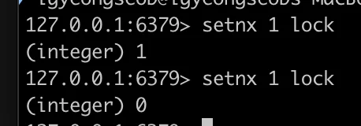

<a id="494eda9b0fe1833b8b5281e96d9dbfa5"></a>

## 1&#46; Docker &#45; redis cli에서의 Lock 테스트

> ✏️ 
> 
> <a id="6adeda9b0fe1835ba6ef014b7b790ce5"></a>
> 
> Redis를 활용한 방법은 MySQL의 Named Lock과 거의 비슷하다&#46; <br>Named Lock 과 다른 점은 <strong><u>‘Redis 사용’</u></strong> 및 <strong><u>‘Session 관리에 신경을 안 써도 된다’</u></strong> 는 점이다&#46;

<details>
<summary>1&#46; redis cli 실행</summary>

- 실행 컨테이너 확인
    <a id="782eda9b0fe18289ae24019d08067f65"></a>

    ```groovy
    docker ps
    ```

- redis cli 실행
    <a id="d69eda9b0fe1828c8ea98116e7541111"></a>

    ```groovy
    docker exec -it [컨테이너 ID] redis-cli
    ```

</details>

<details>
<summary>2&#46; 키를 통한 Lettuce lock 설정 및 삭제</summary>

<a id="696eda9b0fe183ab85920128de3cddaf"></a>

```docker
# key에 lock 설정
setnx 1 lock

# 삭제 
del 1
```

- 실행 결과
    

    - 성공&#58; <code>1</code>

    - 실패&#58; <code>0</code>

</details>

<a id="612eda9b0fe182af872381f183705101"></a>

## 2&#46; Redis 라이브러리 사용

- 코드
    <details>
    <summary>&#91; 코드 &#93; RedisLockRepository</summary>

    <a id="b3beda9b0fe182c8bab501f29c4396c2"></a>

    ```java
    package com.example.stock.repository;

    import org.springframework.data.redis.core.RedisTemplate;
    import org.springframework.stereotype.Component;

    import java.time.Duration;

    @Component
    public class RedisLockRepository {

        private final RedisTemplate<String, String> redisTemplate;

        public RedisLockRepository(RedisTemplate<String, String> redisTemplate) {
            this.redisTemplate = redisTemplate;
        }

        public Boolean lock(Long key) {
            return redisTemplate
                    .opsForValue()
                    .setIfAbsent(getneratekey(key), "lock", Duration.ofMillis(3_000));
        }

        public Boolean unlock(Long key) {
            return redisTemplate.delete(getneratekey(key));
        }

        private String getneratekey(Long key) {
            return key.toString();
        }
    }
    ```

    </details>

    <details>
    <summary>&#91; 코드 &#93; LettuceLockStockFacade</summary>

    <a id="9d8eda9b0fe183e89c6581afe165fcfa"></a>

    ```java
    package com.example.stock.facade;

    import com.example.stock.repository.RedisLockRepository;
    import com.example.stock.service.StockService;
    import org.springframework.stereotype.Component;

    @Component
    public class LettuceLockStockFacade {

        private final RedisLockRepository redisLockRepository;
        private final StockService stockService;

        public LettuceLockStockFacade(RedisLockRepository redisLockRepository, StockService stockService) {
            this.redisLockRepository = redisLockRepository;
            this.stockService = stockService;
        }

        public void decrease(Long id, Long quantity) throws InterruptedException {
            while (!redisLockRepository.lock(id)) {
                Thread.sleep(1000);
            }

            try {
                stockService.decrease(id, quantity);
            } finally {
                redisLockRepository.unlock(id);
            }

        }
    }

    ```

    </details>

    <details>
    <summary>&#91; 코드 &#93; LettuceLockStockFacadeTest</summary>

    <a id="032eda9b0fe1828bb80801d41f49ea19"></a>

    ```java
    package com.example.stock.facade;

    import com.example.stock.domain.Stock;
    import com.example.stock.repository.StockRepository;
    import org.junit.jupiter.api.AfterEach;
    import org.junit.jupiter.api.BeforeEach;
    import org.junit.jupiter.api.Test;
    import org.springframework.beans.factory.annotation.Autowired;
    import org.springframework.boot.test.context.SpringBootTest;

    import java.util.concurrent.CountDownLatch;
    import java.util.concurrent.ExecutorService;
    import java.util.concurrent.Executors;

    import static org.junit.jupiter.api.Assertions.*;

    @SpringBootTest
    class LettuceLockStockFacadeTest {

        @Autowired
        private LettuceLockStockFacade lettuceLockStockFacade;

        @Autowired
        private StockRepository stockRepository;

        @BeforeEach
        public void before() {
            stockRepository.saveAndFlush(new Stock(1L, 100L));
        }

        @AfterEach
        public void after() {
            stockRepository.deleteAll();
        }

        // FIXME: lettuce 테스트 오류
        @Test
        public void 동시에_100명_주문() throws InterruptedException {
            int threadCount = 100;
            ExecutorService executorService = Executors.newFixedThreadPool(100);
            CountDownLatch latch = new CountDownLatch(threadCount);

            for (int i = 0; i < threadCount; i++) {
                executorService.submit(() -> {
                    try {
                        lettuceLockStockFacade.decrease(1L, 1L);
                    } catch (InterruptedException e) {
                        throw new RuntimeException(e);
                    } finally {
                        latch.countDown();
                    }
                });
            }
            latch.await();

            Stock stock = stockRepository.findById(1L).orElseThrow();

            // 100 - (100 * 1) = 0
            assertEquals(0, stock.getQuantity());
        }

    }
    ```

    </details>

<a id="e0deda9b0fe1830fbc9f0145d833a128"></a>

‣ &#45; <strong>lettuce에서 lock할 때 동시성 문제</strong>

- redis 는 싱글스레드로 동작하며 setnx 는 값이 존재하지 않을때만 값을 set 하는 명령어이다&#46;

- 그렇기때문에 여러스레드에서 동시에 접근하여도 이전스레드의 작업이 끝날때까지 대기했다가 명령어를 실행하게 된다&#46; 

- 이러한 원리로 동시성문제를 해결할 수 있다
