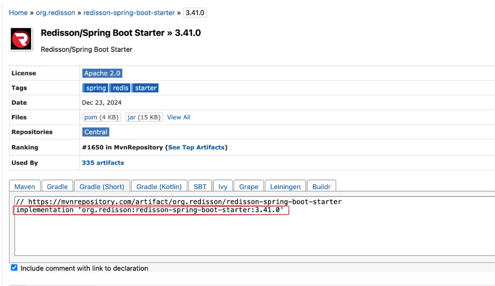
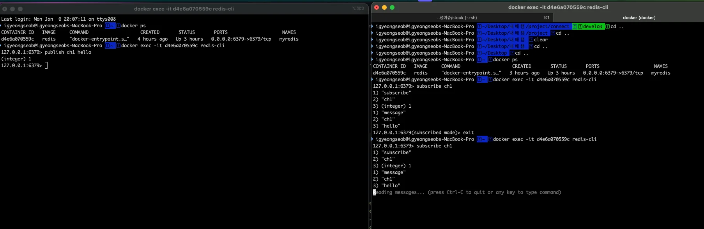

<a id="1c0eda9b0fe18220b525017450e450ae"></a>

## Template

---

> 📖 
> 
> <a id="7fbeda9b0fe18246b03d81b0c822e454"></a>
> 
> <code>Redisson</code>는 자신이 점유하고 있는 <strong><u>락을 해제</u></strong>할 때 <strong>채널에 메세지를 보내</strong> <strong><u>락을 획득해야하는 스레드</u></strong><strong>들</strong>에게 <strong><u>락 획득 메세지를 전달</u></strong>한다&#46; 
> 
> <a id="eb5eda9b0fe182758e9d811513e71b87"></a>
> 
> 그러면 전달 받은 스레드들을 락 획득을 시도한다&#46; 
> 
> <a id="1d4eda9b0fe182369efd8177c9648653"></a>
> 
> <code>Lettuce</code>는 <u>계속 락 획득을 시도</u>하는 반면, <code>Redisson</code>는 <strong><u>락이 해제 되었을 때, 한번 혹은 몇번만 시도</u></strong>하기 때문에 <strong><u>레디스의 부하를 줄</u></strong>여준다&#46; 

<details>
<summary>mvn(maven)에서 redisson 의존성 검색 및 추가하기</summary>

> ‣

- <strong><a href="https://mvnrepository.com/artifact/org.redisson/redisson-spring-boot-starter">Redisson/Spring Boot Starter</a></strong><strong>에 대한 의존성 추가하기 </strong>

- 원하는 version 클릭  &#45; Gradle(Short)  &#45; implementation 복사 후, build&#46;gradle에 추가 
    

</details>

<details>
<summary>Redisson &#45; Pub/Sub CLI 실습</summary>

- Docker  CLI
    - Redis Container Id 확인
        <a id="524eda9b0fe182babcc00109b4868c04"></a>

        ```docker
         docker ps
        ```

    - Redis CLI 실행
        <a id="8e4eda9b0fe1833abf110186b263edef"></a>

        ```docker
        docker exec -it [컨테이너 ID] redis-cli
        ```

        - 두개의 터미널 생성 및 Redis CLI 실행
            

    - 채널 구독 
        <a id="286eda9b0fe183449ff3815fc29dee97"></a>

        ```docker
        subscribe ch1
        # 채널 구독 
        	# 1) "subscribe"
        	# 2) "ch1"
        	# 3) (integer) 1   # 1: 성공
        # 발행된 메세지 구독(수신)
        	# 1) "message"
        	# 2) "ch1"
        	# 3) "hello"
        ```

    - 메세지 발행
        <a id="412eda9b0fe182e38de9015ad127bffd"></a>

        ```docker
        publish ch1 hello
        # 메세지 발생
        	# (integer) 1 # 1: 성공
        ```

</details>

<details>
<summary>Redisson &#45; Pub/Sub  코드 실습</summary>

<details>
<summary>Redisson 의존성 추가 </summary>

<a id="3b4eda9b0fe182649de5016fc2cdc52b"></a>

```groovy
dependencies {
		implementation 'org.redisson:redisson-spring-boot-starter:3.41.0'
```

</details>

<details>
<summary>&#91; 코드 &#93; RedissonLockStockFacade</summary>

<a id="b3deda9b0fe1826281690129b02e15f4"></a>

```groovy
@Component
public class RedissonLockStockFacade {

    private RedissonClient redissonClient;
    private StockService stockService;

    public RedissonLockStockFacade(RedissonClient redissonClient, StockService stockService) {
        this.redissonClient = redissonClient;
        this.stockService = stockService;
    }

    public void decrease(Long key, Long quantity) {
        RLock lock = redissonClient.getLock(key.toString());

        try {
            boolean available = lock.tryLock(10, 1, TimeUnit.SECONDS);

            if (!available) {
                System.out.println("lock 획득 실패");
                return;
            }

            stockService.decrease(key, quantity);
        } catch (InterruptedException e) {
            throw new RuntimeException(e);
        } finally {
            lock.unlock();
        }
    }
}
```

</details>

<details>
<summary>&#91; 코드 &#93; RedissonLockStockFacadeTest</summary>

<a id="d17eda9b0fe1820f930b816ffbcd1cad"></a>

```groovy
@SpringBootTest
class RedissonLockStockFacadeTest {

    @Autowired
    private RedissonLockStockFacade redissonLockStockFacade;

    @Autowired
    private StockRepository stockRepository;

    @BeforeEach
    public void insert() {
        Stock stock = new Stock(1L, 100L);

        stockRepository.saveAndFlush(stock);
    }

    @AfterEach
    public void delete() {
        stockRepository.deleteAll();
    }

    @Test
    public void 동시에_100개의요청() throws InterruptedException {
        int threadCount = 100;
        ExecutorService executorService = Executors.newFixedThreadPool(32);
        CountDownLatch latch = new CountDownLatch(threadCount);

        for (int i = 0; i < threadCount; i++) {
            executorService.submit(() -> {
                try {
                    redissonLockStockFacade.decrease(1L, 1L);
                } finally {
                    latch.countDown();
                }
            });
        }

        latch.await();

        Stock stock = stockRepository.findById(1L).orElseThrow();

        // 100 - (100 * 1) = 0
        assertEquals(0, stock.getQuantity());
    }
}
```

</details>

</details>

<details>
<summary>🤬 오류 &#45; 테스트 실패</summary>

<a id="47ceda9b0fe1820ab77d01d1fe532a4e"></a>

### 오류 원인

- Redis 키 충돌

<a id="eb3eda9b0fe182aa8433012b1952c4da"></a>

이전 CLI 실습 시, 생성한 key 값이 삭제되지 않고 남아있어 키 충돌이 발생

<a id="d15eda9b0fe18248bcd4818715f01b53"></a>

### 해결

<a id="886eda9b0fe1830ba30c01a95a8cb70e"></a>

```docker
# 실행 중 인 Redis Container 확인
docker ps

# Container 내부 redis-cli 접속
docker exec -it [redis 컨테이너 id] redis-cli

# 생성된 key 확인
gets *

# 생성된 key 삭제
DEL [key]
```

</details>
