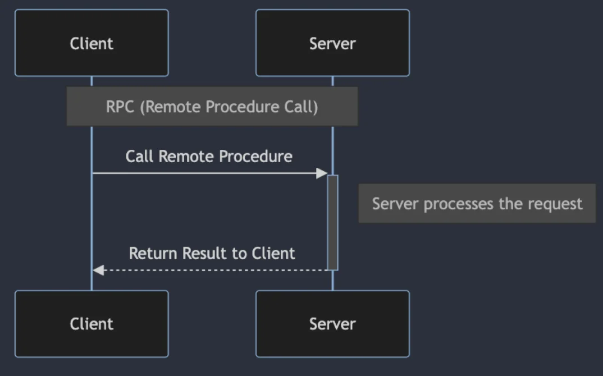
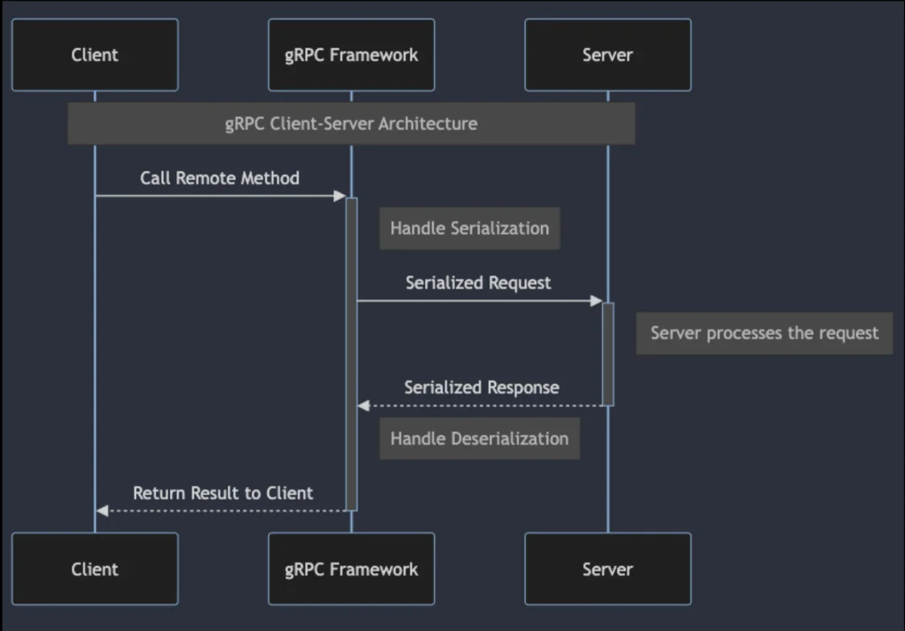
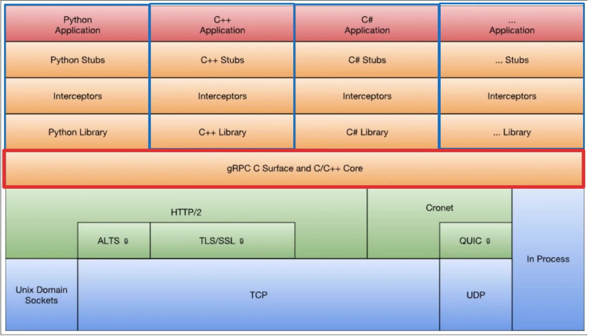

<a id="3a1eda9b0fe180338b9ec4c298f408b0"></a>

‣

<a id="3a1eda9b0fe180d685e4ce0347c8025d"></a>

## gRPC (google Remote Procedure Call)

---

> 📖 
> 
> <a id="3a1eda9b0fe180d9bb19c87b9fe0f518"></a>
> 
> <code>gRPC</code>
> 
> 
> 
> - 구글의 <code>스텁비(Stubby)</code>에서 시작되어 오픈소스화
>     - gRP의 공개 및 오픈소스화 (2015)
> 
> - CNCF (Cloud Native Computing Foundation) 합류 (2017)
> 
> - 지속적인 발전, 커뮤니티 성장

<a id="3a1eda9b0fe180dabb48df466265dedd"></a>

### gRPC 개념 이해

<details>
<summary>gRPC의 등장 배경</summary>

- 마이크로 서비스의 증가 

- 분산 시스템의 증가

- 효율적이고 강력한 시스템 간 통신 방법을 제공하기 위해 개발

</details>

<details>
<summary>gRPC 개념 이해&#58; <code>RPC (Remote Procedure Call)</code></summary>

> ✏️ 
> 
> <a id="3a1eda9b0fe1802091dec8444ddd97a9"></a>
> 
> <code>원격 프로시저 호출 (RPC, Remote Procedure Call)</code>
> 
> <a id="3a1eda9b0fe180199d17e4631151733a"></a>
> 
> <strong>클라이언트</strong>가 <u>네트워크를 통해 다른 서버에 있는 함수(프로시저)를 로컬에서 실행</u>하는 것 처럼 호출 가능하게 만드는 통신 방식



</details>

<details>
<summary>gRPC 개념 이해&#58; <code>Protocol Buffers</code></summary>


> ✏️ 
> 
> <a id="3a1eda9b0fe180ffb757ec859d5ecec0"></a>
> 
> gRPC는 <code>Protocol Buffers</code>, 일명 <code>protobuf</code>를 사용한다&#46;
> 
> - <code>프로토콜 버퍼</code>는 <strong><u>데이터를 직렬화</u></strong><strong><u> 하기 위한 </u></strong><strong><u>유연</u></strong><strong><u>하고 </u></strong><strong><u>효율</u></strong><strong><u>적</u></strong>이며 <strong><u>자동화</u></strong><strong><u> 된 메커니즘</u></strong>이다&#46; 
> 
> - <strong><u>XML보다 작</u></strong>지만 <strong><u>더 빠르고 단순</u></strong>하다&#46;
> 
> - <strong><u>다양한 데이터 스트림</u></strong>에서 <strong><u>다양한 언어</u></strong>로 <strong><u>다양한 구조의 데이터를 쉽게 읽고 쓸 </u></strong>수 있다&#46; 

<a id="3a1eda9b0fe180b9b907f38515c985d1"></a>

```c
syntax = "proto3"

package tutorial;

option java_package = "com.example.tutorial";
option java_outer_classname = "AddressBookProtos";

message Person {
	required string name = 1;
	required int32 id = 2;
	string email = 3; //option in proto3
}

enum PhoneType {
	MOBILE = 0;
	HOME = 1;
	WORK = 2;
}

message PhoneNumber { 

	...
```

</details>

<details>
<summary>gRPC 개념 이해&#58; <code>클라이언트 &#45; 서버 아키텍처</code></summary>

> gRPC는 <code>네트워크 복잡성</code> 과 <code>데이터 직렬화/역직렬화</code> 과정을 관리



- 클라이언트 &#45; 서버 아키텍처 사용

- 클라이언트는 원하는 서비스의 메소드 호출

- 서버는 요청을 받아 처리한 후 클라이언트에게 전달

</details>

<details>
<summary>gRPC 개념 이해&#58; <code>주요 특징 및 장점</code></summary>



- <code>언어 중립적</code>
    - Python, Java, C&#35;, Node&#46;js 등 지원

- <code>고성능</code>
    - HTTP/2 프로토콜 사용

    - 낮은 지연시간과 높은 처리량

- <code>강력한 인터페이스 정의</code>
    - Protocol Buffers 를 사용하여 API 정의

    - 작은 메시지 크기, 빠른 직렬화/역직렬화 속도 제공

- <code>스트리밍 지원</code>
    - 서버&#45;클라이언트 간의 양방향 스트리밍 지원

- <code>보안</code>
    - 기본적으로 SSL/TLS 통한 보안 연결을 지원

</details>

<details>
<summary>gRPC 사용 사례</summary>

- 마이크로 서비스간 통신

- 클라우드 기반 애플리케이션

- 멀티 플랫폼 서비스 (웹, 모바일 등)

- 실시간 데이터 처리 및 스트리밍

</details>
