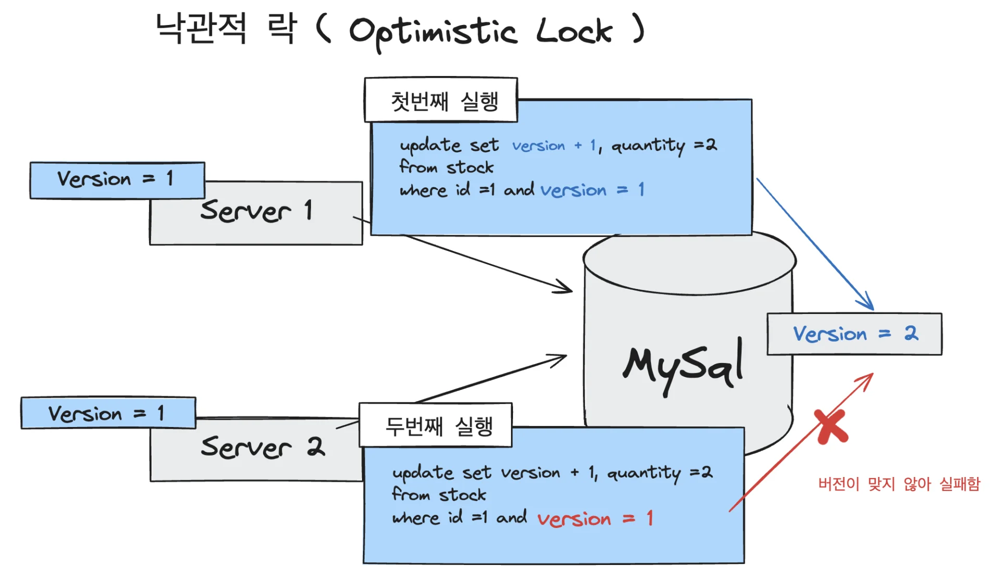
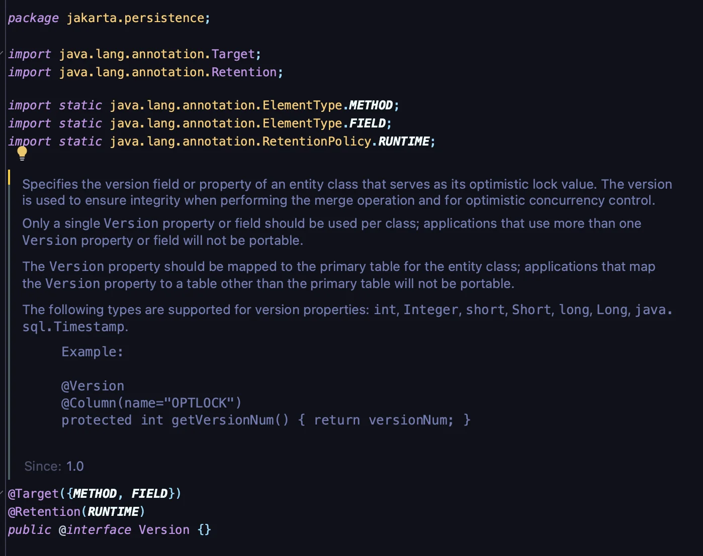
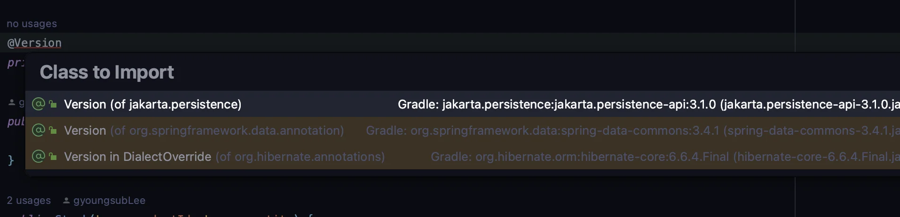
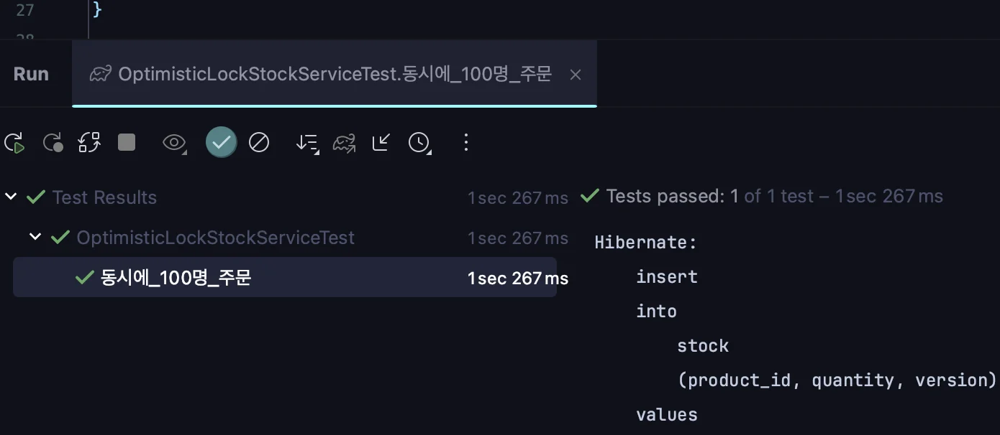

> 🤔 
> 
> <a id="22feda9b0fe18320af55018492eb0b61"></a>
> 
> <strong>데이터베이스를 활용한 데이터 정합성을 맞추는 방법 (3가지)</strong>
> 
> - Pessimistic Lock ( 비관적 락 )
> 
> - <strong>Optimistic Lock ( 낙관적 락 ) </strong>
> 
> - Name Lock ( 명명된 락)

<a id="8aeeda9b0fe182a1915f015d23b2d5fc"></a>

## Optimistic Lock ( 낙관적 락 ) 

---

> 📖 
> 
> - <strong><u>실제로 Lock을 이용하지 않</u></strong>고 <strong><u>버전 사용하여 정합성을 맞</u></strong>추는 방법이다&#46;
> 
> - 먼저 데이터를 읽은 후에 update를 수행할 때, 현재 내가 읽은 버전이 맞는지 확인하여 업데이트 진행한다&#46;<br>만약 읽은 버전에서 수정사항이 생겨 버전이 맞이 않는 경우 다시 조회하여 작업을 수행한다&#46; &#124;

<a id="02ceda9b0fe183e39ecf0146631a12fc"></a>

### Optimistic Lock ( 낙관적 락 ) 개념



1. <code>서버 1</code>가 <code>서버 2</code>에서 데이터베이스의 버전 1인 row을 읽어옴

1. 읽어온 후, <code>서버 1</code>에서 먼저 업데이트 쿼리를 날리는데, 이때 업데이트 쿼리를 수행할 때 <br><strong><u>where 조건에 </u></strong><strong><u><code>version =  1</code></u></strong><strong><u>인 것을 명시</u></strong>하고 해당 버전 <code>1</code>에서 <code>&#43;1</code>을 한  <code>2</code> 상태값으로 업데이트한다&#46; 
    <a id="880eda9b0fe18359807f01bc8bc3b94e"></a>

    따라서 version은 <code>2</code>로 갱신된다&#46; 

1. 그리고 <code>서버 2</code>가 이후 동일하게 업데이트 쿼리를 수행하는데, 마찬가지로 읽은 버전을 업데이트하는 조건이 포함되어 있으며, <br>해당 버전이 이후 갱신된 버전과 맞지 않기 때문에, 업데이틑 수행되지 않는다&#46; 
    - <code>요청 버전&#58; 1</code> ≠ <code>실제 버전&#58; 2</code>

<a id="d5feda9b0fe182f2ae3101d85013543b"></a>

위와 같이 <strong><u>버전 오류가 발생되어 데이터 정합성이 맞지 않</u></strong>는 경우, 서버 2에서는  <u>다시 데이터를 읽어 작업을 수행</u>한다&#46; 

<a id="335eda9b0fe182b2a0da8127d8c8527d"></a>

### Spring Data JPA에서의 낙관적 락 ( Optimistic Lock )

> ✏️ 
> 
> <a id="f3aeda9b0fe1832a948901b36f8575cd"></a>
> 
> <strong><u>낙관적 락( Optimistic Lock)</u></strong>은 실제 Lock이 아닌  <strong>version</strong> 통해 데이터 정합성을 검증한다
> 
> <a id="f6feda9b0fe1832b9ff50107a55bc5bc"></a>
> 
> 스프링 데이터 JPA 에서는 이를  <code>&#64;Version</code> 및 <code>&#64;Lock</code> Annotation을 활용하여 손쉽게 구현할 수 있다&#46; 

<a id="d8eeda9b0fe183a2a99d01f56fc88839"></a>

```java
@Lock(LockModeType.OPTIMISTIC)
@Query("select s from Stock s where s.id = :id")
Stock findByIdWithOptimisticLock(Long id);
```

<details>
<summary><code>&#64;Version</code></summary>



</details>

<details>
<summary><code>&#64;Lock</code></summary>


</details>

<details>
<summary><code>LockModeType</code></summary>


</details>

> ⚠️ 
> 
> <a id="d5beda9b0fe182ef8dd001bd09a966a1"></a>
> 
> <strong><code>jakarta&#46;persistence</code></strong><strong> 패키지를 사용</strong>해야 한다&#46; 
> 
> > <code>import jakarta&#46;persistence&#46;Version</code>
> 
> 
> 
> <a id="f84eda9b0fe1826393d101a2ab643934"></a>
> 
> 그림과 같이 3가지  버전이 존재한다&#46;  그중<u> jakarta&#46;persistence를 사용</u>해야 한다&#46; 

<a id="ffbeda9b0fe18260ad500110c84cebef"></a>

### 낙관적 락(Optimistic Lock) 적용

1. 엔티티에 version 필드를 추가 후, <code>&#64;Version</code>을 명시
    <details>
    <summary>&#91; 코드 &#93; Stock</summary>

    <a id="adaeda9b0fe18259b13701b700a8b2c9"></a>

    ```java
    @Entity
    public class Stock {

        @Id
        @GeneratedValue(strategy = GenerationType.IDENTITY)
        private Long id;

        private Long productId;

        private Long quantity;

        @Version
        private Long version;

        public Stock() {

        }

        public Stock(Long productId, Long quantity) {
            this.productId = productId;
            this.quantity = quantity;
        }

        public Long getQuantity() {
            return quantity;
        }

        public void decrease(Long quantity) {
            if (this.quantity - quantity < 0) {
                throw new RuntimeException("재고는 0개 미만이 될 수 없습니다.");
            }

            this.quantity -= quantity;
        }
    }
    ```

    - 버전은 숫자로 관리된다&#46; 따라서 Long 타입을 명시함

    </details>

1. 낙관적 락으로 조회하는 메서드 생성 &#45; <code>&#64;Lock(LockModeType&#46;OPTIMISTIC)</code>
    <details>
    <summary>&#91; 코드 &#93;  StockRepository</summary>

    <a id="f2eeda9b0fe18337ac6001d9d776c799"></a>

    ```java
    @Lock(LockModeType.OPTIMISTIC)
    @Query("select s from Stock s where s.id = :id")
    Stock findByIdWithOptimisticLock(Long id);
    ```

    </details>

1. 버전이 맞지 않아 데이터의 정합성에 문제가 생겨 업데이트가 실패한 경우, 다시 시도
    <details>
    <summary>&#91; 코드 &#93; OptimisticLockStockFacade</summary>

    - 버전 오류( 데이터 정합성 문제)가 발생되어 업데이트 로직이 실패한 경우, <br>다시 최근 버전의 데이터를 조회하여 다시 업데이트를 실행함

    <a id="20beda9b0fe182ef945781e7d5935698"></a>

    ```java
    package com.example.stock.facade;


    import com.example.stock.service.OptimisticLockStockService;
    import org.springframework.stereotype.Component;

    @Component
    public class OptimisticLockStockFacade {

        private final OptimisticLockStockService optimisticLockStockService;

        public OptimisticLockStockFacade(OptimisticLockStockService optimisticLockStockService) {
            this.optimisticLockStockService = optimisticLockStockService;
        }

        public void decrease(Long id, Long quantity) throws InterruptedException {
            // 업데이트가 실패 되었을 시 계속 재시도
            while (true) {
                try {
                    optimisticLockStockService.decrease(id, quantity);
                    break;  // 정상적으로 업데이트 시, while 문 종료
                } catch (Exception e) {
                    Thread.sleep(50);  // 업데이트 실패 시, 50ms 이후 재시도
                }
            }
        }
    }
    ```

    </details>

<a id="61feda9b0fe1820c9d9281e7e873e8b1"></a>

### 코드 예제

<details>
<summary>&#91; 코드 &#93; Stock</summary>

- 엔티티에 버전 정보를 저장할 version 필드 추가 

<a id="7f7eda9b0fe183c3bb0a814431ce1fe1"></a>

```java
package com.example.stock.domain;


import jakarta.persistence.*;

@Entity
public class Stock {

    @Id
    @GeneratedValue(strategy = GenerationType.IDENTITY)
    private Long id;

    private Long productId;

    private Long quantity;

    @Version
    private Long version;

    public Stock() {

    }

    public Stock(Long productId, Long quantity) {
        this.productId = productId;
        this.quantity = quantity;
    }

    public Long getQuantity() {
        return quantity;
    }

    public void decrease(Long quantity) {
        if (this.quantity - quantity < 0) {
            throw new RuntimeException("재고는 0개 미만이 될 수 없습니다.");
        }

        this.quantity -= quantity;
    }
}
```

</details>

<details>
<summary>&#91; 코드 &#93; StockRepository</summary>

- 낙관적 락 사용을 위한 <code>&#64;Lock(LockModeType&#46;OPTIMISTIC)</code> 선언된 조회 메서드 추가 

<a id="1d7eda9b0fe18282b28c81f163526e82"></a>

```java
package com.example.stock.repository;

import com.example.stock.domain.Stock;
import jakarta.persistence.LockModeType;
import org.springframework.data.jpa.repository.JpaRepository;
import org.springframework.data.jpa.repository.Lock;
import org.springframework.data.jpa.repository.Query;
import org.springframework.stereotype.Repository;

@Repository
public interface StockRepository extends JpaRepository<Stock, Long> {

    @Lock(LockModeType.PESSIMISTIC_WRITE)
    @Query("select s from Stock s where s.id = :id")
    Stock findByIdWithPessimisticLock(Long id);

    @Lock(LockModeType.OPTIMISTIC)
    @Query("select s from Stock s where s.id = :id")
    Stock findByIdWithOptimisticLock(Long id);
}

```

</details>

<details>
<summary>&#91; 코드 &#93; OptimisticLockStockService</summary>

- Optimistic Lock이 적용된 메서드를 처리할 서비스 로직

<a id="24aeda9b0fe183dcbbe4010782814214"></a>

```java
package com.example.stock.service;

import com.example.stock.domain.Stock;
import com.example.stock.repository.StockRepository;
import org.springframework.stereotype.Service;
import org.springframework.transaction.annotation.Transactional;

@Service
public class OptimisticLockStockService {

    private final StockRepository stockRepository;

    public OptimisticLockStockService(StockRepository stockRepository) {
        this.stockRepository = stockRepository;
    }

    @Transactional
    public void decrease(Long id, Long quantity) {

        Stock stock = stockRepository.findByIdWithOptimisticLock(id);

        stock.decrease(quantity);

        stockRepository.save(stock);
    }
}
```

</details>

<details>
<summary>&#91; 코드 &#93; OptimisticLockStockFacade</summary>

- 버전 오류( 데이터 정합성 문제)가 발생되어 업데이트 로직이 실패한 경우, <br>다시 최근 버전의 데이터를 조회하여 다시 업데이트를 실행함

<a id="128eda9b0fe183b6bc0d817ea3fa032b"></a>

```java
package com.example.stock.facade;


import com.example.stock.service.OptimisticLockStockService;
import org.springframework.stereotype.Component;

@Component
public class OptimisticLockStockFacade {

    private final OptimisticLockStockService optimisticLockStockService;

    public OptimisticLockStockFacade(OptimisticLockStockService optimisticLockStockService) {
        this.optimisticLockStockService = optimisticLockStockService;
    }

    public void decrease(Long id, Long quantity) throws InterruptedException {
        // 업데이트가 실패 되었을 시 계속 재시도
        while (true) {
            try {
                optimisticLockStockService.decrease(id, quantity);
                break;  // 정상적으로 업데이트 시, while 문 종료
            } catch (Exception e) {
                Thread.sleep(50);  // 업데이트 실패 시, 50ms 이후 재시도
            }
        }
    }
}

```

</details>

<details>
<summary>&#91; 테스트 코드 &#93; OptimisticLockStockServiceTest </summary>

<a id="bd5eda9b0fe182f4966c0163701429bb"></a>

```java
package com.example.stock.service;

import com.example.stock.domain.Stock;
import com.example.stock.facade.OptimisticLockStockFacade;
import com.example.stock.repository.StockRepository;
import org.junit.jupiter.api.AfterEach;
import org.junit.jupiter.api.BeforeEach;
import org.junit.jupiter.api.Test;
import org.springframework.beans.factory.annotation.Autowired;
import org.springframework.boot.test.context.SpringBootTest;

import java.util.concurrent.CountDownLatch;
import java.util.concurrent.ExecutorService;
import java.util.concurrent.Executors;

import static org.junit.jupiter.api.Assertions.*;

@SpringBootTest
class OptimisticLockStockServiceTest {

    @Autowired
    private OptimisticLockStockFacade optimisticLockStockFacade;

    @Autowired
    private StockRepository stockRepository;

    @BeforeEach
    public void before() {
        stockRepository.saveAndFlush(new Stock(1L, 100L));
    }

    @AfterEach
    public void after() {
        stockRepository.deleteAll();
    }

    @Test
    public void 동시에_100명_주문() throws InterruptedException {
        int threadCount = 100;
        ExecutorService executorService = Executors.newFixedThreadPool(100);
        CountDownLatch latch = new CountDownLatch(threadCount);

        for (int i = 0; i < threadCount; i++) {
            executorService.submit(() -> {
                try {
                    optimisticLockStockFacade.decrease(1L, 1L);
                } catch (InterruptedException e) {
                    throw new RuntimeException(e);
                } finally {
                    latch.countDown();
                }
            });
        }
        latch.await();

        Stock stock = stockRepository.findById(1L).orElseThrow();

        // 100 - (100 * 1) = 0
        assertEquals(0, stock.getQuantity());
    }
}
```

- 결과 &#45; 성공
    

</details>

<a id="fd4eda9b0fe183479588011faca3ef03"></a>

### 장단점

- 장점
    - 별도의 락을 잡지 않으므로 <code>비관적 락 (pesimistic lock)</code>보다 성능성 이점이 있다&#46; 

- 단점 
    - 업데이트가 실패했을 경우, 재시도 로직을 개발자가 직접 작성해야하는 번거로움이 있다&#46; 

    - 충돌이 빈번하게 일어난다면 재시도를 하기 때문에 오히려 <code>비관적 락 (pesimistic lock)</code>보다 성능이 떨어질 수 있다&#46; 

- 정리 
    <a id="1f4eda9b0fe1831b8c7b01f46824ebc3"></a>

    충돌이 빈번하게 일어나거나 혹은 일어날 것이라고 예상된다면, <code>비관적 락 (pesimistic lock)</code>을 사용하는 것이 성능에 이점이 있고 <br>빈번하게 일어나지 않는다면 <code>낙관적 락(optimistic lock)</code>이 더 성능상 이점이 있다&#46;
