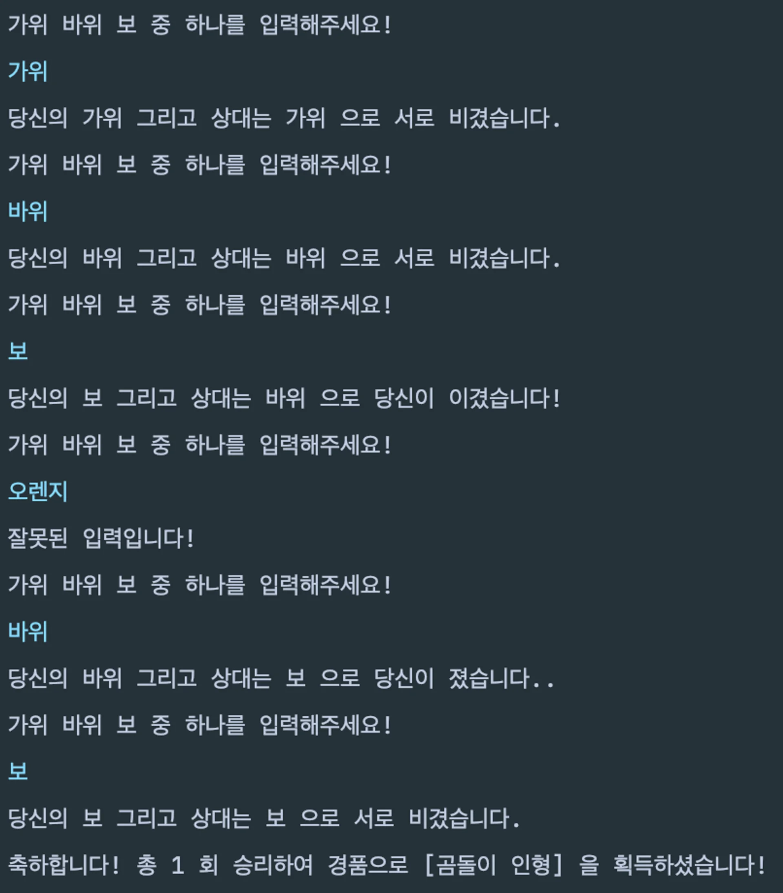

<details>
<summary>과제를 끝내고 나면 할 수 있어요&#33;</summary>

- 반복문을 통해 java/kotlin 실행흐름을 구성할 수 있어요&#46;

- 완결된 java/kotlin 프로그램을 만들 수 있어요&#46;

- 맵 자료구조의 활용 방법을 이해하고 사용해 볼 수 있어요&#46;

- 여러가지 조건문 활용방법을 이해하고 사용해 볼 수 있어요&#46;

</details>

> ⚡ <strong>Notification&#58; 과제 시작 전 확인할 내용&#33;</strong>

[02장 자바 시작하기]()

- [ ] 개발환경 구축 완료

- [ ] 자바 파일 생성 후 실행 가능

- [ ] 기본 데이터 유형 중 리스트(lists)를 이해

> 🍀 <strong>본격적으로 시작해 볼까요?</strong>

- <strong>5번의 가위바위보 게임을 해서 승리한 횟수 상당의 상품을 받아가는 게임을 만들어봐요</strong>
    <details>
    <summary>실행 화면 예시</summary>

    

    </details>

1. <strong>5번의 가위바위보를 진행합니다&#46;</strong>

1. <strong>유저는 매 판마다 “가위”, “바위”, “보” 중 하나를 입력합니다&#46;</strong>
    - 잘못된 입력을 받았다면 <code>잘못된 입력입니다&#33;</code> 를 출력해주세요&#46;

1. <strong>컴퓨터는 </strong><strong><code>가위 , 바위, 보</code></strong><strong> 중 랜덤하게 하나를 낼 수 있습니다&#46;</strong>
    <details>
    <summary>힌트</summary>

    > lv1 에서 배웠던 <code>Random</code> 을 응용해봅시다&#33;

    </details>

1. <strong>매판마다 진행한 가위 바위 보의 승패에 대한 결과를 출력됩니다&#46;</strong>
    <details>
    <summary>힌트</summary>

    > if&#126;else 문이 너무 복잡해지면 Java의 <code>switch/case</code>을 사용해보세요&#33;

    </details>

1. <strong>5판을 모두 마치면 승리한 횟수에 걸맞는 경품을 획득할 수 있습니다&#46;</strong>
    <details>
    <summary>힌트</summary>

    > <code>Map</code> 을 사용해서 보다 쉽게 상품을 찾아볼 수 있어요

    <a id="fffeda9b0fe18123be0bf5594e57a344"></a>

    ```java

    Map<Integer, String> gifts = new HashMap<>();
    gifts.put(0, "꽝");
    gifts.put(1, "곰돌이 인형");
    gifts.put(2, "스파르타 랜드 입장권");
    gifts.put(3, "스파르타 캐니언 항공 투어권");
    gifts.put(4, "호텔 스파르타 숙박권");
    gifts.put(5, "스파르테이트 항공권");

    System.out.println("축하합니다! 총 " + numOfWins + " 회 승리하여 경품으로 [" + gifts.get(numOfWins) + "] 을 획득하셨습니다!");

    ```

    </details>

<details>
<summary>전체 코드(정답)</summary>

<a id="fffeda9b0fe181219ac0e87d2fb267df"></a>

```java

import java.util.HashMap;
import java.util.Map;
import java.util.Random;
import java.util.Scanner;

public class Main {
    public static void main(String[] args) {
        String[] rsp = {"바위", "가위", "보"};
        Map<Integer, String> gifts = new HashMap<>();
        gifts.put(0, "꽝");
        gifts.put(1, "곰돌이 인형");
        gifts.put(2, "스파르타 랜드 입장권");
        gifts.put(3, "스파르타 캐니언 항공 투어권");
        gifts.put(4, "호텔 스파르타 숙박권");
        gifts.put(5, "스파르테이트 항공권");

        int cnt = 0;
        int numOfWins = 0;

        Scanner scanner = new Scanner(System.in);
        Random random = new Random();

        while (cnt < 5) {
            System.out.println("가위 바위 보 중 하나를 입력해주세요!");
            String userInput = scanner.nextLine();

            if (!userInput.equals("바위") && !userInput.equals("가위") && !userInput.equals("보")) {
                System.out.println("잘못된 입력입니다!");
                continue;
            }

            String randomRcp = rsp[random.nextInt(rsp.length)];

            switch (userInput) {
                case "바위":
                    switch (randomRcp) {
                        case "바위":
                            System.out.println("당신의 " + userInput + " 그리고 상대는 " + randomRcp + " 으로 서로 비겼습니다.");
                            break;
                        case "가위":
                            System.out.println("당신의 " + userInput + " 그리고 상대는 " + randomRcp + " 으로 당신이 이겼습니다!");
                            numOfWins++;
                            break;
                        default:
                            System.out.println("당신의 " + userInput + " 그리고 상대는 " + randomRcp + " 으로 당신이 졌습니다..");
                            break;
                    }
                    break;
                case "가위":
                    switch (randomRcp) {
                        case "가위":
                            System.out.println("당신의 " + userInput + " 그리고 상대는 " + randomRcp + " 으로 서로 비겼습니다.");
                            break;
                        case "보":
                            System.out.println("당신의 " + userInput + " 그리고 상대는 " + randomRcp + " 으로 당신이 이겼습니다!");
                            numOfWins++;
                            break;
                        default:
                            System.out.println("당신의 " + userInput + " 그리고 상대는 " + randomRcp + " 으로 당신이 졌습니다..");
                            break;
                    }
                    break;
                case "보":
                    switch (randomRcp) {
                        case "보":
                            System.out.println("당신의 " + userInput + " 그리고 상대는 " + randomRcp + " 으로 서로 비겼습니다.");
                            break;
                        case "바위":
                            System.out.println("당신의 " + userInput + " 그리고 상대는 " + randomRcp + " 으로 당신이 이겼습니다!");
                            numOfWins++;
                            break;
                        default:
                            System.out.println("당신의 " + userInput + " 그리고 상대는 " + randomRcp + " 으로 당신이 졌습니다..");
                            break;
                    }
                    break;
            }
            cnt++;
        }

        System.out.println("축하합니다! 총 " + numOfWins + " 회 승리하여 경품으로 [" + gifts.get(numOfWins) + "] 을 획득하셨습니다!");
    }
}


```

</details>

> 🔥 <strong>완료하셨다면?</strong>

- 과제를 수행하며 고민하고 검색했던 내용을 모아 TIL을 작성해주세요&#46;

- 최종코드와 함께 업로드한 TIL을 제출해주세요&#46;

- <strong>원활하게 작동되는 정답코드를 퀘스트로 제출해주세요 👉 </strong><strong><a href="https://forms.gle/pomadzyiNKAyw4CB8">https&#58;//forms&#46;gle/pomadzyiNKAyw4C</a></strong>
