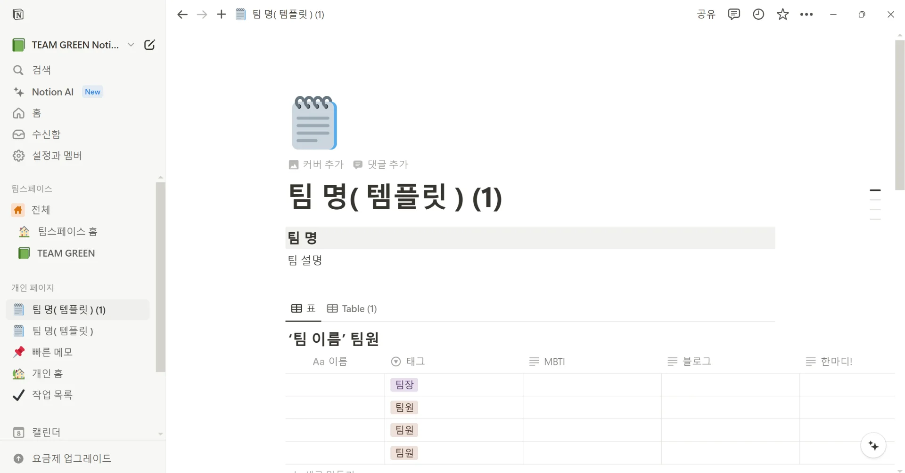
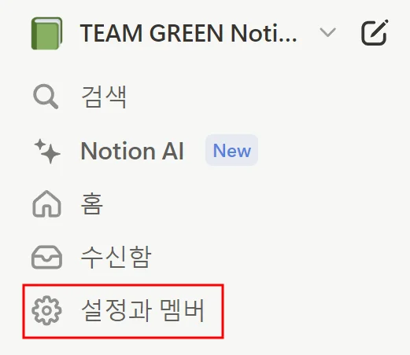
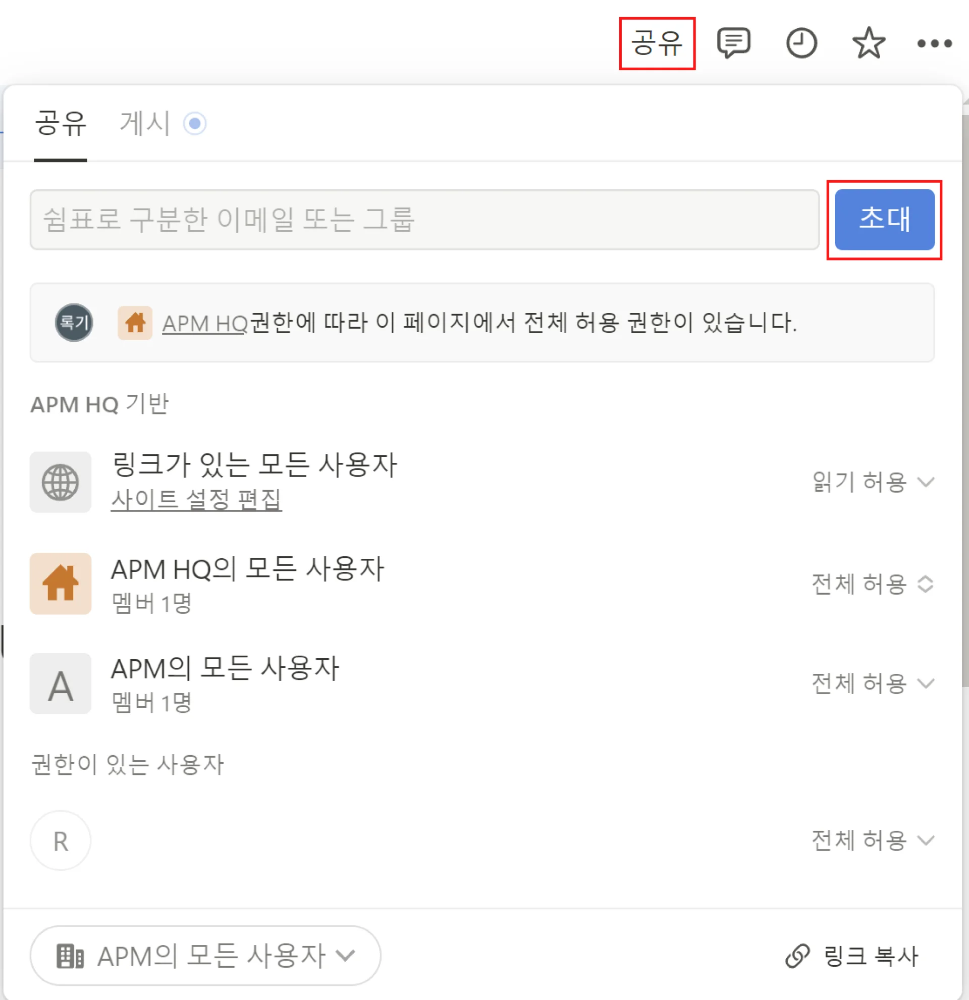
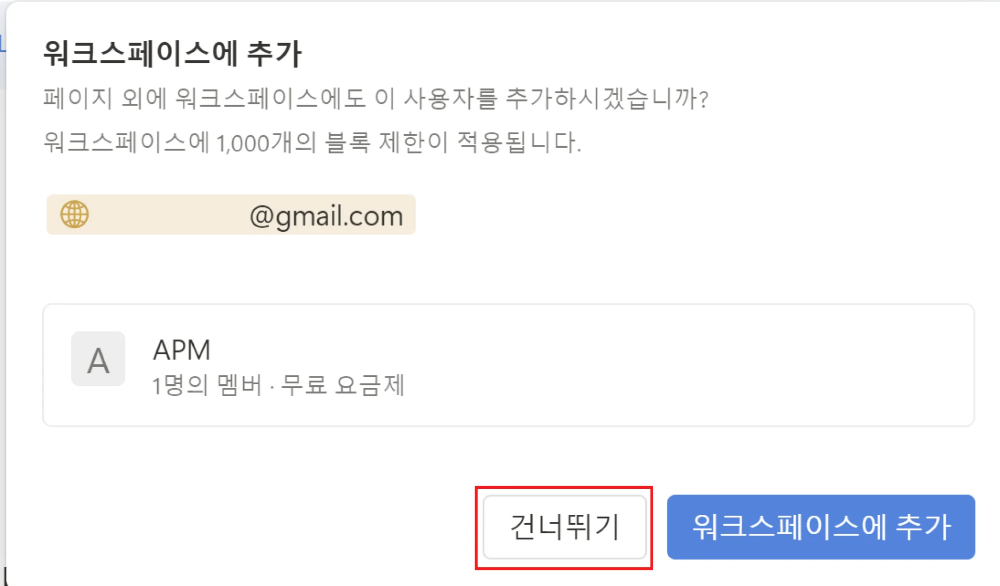

🧐 프로젝트를 진행하다 보면 Notion 팀 스페이스를 생성하여 진행하는 경우가 많은데요&#46; 무료 요금제를 사용하는 경우 2명 이상의 멤버가 있으면 <strong><code>사용 가능 블록이 1,000개로 제한</code></strong><strong> </strong>되어있습니다&#33; 

위와 같은 경고문이 표시되는 경우 절대 요금제 업그레이드를 위해 결제하지 마세요&#33; 여러분들의 돈은 소중하니까요&#33; 

<strong>아주 간단하게 블록 제한 해제하는 방법을 작성해두었으니, 아래의 방법으로 해결해보아요 😊</strong>

한 줄 요약&#58; <strong><code>멤버</code></strong>로 초대된 팀원들을 모두 삭제하고 다시 <code>게스트</code>로 초대한다&#46;

<strong>&#91;Notion 블록 초과 해결 방법&#93;</strong>

 1&#46; Notion 팀스페이스를 생성한 최초 인원(쉽게 말해 팀스페이스를 생성하여 다른 팀원들을 초대하신 분을 말해요&#33;)이 <strong>설정과 멤버</strong> 탭을 들어간다&#46; (<strong>좌측 상단 사이드바</strong>에 있습니다&#33;)

1. 클릭 후 표시되는 화면에서 멤버 목록을 확인한 후<strong> 본인을 제외한 모든 인원</strong>을 삭제한다&#46; (하단 이미지 참고)

1. 페이지 우측 상단에 “공유”를 누르고 초대할 팀원의 이메일을 입력한 후 “초대”를 눌러 다시 팀원을 초대한다&#46; (단, 초대할때 “워크스페이스 초대하기” 를 꼭 건너뛰기 해주셔야 합니다&#46;)

팀원분들을 다시 초대하실 때 “워크스페이스 초대하기”를 <strong>꼭&#33;&#33;&#33;&#33;</strong> <strong>건너뛰기</strong> 해주셔야 합니다&#46; 워크스페이스에 추가를 누르면 동일하게 멤버로 추가되어 블록 수 제한을 피할 수 없어요 ㅠㅠ 

건너뛰기를 눌러 초대하게 되면, 게스트로 참여한 것이기 때문에 블록 개수 제한 없이 사용하실 수 있습니다 😃
