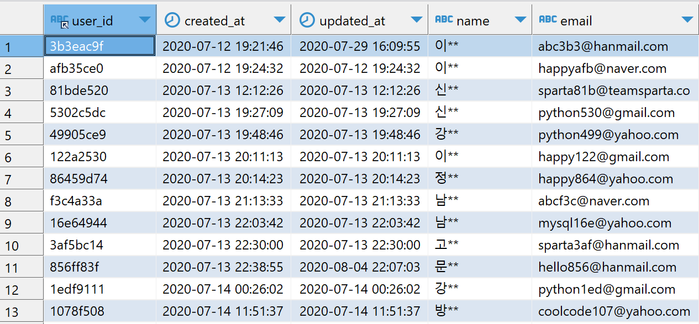
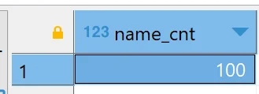

<a id="fffeda9b0fe1816688e8f90adfba5ffa"></a>

## 1&#46; 목적

> 📖 <strong>Excel보다 쉬운 SQL 강의</strong>를 통해 학습한 내용을 기반으로, 한 발 앞서 나가는 과제를 함께 수행합니다&#46;  과제를 통해 어떤 부분을 모르는지, 파악하고 새로운 성장의 기회를 만들어보아요&#46;

<details>
<summary>과제를 끝내고 나면 할 수 있어요&#33;</summary>

- 데이터 정보를 읽고 이해하기

- SELECT &#45; FROM &#45; WHERE 구문 사용하기

- 텍스트 내장함수 사용하기

</details>

<a id="fffeda9b0fe1814b8543d841abc67ce7"></a>

## 2&#46; 사전확인&#33;

> ⚡ <strong>Notification&#58; 과제 시작 전 확인할 내용&#33;</strong>

- [ ] Excel보다 쉬운 SQL 강의 수강 완료

- [ ] DBeaver 환경설치

- [ ] sparta Database 접속연결

- [ ] SELECT, FROM, WHERE 문법 이해
    - 관련자료(한글로 번역해서 보기&#33;)

    [MySQL WHERE Clause]()

<a id="fffeda9b0fe1815992def18a31f22e71"></a>

## 3&#46; 문제 

> 🍀 <strong>본격적으로 시작해 볼까요?</strong>

- <strong>상황&#58; </strong>여러분들은 스파르타코딩클럽의 분석가로 취직했습니다&#46; DBeaver를 테스트 해볼 겸 “김”씨로 시작하는 이용자들 수를 세어 보기로 했습니다&#46;

- <strong>데이터 설명</strong>
    - user 테이블은 스파르타 코딩클럽에 가입한 유저들의 정보를 날짜별로 기록한 테이블입니다&#46;
        - user&#95;id&#58; 익명화된 유저들의 아이디(varchar255)

        - created&#95;at&#58; 아이디 생성 날짜(timestamp)

        - updated&#95;at&#58; 정보 업데이트 날짜(timestamp)

        - name&#58; 익명화된 유저들의 이름(varchar255)

        - email&#58; 이메일(varchar255)

        

- <strong>문제&#58; </strong>다음과 같은 결과테이블을 만들어봅시다&#46;
    - name&#95;cnt&#58; “김”씨 성을 가지고 있는 교육생의 수

    

- &#42;10분 동안 고민하고 해결되지 않을때 보기&#42;
    <details>
    <summary>힌트 1단계</summary>

    - 텍스트 값 기반으로 찾는 substr 내장함수를 사용해보세요

    </details>

    <details>
    <summary>힌트 2단계(정답)</summary>

    <a id="fffeda9b0fe181a6a273e40df80f0730"></a>

    ```sql
    SELECT count(distinct(user_id)) as name_cnt
    FROM 
        users
    where substr(name,1,1) = '김'
    ```

    </details>

<a id="fffeda9b0fe18142b8a3f8039b767d56"></a>

## 4&#46; 결과 공유

> 🔥 <strong>완료하셨다면?</strong>

- 코드와 결과가 제시된 정답과 같다면?
    - 과제를 수행하며 고민하고 검색했던 내용을 모아 TIL을 작성해주세요&#46;

    - 최종코드와 함께 업로드한 TIL을 제출해주세요&#46;

    - <strong>원활하게 작동되는 정답코드를 퀘스트로 제출해주세요 👉 </strong><strong><a href="https://forms.gle/pomadzyiNKAyw4CB8">https&#58;//forms&#46;gle/pomadzyiNKAyw4CB8</a></strong>

- 정답과 다르다면?
    - 아직 어려운 것이 당연합니다&#46; 어떤 부분에서 어려웠는지, 매니저님께 1on1요청을 해주세요&#46; <br>함께 풀어나가면 훨씬 쉬울거에요
