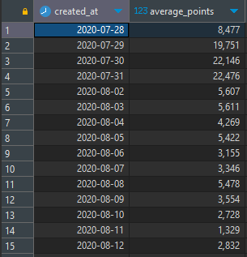

<a id="fffeda9b0fe181ffb72ec40d56b3dbfd"></a>

## 1&#46; 목적

> 📖 <strong>Excel보다 쉬운 SQL 강의</strong>를 통해 학습한 내용을 기반으로, 한 발 앞서 나가는 과제를 함께 수행합니다&#46;  과제를 통해 어떤 부분을 모르는지, 파악하고 새로운 성장의 기회를 만들어보아요&#46;

<details>
<summary>과제를 끝내고 나면 할 수 있어요&#33;</summary>

- 그룹화를 통한 시계열 데이터 생성하기

- SELECT &#45; FROM &#45; JOIN &#45; GROUP BY 구문 사용하기

- 내장함수를 이용한 데이터형 변환

</details>

<a id="fffeda9b0fe18177a672c6bbb79df430"></a>

## 2&#46; 사전확인&#33;

> ⚡ <strong>Notification&#58; 과제 시작 전 확인할 내용&#33;</strong>

- [ ] Excel보다 쉬운 SQL 강의 수강 완료

- [ ] DBeaver 환경설치

- [ ] sparta Database 접속연결

- [ ] <code>SELECT</code>, <code>FROM</code>, <code>GROUP BY</code>,  문법 이해
    - 관련자료(한글로 번역해서 보기)

    [MySQL GROUP BY Statement]()

<a id="fffeda9b0fe181779a0afaf12419374f"></a>

## 3&#46; 문제 

> 🍀 <strong>본격적으로 시작해 볼까요?</strong>

- <strong>상황&#58; </strong> 이번에는 이용자들이 잘 활동하고 있는지 보고자 합니다&#46; 포인트가 많을수록 활동을 잘하고 있다고 생각 할 수 있습니다&#46; 날짜별로 획득한 포인트가 점점 늘어나는지 줄어드는지 확인해 봅시다&#46;

- <strong>데이터 설명</strong>
    - point&#95;users 테이블은 스파르타코딩클럽 가입 유저들의 포인트에 대한 정보를 기록한 테이블입니다&#46; 
        - point&#95;user&#95;id&#58; user&#95;point 행을 구별하기 위한 key(varchar255)

        - created&#95;at&#58; 아이디 생성 날짜(timestamp)

        - updated&#95;at&#58; 정보 업데이트 날짜(timestamp)

        - user&#95;id&#58; 익명화된 유저들의 아이디(varchar255)

        - point&#58; 보유하고 있는 포인트(int)
            

- <strong>문제&#58; </strong>다음과 같은 결과테이블을 만들어봅시다&#46;
    - created&#95;at&#58; 익명화된 유저들의 아이디(varchar255)

    - average&#95;points&#58; 유저가 획득한 날짜별 평균 포인트(int), 반올림 필수



- &#42;10분 동안 고민하고 해결되지 않을때 보기&#42;
    <details>
    <summary>힌트 1단계</summary>

    - DATE 내장함수를 이용해 데이터형을 날짜형으로 바꿀 수 있습니다&#46;

    - AVG 내장함수를 이용해 평균 값을 구할 수 있어요&#46;

    - ROUND 내장함수를 통해서 반올림 할 수 있습니다&#46;

    </details>

    <details>
    <summary>힌트 2단계(정답)</summary>

    <a id="fffeda9b0fe1811692eac4c5305a91a6"></a>

    ```sql
    SELECT 
        DATE(p.created_at) AS created_at,
        ROUND(AVG(p.point)) AS average_points
    FROM 
        point_users p
    GROUP BY 
        DATE(p.created_at);
    ```

    </details>

<a id="fffeda9b0fe181a2a083f4d36b2c27ab"></a>

## 4&#46; 결과 공유

> 🔥 <strong>완료하셨다면?</strong>

- 코드와 결과가 제시된 정답과 같다면?
    - 과제를 수행하며 고민하고 검색했던 내용을 모아 TIL을 작성해주세요&#46;

    - 최종코드와 함께 업로드한 TIL을 제출해주세요&#46;

    - <strong>원활하게 작동되는 정답코드를 퀘스트로 제출해주세요 👉 </strong><strong><a href="https://forms.gle/pomadzyiNKAyw4CB8">https&#58;//forms&#46;gle/pomadzyiNKAyw4C</a></strong>

- 정답과 다르다면?
    - 아직 어려운 것이 당연합니다&#46; 어떤 부분에서 어려웠는지, 매니저님께 1on1요청을 해주세요&#46; <br>함께 풀어나가면 훨씬 쉬울거에요
