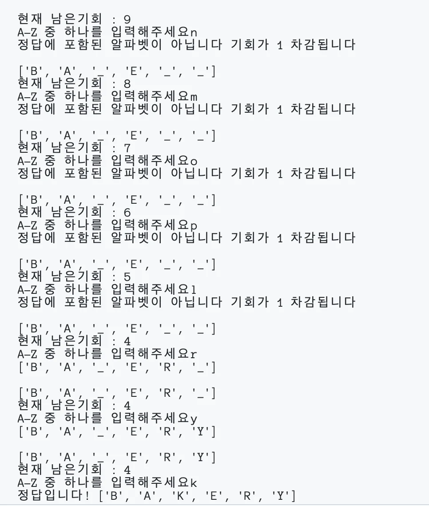
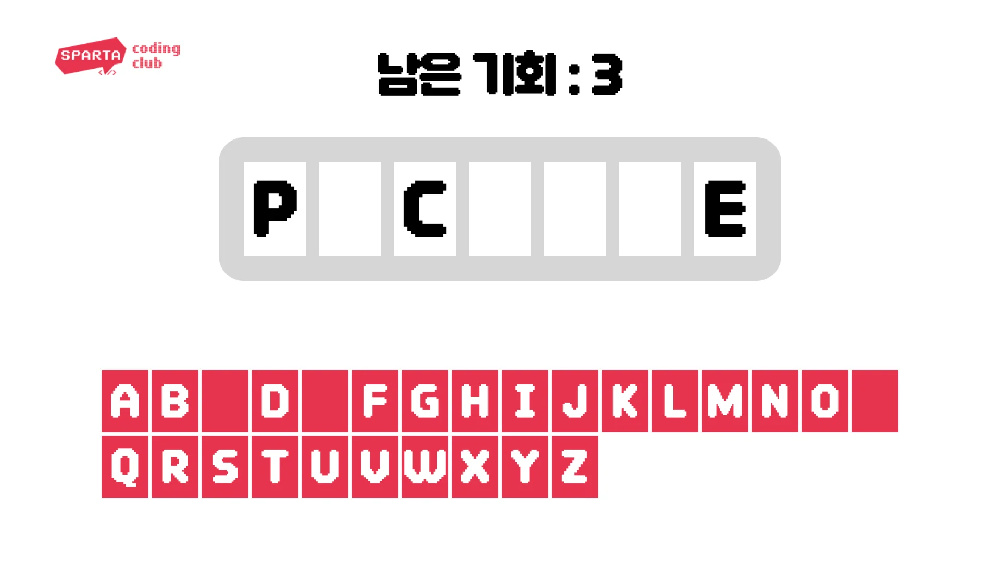

<details>
<summary>과제를 끝내고 나면 할 수 있어요&#33;</summary>

- 반복문을 통해 java/kotlin 실행흐름을 구성할 수 있어요&#46;

- 완결된 java/kotlin 프로그램을 만들 수 있어요&#46;

- 리스트의 메서드를 이해하고 사용할 수 있어요&#46;

- 여러가지 조건문 활용방법을 이해하고 사용해 볼 수 있어요&#46;

</details>

> ⚡ <strong>Notification&#58; 과제 시작 전 확인할 내용&#33;</strong>

[02장 자바 시작하기]()

- [ ] 개발환경 구축 완료

- [ ] 자바 파일 생성 후 실행 가능

- [ ] 기본 데이터 유형 중 리스트(lists)를 이해

<details>
<summary>과제 수행을 위해 참고하면 좋을 만한 자료</summary>


</details>

> 🍀 <strong>본격적으로 시작해 볼까요?</strong>

- 단<strong>어를 주어진 기회 안에 맞추는 게임을 만들어보세요</strong>
    <details>
    <summary>단어 맞추기 게임 실행 화면 예시</summary>

    

    </details>



1. <strong>컴퓨터가 랜덤으로 영어단어를 선택합니다&#46;</strong>
    1. 영어단어의 자리수를 알려줍니다&#46;
        <a id="fffeda9b0fe181709560c0e4838499dd"></a>

        ex ) PICTURE = 7자리 ⇒ <code>&#95; &#95; &#95; &#95; &#95; &#95; &#95;</code>

    <details>
    <summary>힌트</summary>

    <a id="fffeda9b0fe18153b298fffb6a0627fb"></a>

    아래 단어들을 활용해보세요&#33;

    <a id="fffeda9b0fe181c98780df991e247564"></a>

    ```html
    [
        "airplane",
        "apple",
        "arm",
        "bakery",
        "banana",
        "bank",
        "bean",
        "belt",
        "bicycle",
        "biography",
        "blackboard",
        "boat",
        "bowl",
        "broccoli",
        "bus",
        "car",
        "carrot",
        "chair",
        "cherry",
        "cinema",
        "class",
        "classroom",
        "cloud",
        "coat",
        "cucumber",
        "desk",
        "dictionary",
        "dress",
        "ear",
        "eye",
        "fog",
        "foot",
        "fork",
        "fruits",
        "hail",
        "hand",
        "head",
        "helicopter",
        "hospital",
        "ice",
        "jacket",
        "kettle",
        "knife",
        "leg",
        "lettuce",
        "library",
        "magazine",
        "mango",
        "melon",
        "motorcycle",
        "mouth",
        "newspaper",
        "nose",
        "notebook",
        "novel",
        "onion",
        "orange",
        "peach",
        "pharmacy",
        "pineapple",
        "plate",
        "pot",
        "potato",
        "rain",
        "shirt",
        "shoe",
        "shop",
        "sink",
        "skateboard",
        "ski",
        "skirt",
        "sky",
        "snow",
        "sock",
        "spinach",
        "spoon",
        "stationary",
        "stomach",
        "strawberry",
        "student",
        "sun",
        "supermarket",
        "sweater",
        "teacher",
        "thunderstorm",
        "tomato",
        "trousers",
        "truck",
        "vegetables",
        "vehicles",
        "watermelon",
        "wind"
    ]
    ```

    </details>

1. <strong>사용자는 A 부터 Z 까지의 알파벳 중에서 하나를 입력합니다&#46;</strong>
    1. 입력값이 A&#45;Z 사이의 알파벳이 아니라면 다시 입력을 받습니다
        <details>
        <summary>힌트</summary>

        <a id="fffeda9b0fe181b792eaf0cb442a9bd0"></a>

        Java 의 <code>Charactor&#46;isLetter()</code> 을 활용해보세요

        </details>

    1. 입력값이 한 글자가 아니라면 다시 입력을 받습니다

    1. 이미 입력했던 알파벳이라면 다시 입력을 받습니다&#46;

    1. 입력값이 정답에 포함된 알파벳일 경우 해당 알파벳이 들어간 자리를 전부 보여주고, 다시 입력을 받습니다&#46;
        1. ex ) 정답이 eyes 인 경우에 E 를 입력했을 때
            1. <code>&#95; &#95; &#95; &#95;</code> → <code>E &#95; E &#95;</code>

    1. 입력값이 정답에 포함되지 않은 알파벳일 경우 기회가 하나 차감되고, 다시 입력을 받습니다&#46;

1. <strong>사용자가 9번 틀리면 게임오버됩니다&#46;</strong>

1. <strong>게임오버 되기 전에 영어단어의 모든 자리를 알아내면 플레이어의 승리입니다&#46;</strong>

> 🔥 <strong>완료하셨다면?</strong>

- 과제를 수행하며 고민하고 검색했던 내용을 모아 TIL을 작성해주세요&#46;

- 최종코드와 함께 업로드한 TIL을 제출해주세요&#46;

- <strong>원활하게 작동되는 정답코드를 퀘스트로 제출해주세요 👉 </strong><strong><a href="https://forms.gle/pomadzyiNKAyw4CB8">https&#58;//forms&#46;gle/pomadzyiNKAyw4C</a></strong>

<details>
<summary>완성하지 못했다면?</summary>

<a id="fffeda9b0fe181d6819ece77cd69c715"></a>

아직 어려운 것이 당연합니다&#46; 어떤 부분에서 어려웠는지, 매니저님께 1on1요청을 해주세요&#46; <br>함께 풀어나가면 훨씬 쉬울거에요&#33;

</details>
