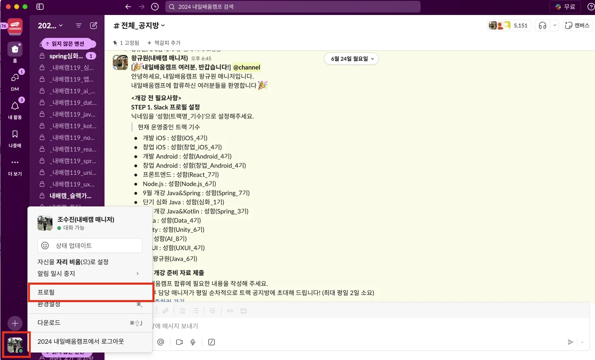
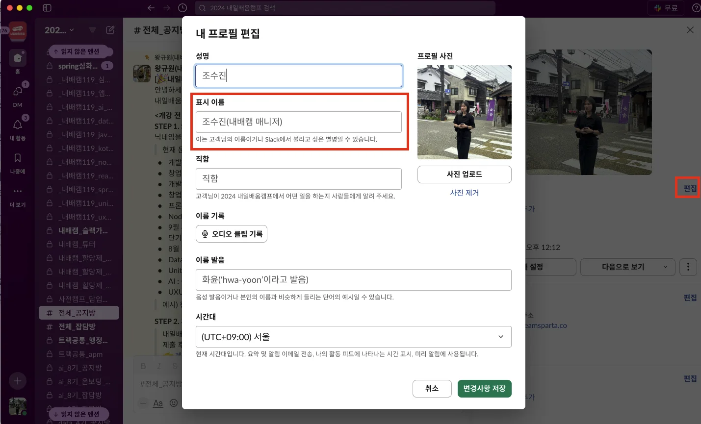

> 📖 내일배움캠프에 오신 대원 여러분들을 환영합니다&#33; 시작에 앞서, 나는 앞으로 어떤 각오로 캠프에 임할 것인지, 캠프를 수료한 후 나의 엔드픽처는 무엇인지 생각해봅시다&#46;

###  &#91;미션 1&#93; 프로필 설정 및 자기소개

- 스프링 트랙을 함께할 동료 및 담당 매니저와 더욱 효과적으로 소통하기 위해, 프로필을 설정합니다&#46; 아래 가이드에 따라 슬랙 프로필 설정을 완료해주세요&#46;

> 📖 이미지는 각자의 얼굴이 나온 사진을 권장합니다&#46; (마스크 쓴 사진 No&#33;) 이름은 실명을 사용합니다&#46; (성까지)

슬랙 프로필 설정

- 슬랙 좌측 하단 프로필 사진 클릭 → ‘프로필’ 버튼을 눌러 프로필을 변경할 수 있습니다&#46;
    

    

### → <strong>이름(Spring&#95;7기)</strong> 로 통일하여 사용합니다&#46;

###  &#91;미션 2&#93; 스타터 노트 작성

- 아래 내용을 복사하여 개인 블로그에 붙여 넣고, 질문에 대한 답변을 작성합니다&#46; 작성 및 제출해 주신 링크를 바탕으로 담당 매니저와의 1on1 미팅을 진행합니다&#46; 

---

1. <strong>내가 내일배움캠프에 참여한 계기는 무엇인가요?</strong>
    - 

1. 내가 이해한 <strong>개발자</strong>는 어떤 역할을 하는 사람인가요? 
    - 

1. 프로그래밍을 경험해보셨나요? 해보셨다면 어떤 경험을 하셨는지를 작성해주시고, 아니라면 프로그래밍에 대해 찾아본 것을 작성해주세요&#46;
    - 

1. <strong>개발자의 역할을 수행하는 데에 있어 나의 강점과 연관된 부분은 무엇이라고 생각하나요?  </strong>혹은 보완, 개선하고 싶은 개인 역량이 있나요 ?
    - <em>과거 혹은 현재의 업무와 연관 지어도 좋습니다&#46; ‘능력’을 기준으로 고민해주세요&#46;</em>

1. <strong>본 코스 수료 후, 어떤 개발자로 성장하고 싶나요?</strong>
    - 

1. <strong>본 코스 수료 후, 개발자가 된 5년 후 목표로하는 점은 무엇인가요? </strong>

###  &#91;미션 3&#93; 담당 매니저와의 1on1

작성한 스타터 노트를 TIL 링크를 통해 제출해주세요&#46; 

담당 매니저와의 1 on 1 미팅을 진행합니다&#46;

사전캠프 기간 중, 일정과 시간을 정하고 매니저가 슬랙 DM을 통해 연락드릴 예정입니다&#46;
