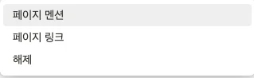
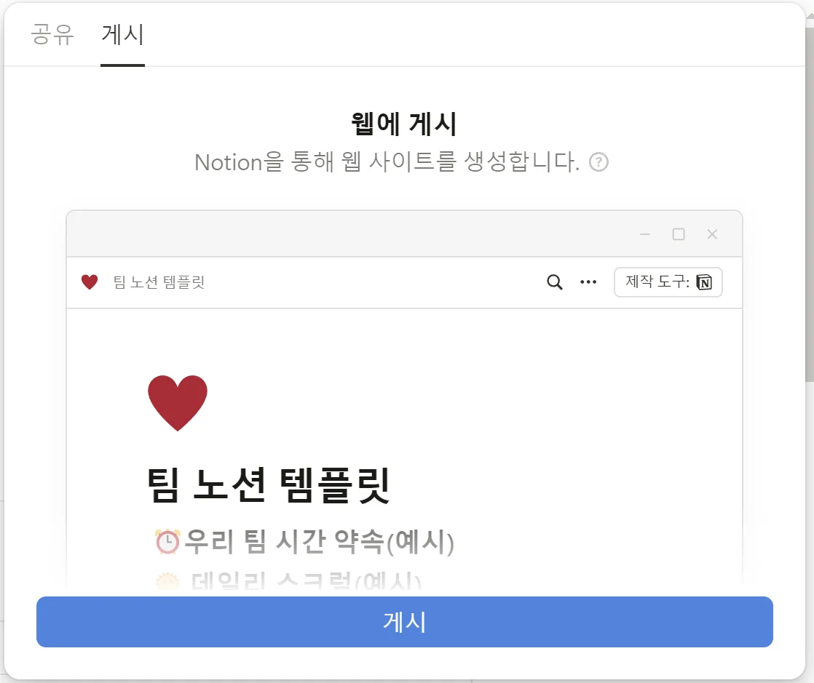
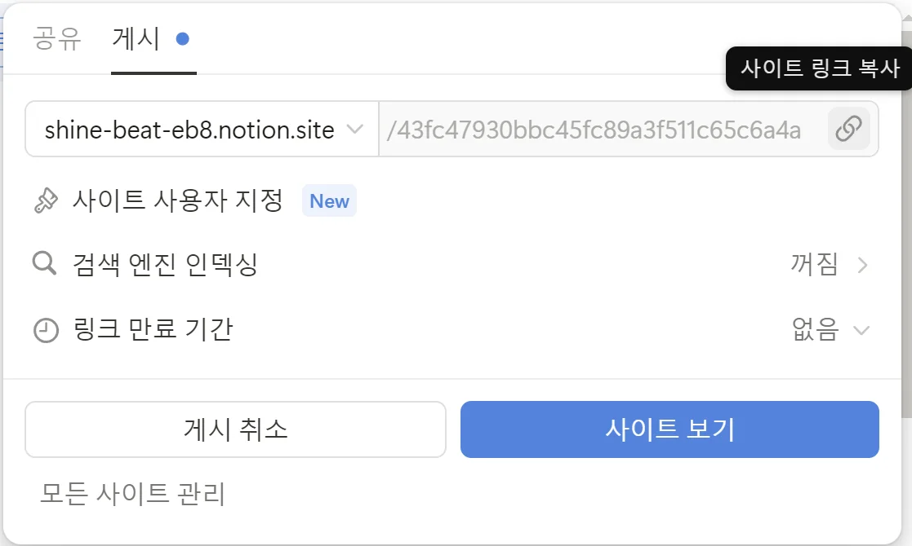

> 💡 아래 나의 조(예&#58;1조)에 노션 페이지 링크를 걸어주세요&#46;  Guide &#58; 페이지 링크를 걸고 싶은 곳에 커서를 클릭하고 키보드로 ‘&#91;&#91;’를 입력하시면 우리 팀의 노션 페이지를 검색해서 링크를 걸 수 있습니다&#46;   혹은, 링크를 걸고 싶은 노션 페이지의 URL을 복사해서 링크를 걸고 싶은 곳에 붙여넣고, 아래 이미지가 뜨면 ‘페이지 멘션’을 선택해주세요&#46; 
> 
> 
> 
> 
> 
>  &#43; 공유하실 때는 오른쪽 상단의 공유 누르신 후 공유 탭 옆에 있는 ‘<strong>게시</strong>’ 탭을 이용하여 
> 
> 
> 
> 게시 (파란버튼) 누르시고 &#45;&#62; 웹에 게시 링크 복사 (하단 이미지 참고) 
> 
> 
> 
> 
> 
> 
> 
> ‘공유’가 아닌 ‘게시’를 사용하여 공유 해주셔야 확인이 가능합니다&#46;
> 
> 
> 
> 게시 링크로 공유 부탁드려요 ☺️
> 
> 
> 
> 혹시 어려움이 있으시다면 주저하지 마시고, 담임 매니저님께 연락 부탁드립니다&#46;

<strong>해당하는 조에 링크 붙여넣기 후 ‘페이지 멘션’</strong>
