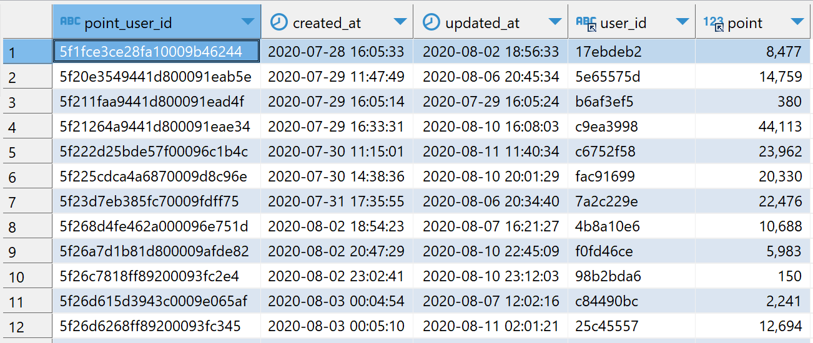
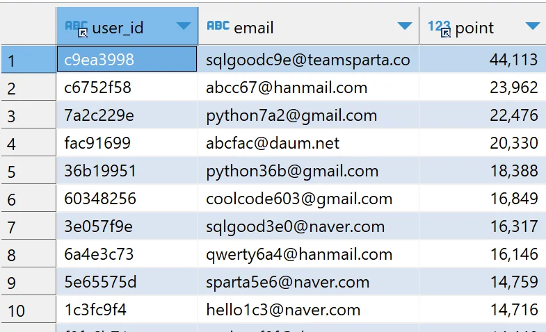
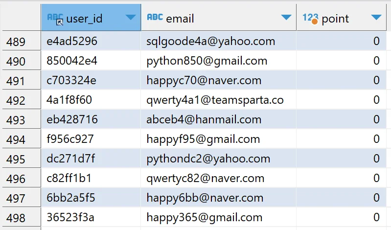

<a id="fffeda9b0fe1813488f7f9d77a3be872"></a>

## 1&#46; 목적

> 📖 <strong>Excel보다 쉬운 SQL 강의</strong>를 통해 학습한 내용을 기반으로, 한 발 앞서 나가는 과제를 함께 수행합니다&#46;  과제를 통해 어떤 부분을 모르는지, 파악하고 새로운 성장의 기회를 만들어보아요&#46;

<details>
<summary>과제를 끝내고 나면 할 수 있어요&#33;</summary>

- 두 테이블을 연결하는 데이터 가공하기

- SELECT &#45; FROM &#45; JOIN &#45; ORDER BY 구문 사용하기

</details>

<a id="fffeda9b0fe1817f836dc6ea65fe4748"></a>

## 2&#46; 사전확인&#33;

> ⚡ <strong>Notification&#58; 과제 시작 전 확인할 내용&#33;</strong>

- [ ] Excel보다 쉬운 SQL 강의 수강 완료

- [ ] DBeaver 환경설치

- [ ] sparta Database 접속연결

- [ ] SELECT, FROM, GROUPBY, JOIN, ORDER BY  문법 이해
    - 관련자료(한글로 번역해서 보기&#33;)

    [MySQL Joins]()

    [MySQL ORDER BY Keyword]()

<a id="fffeda9b0fe18150bcd4e2223a8bd8b8"></a>

## 3&#46; 문제 

> 🍀 <strong>본격적으로 시작해 볼까요?</strong>

- <strong>상황&#58; </strong>이번에는 이용자들 별로 획득한 포인트를 학생들에게 이메일로 보내려고 합니다&#46; 이를 위한 자료를 가공해봅시다&#46; 특히 users 테이블에는 있으나 point&#95;users 에는 없는 유저가 있어요&#46; 이 유저들의 경우 point를 0으로 처리합시다&#46;

- <strong>데이터 설명</strong>
    - users 테이블은 스파르타 코딩클럽에 가입한 유저들의 정보를 날짜별로 기록한 테이블입니다&#46;
        - user&#95;id&#58; 익명화된 유저들의 아이디(varchar255)

        - created&#95;at&#58; 아이디 생성 날짜(timestamp)

        - updated&#95;at&#58; 정보 업데이트 날짜(timestamp)

        - name&#58; 익명화된 유저들의 이름(varchar255)

        - email&#58; 이메일(varchar255)

        

    - point&#95;users 테이블은 스파르타코딩클럽 가입 유저들의 포인트에 대한 정보를 기록한 테이블입니다&#46; 
        - point&#95;user&#95;id&#58; point&#95;users 테이블의 행을 구별하기 위한 key(varchar255)

        - created&#95;at&#58; 아이디 생성 날짜(timestamp)

        - updated&#95;at&#58; 정보 업데이트 날짜(timestamp)

        - user&#95;id&#58; 익명화된 유저들의 아이디(varchar255)

        - point&#58; 보유하고 있는 포인트(int)
            

- <strong>문제&#58; </strong>다음과 같은 결과 테이블을 만들어봅시다&#46;
    - user&#95;id&#58; 익명화된 유저들의 아이디

    - email&#58; 유저들의 이메일

    - point&#58; 유저가 획득한 포인트
        - users 테이블에는 있지만 point&#95;users에는 없는 user는 포인트가 없으므로 0 으로 처리

        - 포인트 기준으로 내림차순 정렬

    - 1&#126;10행
        

    - 490 &#126; 498행
        

- &#42;10분 동안 고민하고 해결되지 않을때 보기&#42;
    <details>
    <summary>힌트 1단계</summary>

    - 두 테이블을 연결하려면 user&#95;id 라는 컬럼을 key로 연결하면 됩니다&#33;

    - 조인하려는 두 테이블 중 하나의 테이블을 기준으로 하려면 LEFT JOIN을 활용하면 됩니다&#33;

    - 해당 값이 NULL이면 지정한 다른 값을 지정하는 COALESCE 함수가 존재합니다&#33;
        [MySQL COALESCE() Function]()

    </details>

    <details>
    <summary>힌트 2단계(정답)</summary>

    <a id="fffeda9b0fe1811ea4f1c6c5cfa54071"></a>

    ```sql
    SELECT 
        u.user_id, u.email,
        COALESCE(p.point,0) as point
    FROM 
        users u
    left JOIN 
        point_users p ON u.user_id = p.user_id
    order by p.point desc;
    ```

    </details>

<a id="fffeda9b0fe1811183cde0241844a9e7"></a>

## 4&#46; 결과 공유

> 🔥 <strong>완료하셨다면?</strong>

- 코드와 결과가 제시된 정답과 같다면?
    - 과제를 수행하며 고민하고 검색했던 내용을 모아 TIL을 작성해주세요&#46;

    - 최종코드와 함께 업로드한 TIL을 제출해주세요&#46;

    - <strong>원활하게 작동되는 정답코드를 퀘스트로 제출해주세요 👉 </strong><strong><a href="https://forms.gle/pomadzyiNKAyw4CB8">https&#58;//forms&#46;gle/pomadzyiNKAyw4C</a></strong>

- 정답과 다르다면?
    - 아직 어려운 것이 당연합니다&#46; 어떤 부분에서 어려웠는지, 매니저님께 1on1요청을 해주세요&#46; <br>함께 풀어나가면 훨씬 쉬울거에요
