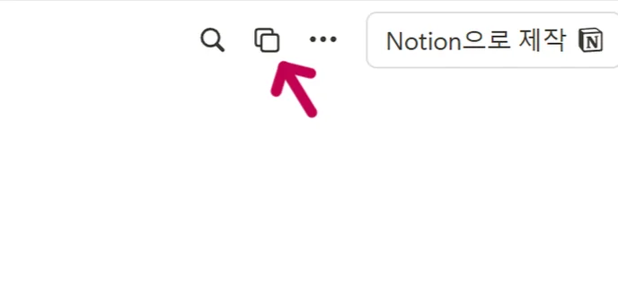
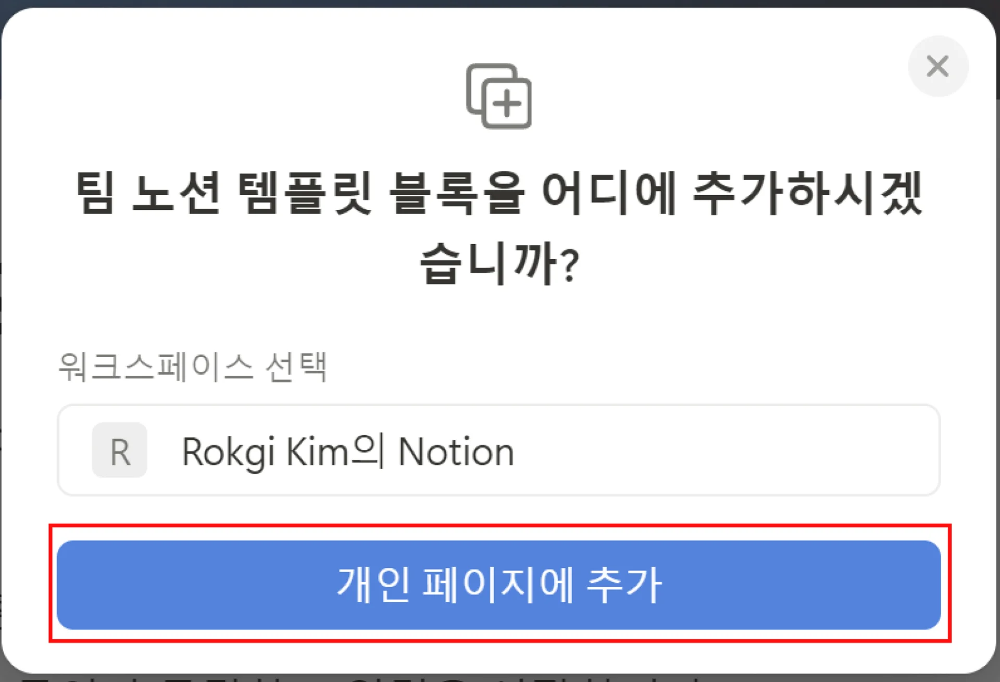
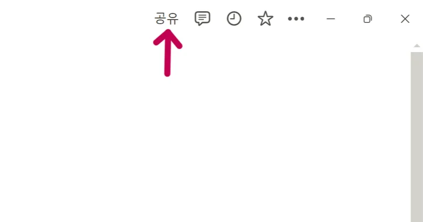
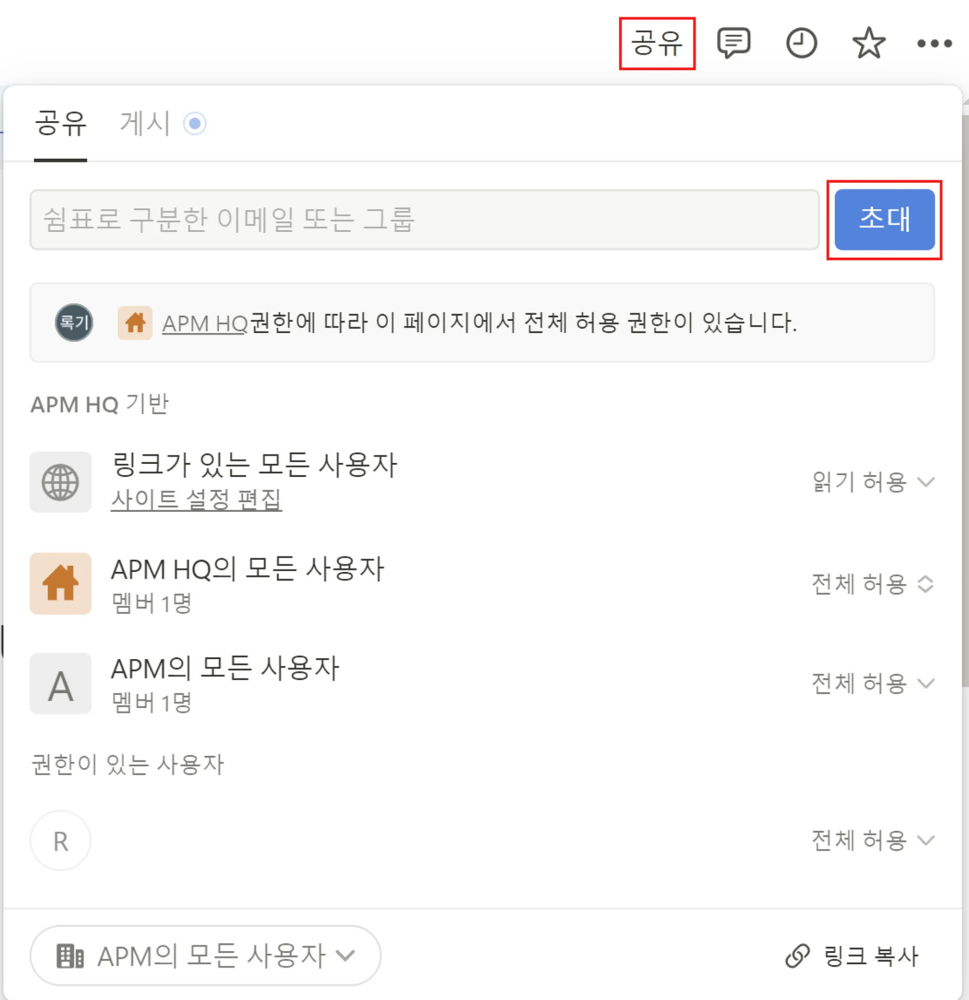
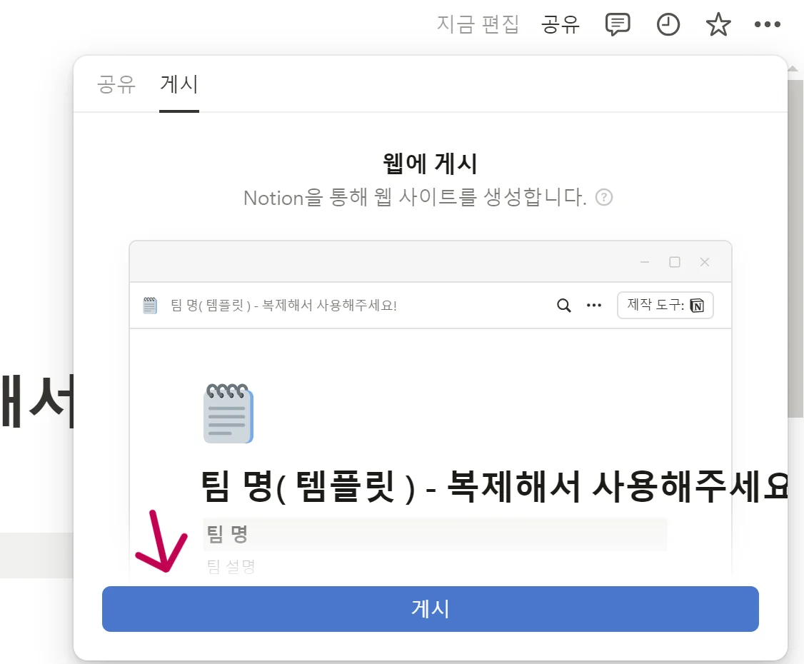
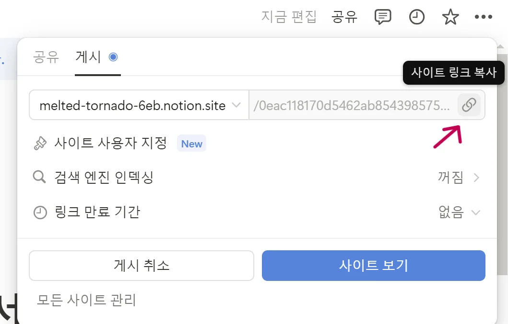

> 👍🏻 <strong>팀장 선정 및 팀 노션 만들기</strong>
> 
> ---
> 
> > 앞으로 함께 할 팀원들과 간단한 스몰토크를 나누고, 팀장을 선정해요&#33; 팀 노션을 생성하며 서로에 대해 더 깊게 알아가는 시간을 가져 보세요&#33; 😎
> 
> > 🧚 <strong>가이드 1 &#58; </strong>팀장을 선정하고 아래 방법을 참고하여 팀 노션 만들기  <strong>가이드 2 &#58;</strong> 게시로 변경 후 노션 링크를 복사해서 ‘팀 노션 모음’에 복붙하기  <strong>가이드 3 </strong>&#58; 노션 내용을 작성하며 팀원들과 더 깊게 알아가는 시간 가지기                    (우리 팀원, 우리 팀 시간 약속, 데일리 스크럼 작성하기)
> 
> ---
> 
> [팀 노션 템플릿](#/post/fffeda9b-0fe1-8181-9e48-f17150d26fc0)
> 
> [팀 노션 모음](#/post/fffeda9b-0fe1-81ab-9ea4-e6eb12f0a7c7)
> 
> [Notion 블록 초과 시 해결 방법](#/post/fffeda9b-0fe1-8133-924a-e79dd56d5660)
> 
> ---
> 
> 

> 
<strong>팀 노션 만드는 방법 안내</strong>

> 
> 
> 
> 1️⃣ 위의 “♥️<strong>팀 노션 템플릿</strong>” 페이지 클릭
> 
> 
> 
> 2️⃣ 우측 상단에 표시되는 <strong>복제</strong> 버튼 클릭 (표시되지 않을 경우 매니저에게 문의) 
> 
> 
> 
> 
> 
> 3️⃣ 워크스페이스 선택 후 개인 페이지에 <strong>추가하기 </strong>
> 
> 
> 
> 
> 
> 4️⃣ 우측 상단에 표시되는 <strong>공유 </strong>버튼 클릭
> 
> 
> 
> 
> 
> 5️⃣ 팀원분들이 노션에서 사용하시는 이메일을 입력하고 <strong>초대</strong> 누르기
> 
> 
> 
> (<strong>중요&#33; </strong>꼭 건너뛰기를 눌러주세요&#33;)
> 
> 
> 
> 
> 
> 
> 
> 6️⃣ 팀원분들이 “<strong>게스트</strong>”로 초대되었다면 모든 준비 완료&#33;
> 
> 
> 
> 7️⃣ 우측 상단에 공유 → 게시를 통해 <strong>게시</strong>해줍니다&#46;
> 
> 
> 
> 
> 
> 8️⃣ 링크 복사 후 “<strong>팀 노션 모음”</strong>에 붙여 넣기 하면 완료&#33;
> 
> 
> 
> 

> 
> 
