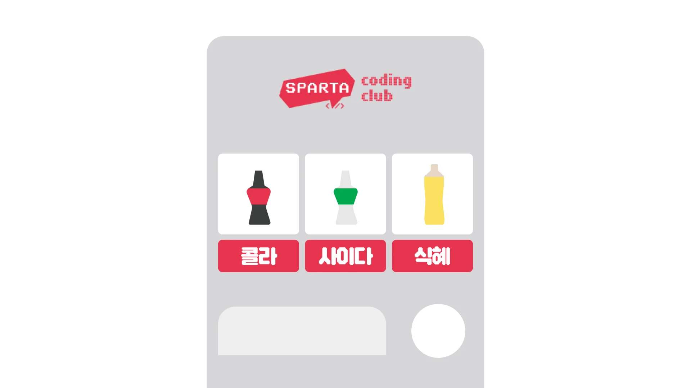

<details>
<summary>과제를 끝내고 나면 할 수 있어요</summary>

- java/kotlin 에서 사용자 입력을 받을 수 있어요&#46;

- java/kotlin 의 조건문을 이해하고 사용할 수 있어요&#46;

- java/kotlin 의 맵 자료구조를 이해하고 사용할 수 있어요&#46;

- java/kotlin 의 반복문을 이해하고 사용할 수 있어요&#46;

- 완결된 java/kotlin 프로그램을 만들 수 있어요&#46;

</details>

> ⚡ <strong>Notification&#58; 과제 시작 전 확인할 내용&#33;</strong>

- [ ] 개발환경 구축 완료

- [ ] 자바 파일 생성 후 실행 가능

- [ ] 조건문을 작성할 수 있다&#46; 

- [ ] 자바 산술 연산자를 사용할 수 있다&#46; 

- [ ] 변수를 선언할 수 있다&#46;

- [ ] java 의 Scanner을 이해하고 있다&#46;

<details>
<summary>과제수행을 위해 참고하면 좋을 만한 자료</summary>

[04&#45;01 if 문]()

</details>

> 🍀 <strong>본격적으로 시작해볼까요?</strong>

- <strong>자바 코드를 이용해 자판기를 만들어 봅시다&#46;</strong>



1. <strong>사용자가 볼 수 있게 메뉴를 표시합니다&#46;</strong>
    - 다음과 같은 음료를 실행창에 표시합니다&#46;
        - 사이다 1,700원

        - 콜라 1,900원

        - 식혜 2,500원

        - 솔의눈 3,000원

    <details>
    <summary>힌트1</summary>

    <a id="fffeda9b0fe181f78312daabe8a12616"></a>

    맵 자료형을 사용해서 음료 정보를 담아보세요&#46;

    <a id="fffeda9b0fe18161b70fc3c98cf8efeb"></a>

    ```java
    Map<String, Integer> beverages = Map.of(
                    "사이다", 1700,
                    "콜라", 1900,
                    "식혜", 2500,
                    "솔의눈", 3000
            );

    ```

    </details>

    <details>
    <summary>힌트2</summary>

    <a id="fffeda9b0fe181bf8f09ce05f423a898"></a>

    맵의 items 와 for 문을 조합해서 사용해보세요&#46;

    <a id="fffeda9b0fe1810a8411db59cbeb53f8"></a>

    ```java

    for (Map.Entry<String, Integer> beverage : beverages.entrySet()) {
    		// 여기에 System.out.println 문을 적어주세요
    }

    ```

    </details>

1. <strong>사용자는 음료를 선택할 수 있습니다&#46; </strong>
    - 사용자에게 어떤 음료를 살 것인지를 입력받습니다&#46;
        - ex) 사이다

        - 목록에 없는 음료일 경우 실행이 종료됩니다&#46;

    <details>
    <summary>힌트1</summary>

    <a id="fffeda9b0fe18136b5b7cca45c8ae1ff"></a>

    Java  <code>Scanner</code> 클래스를 사용해보세요

    <a id="fffeda9b0fe181fb94a8e181a972464b"></a>

    ```java

    Scanner scanner = new Scanner(System.in);
    String userChoice = scanner.nextLine();

    ```

    </details>

    <details>
    <summary>힌트2</summary>

    <a id="fffeda9b0fe1819aad25d83322dadb5d"></a>

    맵의 <code>keys</code> / <code>keySet</code> 를 사용해보세요&#46;

    <a id="fffeda9b0fe1814abaa3c2391cd715ff"></a>

    ```java
    System.out.println(beverages.keySet());
    ```

    <a id="fffeda9b0fe181b0ae3fcc91c940d897"></a>

    ```java
    if (beverages.containsKey(userChoice)) {}
    ```

    </details>

1. <strong>사용자는 지불할 금액을 입력할 수 있습니다&#46;</strong>
    - 사용자에게 얼마를 넣을지 입력받습니다&#46;
        - ex) 2000

        - 지불하는 금액이 선택한 음료의 비용보다 작다면 “돈이 부족합니다&#46;” 를 출력합니다

    <details>
    <summary>힌트1</summary>

    <a id="fffeda9b0fe181d69dbecb04ebf557d4"></a>

    ```java

    int coin = scanner.nextInt();
    ```

    </details>

    <details>
    <summary>힌트2</summary>

    <a id="fffeda9b0fe18160b521dc7d4102b11f"></a>

    ```java

    System.out.println(beverages.get("콜라"));
    System.out.println(beverages.get("사이다"));
    System.out.println(beverages.get("식혜"));

    String userChoice = "콜라";
    System.out.println(beverages.get(userChoice));

    if (coin < beverages.get(userChoice)) {
        // 실행 종료하기
        System.out.println("돈이 부족합니다");
    } else {
        // 돈이 충분할 경우
    }
    ```

    </details>

1. <strong>사용자는 음료를 구매하고 남은 잔액을 확인할 수 있습니다&#46;</strong>
    - 잔액을 화면에 표시합니다&#46; 
        - ex) 입력한 돈 2000원, 사이다 1700원 일때 300원을 잔액으로 보여줍니다&#46; 

    <details>
    <summary>힌트</summary>

    <a id="fffeda9b0fe181ffaa62c0638684dd7e"></a>

    ```java

    int remain = beverages.get(userChoice) - coin
    println(remain)
    ```

    </details>

> 🔥 <strong>완료하셨다면?</strong>

- 과제를 수행하며 고민하고 검색했던 내용을 모아 TIL을 작성해주세요&#46;

- 최종코드와 함께 업로드한 TIL을 제출해주세요&#46;

- <strong>원활하게 작동되는 정답코드를 퀘스트로 제출해주세요 👉 </strong><strong><a href="https://forms.gle/pomadzyiNKAyw4CB8">https&#58;//forms&#46;gle/pomadzyiNKAyw4C</a></strong>

<details>
<summary>완성하지 못했다면?</summary>

<a id="fffeda9b0fe18176ab6ff6f4825f5dbb"></a>

아직 어려운 것이 당연합니다&#46; 어떤 부분에서 어려웠는지, 매니저님께 1on1요청을 해주세요&#46; <br>함께 풀어나가면 훨씬 쉬울거에요&#33;

</details>
